# 01 — Đề xuất công nghệ và kiến trúc Web-ERP

Trạng thái: **đã được chủ dự án duyệt ngày 2026-11-11** (QĐ-05 trong [QUYET-DINH.md](../QUYET-DINH.md)).
Riêng hướng báo cáo chính thức (mục 7) còn chờ CQ-03.

> **Cập nhật QĐ-06 (2026-11-11):**
> - Dự án này **chỉ làm frontend**. Backend do đội khác làm và trả về HTML theo chuẩn
>   [02-chuan-html-erp.md](02-chuan-html-erp.md).
> - Phần server ở mục 3–5 và 8 (API JSON, Dapper, SignalR, report runner…) trở thành **khuyến nghị cho đội backend**.
>   Mục 5 (API JSON) được thay bằng chuẩn HTML.
> - Phần frontend (mục 2, 6) vẫn giữ nguyên. Thư mục frontend là `web/`.
Dựa trên: QĐ-01…QĐ-05 và phân tích ở [legacy-analysis/01-tong-quan.md](../legacy-analysis/01-tong-quan.md).

## 1. Tóm tắt đề xuất

| Lớp | Đề xuất | Ghi chú |
|---|---|---|
| Frontend | **HTML + CSS + JavaScript thuần**: ES Modules và Web Components (Custom Elements) | **Không build, không npm, không framework.** Chủ dự án nghiêng về hướng này và mình đồng ý (lý do ở mục 2) |
| Thư viện FE | Vài thư viện "chép vào là chạy", đặt trong `wwwroot/vendor/`, ghim phiên bản: **Tabulator** (lưới dữ liệu, MIT), **Apache ECharts** (biểu đồ dashboard, Apache-2.0), **SignalR JS client** (thông báo realtime, MIT) | Mỗi thư viện được bọc trong một component `erp-*`, để sau này thay được mà không sửa màn hình |
| Backend | **ASP.NET Core trên .NET 10**: một site phục vụ cả API JSON lẫn file tĩnh của frontend | Không cần Node trên server. Triển khai IIS đơn giản (bài học Medcom) |
| Truy cập dữ liệu | **Microsoft.Data.SqlClient + Dapper** | Hợp với DB cũ nhiều SP, schema khác nhau theo khách, metadata động. Không dùng EF Core cho bảng ERP |
| Database | SQL Server hiện có (`dbo` của ERP) + schema **`web`** cho bảng riêng của web | QĐ-01, QĐ-02 |
| Realtime | SignalR (có sẵn trong ASP.NET Core) | Thông báo, chat, báo "dữ liệu đã đổi" |
| Excel / PDF | **ClosedXML** (MIT) cho xuất Excel; PDF và báo cáo xem mục 7 | Không dùng Aspose/EPPlus như bản cũ (vấn đề giấy phép) |

## 2. Vì sao chọn HTML/CSS/JS thuần (và cách giữ cho nó không thành "mì spaghetti")

**Phù hợp với dự án này:**

1. **Phần lớn màn hình là dữ liệu, không phải code.**
   - Menu, form, ô nhập, cột, nút, lookup đều sinh từ metadata `SY_*`.
   - Lượng JS cần viết là có giới hạn:
     - engine render: khoảng 20–30 module;
     - bộ component dùng chung;
     - các màn viết tay. Medcom cần khoảng 49 màn như vậy; nhiều khách dùng chung.
   - JS thuần quản lý được khối lượng này.
2. **Dễ bảo trì và dễ sửa:**
   - IT mở file `.js`/`.css` ra sửa và tải lại trang là thấy, không cần toolchain.
   - Không lo framework đổi phiên bản mỗi năm.
   - Mọi trình duyệt hiện đại đều hỗ trợ sẵn ES Modules, Custom Elements, CSS custom properties, container queries và
     `<dialog>`.
3. **Triển khai trên Windows/IIS đơn giản nhất:**
   - Chép `wwwroot` là xong.
   - Medcom dùng Next.js phải chạy Node như một Windows service, qua IIS ARR. Cấu hình đó dễ hỏng và khó vận hành.

**Quy ước bắt buộc để giữ trật tự:**

- **Cấu trúc file:**
  - Mỗi component một file. Tên thẻ có tiền tố `erp-` (`<erp-grid>`, `<erp-lookup>`, `<erp-ribbon>`…).
  - Mỗi màn viết tay một file trong `js/screens/<FormName>.js`, đăng ký theo `FormName`.
- **Kiểm tra kiểu không cần build:** `// @ts-check` + JSDoc ở đầu file. VS Code tự kiểm tra kiểu mà không cần build
  TypeScript.
- **Trạng thái ứng dụng:**
  - Không biến toàn cục, trừ `window.ErpApp`.
  - Trạng thái nằm trong một module `store.js` nhỏ, theo mô hình publish/subscribe.
  - Gọi API chỉ qua `api.js`.
- **CSS:**
  - Chia lớp bằng `@layer reset, tokens, base, components, themes, utilities`.
  - Màu, khoảng cách, bo góc, đổ bóng, độ mờ đều là token (`--erp-*`). Component không đặt màu cứng.
- **Không dùng Shadow DOM** cho component nghiệp vụ, để theme CSS chung áp được vào mọi nơi.
- **Kiểm thử:**
  - Có trang `tests/index.html` chạy test unit ngay trong trình duyệt, không cần cài gì.
  - Playwright (cần Node) chỉ là tùy chọn cho CI về sau.

**Phương án khác đã cân nhắc:**

| Phương án | Ưu | Nhược với dự án này |
|---|---|---|
| React / Next.js (như Medcom) | Hệ sinh thái lớn | Cần build pipeline, Node, IT phải học. Medcom chậm và deploy phức tạp |
| Blazor (.NET 10) | Viết C# cả hai phía | Blazor Server giữ kết nối liên tục cho mỗi tab, trễ trên mạng yếu. WASM tải nặng. IT vẫn phải học mô hình component riêng |
| Razor Pages/MVC + htmx | Render ở server, ít JS | Lưới dày, Ribbon, tab tài liệu, sửa trực tiếp trên lưới vẫn cần nhiều JS. Lai hai mô hình khó bảo trì hơn |

## 3. Kiến trúc tổng thể

```mermaid
flowchart LR
  subgraph Browser["Trình duyệt — HTML/CSS/JS thuần"]
    SHELL["Shell: erp-ribbon · erp-tabs · theme"]
    ENGINE["Engine render: LIST · LISTEDIT · EDIT<br/>layout LYT 40 cột · controls · formula"]
    SCREENS["Màn viết tay (screens/&lt;FormName&gt;.js)"]
    COMP["erp-grid (Tabulator) · erp-lookup · erp-filterbar<br/>erp-report-viewer · erp-attach"]
  end
  subgraph Api["ASP.NET Core .NET 10 (một site IIS)"]
    AUTH["Đăng nhập (hash ERP cũ) · cookie · antiforgery"]
    TEN["Tenant/DB resolver"]
    META["Metadata compiler SY_* → JSON (cache + nạp lại)"]
    PERM["Quyền: menu · form · trường · chi nhánh · khóa sổ"]
    QRY["Query: danh sách · lọc · tổng · lookup (tham số hóa)"]
    CMD["Lưu chứng từ tương thích Storer<br/>hook EBS/ESS/SP · Msg/MsgType · số chứng từ"]
    RPT["Report runner: *ReportStp → lưới/Excel/PDF"]
    HUB["SignalR hub"]
  end
  subgraph Sql["SQL Server (mỗi tenant/DB)"]
    DBO["dbo: bảng ERP · SY_* · SP · view · trigger"]
    WEB["web: UserSetting · GridLayout · SavedFilter · Session · CommandJournal · MigrationHistory"]
  end
  WIN["ERP.NET WinForms (chạy song song)"] --> DBO
  Browser -- "HTTPS JSON" --> Api
  Api --> DBO
  Api --> WEB
```



**Nguyên tắc:**

1. Trình duyệt **không bao giờ** nhận SQL, tên bảng tự do hay chuỗi kết nối. Metadata được server biên dịch thành JSON
   có kiểu.
2. Mọi SQL lấy từ metadata (lookup, lọc, nút, hook) chạy ở server:
   - Placeholder `{Field}`, `'{0}'`… được đổi thành tham số `@p…`.
   - Chỗ nào không tham số hóa được thì escape. Kết quả nghiệp vụ phải như cũ.
3. Mọi kiểm tra quyền, khóa sổ, `isLock`, chi nhánh, chủ chứng từ đều làm lại ở server. Giao diện chỉ là lớp tiện lợi.
4. Ghi dữ liệu đúng "hợp đồng" WinForms (QĐ-01):
   - cùng định dạng `UserAutoID`, số chứng từ, cột audit, payload XML;
   - cùng thứ tự hook;
   - xung đột phát hiện bằng `DateUpdate`.

## 4. Cấu trúc thư mục đề xuất

```
src/
  WebErp.Api/                 ASP.NET Core .NET 10 — endpoint, auth, SignalR, phục vụ wwwroot
    wwwroot/
      index.html              shell (ribbon + tab tài liệu)
      login.html
      css/
        tokens.css            biến mặc định (--erp-*)
        base.css  layout.css  ribbon.css  tabs.css  grid.css  form.css  dialog.css  print.css  responsive.css
        themes/               mỗi theme một file (mục 6)
      js/
        app.js                khởi động
        core/                 api.js · auth.js · router.js · store.js · events.js · i18n.js · format.js
                              keyboard.js · dialog.js · toast.js · theme.js · msg-protocol.js
        engine/               screen-loader.js · form-list.js · form-listedit.js · form-edit.js
                              layout-lyt.js · formula.js · controls/*.js
        components/           erp-ribbon.js · erp-tabs.js · erp-grid.js · erp-lookup.js · erp-filterbar.js
                              erp-toolbar.js · erp-report-viewer.js · erp-attach.js · erp-menu-drawer.js
        screens/              <FormName>.js — màn viết tay (AR_InvoiceFrm.js, CS_ReceiptFrm.js…)
      vendor/                 tabulator@x.y.z/ · echarts@x.y.z/ · signalr@x.y.z/ (chép file, ghim phiên bản)
      tests/                  index.html chạy test unit trong trình duyệt
  WebErp.Core/                nghiệp vụ dùng chung: metadata compiler, permission, numbering, save pipeline,
                              legacy password, formula, report runner, SQL tham số hóa
db/
  migrations/                 001_create_schema_web.sql, 002_..., chạy lại được, ghi web.MigrationHistory
tests/
  WebErp.Tests/               unit test + test đối chiếu với DB test (so kết quả web vs WinForms)
tools/                        legacy-decompile · metadata-export (đã có)
```

## 5. API chính (bản nháp)

| Nhóm | Endpoint | Ghi chú |
|---|---|---|
| Đăng nhập | `POST /api/auth/login` (tenant, DB, user, mật khẩu) · `POST /api/auth/logout` · `GET /api/auth/me` · `POST /api/auth/change-password` | Kiểm tra hash cũ; ghi `SY_UserLog`; khóa tạm sau N lần sai |
| Tenant | `GET /api/tenants` | Danh sách công ty/DB được phép (thay cho "cấu hình" trong `settings.config`) |
| Menu | `GET /api/menu` | Kết quả `SY_GetUserMenuFnc` + `VN/EN/CH`, dựng ribbon/cây |
| Màn hình | `GET /api/screens/{formName}?para=` | JSON đã biên dịch: loại form, slot bảng, ô nhập (LYT), cột, lookup, lọc, nút, quyền đã áp |
| Dữ liệu | `POST /api/screens/{formName}/query` | Lọc, sắp xếp, phân trang, tổng nhóm/footer tính ở server |
| | `GET /api/screens/{formName}/records/{key}` | Master + mọi detail + `DateUpdate` làm mốc xung đột |
| | `POST /api/screens/{formName}/new` | Giá trị mặc định, số chứng từ dự kiến, `CopyDataOnAddNew` |
| | `POST /api/screens/{formName}/save` | Một transaction như `Storer` + hook. Trả theo giao thức `Msg/MsgType` |
| | `POST /api/screens/{formName}/delete` | Hook `EBD/ESD`, kiểm tra khóa |
| | `POST /api/screens/{formName}/field-change` | Grid action / công thức cần dữ liệu DB |
| Hành động | `POST /api/screens/{formName}/actions/{actionId}` | Nút `SY_FrmOptBtnTbl` / `*ButtonCtl`, tham số người dùng nhập |
| Tra cứu | `GET /api/lookups/{dropdownId}?q=&params=` | `SY_FrmDrdwTbl`, top N + tìm theo `ColumnArr` |
| Báo cáo | `GET /api/reports/{name}/params` · `POST /api/reports/{name}/run?format=json\|xlsx\|pdf` | Tham số từ chữ ký `*ReportStp` + `SY_RpDTbl` |
| Cá nhân | `GET/PUT /api/me/settings` · `GET/PUT /api/me/grid-layouts/{form}/{grid}` · `.../saved-filters` · `.../recent` · `.../favorites` | Lưu ở schema `web` |
| Realtime | `/hubs/notify` | Thông báo (`SY_NotifyMsgTbl`), chat, "dữ liệu đã đổi" |

**Giao thức `Msg/MsgType`** (giữ đúng hành vi WinForms):

- SP hoặc hook trả `MsgType` 1 hoặc 4: server trả `{ outcome: "blocked", messages }`.
- Trả 0 hoặc 5: server trả `{ outcome: "confirm", confirmId, messages }`. Client hỏi người dùng, rồi gửi lại kèm
  `confirmIds`.
- Còn lại: thông báo và cho qua.

## 6. Giao diện: Ribbon mặc định, nhiều theme, responsive (QĐ-04)

**Bố cục shell:**

- **Thanh tiêu đề:** tên công ty (`COM1`) / chi nhánh, kỳ, DB, ngôn ngữ, người dùng, chọn theme.
- **Ribbon:**
  - tab = menu cấp 1 (Hệ thống, Danh mục, Mua hàng, Bán hàng, Kho…);
  - nhóm = cấp 2;
  - nút có biểu tượng = cấp 3+;
  - có ô "Tìm chức năng" (Ctrl+K), "Gần đây", "Yêu thích".
- **Vùng tab tài liệu:**
  - mỗi form một tab, giữ trạng thái khi chuyển tab;
  - Ctrl+click mở thêm bản mới, giống WinForms;
  - cảnh báo khi đóng tab đang sửa.
- **Thanh công cụ form** (Thêm / Sửa / Xóa / Lưu / Hủy / Tìm / Nạp lại / In / Xuất / Đóng) và phím tắt quen thuộc:
  F2 thêm nhanh, F3, F4 tra cứu, F5 nạp lại, F7, Ctrl+S…

**Theme** — mỗi theme một file `css/themes/<tên>.css`, chỉ ghi đè token và hiệu ứng của lớp vỏ:

| Theme | Phong cách |
|---|---|
| `ribbon-classic` (**mặc định**) | Giống Office/Janus Ribbon: sáng, viền rõ, mật độ cao |
| `ribbon-dark` | Ribbon nền tối |
| `fluent-mica` | Windows 11: Mica/Acrylic, bo góc nhẹ |
| `glassmorphism` | Kính mờ (`backdrop-filter`), nền gradient |
| `glassy-aero` | Kính bóng kiểu Aero: viền sáng, highlight |
| `neumorphism` | Soft UI nổi/chìm. Tăng viền và tương phản để đạt AA |
| `claymorphism` | Khối "đất sét": bo tròn lớn, bóng đôi, màu pastel |
| `aurora` | Nền gradient chuyển động nhẹ (tắt khi `prefers-reduced-motion`) |
| `neon-cyber` | Phong cách công nghệ: nền tối, viền phát sáng |
| `material-you` | Material 3, màu động theo màu nhấn |
| `minimal-flat` | Phẳng tối giản |
| `high-contrast` | Tương phản cao, cho khả năng tiếp cận |

**Quy tắc chung của theme:**

- Lưới dữ liệu và ô nhập **luôn nền đặc** để số liệu dễ đọc và cuộn mượt. Hiệu ứng kính/nổi chỉ áp cho ribbon, panel,
  hộp thoại, thẻ dashboard.
- Có fallback khi trình duyệt không hỗ trợ `backdrop-filter`.
- Chữ phải đạt độ tương phản WCAG AA ở mọi theme.

**Tùy chọn người dùng:** mật độ (gọn / chuẩn / thoáng), cỡ chữ, màu nhấn, kiểu điều hướng (Ribbon / Sidebar), theo
hệ thống sáng/tối. Tất cả lưu trong `web.UserSetting`.

**Responsive:**

| Màn hình | Hành vi |
|---|---|
| ≥ 1280 px | Ribbon đầy đủ; form nhập theo lưới 40 cột của `LYT` |
| 768–1279 px | Ribbon thu gọn: biểu tượng, nhóm mở bằng popup; form nhập co theo container query |
| < 768 px | Ngăn kéo cây menu + thanh điều hướng dưới; ô nhập xếp dọc theo `SizeWebM` (LYT vị trí 20); lưới chuyển dạng thẻ (card view), chi tiết chứng từ mở trang con |

## 7. Báo cáo `.rpx` — cần chọn hướng (CQ-03)

| Hướng | Mô tả | Ưu | Nhược |
|---|---|---|---|
| A | Engine thương mại tương thích ActiveReports (dòng ActiveReports.NET của MESCIUS, bản kế tiếp AR6; có "Section Report" dùng `.rpx` và viewer web) | Giữ gần nguyên 776 mẫu, kể cả script | Phí giấy phép. **Cần xác minh** khả năng mở `.rpx` của AR6 và điều khoản triển khai web |
| B | Chuyển mẫu sang HTML/CSS in (`@page`) render PDF ở server | Miễn phí, IT sửa mẫu bằng HTML | Khối lượng chuyển lớn (776 mẫu, 17% có script) |
| C (cho demo) | Report runner chạy `*ReportStp` → lưới + Excel; chỉ làm mẫu in HTML cho vài chứng từ chính (hóa đơn, phiếu thu/chi, phiếu nhập/xuất) | Ra kết quả nhanh, dữ liệu đúng 100% từ SP cũ | Chưa giống bản in cũ |

**Đề xuất:** làm hướng C cho demo. Song song thử hướng A với khoảng 20 mẫu dùng nhiều nhất, rồi mới quyết A hay B.

## 8. Bảo mật và vận hành

- **Đăng nhập:** cookie HttpOnly + Secure + SameSite. Antiforgery cho mọi POST. Khóa tạm sau N lần sai. Không lưu mật
  khẩu ở trình duyệt.
- **Chuỗi kết nối và bí mật tích hợp:** nằm trong cấu hình server (biến môi trường / `appsettings.Local.json` không
  commit). Login SQL của web có quyền tối thiểu (QĐ-02).
- **Nhật ký:** mọi lệnh ghi được lưu vào `web.CommandJournal` (ai, khi nào, form, khóa, kết quả) và `SY_UserLogDetail`
  (để màn nhật ký WinForms thấy).
- **Triển khai:** `dotnet publish` → script cập nhật kiểu `CAP-NHAT.cmd` của Mak (build vào thư mục tạm → kiểm tra →
  `app_offline.htm` → chép). Migration DB do người có quyền chạy, không tự chạy khi khởi động.

## 9. Lộ trình demo đề xuất (lát cắt dọc, chạy trên DB pilot)

1. **Nền:**
   - Solution .NET 10, schema `web` + migration.
   - Đăng nhập bằng user ERP cũ và chọn DB.
   - Shell Ribbon dựng từ `SY_Menu` thật.
   - 3–4 theme đầu tiên (`ribbon-classic`, `glassmorphism`, `neumorphism`, `claymorphism`), responsive.
2. **Danh mục (LIST/LISTEDIT):** xem → lọc → sửa → lưu, qua metadata thật (đối tượng, mặt hàng, kho…).
3. **Chứng từ EDIT master–detail từ metadata:** một form động, ví dụ đề nghị mua hàng.
4. **Một chứng từ viết tay lõi** (hóa đơn bán hoặc phiếu thu): xem trước, rồi bật ghi qua đúng hook/SP.
5. **Report runner** cơ bản + xuất Excel.
6. **Đối chiếu:** chứng từ tạo trên web mở được và sửa được trên WinForms, và ngược lại.

**Điều kiện để bắt đầu:**

- chủ dự án duyệt đề xuất này (CQ-05);
- chọn DB pilot (CQ-01);
- chạy `tools/metadata-export` trên DB đó (CQ-04);
- xác nhận danh sách ngoại lệ bảo mật (CQ-02).

## 10. Rủi ro chính

| Rủi ro | Giảm thiểu |
|---|---|
| Lưới dữ liệu phức tạp (Janus GridEX: nhóm, tổng, định dạng điều kiện, sửa trực tiếp) | Dùng Tabulator bọc trong `erp-grid`. Tổng/nhóm cho dữ liệu lớn tính ở server |
| Công thức cột (`DataColumn.Expression`) phải cho kết quả y hệt | Bộ đánh giá biểu thức dùng chung một bộ test cho cả JS và C#. Đối chiếu với dữ liệu thật |
| WinForms ghi đè thay đổi của web (không có kiểm tra xung đột) | Không chặn được. Web phát hiện được khi tự mình lưu. Hướng dẫn người dùng |
| Metadata khác nhau theo khách / theo build | Compiler báo key không hỗ trợ thay vì bỏ qua im lặng; có trang "chẩn đoán metadata" cho admin |
| Hành vi engine chưa rõ (EDITTOP, thứ tự mặc định, XML gửi SP…) | Làm test đối chiếu trên DB test trước khi bật ghi |
| Hiệu năng trên mạng chậm | Phân trang/ảo hóa, nén, cache metadata, không dùng `SERIALIZABLE` khi đọc (bài học Medcom) |
