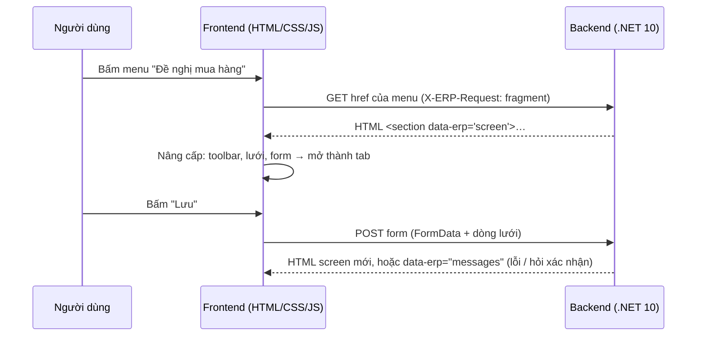

# Chuẩn ERP-HTML v1.0 — hợp đồng giữa Backend và Frontend

Trạng thái: **bản 1.0, chờ đội backend duyệt** (CQ-06). Chủ sở hữu: đội frontend Web-ERP.
Liên quan: [QUYET-DINH.md](../QUYET-DINH.md) QĐ-06. Mock mẫu theo chuẩn này: `web/mock/`.
Bản hướng dẫn thực hành cho BE (mẫu chép dùng, bảng tra, mức hỗ trợ hiện tại của FE):
[../huong-dan/be-tra-html-cho-fe.md](../huong-dan/be-tra-html-cho-fe.md).

Quy ước từ ngữ: **PHẢI** = bắt buộc; **NÊN** = khuyến nghị; **CÓ THỂ** = tùy chọn.

---

## 1. Ý tưởng

- **Backend (BE)** trả về HTML ngữ nghĩa, "thô": không CSS, không JS, không class trình bày.
- Ý nghĩa của từng phần được đánh dấu bằng thuộc tính `data-erp="…"` và một số thuộc tính `data-*` khác.
- **Frontend (FE)** nhận HTML, tìm các vai trò `data-erp`, rồi "nâng cấp" thành giao diện:
  - Ribbon, tab tài liệu, thanh công cụ;
  - lưới dữ liệu (sắp xếp, lọc, nhóm, cố định cột, tổng);
  - ô nhập số/ngày/tra cứu, hộp thoại, theme, responsive.
- Mọi nghiệp vụ nằm ở BE: quyền, khóa sổ, trạng thái, đánh số, hook SP, kiểm tra. FE chỉ hiển thị những gì BE gửi.



## 2. Nguyên tắc chung (PHẢI)

1. **HTML5 hợp lệ, UTF-8, `lang="vi"`.** Văn bản hiển thị đã dịch sẵn theo ngôn ngữ của phiên đăng nhập.
2. **Không gửi trình bày:**
   - không `style`, không `<style>`, không `<link rel=stylesheet>`;
   - không `<script>`, không thuộc tính sự kiện `on*`;
   - không `class` dùng để trình bày.

   FE loại bỏ các thứ này khi nhận.
3. **Ngữ nghĩa trước:** dùng đúng thẻ HTML (`table/thead/tbody/th`, `form/fieldset/legend/label/input/select`,
   `button`, `a`, `dl`, `nav/ul/li`, `menu`, `dialog`). HTML phải **dùng được cả khi không có JS**: link mở được, form
   gửi được.
4. **Mọi URL nằm trong HTML** (`href`, `action`, `formaction`, `data-*-src`). FE không tự ghép URL nghiệp vụ, trừ 4 điểm
   vào cấu hình sẵn ở mục 3.4.
5. **Giá trị máy tách khỏi chữ hiển thị:**
   - số: dạng bất biến (`1234567.5`, dấu chấm thập phân, không phân cách nghìn);
   - ngày: ISO (`2026-11-11`, `2026-11-11T08:30:00`);
   - logic: `true` / `false`.

   Chữ hiển thị CÓ THỂ đã định dạng sẵn. FE ưu tiên giá trị máy để định dạng lại theo cài đặt người dùng.
6. **Quyền và trạng thái do BE quyết:**
   - nút không được phép thì **không gửi**, hoặc gửi kèm `disabled`;
   - ô không được sửa thì gửi `readonly` hoặc `disabled`;
   - cột bị ẩn vì quyền (ví dụ ẩn số tiền) thì **không gửi dữ liệu**.
7. **Định danh ổn định:** tên trường (`name`, `data-field`) dùng đúng tên cột ERP (`ObjectID`, `DocumentDate`…). Mã
   màn hình (`data-screen-id`) dùng đúng `FormName` của ERP.
8. **Không gửi bí mật** (mật khẩu, chuỗi kết nối, hash) trong HTML.

## 3. Trao đổi HTTP

### 3.1 Request FE gửi

| Header | Giá trị | Ý nghĩa |
|---|---|---|
| `Accept` | `text/html` | |
| `X-ERP-Request` | `fragment` | FE chỉ cần phần nội dung, không cần trang đầy đủ. BE CÓ THỂ vẫn trả trang đầy đủ, FE tự tách vai trò cần dùng |
| `X-ERP-Contract` | `1.0` | Phiên bản chuẩn FE hỗ trợ |
| `X-ERP-Tab` | mã tab | Để BE ghi nhật ký (không bắt buộc dùng) |

- Thao tác đọc: `GET`.
- Gửi form: `POST`, kiểu `application/x-www-form-urlencoded`, hoặc `multipart/form-data` khi có file.
- Cookie phiên do BE quản lý (HttpOnly). FE gửi kèm `credentials: same-origin/include`.

### 3.2 Response BE trả

| Mã | Khi nào | FE xử lý |
|---|---|---|
| 200 | Bình thường | Tách các vai trò `data-erp` trong body |
| 303 / 302 | Sau POST thành công, muốn mở URL khác (Post/Redirect/Get) | FE theo redirect và cập nhật URL của tab |
| 400 / 422 | Dữ liệu không hợp lệ | Body là screen có ô lỗi, hoặc `messages` |
| 401 | Chưa đăng nhập / hết phiên | FE mở màn đăng nhập (`loginUrl`) |
| 403 | Không có quyền | Body CÓ THỂ có `messages` |
| 404 | Không có màn hình / bản ghi | FE báo "không tìm thấy" |
| 409 | Xung đột: bản ghi đã bị người khác sửa (so `__version`) | Body có `messages` |
| 5xx | Lỗi hệ thống | FE hiển thị lỗi chung, kèm `messages` nếu có |

Header response CÓ THỂ có:

- `X-ERP-Title`: tiêu đề tab.
- `X-ERP-Contract: 1.0`.

**Tách nội dung:** FE phân tích body và lấy:

- phần tử `[data-erp="screen"]` đầu tiên;
- các `[data-erp="messages"]`;
- các `[data-erp="dialog"]`;
- `[data-erp="session"]`, `[data-erp="menu"]` khi cần.

Ngoài các phần trên, FE bỏ qua mọi thứ khác.

### 3.3 Chống giả mạo request (CSRF)

Mỗi `<form method="post">` PHẢI chứa input ẩn chống giả mạo theo chuẩn của BE (ví dụ ASP.NET Core
`__RequestVerificationToken`). FE gửi nguyên các input ẩn của form.

### 3.4 Điểm vào cấu hình sẵn ở FE

| Khóa | Ví dụ | Trả về |
|---|---|---|
| `loginUrl` | `/erp/login` | `form[data-erp="login"]` |
| `sessionUrl` | `/erp/session` | `[data-erp="session"]` |
| `menuUrl` | `/erp/menu` | `nav[data-erp="menu"]` |
| `homeUrl` | `/erp/home` | `section[data-erp="screen"]` (trang chủ / dashboard) |

## 4. Bảng vai trò `data-erp`

| Vai trò | Thẻ | Mục |
|---|---|---|
| `login` | `form` | 5.1 |
| `session` | `section` chứa `dl` | 5.2 |
| `menu`, `menu-group`, `menu-item` | `nav`, `li` | 5.3 |
| `screen` | `section` | 6 |
| `toolbar` | `menu` | 7 |
| `filter` | `form` | 8 |
| `record` | `form` | 9 |
| `tab` | `fieldset` (trong record) | 9.1 |
| `field` | `div` | 9.2 |
| `grid` | `table` | 11 |
| `row-template` | `template` | 11.6 |
| `pager` | `nav` | 11.5 |
| `tabs`, `tab-panel` | `section` | 12 |
| `messages`, `message` | `div`, `p` | 13 |
| `confirm` | `form` | 13.2 |
| `dialog` | `section` | 14.2 |
| `lookup-result` | `table` | 10 |
| `status` | `data` | 16 |
| `attachments` | `section` | 16 |
| `report-result` | `section` | 15 |
| `print-document`, `print-params` | `section`, `dl` | 15.1 |
| `print-designer` | `section` | 15.2 |
| `layout-designer` | `section` | 15.3 |

## 5. Phiên làm việc và menu

### 5.1 Đăng nhập

```html
<form data-erp="login" method="post" action="/erp/login">
  <h1>Đăng nhập</h1>
  <div data-erp="field" data-control="select"><label for="db">Dữ liệu</label>
    <select id="db" name="Database"><option value="MedData">Medcom – MedData</option></select></div>
  <div data-erp="field" data-control="text"><label for="u">Tên đăng nhập</label>
    <input id="u" name="UserName" autocomplete="username" required></div>
  <div data-erp="field" data-control="password"><label for="p">Mật khẩu</label>
    <input id="p" name="Password" type="password" autocomplete="current-password" required></div>
  <input type="hidden" name="__RequestVerificationToken" value="…">
  <button type="submit" data-action="login">Đăng nhập</button>
</form>
```

- Đăng nhập thành công: `303` về `homeUrl` (hoặc 200 + `screen`).
- Đăng nhập thất bại: 200 kèm form đăng nhập và `messages`.

### 5.2 Thông tin phiên

```html
<section data-erp="session">
  <dl>
    <div data-key="company"><dt>Công ty</dt><dd>CÔNG TY CỔ PHẦN MEDCOM</dd></div>
    <div data-key="tax-code"><dt>MST</dt><dd>0123456789</dd></div>
    <div data-key="branch"><dt>Chi nhánh</dt><dd data-value="HN">Hà Nội</dd></div>
    <div data-key="period"><dt>Kỳ</dt><dd data-value="202611">11/2026</dd></div>
    <div data-key="database"><dt>Dữ liệu</dt><dd>MedData</dd></div>
    <div data-key="user"><dt>Người dùng</dt><dd data-value="admin">Quản trị</dd></div>
    <div data-key="language"><dt>Ngôn ngữ</dt><dd data-value="vi">Tiếng Việt</dd></div>
  </dl>
  <a data-action="logout" href="/erp/logout">Đăng xuất</a>
  <a data-action="change-password" href="/erp/account/password" data-target="dialog">Đổi mật khẩu</a>
</section>
```

Khóa `data-key` chuẩn: `company`, `tax-code`, `branch`, `period`, `database`, `user`, `language`, `server-time`.
BE CÓ THỂ thêm khóa khác; FE hiển thị theo thứ tự nhận được.

### 5.3 Menu

```html
<nav data-erp="menu" aria-label="Menu chính">
  <ul>
    <li data-erp="menu-group" data-menu-id="05" data-icon="purchase">
      <span>Mua hàng</span>
      <ul>
        <li data-erp="menu-item" data-menu-id="05011" data-kind="form" data-screen-id="AP_PurposeRequestListFrm">
          <a href="/erp/screens/AP_PurposeRequestListFrm">Đề nghị mua hàng</a></li>
        <li data-erp="menu-group" data-menu-id="0599"><span>BPTM</span>
          <ul>…</ul></li>
        <li data-erp="menu-item" data-menu-id="0530" data-kind="report" data-screen-id="AP_PurchaseDetailReport"
            data-begin-group>
          <a href="/erp/reports/AP_PurchaseDetailReport">Bảng kê mua hàng</a></li>
      </ul>
    </li>
  </ul>
</nav>
```

**Quy tắc:**

- **Phạm vi:** BE chỉ gửi menu người dùng được phép thấy (kết quả `SY_GetUserMenuFnc`). Thứ tự giữ theo `MenuID`.
- **Độ sâu:** tối đa 5 cấp.
- **Cách FE dựng Ribbon:**
  - cấp 1 → tab Ribbon;
  - cấp 2 có con → nhóm Ribbon;
  - mục lá → nút.
  - Mục lá nằm thẳng dưới cấp 1 được FE gom thành nhóm "Chức năng" và "Báo cáo" theo `data-kind`.
- **Thuộc tính của `menu-item`:**

  | Thuộc tính | Ý nghĩa |
  |---|---|
  | `data-menu-id` | Mã menu |
  | `data-screen-id` | Mã màn hình (FormName); thêm `data-para` nếu có Para |
  | `data-kind` | `form` / `report` / `command` |
  | `data-icon` | Tên biểu tượng (mục 17) |
  | `data-shortcut` | Phím tắt |
  | `data-begin-group` | Có vạch ngăn trước mục |
  | `data-strong` | In đậm |
  | `data-target` | `tab` (mặc định) / `dialog` / `_blank` |

## 6. Màn hình (`screen`)

```html
<section data-erp="screen" data-screen-id="AP_PurposeRequestListFrm" data-para="" data-form-type="LIST"
         data-mode="view" data-screen-key="AP_PurposeRequestListFrm" data-menu-id="05011">
  <h1>Đề nghị mua hàng</h1>
  <menu data-erp="toolbar">…</menu>
  <form data-erp="filter">…</form>
  <table data-erp="grid">…</table>
</section>
```

| Thuộc tính | PHẢI | Ý nghĩa |
|---|---|---|
| `data-screen-id` | ✔ | FormName ERP |
| `data-form-type` | ✔ | Một trong các giá trị dưới bảng này |
| `data-mode` | ✔ | `view` (xem) / `new` (đang thêm) / `edit` (đang sửa) / `find` (tìm). FE bật cảnh báo rời trang khi `new`/`edit` có thay đổi |
| `data-screen-key` | ✔ | Khóa duy nhất để FE không mở trùng tab. Ví dụ `AR_InvoiceFrm` (danh sách) hoặc `AR_InvoiceFrm:SI1126/0001` (một chứng từ) |
| `data-para` | | Para của menu |
| `data-menu-id` | | Menu mở màn này |
| `data-refresh-src` | | URL để FE nạp lại màn (F5); mặc định là URL đã mở |
| `<h1>` | ✔ | Tiêu đề, dùng làm tên tab |

Giá trị `data-form-type`:

- `LIST` — danh sách, có thể sửa trên lưới;
- `LISTEDIT` — lưới + khung nhập;
- `EDIT` — chứng từ master–detail;
- `REPORT` — báo cáo;
- `DASHBOARD` — trang tổng quan;
- `CUSTOM` — màn đặc thù.

Thứ tự con NÊN là: `h1` → `toolbar` → `filter` → `record` → `grid`/`tabs` → `messages`.

## 7. Thanh công cụ và hành động (`toolbar`)

```html
<menu data-erp="toolbar">
  <li><a data-action="new" href="/erp/screens/AR_InvoiceFrm/new" data-shortcut="F2">Thêm</a></li>
  <li><button type="submit" form="rec-SI1126-0001" formaction="/erp/screens/AR_InvoiceFrm/SI1126-0001/edit"
              data-action="edit">Sửa</button></li>
  <li><button type="submit" form="rec-SI1126-0001" formaction="/erp/screens/AR_InvoiceFrm/SI1126-0001/save"
              data-action="save" data-shortcut="Ctrl+S" disabled>Lưu</button></li>
  <li><button type="submit" form="rec-SI1126-0001" formaction="/erp/screens/AR_InvoiceFrm/SI1126-0001/delete"
              data-action="delete" data-confirm="Xóa chứng từ này?">Xóa</button></li>
  <li><a data-action="print" href="/erp/reports/AR_Invoice2Report?DocumentID=SI1126/0001" data-target="_blank">In</a></li>
  <li><button type="submit" form="rec-SI1126-0001" formaction="/erp/screens/AR_InvoiceFrm/SI1126-0001/actions/LapPhieuThu"
              data-action="custom" data-icon="cash" data-confirm="Lập phiếu thu cho hóa đơn này?">Lập phiếu thu</button></li>
</menu>
```

- **Hành động GET** (mở, in, xuất, nạp lại) dùng `<a href>`. **Hành động thay đổi dữ liệu** dùng
  `<button type="submit" formaction formmethod="post">`, gắn với form qua thuộc tính `form`.
- **Vai trò của FE:**
  - chặn sự kiện, gửi request, hiển thị kết quả;
  - hỏi `data-confirm` trước khi gửi;
  - gán phím `data-shortcut`;
  - đặt biểu tượng theo `data-action` hoặc `data-icon`.
- **Tên `data-action` chuẩn:**

  | `data-action` | Biểu tượng | Phím mặc định |
  |---|---|---|
  | `new` | add | F2 / Ctrl+N |
  | `copy` | copy | |
  | `edit` | edit | F3 |
  | `save` | save | Ctrl+S |
  | `save-new` | save | Ctrl+Shift+S |
  | `cancel` | cancel | Esc |
  | `delete` | delete | Ctrl+Delete |
  | `find` | search | Ctrl+F |
  | `reload` | reload | F5 |
  | `print` | print | Ctrl+P |
  | `export` | export | |
  | `import` | import | |
  | `attach` | attach | |
  | `approve` | approve | |
  | `unapprove` | unapprove | |
  | `lock` | lock | |
  | `unlock` | unlock | |
  | `first` / `prev` / `next` / `last` | chevrons | |
  | `close` | close | Alt+W (trình duyệt không cho chặn Ctrl+W) |
  | `help` | help | F1 |

  Nút tùy biến của ERP (`SY_FrmOptBtnTbl`, `*ButtonCtl`, `StatusButtonCtl`) dùng `data-action="custom"`, kèm
  `data-icon`.
- **Hành động cần người dùng nhập tham số** (như `ExecSQLWithParaButtonCtl`): `formaction` trả về một
  `section[data-erp="dialog"]` chứa form tham số (mục 14.2).
- **Bố cục:**
  - Nhóm nút: `<li data-group="Chứng từ">`. FE dựng vạch ngăn theo nhóm.
  - Nút ít dùng: `<li data-overflow>`. FE đưa vào menu "Thêm…".

## 8. Thanh lọc (`filter`)

```html
<form data-erp="filter" method="get" action="/erp/screens/AR_InvoiceFrm">
  <div data-erp="field" data-control="date" data-span="6"><label for="flt-from">Từ ngày</label>
    <input id="flt-from" name="FromDate" type="date" value="2026-11-01"></div>
  <div data-erp="field" data-control="date" data-span="6"><label for="flt-to">Đến ngày</label>
    <input id="flt-to" name="ToDate" type="date" value="2026-11-30"></div>
  <div data-erp="field" data-control="select" data-span="8"><label for="flt-br">Chi nhánh</label>
    <select id="flt-br" name="BranchID"><option value="">(Tất cả)</option><option value="HN" selected>Hà Nội</option></select></div>
  <div data-erp="field" data-control="search" data-span="12"><label for="flt-q">Tìm</label>
    <input id="flt-q" name="q" type="search" placeholder="Số CT, khách hàng…"></div>
  <button type="submit" data-action="find">Lọc</button>
</form>
```

- BE trả về màn hình với lưới đã lọc. FE cập nhật URL của tab bằng query string, nhờ vậy F5 giữ được bộ lọc.
- Ô lọc dùng cùng cấu trúc `field` như mục 9.2.
- Kỳ/quý/năm là `select` hoặc hai ô ngày, theo `SY_FrmFltTbl`.

## 9. Bản ghi (`record`)

```html
<form data-erp="record" id="rec-SI1126-0001" method="post" action="/erp/screens/AR_InvoiceFrm/SI1126-0001/save"
      data-key-field="DocumentID" data-key="SI1126/0001">
  <input type="hidden" name="__RequestVerificationToken" value="…">
  <input type="hidden" name="__version" value="2026-11-10T16:05:11.320">
  <fieldset data-erp="tab" data-tab-id="1">
    <legend>Thông tin chung</legend>
    <div data-erp="field" data-control="text" data-span="8" data-row-start>
      <label for="f-DocumentID">Số chứng từ</label>
      <input id="f-DocumentID" name="DocumentID" value="SI1126/0001" readonly></div>
    <div data-erp="field" data-control="date" data-span="6">
      <label for="f-DocumentDate">Ngày</label>
      <input id="f-DocumentDate" name="DocumentDate" type="date" value="2026-11-10" required></div>
    <div data-erp="field" data-control="lookup" data-span="16" data-row-start>
      <label for="f-ObjectID">Khách hàng</label>
      <input id="f-ObjectID" name="ObjectID" value="KH0001" required
             data-lookup-src="/erp/lookups/CF_ObjectTbl?q={q}" data-lookup-fill="ObjectName,Address">
      <output data-erp="lookup-text" for="f-ObjectID">Bệnh viện Đa khoa A</output></div>
    <div data-erp="field" data-control="money" data-span="8">
      <label for="f-TotalAmount">Tổng tiền</label>
      <input id="f-TotalAmount" name="TotalAmount" value="12500000" data-decimals="0" readonly></div>
  </fieldset>
</form>
```

- **Định danh form:** `id` duy nhất trong trang; nút toolbar và lưới chi tiết tham chiếu tới id này.
- **Khóa xung đột `__version`:** BE đặt giá trị (ví dụ `DateUpdate` lúc mở) và tự so khi lưu. Nếu không khớp, BE trả
  409.
- **Chế độ xem vs. sửa:**
  - `data-mode="view"`: BE gửi các ô `readonly` hoặc `disabled`.
  - `edit` / `new`: BE gửi ô sửa được.
  - FE không tự mở khóa ô.

### 9.1 Tab trong bản ghi

Mỗi `fieldset[data-erp="tab"]` là một tab của phần master. Thứ tự hiển thị theo thứ tự trong HTML; `legend` là tên tab.

- Có từ 2 tab trở lên: FE hiển thị dạng tab.
- Chỉ có 1 tab: FE hiển thị như khung nhóm.
- Nhóm con bên trong tab: dùng `fieldset` lồng, không có `data-erp`.

### 9.2 Ô nhập (`field`)

Cấu trúc **PHẢI** gồm:

- `div[data-erp=field]`;
- một `label[for]`;
- đúng một control chính (`input` / `select` / `textarea` / `output`).

Có thể thêm:

- `output[data-erp=lookup-text]`: chữ đi kèm ô tra cứu;
- `small[data-erp=hint]`: gợi ý;
- `small[data-erp=error]`: lỗi.

| Thuộc tính trên `field` | Ý nghĩa | Nguồn ERP |
|---|---|---|
| `data-control` | Loại ô (bảng dưới) | LYT vị trí 0 `ControlType` |
| `data-span` | Độ rộng trên lưới **40 cột** (1–40) | LYT vị trí 1 `SizeX` |
| `data-rows` | Số dòng cao (textarea) | LYT vị trí 2 `SizeY` |
| `data-row-start` | Bắt đầu dòng mới | LYT vị trí 3 `isFirstPos` |
| `data-gap-after` | Khoảng trống sau ô (đơn vị cột) | LYT vị trí 19 `SizeP` |
| `data-span-mobile` | Độ rộng trên màn hẹp (1–4 trên lưới 4 cột) | LYT vị trí 20 `SizeWebM` |
| `data-label-width` | Độ rộng nhãn (px) khi nhãn đứng bên trái | LYT vị trí 5 |
| `data-invalid` | Ô đang lỗi; kèm `small[data-erp=error]` | |

Các thuộc tính HTML chuẩn đặt trên control:

- `required`, `readonly`, `disabled`;
- `maxlength`, `min`, `max`, `step`;
- `pattern`, `placeholder`, `autocomplete`.

| `data-control` | Control HTML | FE nâng cấp | ControlType ERP |
|---|---|---|---|
| `text` | `input` | | 1 EditX |
| `textarea` | `textarea` | Tự giãn | 1 (SizeY > 1) |
| `password` | `input type=password` | Nút hiện/ẩn | 1 |
| `number` | `input inputmode=decimal` (value bất biến) | Định dạng nghìn/thập phân theo `data-decimals` | 5 NumberX |
| `money` | như `number` | Định dạng tiền, căn phải | 5 |
| `quantity` | như `number` | | 5 |
| `percent` | như `number` | Hậu tố % | 5 |
| `date` | `input type=date` | Hiển thị dd/MM/yyyy, chọn nhanh | 4 DateX |
| `datetime` | `input type=datetime-local` | | 4 |
| `select` | `select` | Ô chọn có tìm kiếm khi > 15 mục | 2 ComboX |
| `multiselect` | `select multiple` | Chọn nhiều dạng thẻ | 3 ComboCheckX |
| `lookup` | `input` + `data-lookup-src` | Tra cứu F4 (mục 10) | 2 ComboX nguồn `SY_FrmDrdwTbl` |
| `checkbox` | `input type=checkbox value=true` (+ input ẩn `false` cùng tên đặt trước) | Công tắc | 6 CheckX |
| `radio` | `fieldset` chứa các `input type=radio` | Nhóm nút | 20 RadioX |
| `color` | `input type=color` | | 7 |
| `label` | `output` | Chữ chỉ đọc | 28 LabelCaption |
| `html` | `div` (HTML an toàn, chỉ thẻ định dạng) | | 30 |
| `button` | `button` / `a` (như toolbar) | | 24, 26 |
| `file` | `input type=file` | Kéo-thả | — |
| `search` | `input type=search` | | — |

## 10. Tra cứu (F4 / lookup)

**Trên ô nhập:**

| Thuộc tính | Ý nghĩa |
|---|---|
| `data-lookup-src` | URL có chỗ thay `{q}` (chuỗi người dùng gõ). BE CÓ THỂ thêm tham số khác vào URL (ví dụ `&BranchID=HN`) |
| `data-lookup-fill` | Danh sách tên trường cần điền khi chọn, cách nhau bằng dấu phẩy. FE tìm ô có `name` trùng trong cùng `record` (hoặc cùng dòng lưới) và điền giá trị từ ô kết quả có `data-field` trùng tên |
| `data-lookup-min` | Số ký tự tối thiểu trước khi tra. Mặc định 0 |
| `data-lookup-free` | Cho phép nhập giá trị không có trong danh sách |
| `data-lookup-add` | URL mở màn thêm nhanh danh mục (F2 trong ERP) |

**Response của `data-lookup-src`:**

```html
<table data-erp="lookup-result" data-total="2">
  <thead><tr><th data-field="ObjectID">Mã</th><th data-field="ObjectName">Tên khách hàng</th><th data-field="Address">Địa chỉ</th></tr></thead>
  <tbody>
    <tr data-value="KH0001" data-text="Bệnh viện Đa khoa A"><td>KH0001</td><td>Bệnh viện Đa khoa A</td><td>12 Lê Lợi, Q.1</td></tr>
    <tr data-value="KH0002" data-text="Phòng khám B"><td>KH0002</td><td>Phòng khám B</td><td>5 Trần Phú</td></tr>
  </tbody>
</table>
```

- `data-value`: giá trị gán vào ô.
- `data-text`: chữ hiển thị trong `lookup-text`.
- Cột có `data-hidden` dùng để điền trường nhưng không hiển thị.
- BE NÊN giới hạn khoảng 50 dòng. Nếu còn nhiều hơn, đặt `data-total` lớn hơn số dòng gửi.

## 11. Lưới dữ liệu (`grid`)

```html
<table data-erp="grid" data-grid-id="T0" data-key-field="DocumentID" data-selectable="single"
       data-total-rows="1250" data-group-by="" data-form="">
  <caption>Danh sách hóa đơn</caption>
  <thead><tr>
    <th scope="col" data-field="DocumentID" data-type="link" data-width="110" data-frozen>Số CT</th>
    <th scope="col" data-field="DocumentDate" data-type="date" data-width="90">Ngày</th>
    <th scope="col" data-field="ObjectName" data-type="text" data-width="240">Khách hàng</th>
    <th scope="col" data-field="StatusName" data-type="status" data-width="110">Trạng thái</th>
    <th scope="col" data-field="TotalAmount" data-type="money" data-decimals="0" data-sum="sum" data-width="130">Tổng tiền</th>
  </tr></thead>
  <tbody>
    <tr data-key="SI1126/0001">
      <td data-value="SI1126/0001"><a href="/erp/screens/AR_InvoiceFrm/SI1126-0001" data-target="tab">SI1126/0001</a></td>
      <td data-value="2026-11-10">10/11/2026</td>
      <td>Bệnh viện Đa khoa A</td>
      <td data-value="2"><data data-erp="status" value="2" data-tone="success">Đã duyệt</data></td>
      <td data-value="12500000">12.500.000</td>
    </tr>
  </tbody>
  <tfoot><tr><td colspan="4">Tổng cộng</td><td data-field="TotalAmount" data-value="845000000">845.000.000</td></tr></tfoot>
</table>
```

### 11.1 Thuộc tính bảng

| Thuộc tính | Ý nghĩa |
|---|---|
| `data-grid-id` | `T0` (lưới chính của LIST), `T1`…`T9`, `TA`…`TJ` (chi tiết), hoặc tên tự đặt |
| `data-key-field` | Tên cột khóa của dòng |
| `data-selectable` | `none` / `single` / `multi`. `multi` thì FE thêm ô chọn. Các nút có `data-requires-selection` gửi kèm `__selected=<key>` (lặp nhiều lần) |
| `data-editable` | Lưới sửa trực tiếp được (chỉ khi `screen` ở `new`/`edit`, hoặc LIST cho phép sửa) |
| `data-form` | id của `record` mà lưới thuộc về. Khi gửi form, FE gửi kèm dữ liệu lưới (11.6) |
| `data-total-rows` | Tổng số dòng ở server; có thể lớn hơn số dòng đang gửi |
| `data-group-by` | Danh sách cột nhóm mặc định, cách nhau dấu phẩy |
| `data-sort` | Sắp xếp mặc định, ví dụ `DocumentDate:desc,DocumentID:asc` |
| `data-query-src` | (CÓ THỂ) URL để FE yêu cầu server sắp xếp/lọc/phân trang. FE thêm `sort`, `page`, `pageSize`, `f.<field>=…` và nhận về `table[data-erp=grid]` mới. Không có thì FE xử lý trên các dòng đã nhận |
| `data-layout-key` | Khóa lưu bố cục cột của người dùng. Mặc định là `screen-id + grid-id` |

### 11.2 Thuộc tính cột (`th`)

| Thuộc tính | Ý nghĩa |
|---|---|
| `data-field` (PHẢI) | Tên cột ERP |
| `data-type` | `text`, `number`, `money`, `quantity`, `percent`, `date`, `datetime`, `bool`, `link`, `status`, `image` |
| `data-decimals` | Số chữ số thập phân hiển thị |
| `data-width` | Độ rộng px mặc định (theo `.dat`/`SY_FrmCfg`) |
| `data-align` | `left` / `center` / `right`. Mặc định số căn phải |
| `data-frozen` | Cố định cột bên trái |
| `data-hidden` | Ẩn mặc định; người dùng bật lại được |
| `data-sum` | `sum` / `count` / `avg` / `min` / `max` — tổng footer khi BE không gửi `tfoot` |
| `data-wrap` | Cho xuống dòng |
| `data-sortable="false"`, `data-filterable="false"` | Tắt sắp xếp/lọc trên cột |
| `data-editor` | Khi lưới sửa được: `text`, `number`, `money`, `date`, `select`, `lookup`, `checkbox`, `none` |
| `data-required`, `data-readonly` | Khi sửa |
| `data-lookup-src`, `data-lookup-fill` | Như mục 10, áp cho ô trong lưới |
| `data-options-src` hoặc `<template data-erp="options" data-field="…">` chứa `<option>` | Danh sách cho `select` |
| `data-group` | Tên nhóm cột (header 2 tầng, tương đương ColumnSets) |

### 11.3 Dòng và ô

- `tr[data-key]` là bắt buộc khi lưới có khóa.
- Tô màu dòng hoặc ô (định dạng có điều kiện của ERP) do BE tính, gửi ra bằng:
  - `data-tone`: `danger`, `warning`, `success`, `info`, `muted`;
  - `data-strong`.
- `td[data-value]`: giá trị máy. Nếu không có, FE dùng chữ trong ô.
- Ô có thể chứa:
  - `a` để mở chi tiết (drill-down);
  - `data[data-erp=status]`;
  - `img` (ảnh nhỏ).

### 11.4 Footer

- BE NÊN gửi `tfoot` chứa tổng của **toàn bộ** dữ liệu ở server, với `td[data-field][data-value]`.
- Nếu không có `tfoot`, FE tự tính theo `data-sum` trên các dòng đang hiển thị, và ghi rõ là "tổng các dòng đang xem".

### 11.5 Phân trang (`pager`)

```html
<nav data-erp="pager" data-page="1" data-page-size="100" data-total="1250">
  <a rel="first" href="?page=1">Đầu</a> <a rel="prev" href="?page=1">Trước</a>
  <span>Trang 1 / 13</span>
  <a rel="next" href="?page=2">Sau</a> <a rel="last" href="?page=13">Cuối</a>
</nav>
```

FE gắn pager vào lưới đứng ngay trước nó. FE có thể nạp tiếp kiểu "cuộn vô hạn" bằng `rel="next"`.

### 11.6 Lưới sửa trực tiếp và cách gửi dữ liệu

- **Dòng mới:**
  - BE gửi `<template data-erp="row-template" data-grid-id="T1">` chứa một `<tr>` mẫu với giá trị mặc định.
  - FE nhân bản mẫu khi người dùng thêm dòng (phím Insert / nút "Thêm dòng").
- **Khi gửi form `record`,** FE thêm các trường sau cho mỗi dòng có thay đổi:

  ```
  T1[0].__key=<data-key hoặc rỗng nếu mới>
  T1[0].__state=new|modified|deleted
  T1[0].ItemID=VT001
  T1[0].Quantity=10
  ```

  - Chỉ số `[i]` đánh liên tục từ 0 theo thứ tự hiển thị.
  - Dòng `unchanged` không gửi. Riêng khi lưới có `data-send-all`, FE gửi mọi dòng với `__state=unchanged` để BE nhận
    đủ thứ tự STT.
- **Lỗi theo dòng:** BE trả lại lưới, đánh dấu ô lỗi bằng `td[data-invalid][title="lỗi…"]`.

## 12. Tab chi tiết (`tabs`)

```html
<section data-erp="tabs">
  <section data-erp="tab-panel" data-tab-id="T1" data-title="Chi tiết hàng hóa">
    <table data-erp="grid" data-grid-id="T1" data-form="rec-SI1126-0001" data-editable>…</table>
  </section>
  <section data-erp="tab-panel" data-tab-id="T2" data-title="Hóa đơn GTGT" data-src="/erp/screens/AR_InvoiceFrm/SI1126-0001/tabs/T2">
  </section>
</section>
```

- Panel có `data-src` thì FE nạp nội dung khi người dùng mở tab lần đầu (lazy).
- `data-badge` trên panel: số đếm hiển thị trên tab, ví dụ số dòng.

**Ô của chứng từ trên trang chi tiết** (ERP: `LYT5…LYT13`, trang chi tiết 1…9 cùng trang với lưới T1…T9; form viết tay có
thể tách thành trang riêng, vd "Công nợ & Giảm giá / CK" của hóa đơn bán):

```html
<form data-erp="record" id="rec-AR-InvoiceFrm" method="post" action="…">…</form>
<section data-erp="tabs">
  <section data-erp="tab-panel" data-tab-id="T1" data-title="Sơ yếu lý lịch" data-src="/erp/screens/HR_PersonFrm/00001/tabs/T1">
    <fieldset>
      <div data-erp="field" data-control="text" data-span="8"><label for="rec-HR-PersonFrm-BirthPlace">Nơi sinh</label>
        <input id="rec-HR-PersonFrm-BirthPlace" name="BirthPlace" form="rec-HR-PersonFrm" readonly value="Hà Nội"></div>
    </fieldset>
  </section>
  <section data-erp="tab-panel" data-tab-id="L6" data-title="Công nợ &amp; Giảm giá / CK">
    <fieldset>…ô…</fieldset>
  </section>
</section>
```

- Ô đặt trong một `fieldset` (không `data-erp`) ở đầu panel, cấu trúc như mục 9.2.
- Ô nằm ngoài `form[data-erp=record]` nên control (`input` / `select` / `textarea`, kể cả input ẩn của checkbox) **PHẢI** có
  thuộc tính `form` = `id` của record, để vẫn thuộc chứng từ khi gửi.
- Panel vừa có ô vừa có `data-src`: FE giữ phần ô, nội dung nạp về đặt phía sau (lưới của trang).
- Trang chỉ có ô: không có `data-src`.

## 13. Thông điệp và xác nhận

### 13.1 Thông điệp (`messages`)

```html
<div data-erp="messages">
  <p data-erp="message" data-msg-type="error" data-legacy-type="1">Ngày chứng từ thuộc kỳ đã khóa sổ.</p>
  <p data-erp="message" data-msg-type="warning" data-field="ObjectID">Khách hàng vượt hạn mức công nợ 15.000.000.</p>
</div>
```

- **`data-msg-type`:** `error` (chặn), `warning`, `info`, `success`.
- **`data-field`:** gắn thông điệp vào ô tương ứng.
- **`data-legacy-type`:** `MsgType` gốc của SP. Đặt khi thông điệp đến từ SP/hook.
- **Ánh xạ từ quy ước `Msg/MsgType` của ERP** (tài liệu 10 §7.3):
  - `MsgType` 1 hoặc 4 → `error`;
  - `MsgType` 0 hoặc 5 → `confirm` (13.2);
  - còn lại → `info` / `warning`.
- **Cách FE hiển thị:**
  - `success` / `info`: toast;
  - `error` / `warning`: khung trên đầu màn hình (và tại ô, nếu có `data-field`);
  - khi không có `screen` kèm theo: hộp thoại.

### 13.2 Hỏi xác nhận (`confirm`)

```html
<form data-erp="confirm" method="post" action="/erp/screens/AR_InvoiceFrm/SI1126-0001/save">
  <p data-erp="message" data-msg-type="warning" data-legacy-type="0">Số lượng xuất vượt tồn kho. Vẫn lưu?</p>
  <input type="hidden" name="__confirm" value="c7f1…">
  <button type="submit" name="__answer" value="yes" data-action="confirm-yes">Tiếp tục</button>
  <button type="submit" name="__answer" value="no" data-action="confirm-no">Hủy</button>
</form>
```

- FE mở hộp thoại modal.
- Khi người dùng chọn, FE gửi lại form `confirm` **kèm toàn bộ dữ liệu của form gốc** (`record` + dòng lưới).
- BE dùng `__confirm` để biết câu hỏi nào đã được trả lời. Nhiều câu hỏi nối tiếp thì mỗi lần BE trả một `confirm`
  mới.

## 14. Điều hướng và hộp thoại

### 14.1 Link

`a[data-target]` quyết định nơi mở:

| Giá trị | Nơi mở |
|---|---|
| `tab` (mặc định cho link màn hình) | Tab mới; trùng `data-screen-key` thì FE chuyển sang tab đang mở |
| `self` | Thay nội dung tab hiện tại |
| `dialog` | Hộp thoại |
| `_blank` | Cửa sổ mới (in, tải file) |

Link tải file (Excel, PDF) dùng thêm thuộc tính `download`, hoặc BE trả `Content-Disposition: attachment`.

### 14.2 Hộp thoại do BE trả

```html
<section data-erp="dialog" data-size="md">
  <h1>Duyệt đề nghị mua hàng</h1>
  <form method="post" action="/erp/screens/AP_ApprovePurchaseRequestListFrm/actions/Duyet">
    <div data-erp="field" data-control="textarea" data-span="40"><label for="d-notes">Ghi chú</label>
      <textarea id="d-notes" name="Notes"></textarea></div>
    <input type="hidden" name="__RequestVerificationToken" value="…">
    <button type="submit" data-action="approve">Duyệt</button>
    <button type="button" data-action="close">Đóng</button>
  </form>
</section>
```

- `data-size`: `sm` / `md` / `lg` / `full`.
- Kết quả gửi form trong hộp thoại:
  - trả `messages` thì FE hiển thị và đóng hộp thoại khi thành công;
  - trả `screen` thì FE thay màn hình của tab gốc;
  - trả `dialog` mới thì FE thay nội dung hộp thoại.

## 15. Báo cáo (`REPORT`)

```html
<section data-erp="screen" data-screen-id="AP_PurchaseDetailReport" data-form-type="REPORT" data-mode="view">
  <h1>Bảng kê chứng từ mua hàng</h1>
  <form data-erp="filter" method="get" action="/erp/reports/AP_PurchaseDetailReport">
    … tham số của AP_PurchaseDetailReportStp (@FromDate, @ToDate, @BranchID, @Template …) …
    <button type="submit" data-action="find">Xem</button>
  </form>
  <section data-erp="report-result">
    <table data-erp="grid" data-grid-id="R0">…</table>
    <menu data-erp="toolbar">
      <li><a data-action="export" href="…&format=xlsx" download>Excel</a></li>
      <li><a data-action="print" href="…&format=pdf" data-target="_blank">PDF</a></li>
    </menu>
  </section>
</section>
```

- SP trả nhiều result set: mỗi bảng phụ là một `table[data-erp=grid]` tiếp theo, kèm `caption`.
- Bảng `Msg/Type` của SP được chuyển thành `messages`.

### 15.1 Mẫu in (`print-document`)

Màn in chứng từ / báo cáo theo mẫu (thiết kế như ActiveReports). FE dựng trang và in; BE chỉ gửi **mẫu** và **dữ liệu**.
Đặc tả mẫu và bộ dựng: [06-mau-in.md](06-mau-in.md).

```html
<section data-erp="screen" data-screen-id="CS_ReceiptReport" data-form-type="REPORT" data-mode="view" data-screen-key="print:CS_ReceiptReport:PT1126/0001">
  <h1>Phiếu thu</h1>
  <form data-erp="filter" method="get" action="/erp/print/CS_ReceiptReport">
    <input type="hidden" name="DocumentID" value="PT1126/0001;PT1126/0002">
    <div data-erp="field" data-control="select"><label for="pt">Mẫu in</label>
      <select id="pt" name="Template"><option value="CS_ReceiptReport" selected>Phiếu thu</option>…</select></div>
    <button type="submit" data-action="find">Xem</button>
  </form>
  <section data-erp="print-document"
           data-template-src="/erp/print/templates/CS_ReceiptReport/CS_ReceiptReport.rpx" data-template-format="rpx"
           data-design-href="/erp/print/designer/CS_ReceiptReport?Template=CS_ReceiptReport"
           data-number-group="." data-number-decimal="," data-title="Phiếu thu PT1126/0001">
    <dl data-erp="print-params">
      <dt>Từ ngày</dt><dd data-name="FromDate" data-type="date" data-value="2026-11-01">01/11/2026</dd>
      <dd data-name="Sys.SysCom1">CÔNG TY …</dd>
      <dd data-name="Lang.ObjectID">Mã đối tượng</dd>
      <dd data-name="Caption.FromDate">Từ ngày</dd>
      <dd data-name="Image.logo"></dd>
    </dl>
    <table data-erp="grid" data-grid-id="R0">… cột của result set 0 …</table>
    <table data-erp="grid" data-grid-id="R1">… result set 1 (subreport) …</table>
  </section>
</section>
```

- `data-template-src` (PHẢI): URL mẫu, trả `application/json` (`erp-print-template/1`) hoặc XML `.rpx` của WinForms.
  `data-template-format` NÊN có: `json` | `rpx`. FE không chạy Script trong mẫu.
- `data-design-href` (CÓ THỂ): chỉ gửi khi người dùng được sửa mẫu (quyền `EPER` như ERP); FE hiện nút "Thiết kế mẫu".
- `data-number-group`, `data-number-decimal` (NÊN): phân cách số theo cấu hình công ty (WinForms: theo máy, thường `.` `,`).
  Người dùng chọn "Định dạng số" 1,234,567.89 trong Cài đặt (như vùng Windows của máy chạy ERP) thì FE dùng `,` `.` thay
  cho giá trị này.
- Lưới `R0` (PHẢI) = result set chính của SP `<Report>Stp`; `R1`… = các result set sau, đúng thứ tự. Lưới theo mục 11
  (`th[data-field][data-type]`, giá trị máy trong `td[data-value]`); ô `null` của SQL gửi `td[data-null]`. Cột chữ không
  có `data-value` thì FE dùng chữ trong ô. Lưới này là **dữ liệu in**, FE không hiện thành lưới.
- `th[data-format]` (NÊN): chuỗi định dạng .NET của cột theo `SY_FmtFldTbl` + `SY_FmatTbl` (`Functions.GetFormatString`:
  dòng đầu theo `AutoID`, mọi form, so tên không phân biệt hoa thường). FE dùng cho ô TextBox của mẫu để trống
  `OutputFormat`, như `FormatField` của `ReportViewerFrm` (thiếu thì ngày in đủ ngày giờ, số in không phân cách nghìn).
- `dl[data-erp=print-params]`: mỗi `dd[data-name]` một giá trị, `data-type` như cột lưới, giá trị máy ở `data-value`:
  - tên trơn: tham số báo cáo (`@FromDate`, `@Template`, `UINPUT1..6`…);
  - `Sys.<Tên>`: tham số hệ thống (`GetSysParam`: `SysCom1..4`, `ReportLocation`, `ReportPrintDate`, `SubTitle`,
    `ServerDate`, `CurrencyMinor.<Tiền>` = đơn vị lẻ của ngoại tệ);
  - `Lang.<Tên>`: chữ theo ngôn ngữ phiên cho nhãn `Lng<Tên>`, `LngPage`, `Month1..12`;
  - `Caption.<Tham số>`: tên hiển thị của tham số (nhãn `PAR*`);
  - `Image.<Tên>`: ảnh hệ thống (`logo`, `Signature1`…) — `img src` cùng origin.
- Không gửi bí mật trong tham số in (mật khẩu, chuỗi kết nối, token).
- Bảng `Msg/Type` của SP chuyển thành `messages` như mục 15.

### 15.2 Trình thiết kế mẫu in (`print-designer`)

Sửa mẫu in như trình thiết kế ActiveReports của ERP (kéo thả, thuộc tính, nhóm, tổng, biểu thức, xem trước). FE làm toàn
bộ giao diện; BE gửi mẫu, URL dữ liệu xem trước và form lưu.

```html
<section data-erp="screen" data-screen-id="CS_ReceiptReport" data-form-type="CUSTOM" data-mode="edit" data-screen-key="design:CS_ReceiptFrm:CS_ReceiptReport">
  <h1>Thiết kế mẫu in — In phiếu thu</h1>
  <section data-erp="print-designer" data-template-name="CS_ReceiptReport"
           data-template-src="/erp/screens/CS_ReceiptFrm/print/templates/CS_ReceiptReport.rpx" data-template-format="rpx"
           data-preview-src="/erp/screens/CS_ReceiptFrm/print?DocumentID=PT1126/0001&amp;Template=CS_ReceiptReport">
    <form method="post" action="/erp/screens/CS_ReceiptFrm/print/designer/save">
      <input type="hidden" name="__RequestVerificationToken" value="…">
      <input type="hidden" name="Template" value="CS_ReceiptReport">
    </form>
  </section>
</section>
```

- `data-template-src` (PHẢI), `data-template-format` (NÊN): như 15.1 — mẫu đang có hiệu lực (`.rpx` hoặc JSON web).
- `data-preview-src` (CÓ THỂ): URL màn in 15.1 của một chứng từ; FE lấy lưới `R0`… và tham số in để xem trước bằng dữ
  liệu thật và liệt kê trường. Không có thì FE dùng dữ liệu giả theo cột mẫu dùng.
- `form[method=post]` (CÓ THỂ): có thì người dùng được lưu. FE gửi `multipart/form-data` gồm mọi input của form +
  `Json` (mẫu `erp-print-template/1`) + `Comment` (ghi chú phiên bản). BE trả `messages` (`success` khi đã lưu, `error`
  + 422 khi mẫu không hợp lệ / không có quyền). Không có form = chỉ xem.
- BE PHẢI kiểm lại mẫu khi lưu (schema, kích thước, tên control, biểu thức theo 06-mau-in.md §4) — không tin FE.

### 15.3 Trình vẽ layout form (`layout-designer`)

Vẽ lại bố cục ô của form chứng từ (chuỗi `LYT` của `SY_FrmCfg`) như trình thiết kế layout Ctrl+F12 của ERP. FE làm
toàn bộ giao diện. BE gửi URL bố cục và form lưu, rồi ghi cấu hình như WinForms. Thiết kế: [07-ve-layout-form.md](07-ve-layout-form.md).

```html
<section data-erp="screen" data-screen-id="AP_PurposeRequestListFrm" data-form-type="CUSTOM" data-mode="edit"
         data-screen-key="layout:AP_PurposeRequestListFrm">
  <h1>Vẽ layout — Đề nghị mua hàng</h1>
  <section data-erp="layout-designer" data-form="AP_PurposeRequestListFrm"
           data-layout-src="/erp/screens/AP_PurposeRequestListFrm/layout/data">
    <form method="post" action="/erp/screens/AP_PurposeRequestListFrm/layout/save">
      <input type="hidden" name="__RequestVerificationToken" value="…">
      <input type="hidden" name="Form" value="AP_PurposeRequestListFrm">
    </form>
  </section>
</section>
```

- `data-form` (PHẢI): FID đang vẽ, tức tên form chạy, có hậu tố Para nếu menu có Para.
- `data-layout-src` (PHẢI): URL trả JSON `erp-form-layout/1` (07-ve-layout-form.md §3).
  - JSON gồm: tab, ô theo thứ tự, cột của bảng, phiên bản đã lưu, `revision`.
- `form[method=post]` (CÓ THỂ): có thì được lưu; không có thì chỉ xem.
  - Form PHẢI có `input[name=Form]`.
  - **Lưu**: FE gửi `multipart/form-data` gồm mọi input của form + `Json` (bố cục, kèm `revision` lúc mở) + `Comment`.
  - **Khôi phục**: FE gửi `Restore` = số phiên bản thay cho `Json`.
- BE trả `messages`:
  - `success` khi đã lưu;
  - `error` + 422 khi bố cục không hợp lệ hoặc không có quyền;
  - `error` + 409 khi bố cục đã bị đổi từ lúc mở.
- BE PHẢI kiểm lại bố cục khi lưu: tên ô, tab, nhóm, loại control, độ rộng, độ dài cột DB. Không tin FE.
- Màn chứng từ có nút `data-action="layout"` (phím Ctrl+F12) trỏ tới màn này, chỉ khi người dùng được vẽ.

## 16. Thành phần khác

- **Trạng thái:** `<data data-erp="status" value="18" data-tone="success">Đã lập hóa đơn</data>`.
  - `data-tone`: `neutral`, `info`, `success`, `warning`, `danger`.
- **Đính kèm:**

  ```html
  <section data-erp="attachments" data-upload="/erp/…/attachments">
    <ul>
      <li><a href="…" download>file.pdf</a> <small>120 KB</small></li>
    </ul>
    <form method="post" enctype="multipart/form-data" action="…"><input type="file" name="files" multiple></form>
  </section>
  ```
- **Dashboard** (`data-form-type="DASHBOARD"`):
  - thẻ chỉ số: `section[data-erp="kpi"]` chứa `h2` + `data[value]`;
  - biểu đồ: bảng dữ liệu `table[data-erp="chart"][data-chart="bar|line|pie"]`.

## 17. Biểu tượng (`data-icon`)

FE có bộ biểu tượng SVG riêng. BE chỉ gửi **tên**. Tên không có trong danh sách thì FE dùng biểu tượng mặc định.

- **Phân hệ:**
  - `system`, `catalog`, `purchase`, `sales`, `warehouse`, `stock`;
  - `cash`, `tools`, `asset`, `cost`, `ledger`;
  - `business`, `hr`, `office`, `report`, `dashboard`, `settings`.
- **Hành động:** tên trùng với `data-action` ở mục 7 (`add`, `edit`, `save`, `delete`, `search`, `print`, `export`,
  `import`, `attach`, `approve`, `lock`, `cash`, `truck`, `qr`, `mail`, `user`, `users`, `key`, `calendar`, `clock`,
  `star`, `help`).

## 18. Bảo mật phía FE

- FE **không chạy script** trong HTML nhận từ BE.
- FE bỏ các thuộc tính `on*`, `style`, `class`, và các URL `javascript:`.
- Chỉ nhận các thẻ thuộc danh sách cho phép. Gồm các thẻ đã dùng trong tài liệu này, cùng
  `b i strong em u br hr span p ul ol li small sup sub img`.
- FE chỉ gửi request tới cùng origin với BE, hoặc tới các origin được cấu hình.

## 19. Phiên bản và kiểm tra tuân thủ

- **Phiên bản:**
  - Tăng số phụ (1.x) khi chỉ thêm thuộc tính/vai trò mới; FE bỏ qua thứ không biết.
  - Tăng số chính khi đổi nghĩa.
  - BE NÊN gửi header `X-ERP-Contract`.
- **Danh sách kiểm tra cho BE:**
  - [ ] Không có `style` / `class` / `script` / `on*`.
  - [ ] Mọi `screen` có `data-screen-id`, `data-form-type`, `data-mode`, `data-screen-key`, `h1`.
  - [ ] Mọi `field` có `label[for]` trỏ đúng control. Số và ngày dùng giá trị bất biến (số dấu chấm, ngày ISO).
  - [ ] Mọi `th` trong `grid` có `data-field`. Mọi `tr` có `data-key` khi lưới có khóa.
  - [ ] Form POST có token chống giả mạo; `record` có `__version` khi sửa.
  - [ ] Nút không được phép thì không gửi, hoặc gửi kèm `disabled`. Dữ liệu cột bị ẩn vì quyền không có trong HTML.
  - [ ] Thông điệp từ SP được ánh xạ đúng `data-msg-type` / `confirm`.
  - [ ] `print-document` có `data-template-src` và lưới `R0`; tham số in có `data-name`, giá trị máy bất biến.
  - [ ] `print-designer` có `data-template-src`; form lưu có token và `input[name=Template]`.
- **Kiểm tra thực tế:** FE có trang `web/tools/validate.html`. Dán HTML hoặc nhập URL của BE vào, trang báo lỗi theo
  danh sách trên.

## 20. Ví dụ đầy đủ

Xem thư mục `web/mock/`, sinh từ metadata Medcom:

- `menu.html`, `session.html`, `login.html`;
- `screens/*.html` — màn LIST, EDIT, REPORT;
- `lookups/*.html`.

Các file này chính là ví dụ chuẩn cho đội BE.
