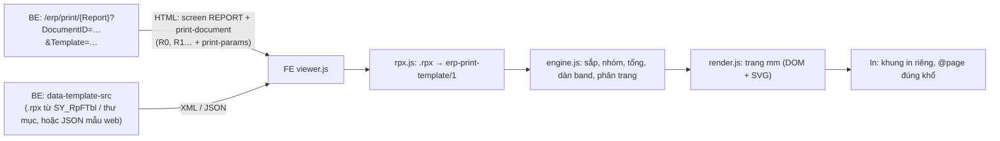

# 06 — Mẫu in và trình thiết kế mẫu in (M6)

Trạng thái (2026-11-13): **GĐ0–GĐ2 xong cả FE và BE**. Đã có mô hình mẫu, ngôn ngữ biểu thức, bộ chuyển `.rpx`, bộ dựng
trang, in đúng khổ. Ngoài ra có nút In trên chứng từ, mẫu `.rpx` lấy từ `SY_RpFTbl`, trình thiết kế, và kho mẫu web có phiên
bản cùng quyền `EPER`. Quyết định: [QĐ-09](../QUYET-DINH.md). Hợp đồng HTML:
[02 mục 15.1–15.2](02-chuan-html-erp.md#151-mẫu-in-print-document). Hướng dẫn BE:
[be-tra-html-cho-fe.md mục 5.4b–5.4c](../huong-dan/be-tra-html-cho-fe.md).

## 1. Mục tiêu

- In chứng từ và báo cáo trên web **giống bản in WinForms** (ActiveReports 3, 787 mẫu `.rpx` của Medcom).
- Người dùng sửa mẫu **linh động như trình thiết kế ActiveReports** của ERP: kéo thả, thuộc tính, nhóm, tổng, biểu thức.
- Chạy song song với WinForms trên cùng DB: mẫu `.rpx` khách đang sửa vẫn là nguồn chính cho đến khi tách sang mẫu web.

## 2. Kiến trúc



- **Dữ liệu** do BE lấy từ SP `<Report>Stp` (mỗi result set một lưới `R0`, `R1`…) và gửi như mọi lưới ERP-HTML.
- **Mẫu** là dữ liệu, không phải mã: FE không bao giờ chạy Script trong `.rpx`; biểu thức chạy trong ngôn ngữ an toàn (§4).
- Một bộ dựng duy nhất (JS, không thư viện) dùng cho xem trước, in, trình thiết kế và test Node.

| Tệp | Việc |
|---|---|
| `web/js/print/xml.js` | Đọc XML tối giản (không DOM, không thực thể ngoài) |
| `web/js/print/rpx.js` | `.rpx` → mẫu JSON; quy ước ERP → thuộc tính tường minh; cảnh báo theo mức |
| `web/js/print/expr.js` | Ngôn ngữ biểu thức an toàn |
| `web/js/print/netformat.js` | Định dạng .NET (`#,##0.##`, `dd/MM/yyyy`…) theo cách .NET Framework |
| `web/js/print/words.js` | Đọc số thành chữ — chép đúng `Tools.Currency` của WinForms |
| `web/js/print/engine.js` | Bộ dựng trang (không DOM) |
| `web/js/print/render.js` | Vẽ trang, đo chữ bằng trình duyệt |
| `web/js/print/barcode.js` | Code 128 (SVG). QR: GĐ3 |
| `web/js/print/viewer.js` | Vai trò `print-document`: thanh xem, thu phóng, in |
| `web/js/print/fake.js` | Dữ liệu giả theo cột mẫu dùng (xem trước khi chưa có dữ liệu) |
| `web/tools/rpx.html` | Kiểm hàng loạt thư mục `Reports` trong trình duyệt |
| `tools/print-tests/` | Test Node: số thành chữ (2.268 dòng đối chiếu mã gốc), định dạng (.NET), biểu thức, bộ dựng; `rpx-batch.mjs` |

## 3. Mô hình mẫu `erp-print-template/1`

Đơn vị **mm** (tọa độ, kích thước), **pt** (cỡ chữ, padding). Tọa độ control tuyệt đối trong band.

```jsonc
{
  "$schema": "erp-print-template/1", "id": "CS_ReceiptReport", "title": "Phiếu thu", "unit": "mm",
  "page": { "paper": "A4|A5|A3|Letter|custom", "orientation": "portrait|landscape", "width": 210, "height": 297,
            "margin": { "top": 10, "right": 10, "bottom": 10, "left": 10 }, "bodyWidth": 190 },
  "locale": { "group": ".", "decimal": "," },            // tùy chọn; mặc định theo công ty (BE gửi)
  "data": { "sort": { "auto": true, "by": ["Col"] } },   // auto: sắp theo cột nhóm như ReportViewerFrm; false = NOSORT
  "styles": { "Normal": { "font": "Arial", "size": 10 } },
  "groups": [{ "id": "GH1", "by": "DocumentID", "newPage": "none|before|after",
               "keepTogether": "none|firstDetail|all", "repeatHeader": "none|onPage" }],
  "bands": [{ "id": "GH1", "type": "reportHeader|pageHeader|groupHeader|detail|groupFooter|pageFooter|reportFooter",
              "group": "GH1", "height": 30, "visible": true, "visibleWhen": "biểu thức", "canGrow": true, "canShrink": false,
              "keepTogether": true, "printAtBottom": false, "stretchControls": true, "background": "#rrggbb",
              "controls": [ /* §3.1 */ ] }],
  "assets": { "img1": { "mime": "image/png", "data": "base64…" } },
  "source": { "kind": "rpx|web", "file": "…rpx", "fileDate": "…", "converter": "rpx2json/1", "warnings": [] }
}
```

### 3.1 Control

Chung: `id`, `type`, `x y w h`, `style {font size bold italic underline strike color background align valign wrap
lineSpacing letterSpacing}`, `border {top|right|bottom|left: {style: solid|dash|dot|dashDot|double|thick…, color}}`,
`padding {l r t b}` (pt), `visible`, `visibleWhen`, `rules [{when, style} | {when, styleFrom: {background: "Cột"}}]`, `role`.

| type | Thuộc tính riêng |
|---|---|
| `text` | `value` (một trong: `text`, `field`, `expr`, `template` "{COT}", `dateText`+`field`, `sys`, `lang`, `subtitle`, `paramCaption`, `userInput`, `pageInfo`, `printDate`), `format` (chuỗi .NET hoặc `{kind: words, currency, lang, abs}` / `{kind: monthName}`), `canGrow`, `canShrink`, `summary {func sum/count/avg/min/max/concat…, scope report/page/group:ID, running none/group/all, lookAhead, distinct, distinctField, separator}`, `hideDuplicates value/control`, `hideIfEmpty`, `suppressZero`, `abs`, `roundIfInteger`, `indent` |
| `line` | `x1 y1 x2 y2`, `style.lineStyle`, `weight`, `color` |
| `rect` | `border`, `fill`, `radius` |
| `image` | `src {asset} | {field} | {system: "logo"}`, `fit clip/stretch/zoom` |
| `checkbox` | `caption`, `value` (giá trị đúng/sai) |
| `barcode` | `symbology code128/qr`, `value`, `caption` |
| `subreport`, `crossLine`, `chart` | GĐ3–4 (in chưa có, cảnh báo) |

### 3.2 Quy ước ERP được đổi thành thuộc tính (rpx.js)

| WinForms (`ReportViewerFrm`, `DesinerToolAR`) | Mẫu web |
|---|---|
| Tên `SysCom1..4`, `sys*` | `value.sys` — giá trị từ `Sys.<Tên>` BE gửi (`GetSysParam`) |
| Tên `Lng<Field>` | `value.lang` — `Lang.<Field>` (BE gửi), thiếu thì giữ chữ gốc |
| `LngPageInfo` / `EN` / `VN` | `value.pageInfo` → "Trang N/M" (theo nhóm nếu có SummaryGroup) |
| `sysReportPrintDate` | `value.printDate` (theo `Sys.ReportPrintDate`) |
| Tên `DATETIMEREPORT*` | `value.dateText` {D}{M}{Y}{YY}{longdate}{ReportLocation} — ngày từ cột hoặc ngày máy chủ |
| Tên chứa `TITLE` + chữ có `{COT}` | `value.template` |
| Tên `COUNTNUMBER*`, Tag `CountNumber;Tiền;NN;NS` | `format.kind = words` (`abs` khi có phần thứ tư) |
| Tag `isBold`, Script IsBold | `rules: IsBold = 1 → bold` |
| Tag `BackColorFormat;Cột` / `ForeColorFormat;Cột` | `rules.styleFrom` |
| Tag `StringSummary1..6` | `summary.func = concat` (dấu nối, distinct) |
| Tag `SpaceN`, `NoSign`, `SuppressZero`, `Round`, `Month`, `HideEmpty`, `DuplicateHide/InVisible` | `indent`, `abs`, `suppressZero`, `roundIfInteger`, `format.kind = monthName`, `hideIfEmpty`, `hideDuplicates` |
| Tag `VisibleExp:` (control / section) | `visibleWhen` (`{COT}` → tên cột) |
| Section Tag `AutoGrow`, Detail | `stretchControls` (ô CanGrow kéo tới đáy band, như `AeKaHLvdNgR`) |
| `SORTBY` / `NOSORT` | `data.sort` |
| SummaryType 1/2/3/4, SummaryFunc, SummaryRunning, SummaryGroup | `summary` / `PageNumber`… (SummaryType None ⇒ không tổng) |
| `OutputFormat` `#,###.##` với \|v\| < 1 | thêm "0" trước như viewer (`,5` → `0,5`) |
| TextBox để trống `OutputFormat` (`FormatField`), Tag `Format;Cột` | `autoFormat` — lấy định dạng cột BE gửi ở `th[data-format]` (`SY_FmtFldTbl`) |

Mã Script: chỉ nhận dạng 2 mẫu quen (IsBold, ẩn PageHeader từ trang 2); còn lại giữ `source.script`, cảnh báo `manual`.

Kết quả trên 787 mẫu Medcom (`node tools/print-tests/rpx-batch.mjs <Reports> --build`): **630 ok, 111 layout,
34 later, 12 manual**, 0 lỗi đọc; dựng thử cả 787 mẫu với dữ liệu giả: 1.835 trang / 1,2 s.

## 4. Ngôn ngữ biểu thức (`expr.js`)

- Cú pháp: `c ? a : b`, `or`/`||`, `and`/`&&`, `not`/`!`, `= == <> != < <= > >=`, `like` (`%` `_`), `in (…)`,
  `+ - &`, `* / % \ mod`, chuỗi `'…'`/`"…"`, `true false null`, cột `Ten` / `[Tên có dấu cách]`, tham số `@X` /
  `Param.X`, hệ thống `Sys.X`, biến `PageNumber PageCount GroupPageNumber GroupPageCount RowNumber GroupRowNumber
  GroupNumber IsFirstRowOfGroup IsLastRowOfGroup`.
- Hàm: `IIf IsNull Nz Coalesce Len Trim Upper Lower Left Right Mid Substring Replace Contains StartsWith EndsWith
  PadLeft PadRight Format ToString CStr Val Round Floor Ceiling Abs Int Fix Now Today Date Day Month Year Hour Minute
  AddDays AddMonths AddYears DateDiff DateText MonthName NumberToWords Choose`; tổng `Sum Count CountDistinct Avg Min
  Max First Last Concat` (đối số 2: `"report"`, `"page"` hoặc id nhóm).
- Giá trị: null nối chuỗi = rỗng; null trong phép tính = 0; chia 0 = null; so chuỗi không phân biệt hoa thường (như
  `DataTable` và SQL Server của ERP), phân biệt dấu; `Round` nửa về chẵn như `Math.Round` .NET.
- An toàn: không gán, không vòng lặp, không truy cập đối tượng JS; tối đa 2.000 ký tự, sâu 64, 10.000 bước / lần tính.
  Lỗi khi tính ⇒ ô rỗng + cảnh báo (điều kiện hiện lỗi ⇒ vẫn hiện, như viewer cũ).

## 5. Bộ dựng (`engine.js`)

1. Sắp dữ liệu theo cột nhóm (+ `sort.by`), ổn định.
2. Cây nhóm: đoạn dòng cho từng cấp; tổng nhóm biết trước nên in được ở **đầu nhóm** (look-ahead, 573 ô / 89 mẫu).
3. Luồng band: RH → PH (trang 1 nằm dưới RH) → GH… → Detail → GF… → RF; PH/PF dựng theo từng trang.
4. Dàn band: ẩn/hiện, quy tắc định dạng, đo ô CanGrow bằng trình duyệt, **đẩy ô nằm hẳn bên dưới** ô lớn lên [S],
   band tự cao, `stretchControls` kéo ô CanGrow tới đáy band, `canShrink`.
5. Phân trang: `newPage before/after`, `keepTogether` band / nhóm (firstDetail, all), lặp tiêu đề nhóm, `printAtBottom`.
6. Lượt hai: `PageNumber/PageCount`, số trang theo nhóm, tổng theo trang.

Giá trị cột ở band không phải Detail: GH = dòng đầu nhóm, GF = dòng cuối nhóm, RH/PH = dòng đầu, RF/PF = dòng cuối.

[S] = suy luận, cần đối chiếu bằng PDF xuất từ WinForms trên DB thử (z4): đẩy ô khi CanGrow, thứ tự RH/PH trang 1,
`DuplicateHide` qua trang, độ dày nét viền, khoảng dòng GDI so với CSS.

## 6. Hiển thị và in

- Trang là `div.pp-page` khổ thật (mm), control `position: absolute`; viền vẽ thành đoạn SVG nằm giữa mép nên hai ô
  kề nhau chung một nét. Font: tên trong mẫu + dự phòng (Tahoma → Segoe UI, Times New Roman → Liberation Serif…).
- In: khung in riêng (iframe) chỉ chứa trang, `@page { size: <w>mm <h>mm; margin: 0 }`; nút In và Ctrl+P.
- Trang giấy là **ngoại lệ token** của chuẩn giao diện (03): giấy trắng, mực đen, cỡ chữ pt theo mẫu.

## 7. Kho mẫu (BE) và chạy song song WinForms

- Nguồn `.rpx`: bản mới nhất trong `SY_RpFTbl` (khách lưu bằng trình thiết kế WinForms), không có thì thư mục `Reports`
  (`WebErp:Erp:ReportsRoot/{mã công ty}`, tùy chọn).
- Mẫu web (migration BE `0002_print_templates`): `web.PrintTemplate` (báo cáo + mẫu → phiên bản đang dùng),
  `web.PrintTemplateVersion` (bất biến: JSON, sha256, ghi chú, người / giờ lưu, nguồn `rpx` + ngày + sha256 hoặc `web`).
  Ảnh nhúng nằm trong JSON (base64). Lưu lần đầu = "tách sang web": từ đó web in theo JSON, WinForms vẫn in `.rpx`.
- URL mẫu kèm `?v=` (số phiên bản web / ngày tệp `.rpx`) nên đổi mẫu là FE nạp bản mới.
- Quyền sửa mẫu như `ReportViewerFrm`: quyền Admin trên form luôn được; còn lại `EPER` của mẫu (`SY_FrmCfg`, FID = tên tệp):
  0 / trống mọi người dùng, 1 cần quyền Quản lý, 2 chỉ Admin. Nhật ký `WebErp.Print` khi lưu.
- Chưa: danh sách phiên bản + khôi phục trên giao diện; báo khi `.rpx` đổi sau phiên bản web; `SY_UserLog` "Sửa mẫu in".

## 8. Giai đoạn

| GĐ | Nội dung | Trạng thái |
|---|---|---|
| 0 | Mô hình, biểu thức, `rpx.js`, trang kiểm, vai trò `print-document` (02 + hướng dẫn BE + validator), mock | **xong** |
| 1 | Bộ dựng + in; BE: màn in, tệp mẫu từ `SY_RpFTbl`, nút In trên chứng từ, kiểm quyền từng chứng từ | **xong** (in nhiều chứng từ từ danh sách: sau) |
| 2 | Trình thiết kế MVP: canvas mm, kéo/co giãn, căn/phân bố, thuộc tính, danh sách trường, band, trang, xem trước, lưu phiên bản, quyền | **xong** (§9, §7) |
| 3 | Đủ như ActiveReports cho chứng từ + tem: QR, tem nhiều cột, subreport, crossLine, repeatToFill, watermark, nhập rpx, 8 mẫu có script tay | |
| 4 | PDF máy chủ, email/in hàng loạt, crosstab, biểu đồ, drill-down, so sánh phiên bản | |

## 9. Trình thiết kế (`designer.js`, chuẩn 15.2)

- **Canvas**: band xếp dọc như ActiveReports (thanh tên band, thân band khổ mm, tay kéo đổi chiều cao), thước cm, lưới 5 mm,
  bắt dính 1 mm (giữ Alt để tắt), thu phóng 50–200 %. Control vẽ bằng đúng font / cỡ / căn của mẫu; ô gắn cột màu xanh,
  biểu thức màu tím, ô ẩn mờ.
- **Thao tác**: bấm chọn, Shift/Ctrl chọn thêm, khung chọn, kéo dời (thả sang band khác được), 8 tay nắm co giãn, mũi tên
  dời 1 mm (Shift 5 mm, Alt 0,1 mm), Ctrl+mũi tên đổi cỡ, Delete, Ctrl+C/X/V/D, Ctrl+A, Ctrl+Z/Y (100 bước), Esc hủy kéo.
- **Thêm**: chữ, trường (hoặc kéo từ danh sách trường), đường, khung, ảnh (logo), ô chọn, mã vạch, số trang; thêm/xóa nhóm.
- **Căn**: trái / giữa / phải / trên / giữa dọc / dưới theo control chọn đầu, cùng rộng / cùng cao, phân bố ngang / dọc, lên
  trên cùng / xuống dưới cùng.
- **Thuộc tính**: trang (khổ, hướng, lề, vùng in, tự sắp), band (cao, hiện, điều kiện, CanGrow/Shrink, giữ liền, kéo ô,
  in ở đáy, nền; nhóm: cột, sang trang, giữ liền, lặp tiêu đề), control (vị trí, mã, nội dung theo loại, định dạng .NET +
  số thành chữ, CanGrow, ẩn rỗng / số 0 / trùng, bỏ dấu âm, tổng: hàm / phạm vi / lũy kế, font, cỡ, B/I/U, căn, màu, lề,
  viền từng cạnh, điều kiện hiện). Biểu thức kiểm cú pháp ngay khi gõ.
- **Xem trước** bằng chính bộ dựng in với dữ liệu thật của chứng từ (`data-preview-src`) hoặc dữ liệu giả.
- **Lưu**: kiểm trước (biểu thức, mã trùng, vượt vùng in), hỏi ghi chú, POST form của BE; **Nhập** `.rpx` / `.json`,
  **Xuất** JSON. Chưa có (GĐ3): sửa rule định dạng có điều kiện bằng giao diện, subreport, tem nhiều cột, QR, watermark.

Hiệu chỉnh: cần 15–20 PDF xuất từ WinForms (cùng dữ liệu z4) để so ≤ 0,5 mm, cùng số trang, cùng chữ.
