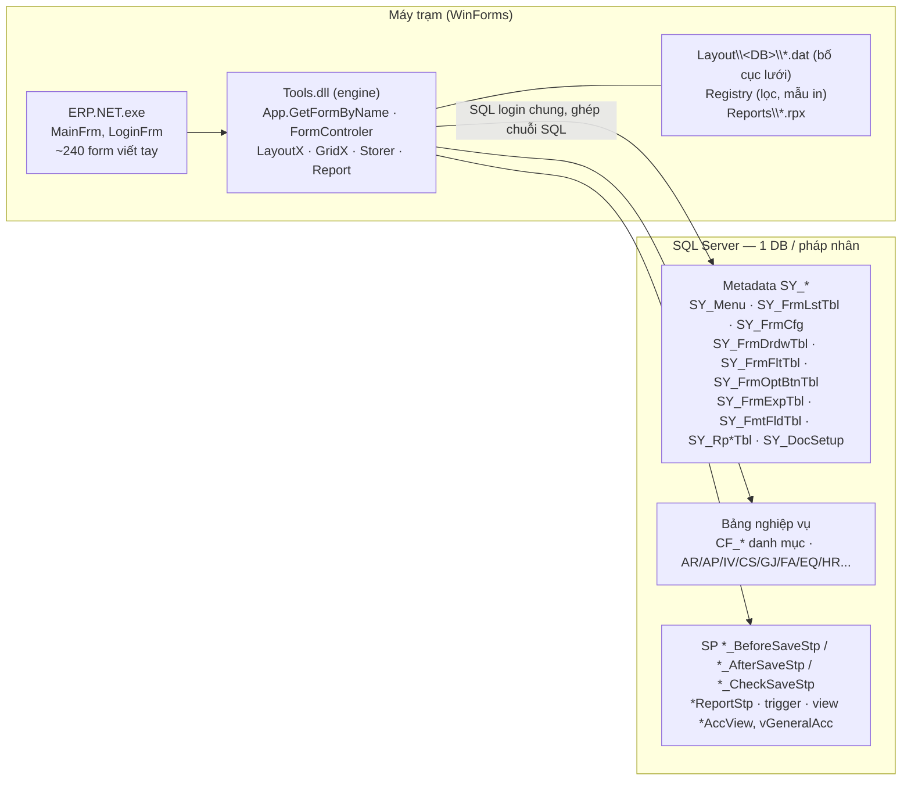
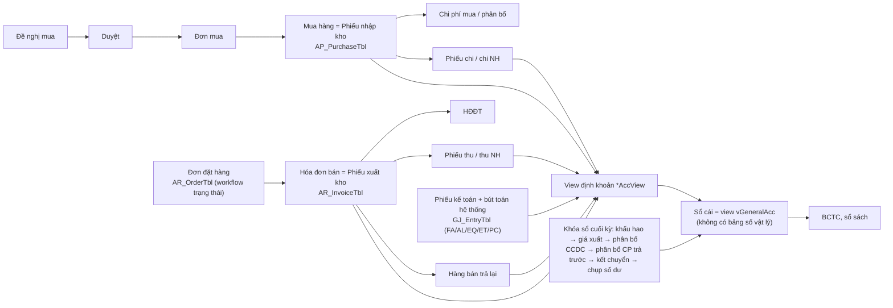

# 01 — Tổng quan ERP.NET (đọc file này đầu tiên)

Ngày tổng hợp: 2026-11-11. Đây là bản tóm tắt của toàn bộ giai đoạn phân tích. Chi tiết và dẫn nguồn nằm trong các
tài liệu con (bảng mục lục ở cuối). Quy ước nhãn trong các tài liệu con: **[XM]/[V]** = đã xác minh trong mã hoặc dữ
liệu; **[SL]/[SĐ]/[S]** = suy luận; **[?]** = chưa rõ.

---

## 1. ERP.NET là gì

- **Một nền tảng, nhiều khách hàng.** Trong `D:\Data` có 22 thư mục triển khai: 18 bản ERP.NET (kế toán – mua – bán –
  kho – tài sản…), 2 bản BanHang (bán lẻ), 1 bản ERP.VLS (trung tâm đào tạo) và 1 bản SoBaBuoc (sổ an toàn thực phẩm).
  Có ít nhất 12 build khác nhau, phát hành từ 04/2026 đến 11/2026. Mỗi khách có 1–18 database SQL Server, ví dụ
  nhiều pháp nhân hoặc nhiều năm. Xem [02](02-trien-khai-khach-hang.md).
- **Công nghệ:** VB.NET WinForms trên .NET Framework 4.6.2. Giao diện dùng Janus WinForms v4 (GridEX, Ribbon,
  ExplorerBar), báo cáo dùng ActiveReports 6 (`.rpx`), xuất Excel/Word dùng EPPlus/Aspose. Tên sản phẩm trên thanh tiêu
  đề là "NET.PRO 7.6".
- **Kiến trúc client–DB 2 lớp:** mỗi máy trạm kết nối thẳng SQL Server bằng một SQL login dùng chung, đọc từ
  `settings.config` đã mã hóa 3DES. Không có tầng server ứng dụng. Mọi kiểm tra quyền nằm ở máy trạm.
- **Engine điều khiển bằng metadata:** `Tools.dll` dựng phần lớn màn hình từ các bảng `SY_*` trong DB của từng khách.
  `ERP.NET.exe` chỉ chứa khoảng 240 form "viết tay" cho các chứng từ phức tạp. Các form này vẫn gắn vào engine.
  Logic nghiệp vụ nằm rải ở ba nơi:
  - code client;
  - SQL nhúng trong metadata;
  - stored procedure và trigger trong DB (MedData có 647 SP và 50 trigger).

## 2. Cách một "trang" được tạo ra

Từ lúc bấm menu đến lúc thấy màn hình ([10](10-engine-form-dong.md), [12](12-vo-ung-dung-dang-nhap-phan-quyen.md),
[30](30-metadata-menu-form-db.md)):

1. **Menu.**
   - `MainFrm` gọi `SY_GetUserMenuFnc(@User)` để lấy menu được phép thấy.
   - Kết quả dựng thành cây menu hoặc Ribbon từ `SY_Menu` (`MenuID` phân cấp theo cặp số, `VN/EN/CH`, `FormName`,
     `Para`, `Filter`, `MenuType`, `isDisable`…).
2. **Bấm menu.** Tên cửa sổ là `FormName` hoặc `FormName_Para`. Engine tìm form theo thứ tự:
   1. `GetFormAcc` — 18 chứng từ lõi khởi tạo cứng: mua, bán, trả lại, dịch vụ, thu/chi, phiếu kế toán, nhập/xuất/
      chuyển kho, tính giá, kỳ, thiết lập;
   2. lớp Form cùng tên trong `ERP.NET.exe` hoặc `Tools.dll` (tìm bằng reflection);
   3. dòng `SY_FrmLstTbl` theo `FormType`;
   4. tên kết thúc `Report` thì mở trình báo cáo chạy SP `<FormName>Stp`;
   5. không thấy thì báo lỗi "Form not found". Đây là lỗi phổ biến nhất trong log, khoảng 455 dòng.
3. **Form động** theo `FormType`:

   | FormType | Lớp | Mô tả |
   |---|---|---|
   | `LIST` | `FrmFormList` | Danh mục dạng lưới, sửa trực tiếp |
   | `LISTEDIT` / `LISTEDIT2` | `FrmFormListEdit` | Lưới + khung nhập |
   | `EDIT` | `FrmMasterDetail` | Chứng từ master + tab ô nhập + n tab chi tiết |
   | `EDITTOP` | `FrmMasterEditTop` | Như EDIT, nhập không cần bấm Sửa |
   | `POS` | `POSTableFrm` | Sơ đồ bàn |
   | `CALENDAR` | `FormCalendarFrm` | Lịch |
   | `TIMELINE` | `FormTimeLineFrm` | Dòng thời gian |
   | `TREE` | — | Rỗng |

   Ở Medcom, ba loại `LIST`, `EDIT`, `LISTEDIT` đã phủ hết 122 menu form động đang bật.
4. **Cấu hình màn hình** nằm trong `SY_FrmCfg` dạng key–value (`FID, KeyID, SubID, KeyValue, SubValue`):
   - slot bảng `T0` (master), `T1..T9`, `TA..TJ` (chi tiết), mỗi slot có `TN` (bảng), `PK`, `SO` (sắp xếp), `SUM`,
     `MUL/MDL` (liên kết master–detail), `FKA/FKB` (join tra cứu);
   - chuỗi `LYT` 21 vị trí cho từng ô nhập: loại control, kích thước, xuống dòng, chỉ đọc, nhãn, quyền sửa/xem, mặc
     định, bắt buộc…, đặt trên lưới 40 cột;
   - thuộc tính `LYS` của control;
   - hook SQL theo vòng đời: `ESL` (mở form), `EBN/EBE/EBD/EBS` (trước thêm/sửa/xóa/lưu), `ESS/ESD` (sau lưu/xóa)…;
   - đánh số chứng từ, sao chép khi thêm mới (`CD`), thanh công cụ, tìm kiếm và tổng hợp.

   Từ điển 1.541 khóa lấy từ mã nguồn: [data/winforms-property-keys-source.csv](data/winforms-property-keys-source.csv).
5. **Thành phần dùng chung** ([11](11-engine-luoi-tra-cuu-bao-cao.md)):
   - lưới GridX: nhóm, tổng, định dạng có điều kiện, cột link, sửa trực tiếp, xuất Excel;
   - tra cứu/F4: `SY_FrmDrdwTbl`;
   - thanh lọc: `SY_FrmFltTbl`;
   - nút tùy biến: `SY_FrmOptBtnTbl` và `*ButtonCtl`, chạy SQL có tham số, đổi trạng thái, in, import, tạo chứng từ từ
     nguồn;
   - công thức cột: `SY_FrmExpTbl`, cú pháp `DataColumn.Expression`;
   - nhãn và định dạng: `SY_FmtFldTbl`.
6. **Lưu.**
   - `Storer` sinh INSERT/UPDATE cho master và mọi detail trong một transaction, kèm cột audit
     `UserCreate/DateCreate/UserUpdate/DateUpdate` (chỉ master).
   - Sau đó gọi hook và SP sau lưu. Phần lớn SP sau lưu chạy **sau commit**.
   - SP trả về theo quy ước `Msg/MsgType`: 0 và 5 hỏi tiếp tục/hủy, 1 và 4 chặn, còn lại cho qua.
   - Không có kiểm tra xung đột khi nhiều người cùng sửa.
7. **Báo cáo.**
   - Không có SQL trong `.rpx`. Hợp đồng là tên `<X>Report` ⇄ file `Reports\<X>.rpx` hoặc mẫu trong `SY_RpFTbl` ⇄ SP
     `<X>ReportStp`.
   - Tham số lấy từ chữ ký SP và `SY_RpDTbl`.
   - Result set đầu là bảng chính, các result set kế tiếp nuôi subreport, bảng `Msg/Type` báo lỗi.

## 3. Bản đồ phân hệ

Số liệu theo menu Medcom ([data/menu-medcom-tree.md](data/menu-medcom-tree.md)) và schema MedData. "Động / Viết tay /
Báo cáo" là số mục menu đang bật.

| Menu gốc | Phân hệ | Tiền tố bảng | Động / Viết tay / Báo cáo | Màn hình chính | Tài liệu |
|---|---|---|---|---|---|
| 01 | Hệ thống | SY | 2 / 16 / 0 | Người dùng, nhóm, phân quyền, thiết lập, kỳ/năm tài chính, khóa sổ, nhật ký, sao lưu, đa ngữ | [12](12-vo-ung-dung-dang-nhap-phan-quyen.md) |
| 02 | Danh mục | CF | 33 / 0 / 0 | Đối tượng (KH/NCC/NV), vật tư hàng hóa, kho, chi nhánh, tài khoản, khoản mục, ngân hàng… | [30](30-metadata-menu-form-db.md) |
| 05 | Mua hàng | AP | 13 / 4 / 15 | Đề nghị mua → duyệt → đơn mua → mua hàng nội địa/nhập khẩu (kiêm phiếu nhập) → chi phí & phân bổ → trả lại NCC → công nợ phải trả | [20](20-nghiep-vu-mua-ban-kho-quy.md) |
| 06 | Bán hàng | AR | 15 / 3 / 24 | Đơn đặt hàng (workflow trạng thái) → hóa đơn bán (kiêm phiếu xuất) → hóa đơn GTGT/HĐĐT → trả lại → công nợ phải thu; giá, khuyến mãi, điểm | [20](20-nghiep-vu-mua-ban-kho-quy.md) |
| 07, 08 | Kho / Kho thực tế | IV | 24 / 8 / 25 | Nhập/xuất nội bộ, đề nghị nhập hàng, điều chuyển 8 bước, chuyển kho, kiểm kê, QR, tính giá xuất, NXT/thẻ kho | [20](20-nghiep-vu-mua-ban-kho-quy.md) |
| 09 | Thu chi | CS | 1 / 4 / 5 | Phiếu thu/chi tiền mặt và ngân hàng, chọn hóa đơn còn nợ, vượt quỹ | [20](20-nghiep-vu-mua-ban-kho-quy.md) |
| 11 | Công cụ dụng cụ | EQ | 1 / 3 / 4 | Thẻ CCDC, phân bổ, điều chuyển, thanh lý | [21](21-nghiep-vu-ke-toan-tai-san-san-xuat.md) |
| 12 | Tài sản | FA | 7 / 3 / 13 | Hồ sơ TSCĐ, khấu hao, biến động, thanh lý (Medcom: quản lý vòng đời máy) | [21](21-nghiep-vu-ke-toan-tai-san-san-xuat.md) |
| 14 | Giá thành | PC (+ER) | tắt ở Medcom | Định mức, lệnh sản xuất, tập hợp chi phí, giá thành | [21](21-nghiep-vu-ke-toan-tai-san-san-xuat.md) |
| 16 | Tổng hợp | GJ/GL | 7 / 8 / 25 | Phiếu kế toán, số dư đầu kỳ, phân bổ chi phí trả trước, kết chuyển, khóa sổ, BCTC (BCĐKT/KQKD/LCTT), sổ sách | [21](21-nghiep-vu-ke-toan-tai-san-san-xuat.md) |
| 40 | Kinh doanh | AR/KD | 12 / 0 / 11 | Hồ sơ KH, chỉ tiêu NV, CRM | [20](20-nghiep-vu-mua-ban-kho-quy.md) |
| 60 | Nhân sự | HR | 7 / 0 / 6 | Hồ sơ NV, chấm công (chỉ metadata) | [21](21-nghiep-vu-ke-toan-tai-san-san-xuat.md) |
| 04, 10 | eOffice, Quỹ thực tế | OF | tắt ở Medcom | Đề nghị tạm ứng/thanh toán, nghỉ phép, lịch | [21](21-nghiep-vu-ke-toan-tai-san-san-xuat.md) |
| — | Tích hợp | EI, EP | — | HĐĐT (VNPT, Viettel, BKAV, MISA, M-Invoice, Bizzi), vận chuyển (GHN, GHTK, ViettelPost, Ninja, Dochub), Zalo ZNS, Haravan, cổng thuế | [20](20-nghiep-vu-mua-ban-kho-quy.md) |
| — | Biến thể | InvoiceTbl…, AC_, KD_ATTP | — | POS bán lẻ, đào tạo (học viên, lớp, lịch), sổ ATTP | [50](50-bien-the-banhang-vls-sobabuoc.md) |

Quy mô Medcom (một khách):

- **Menu:** 482 mục, 338 đang bật. Trong 301 mục có FormName: 128 báo cáo, 122 form động, 49 form viết tay, 2 lệnh.
- **Form động:** 287 dòng trong `SY_FrmLstTbl`.
- **Schema:** 574 bảng, 231 view, 647 SP, 110 function, 50 trigger.
- **Mẫu báo cáo:** khoảng 759 mẫu chuẩn dùng chung, thêm khoảng 160 mẫu riêng theo khách.

## 4. Luồng nghiệp vụ cốt lõi

Các điểm then chốt:

- **Chứng từ mua/bán kiêm luôn phiếu kho:** hóa đơn bán là phiếu xuất kho, phiếu mua hàng là phiếu nhập kho.
- **Tồn kho, công nợ và sổ cái đều tính động từ view:** `vItemInput/vItemOutput`, `*AccView`, `vGeneralAcc`. Chứng từ
  vừa lưu (kể cả trạng thái "treo", chưa duyệt) là đã lên sổ và tính tồn ngay.
- **Bốn loại khóa:** khóa sổ theo kỳ (`SY_CheckDateOfPeriodOpeningFnc`), khóa dữ liệu, duyệt/khóa chứng từ (`isLock`),
  và quyền "chỉ sửa chứng từ của mình".
- **Duyệt thực tế:** dùng bảng `*StatusTbl` + SP chuyển trạng thái + `*LogTbl` + nút `StatusButton`/`ExecSQL`. Bộ duyệt
  5 cấp `SY_Approve*` có sẵn nhưng Medcom không dùng.

## 5. Vấn đề của hệ cũ mà bản web không được chép

Chi tiết ở mục "Hàm ý cho bản web" của từng tài liệu.

1. **Bảo mật.**
   - Mọi máy trạm dùng chung một SQL login.
   - Mật khẩu băm bằng MD5 với hằng số cứng trong mã.
   - Có mật khẩu Admin sinh theo ngày và máy dev tự vào chế độ admin.
   - Hàm kiểm mật khẩu trả "đúng" khi gặp lỗi.
   - SP chat trả cả hash mật khẩu cho mọi máy.
   - Bí mật tích hợp lưu thô trong bảng cấu hình.
   - Tắt kiểm tra chứng chỉ TLS.
   - Aspose kích hoạt bằng vá bộ nhớ, EPPlus chạy chế độ phi thương mại.
2. **SQL ghép chuỗi khắp nơi:** tham số nút, ô lọc, grid action, import, filter chi nhánh. Đây là nguy cơ SQL injection.
3. **Kiểm tra chỉ ở client:**
   - quyền form mặc định **cho phép** khi không có dòng quyền;
   - khóa sổ, khóa chứng từ, quyền theo trường chỉ chặn ở giao diện;
   - kiểm tra tồn (bị bỏ hẳn khi phiếu trên 500 dòng), hạn mức công nợ, lô FEFO đều làm ở client trước khi lưu.
4. **Hook chạy sai lúc:**
   - hook "fail-open": SQL lỗi thì thao tác vẫn tiếp tục;
   - SP sau lưu chạy ngoài transaction.
5. **Máy trạm tự sửa schema và dữ liệu.**
   - Ngày 1–2 hằng tháng, client chạy ngẫu nhiên thủ tục "chuẩn hóa":
     - nới cột;
     - điền tên trống;
     - đổi tỷ giá 0 thành 1;
     - bỏ phần giờ khỏi `DocumentDate`;
     - tạo index.
   - `ALTER TABLE` / `CREATE PROCEDURE` chạy khi mở form.
   - SP đăng nhập `SY_SetupStp` (MedData) tự khóa chứng từ của các ngày trước.
6. **Trạng thái lưu theo máy chứ không theo user:**
   - bố cục lưới lưu trong file `.dat`;
   - giá trị lọc, mẫu in, máy in lưu trong registry.
7. **Lỗi nghiệp vụ đã ghi nhận:**
   - hủy/thay thế HĐĐT đưa số liệu về 0 hoặc xóa chi tiết hóa đơn gốc;
   - kết chuyển loại 4 nghi đảo chiều Nợ/Có;
   - form chênh lệch tỷ giá là vỏ rỗng;
   - thanh lý tài sản và thanh lý CCDC không sinh bút toán;
   - "Đổi kỳ" không có tác dụng.

## 6. Định hướng cho bản web (đề xuất, chưa quyết định)

Tổng hợp từ [10](10-engine-form-dong.md) §10, [11](11-engine-luoi-tra-cuu-bao-cao.md) §8,
[12](12-vo-ung-dung-dang-nhap-phan-quyen.md) §8, [20](20-nghiep-vu-mua-ban-kho-quy.md) §8,
[21](21-nghiep-vu-ke-toan-tai-san-san-xuat.md) §13, [30](30-metadata-menu-form-db.md) §11 và
[60](60-bai-hoc-du-an-web-truoc.md) §6.

1. **Renderer động đọc metadata `SY_*` lúc chạy, theo từng DB.**
   - Medcom viết tay từng màn hình: sau 5 tuần mới có 25 màn, khoảng 5% số menu, và chỉ dùng được cho Medcom. Với 18
     khách hàng, bắt buộc phải render động.
   - Thứ tự resolve giữ như cũ: trang viết tay (registry theo `FormName`) → form metadata (`LIST/EDIT/LISTEDIT` trước)
     → trình báo cáo chung. Nhờ vậy có thể thay dần từng form viết tay mà không đổi menu.
2. **Server biên dịch metadata thành JSON có kiểu.** Trình duyệt không nhận SQL thô. Mọi SQL trong metadata (lookup,
   lọc, nút, hook) chạy ở server, tham số hóa, có whitelist.
3. **Ghi dữ liệu qua chính hợp đồng của ERP.**
   - Thực hiện trong một transaction: INSERT/UPDATE như `Storer`, payload XML như cũ, hook
     `EBS/ESS/*_CheckSaveStp/*_AfterSaveStp`.
   - Giữ quy ước `Msg/MsgType` của SP.
   - Bài học Medcom: tự viết INSERT nghiệp vụ là lệch logic ERP.
4. **Mọi kiểm tra chuyển về API:** quyền (MAX nhóm/user/ủy quyền, **mặc định từ chối**), chi nhánh, khóa sổ, `isLock`,
   chủ chứng từ, tồn kho, công nợ, lô, đánh số chứng từ (cấp số ở server).
5. **Đa tenant:**
   - Một ứng dụng, nhiều DB.
   - Chọn khách theo tên miền hoặc mã khách; chọn DB/pháp nhân sau đăng nhập.
   - Chuỗi kết nối là bí mật của server.
   - Tham khảo mô hình Mak.
6. **Đăng nhập tương thích user ERP cũ:**
   - Viết lại bộ kiểm hash MD5 cũ (không nạp `Tools.dll`).
   - Nâng cấp hash vào bảng phụ nếu WinForms còn chạy song song.
   - Không mang các cửa hậu sang.
7. **Trạng thái người dùng lưu trong DB:** bố cục lưới, bộ lọc đã lưu, mẫu in, gần đây, yêu thích.
8. **Báo cáo:** report runner chung (tham số từ chữ ký SP → chạy SP → lưới/Excel/PDF). Chuyển 776 mẫu `.rpx` sang
   engine web theo thứ tự tần suất dùng.
9. **Quy trình làm:**
   - Chia lát cắt dọc từng phân hệ.
   - Chạy được trên DB thật ở chế độ chỉ đọc rồi mới bật ghi.
   - Có bộ theo dõi lệch cấu hình.
   - Tránh quy trình "evidence" nặng như Medcom.
   - Deploy tối giản trên IIS: một site ASP.NET Core phục vụ cả API lẫn frontend tĩnh.

Bảng tham khảo thứ tự ưu tiên màn hình: [20](20-nghiep-vu-mua-ban-kho-quy.md) §8.1 (đợt 0: nền tảng & danh mục → bán
hàng → quy trình đơn hàng → mua hàng → kho → tính giá & khóa sổ → tích hợp → biến thể).

## 7. Mức độ đầy đủ của giai đoạn phân tích

**Đã đủ:**

- Đã tìm ra mọi ERP trong `D:\Data`.
- Mã nguồn 4 assembly chính đọc được 100%, kể cả chuỗi đã giải mã.
- Đã có kiến trúc engine, vỏ ứng dụng, phân quyền, các thành phần UI dùng chung, báo cáo.
- Nghiệp vụ mọi phân hệ ở mức form, bảng, SP.
- Cây menu, form và schema đầy đủ của **một** khách (Medcom).
- Kiểm kê 22 bản triển khai, 1.192 mẫu báo cáo, 744 form có layout.
- Bài học từ dự án web trước.

**Còn thiếu** — cần làm trước hoặc song song khi bắt đầu build:

1. **Metadata đầy đủ.**
   - Snapshot Medcom bị lọc: `SY_FrmCfg` chỉ có khoảng 32%, `SY_FrmFltTbl` 18/244 dòng.
   - Chưa có `SY_FrmDrdwTbl`, `SY_FmtFldTbl`, `SY_FrmExpTbl`, `SY_RpDTbl/SY_RpTbl/SY_RpFTbl`, `SY_StTbl`.
   - Các khách khác (TinPhong, Novo, Santino, VLS, KEIKO…) chưa có snapshot nào.
   - Đã soạn sẵn script chỉ đọc: [tools/metadata-export](../../tools/metadata-export/README.md). Cần người có quyền DB
     chạy.
2. **Chọn khách pilot** và xác nhận DB pilot. Nên chọn khách có build mới (TinPhong, Meracine, Novo) và dùng nhiều
   phân hệ.
3. **Quyết định nghiệp vụ** (gom từ "Câu hỏi còn mở" của các tài liệu):
   - WinForms có chạy song song trên cùng DB không, và trong bao lâu?
   - Có được tạo bảng/schema `web` trong DB khách không?
   - Web có giữ hành vi "chứng từ chưa duyệt vẫn lên sổ" không?
   - Giai đoạn đầu có cần in báo cáo RPX không?
   - Có giữ giao diện Ribbon không?
4. **Đối chiếu runtime.** Một số hành vi cần thử trên bản chạy thật hoặc DB test, gồm EDITTOP, POS/CALENDAR/TIMELINE,
   thứ tự giá trị mặc định, định dạng XML gửi SP, và cách xóa detail (cascade hay trigger).
5. **Bản build:** mã dịch ngược là build 09/11/2026 (Meracine-HN). Các khách chạy build cũ hơn có thể khác ở vài key
   cấu hình.

## 8. Mục lục tài liệu

| Tài liệu | Nội dung |
|---|---|
| [00-nguon-du-lieu.md](00-nguon-du-lieu.md) | Bản đồ nguồn: thư mục triển khai, mã dịch ngược `.legacy/`, snapshot metadata/schema, dự án web trước, tài liệu nghiệp vụ |
| **01-tong-quan.md** | Tài liệu này |
| [02-trien-khai-khach-hang.md](02-trien-khai-khach-hang.md) | 22 bản triển khai, phiên bản, DB, lĩnh vực; danh mục báo cáo; form được dùng; log lỗi; công cụ phụ trợ |
| [10-engine-form-dong.md](10-engine-form-dong.md) | Engine form động: dispatch, FormType, vòng đời/toolbar/khóa, `SY_FrmCfg` (slot bảng, LYT, LYS, key), control, `Storer`, hook SQL, `Msg/MsgType` |
| [11-engine-luoi-tra-cuu-bao-cao.md](11-engine-luoi-tra-cuu-bao-cao.md) | GridX, tra cứu/F4, lọc, nút tùy biến, báo cáo `.rpx`, import Excel, đính kèm, duyệt, dashboard |
| [12-vo-ung-dung-dang-nhap-phan-quyen.md](12-vo-ung-dung-dang-nhap-phan-quyen.md) | Khởi động, `settings.config`, đăng nhập & hash mật khẩu, `MainFrm`, menu, mở form, phân quyền, tham số hệ thống, kỳ, đa ngữ, nhật ký |
| [20-nghiep-vu-mua-ban-kho-quy.md](20-nghiep-vu-mua-ban-kho-quy.md) | Mua hàng, bán hàng & công nợ, kho, quỹ, HĐĐT, vận chuyển, đồng bộ thuế; thứ tự ưu tiên dựng màn hình |
| [21-nghiep-vu-ke-toan-tai-san-san-xuat.md](21-nghiep-vu-ke-toan-tai-san-san-xuat.md) | Ghi sổ (`vGeneralAcc`, `GJ_EntryTbl`), khóa sổ, GL/BCTC, TSCĐ, CCDC, sản xuất/giá thành, HR, eOffice, nhà hàng, SY_* nghiệp vụ |
| [30-metadata-menu-form-db.md](30-metadata-menu-form-db.md) | Cây menu, danh mục form động, thống kê `SY_FrmCfg`, nút/hành động, phân quyền, loại chứng từ & trạng thái, schema MedData, so sánh TinPhong |
| [50-bien-the-banhang-vls-sobabuoc.md](50-bien-the-banhang-vls-sobabuoc.md) | BanHang (POS bán lẻ), ERP.VLS (đào tạo), SoBaBuoc (ATTP), POS_DEMO |
| [60-bai-hoc-du-an-web-truoc.md](60-bai-hoc-du-an-web-truoc.md) | Medcom ERP → Web (kiến trúc, màn đã làm, vì sao chậm, rủi ro), Mak (đa tenant theo domain), đề xuất |
| [data/](data/) | CSV/MD dữ liệu: menu, form, khóa cấu hình, hành động, quyền, bảng DB, cột SY_*, báo cáo, layout, so sánh TinPhong; `scripts-30/` để tái tạo |

Công cụ trong repo: [tools/legacy-decompile](../../tools/legacy-decompile/README.md) (dịch ngược + giải mã chuỗi),
[tools/metadata-export](../../tools/metadata-export/README.md) (xuất metadata chỉ đọc).
