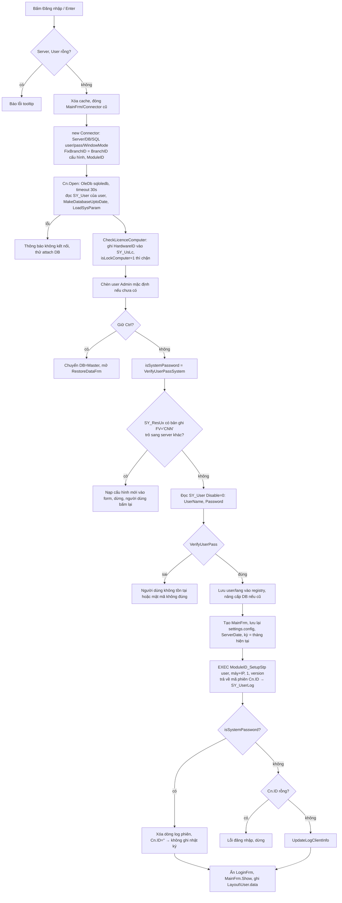

# 12 — Vỏ ứng dụng: khởi động, đăng nhập, màn hình chính, menu, phân quyền, tham số hệ thống

Ngày khảo sát: 2026-11-11. Đọc trước: `00-nguon-du-lieu.md`.

**Phạm vi.** Đây là phần "vỏ" của ERP.NET: chương trình khởi động, đọc `settings.config`, đăng nhập, xác thực mật khẩu, khóa máy và license, tự cập nhật. Tiếp theo là kết nối DB (`Connector`), màn hình chính `MainFrm` (menu, mở form, MDI, dashboard, thông báo, chat, lịch), phân quyền, tham số hệ thống, kỳ kế toán, khóa sổ, đa ngữ, nhật ký, sao lưu và các bảng `SY_*`.

**Nguồn.**
- Mã đã dịch ngược trong `.legacy/decompiled/`. Mọi trích dẫn dạng `ERP.NET/ERP/MainFrm.cs:1231` đều tương đối so với thư mục này.
- Metadata thật của DB MedData (Medcom) trong `workflow-config-20261019/` và schema `run-20261019/columns.json`.
- Định nghĩa SP/function trong `db-audit/evidence-sql/`.
- File cấu hình máy trạm mẫu `D:\Data\Kona\KeToan_KONA_ALL_Dev\` (chỉ xem cấu trúc).

**Quy ước.**
- **[XM]**: đã đọc mã, SQL hoặc dữ liệu và xác minh.
- **[SĐ]**: suy đoán từ ngữ cảnh, cần kiểm chứng thêm.
- Tài liệu không chép mật khẩu, khóa mã hóa, chuỗi kết nối hay hằng bí mật. Ở chỗ cần thiết chỉ ghi "hằng bí mật trong mã" kèm vị trí.

---

## 0. Tóm tắt các phát hiện chính

1. **Không có máy chủ ứng dụng.** Mỗi máy trạm WinForms mở thẳng **một kết nối OleDb tĩnh** tới SQL Server bằng một SQL login dùng chung (lấy từ `settings.config`). Đăng nhập "người dùng ERP" chỉ là một bước kiểm tra trên bảng `SY_User` sau khi đã có kết nối DB với quyền đầy đủ. Mọi kiểm tra quyền đều chạy ở client. [XM] (`Tools/Tools.Data/Connector.cs:373-388`, `ERP.NET/ERP/LoginFrm.cs:2060-2125`)
2. **Mật khẩu người dùng** lưu ở `SY_User.Password`, dạng MD5 có muối 4 chữ số chèn vào chuỗi hex:
   - Đầu vào băm là `UPPER(UserName)` + hằng bí mật 6 ký tự + mật khẩu + muối.
   - Chuỗi lưu dài 38 ký tự.
   - Đổi tên người dùng làm hash mất hiệu lực.
   - Có **mật khẩu hệ thống sinh theo ngày** cho tài khoản Admin và các máy dev, cùng nhiều cửa hậu khác (mục 2.5).
   - [XM] (`Tools/Tools/MD5.cs:27-129`)
3. **Menu hiển thị** do hàm SQL `<ModuleID>_GetUserMenuFnc(@Username)` trả về. Quyền trên form do `Functions.GetPermission` tính: lấy **MAX (OR)** quyền của nhóm, quyền riêng user và quyền của người ủy quyền (`SY_User.UserAuthority`). Kết quả cache 5 phút. [XM] (`Tools/Tools.Utils/Functions.cs:1476-1640`, `evidence-sql/dbo.SY_GetUserMenuFnc.sql`)
4. **`GetPermission` "mở khi lỗi" (fail-open).** Nếu user không có dòng quyền nào cho form, hàm trả về View, Add, Edit, Delete và Manager đều bật (khi form có trong menu đang bật hoặc không có trong menu). Quyền "xem" thực tế chỉ được chặn bằng việc ẩn menu. [XM] (`Tools/Tools.Utils/Functions.cs:1611-1640`)
5. **Có 3 bậc mở form.**
   - Bảng viết tay `MainFrm.GetFormAcc` gồm 18 form (`ERP.NET/ERP/MainFrm.cs:1312-1387`).
   - Tìm **lớp Form theo tên bằng reflection** trong `ERP.NET.exe` và `Tools.dll`.
   - Form **sinh động** từ `SY_FrmLstTbl.FormType` (LIST/LISTEDIT/LISTEDIT2/EDIT/EDITTOP/POS/CALENDAR/TIMELINE/TREE), hoặc **báo cáo** `*Report`, chạy SP `<Tên>Stp` với tham số lấy từ `SY_RpDTbl`.
   - Thống kê trên MedData (427 dòng menu có FormName): 20 dòng qua GetFormAcc, 55 dòng là lớp viết tay khác, 163 dòng sinh động từ `SY_FrmLstTbl`, 181 dòng báo cáo.
   - [XM] (`Tools/Tools/App.cs:490-756`, `Tools/Tools/SysObject.cs:91-192`)
6. **Tiền tố bảng hệ thống thay đổi theo `ModuleID`.** `ModuleID` lấy từ `settings.config` (mặc định `SY`, ngoài ra có `WA` = Web Admin, `KD`...). Các bảng `_Menu`, `_UserGroupPermisstion`, `_UserPermisstion`, `_UserLog`, `_UserLogDetail`, `_Setup`, `_DocSetup`, `_ResUx`, `_SetupStp`, `_GetUserMenuFnc`, `_Update_Permission` đều đổi tiền tố theo nó. `SY_User` và `SY_UserGroup` thì dùng chung. [XM]
7. **Kỳ kế toán "hiện hành" luôn bị ép về tháng hiện tại** khi đăng nhập. Form "Đổi kỳ" (`ChangePeriodFrm`) ghi `SY_Setup.PeriodID` nhưng **không thực sự đổi** `App.mCurrentPeriod`. Có thể đây là lỗi. [XM] (`Tools/Tools.Sys/ChangePeriodFrm.cs:213-225`, `Tools/Tools.Utils/Functions.cs:1028-1053, 1951`)
8. **Trong SP đăng nhập `SY_SetupStp` có logic nghiệp vụ riêng của từng khách hàng.** Bản MedData khóa toàn bộ chứng từ kho/bán/mua của các ngày trước và cập nhật trạng thái đơn hàng. Bản web phải quyết định có gọi SP này hay không. [XM] (`evidence-sql/dbo.SY_SetupStp.sql`)
9. **Rò rỉ dữ liệu nhạy cảm:**
   - SP chat `SP_Chat_ProcessMsg_Stp` trả về `Select * from SY_User` (gồm hash mật khẩu) cho mọi máy trạm.
   - Chức năng "Ghi nhớ mật khẩu" lưu mật khẩu **chỉ mã hóa Base64** trong `Layout\<User>.data`.
   - `SY_Link` và `SY_EmlSetupTbl` chứa mật khẩu.
   - [XM]

---

## 1. Trạng thái toàn cục của "vỏ"

| Đối tượng | Vai trò | Nguồn |
|---|---|---|
| `App.Cn` (`Connector`) | Phiên làm việc. Giữ thông tin server, DB, SQL login, `UserLogin` (tĩnh), `UserGroup`, `BranchID`, `FixBranchID`, `StoreHouseID`, `CostCenterID`, `EmployeeID`, `ManagerID`, `CeoID`, `AgencyID`, `ObjectID`, `ServerDate`, `FromDate`, `ToDate`, `ID` (mã phiên `SY_UserLog.UserAutoID`), `Filter` (Filter của menu đang mở), `LayoutPath`, `ReportPath`, `SharePath` | `Tools/Tools.Data/Connector.cs:48-160, 1871-1925` |
| `Connector.mCn` | **Một** `OleDbConnection` tĩnh cho toàn ứng dụng | `Connector.cs:198-222` |
| `App.ModuleID` | Tiền tố bảng hệ thống (mục 0.6) | `ERP.NET/ERP/LoginFrm.cs:2055-2059` |
| `App.mCurrentPeriod` (`PeriodType`: PeriodID, FromDate, ToDate...) | Kỳ hiện hành | `Tools/Tools/App.cs:41` |
| `App.CurrentPermision` | Quyền của form vừa tính gần nhất | `Tools/Tools/App.cs:58` |
| `SystemPara` | Hashtable tham số hệ thống (từ `SY_Setup`, chi nhánh...) + thay placeholder SQL | `Tools/Tools/SystemPara.cs` |
| `Cache` | Cache kết quả SQL theo **chuỗi SQL**, hạn 5 phút / 10 phút / 1 ngày | `Tools/Tools/Cache.cs:16-229` |
| `Connector.isAdminMode`, `isSystemPassword` | Cờ chế độ quản trị/dev (mục 2.5) | `Connector.cs:78-82, 2308-2319` |
| `App.MDI` / `MainFrm.instance` | Cửa sổ MDI chính | `ERP.NET/ERP/MainFrm.cs:711-715` |

---

## 2. Khởi động và đăng nhập

### 2.1 Điểm vào và tham số dòng lệnh [XM]

`ERP.NET/F4BpNmydKqv0nTjyQU/lW25dKpyasKwWc3oY1.cs:40-85` (lớp obfuscate, `[STAThread] Main`) đọc các cặp tham số:

| Tham số | Biến | Ý nghĩa |
|---|---|---|
| `-u <user>` | `LoginFrm.AutoLoginUser` | Tự điền user và tự đăng nhập sau 500 ms |
| `-p <pass>` | `AutoLoginPass` | Mật khẩu (dạng rõ, trên dòng lệnh) |
| `-d <db>` | `AutoLoginDatabaseName` | Ghi đè tên DB của cấu hình đang chọn |
| `-f <form>` | `AutoLoginShowFormName` | Form mở ngay sau khi vào (ưu tiên hơn `SY_User.StartupForm`) |

Sau đó chương trình chạy `Application.Run(new LoginFrm())`. Khi tự đăng nhập, các ô nhập bị khóa và tiêu đề đổi thành "Tự động đăng nhập..." (`ERP.NET/ERP/LoginFrm.cs:1946-1963`).

### 2.2 `settings.config`: cấu trúc và cơ chế [XM]

- **Vị trí:** `<thư mục exe>\settings.config` (`Tools/Tools/Config.cs:37-43`).
- **Định dạng:** XML của `DataSet` .NET, gồm `<xs:schema>` rồi nhiều phần tử `<Setting>`. Bản Kona có 14 cấu hình.
- **Sao lưu tự động:** `.bk` chép lại mỗi 3 ngày, `.bk2` mỗi 7 ngày. Khi đọc lỗi, chương trình lần lượt thử `.bk`, `.bk2`, rồi tạo bảng rỗng (`Config.cs:85-206`).

**Mã hóa:**
- **Mọi ô** (kể cả `ConfigKey` và `Type`) được mã hóa riêng: Base64( 3DES( ASCII( tiền tố hằng + giá trị ) ) ).
- Khóa và IV 3DES là **hằng bí mật trong mã** (`Config.cs:29-35`). Hàm mã hóa ở `Config.cs:45-62`, hàm giải mã ở `:64-83`, phần bỏ tiền tố khi đọc ở `:219`.
- Nếu mã hóa lỗi, chương trình ghi chuỗi đảo ngược.
- Vì dùng ASCII nên tên cấu hình được bỏ dấu khi lưu (`ConvertUnicode_Khongdau`, `ERP.NET/ERP/LoginFrm.cs:2360`).

**Biến đổi khi đọc:**
- Có một bảng **thay thế tên máy chủ cũ sang tên miền mới** viết cứng trong mã (`Config.cs:222-231`).
- Với một số máy chủ của nhà cung cấp, login `sa` bị đổi sang một login khác (`:248-251`).
- `GroupID` rỗng được gán bằng năm hiện tại (`:237-240`).

**Các trường** (`Config.cs:262-282`, nơi đọc `LoginFrm.cs:2416-2442`, nơi ghi `LoginFrm.cs:2347-2377`):

| Trường | Ý nghĩa thực tế | Ghi chú |
|---|---|---|
| `ConfigKey` | Tên cấu hình hiển thị trong combo "Dữ liệu" | Là khóa. Lưu dạng không dấu |
| `Type` | `Active` hoặc `Backup`, đánh dấu cấu hình đang chọn | `Config.cs:397-437` |
| `Server` | SQL Server: `host`, `host\instance`, hoặc `host,port` | Có dấu phẩy thì thêm `Network Library=DBMSSOCN` (TCP) (`Connector.cs:382-385`) |
| `Database` | Tên DB | Mặc định "DuLieu" (`LoginFrm.cs:2433-2436`) |
| `UserName`, `Password` | **SQL login** dùng chung cho mọi người dùng ERP | Không phải tài khoản ERP |
| `ServerUpdate` | Máy chủ cập nhật, có placeholder `{Server}` | **Không dùng**: luôn bị ghi rỗng khi lưu (`LoginFrm.cs:2366`), không có chỗ nào đọc `Cn.ServerUpdate` |
| `AutoUpdate` | "1"/"0", gán vào `Cn.AutoUpdate` | **Không dùng**: cơ chế cập nhật thật (mục 2.8) bỏ qua cờ này |
| `WindowMode` | "1" nghĩa là **Windows Integrated Security** (SSPI), không phải chế độ cửa sổ | `Connector.cs:378-381` |
| `LeftLogo` / `TopLogo` / `MainIcon` | Tên file (không đuôi) `.png`/`.ico` trong thư mục exe: logo trái, banner form đăng nhập, icon | Mặc định `logo.png`, `icon.ico` (`LoginFrm.cs:2655-2755`) |
| `ModuleID` | Tiền tố bảng hệ thống (mục 0.6). Rỗng nghĩa là `SY` | `LoginFrm.cs:2055-2059` |
| `GroupID` | Nhóm hiển thị khi có trên 10 cấu hình (combo có cột nhóm và ô tìm) | `LoginFrm.cs:2398-2408` |
| `BranchID` | **Chi nhánh cố định của máy trạm** (`Cn.FixBranchID`), ghi đè `SY_User.BranchID` | `LoginFrm.cs:2066`, `Functions.cs:1972-1980` |

**Nhập và xuất cấu hình.** File `.datacfg` hoặc chuỗi gồm dòng "Tên cấu hình : <key> :" kèm một khối mã hóa chứa mọi trường nối bằng `;` (`Config.cs:439-563`). Thao tác này chỉ dùng được khi giữ Ctrl hoặc trên máy dev (`LoginFrm.cs:2575-2580, 2940-2971`).

### 2.3 Màn hình đăng nhập `LoginFrm` [XM]

**Phần hiển thị:**
- Combo **cấu hình dữ liệu** `FldServer`, có tìm kiếm khi trên 10 mục. F2/F3/F5 mở `SY_ConfigSelectorFrm` (`LoginFrm.cs:2839-2856`).
- Người dùng, mật mã (nút hiện/ẩn ở `:3009-3019`).
- Ngôn ngữ VN / EN / CH (`:1972-2022`).
- Nút Đăng nhập / Thoát, nhãn phiên bản.

**Không có** bước chọn công ty, chi nhánh hay kỳ trên màn hình đăng nhập:
- "Công ty" chính là DB, chọn qua cấu hình.
- Chi nhánh lấy từ cấu hình (`BranchID`) hoặc `SY_User.BranchID`.
- Kỳ được tự gán theo tháng hiện tại.

**Phần ẩn:** nhóm `GrpSetting` hiện ra khi bấm link "Thiết lập" mà giữ Ctrl, hoặc ở chế độ admin (`:2307-2338`). Trong đó có:
- Các ô Server, DB, SQL user/pass, ServerUpdate, AutoUpdate, WindowMode, logo, ModuleID, GroupID, BranchID.
- Các nút Thêm/Xóa/Lưu cấu hình.
- Chọn DB từ `master..sysdatabases` (`:2757-2808`).
- Repair DB, Shrink log (`:2635-2653`).
- Quản lý SQL user (`SUTestFrm`, `:2922-2933`).
- SQL Studio, cần `CheckSupperAdmin` (`:2882-2900`).
- Tải gói cập nhật lên DB (`ShowUploadFileX`), cần **mật khẩu cứng trong mã** (`:2810-2837`).
- TeamViewer, đặt định dạng số VN/US cho Windows (`:2858-2868`).
- Nút "Login WA" đăng nhập với `ModuleID=WA` (`:2984-3007`).

**Ghi nhớ:**
- User cuối cùng lưu ở registry `HKCU\<Database>\User` (`:1932, 2131`). User bắt đầu bằng "." thì không lưu.
- Ngôn ngữ lưu ở registry (`GetSettingRegistryDB(db,"CurrentLang")`, `:1937, 2133`).

### 2.4 Luồng đăng nhập (hàm `LoginFrm.DkfCL4Nd3w9`, `ERP.NET/ERP/LoginFrm.cs:2024-2246`) [XM]



Chi tiết từng bước:

1. Kiểm tra Server và User không rỗng (`:2036-2047`). **Không giới hạn số lần thử sai**, không khóa tài khoản.
2. Tạo `Connector` (`:2060-2074`). `ServerUpdate` thay `{Server}` bằng tên host. Giữ Ctrl thì `DataName = "Master"` (`:2075-2078`).
3. `Cn.Open()` (`Tools/Tools.Data/Connector.cs:1319-1528`):
   - Tạo `OleDbConnection` mới, `Connect Timeout=30`, đọc phiên bản SQL (`:1242-1296`).
   - Đọc `SY_User` của user đăng nhập lấy `HoTen`, `UserGroupID`, `BranchID` (`:1345-1360`).
   - Chạy `MakeDatabaseUptoDate()`, tức chuỗi `ALTER/CREATE` theo `DBVersion` trong `<Module>_Setup` (`:1364, 1532-1785`).
   - Kiểm tra kích thước log và tự shrink (`:1379-1400`), rồi `LoadSysParam` (`:1402`).
   - Tạo thư mục `Layout\<DB>` (`:1405-1424`). Kỳ mặc định là tháng hiện tại, `PeriodID="0001"` (`:1440-1445`).
   - Lỗi "Cannot open database" thì thử attach DB (`:1473, 1485-1530`).
4. `CheckLicenceComputer` (`Connector.cs:2279-2306`): mục 2.7.
5. `insert into SY_User(...'Admin'...)` với **hash cố định trong mã** (`LoginFrm.cs:2086`). Lệnh lỗi bỏ qua nếu Admin đã tồn tại. Hệ quả: DB mới luôn có Admin với mật khẩu mặc định của nhà cung cấp.
6. `isSystemPassword` (`:2101`): mục 2.5.
7. Nếu SQL user khác `DEV`, chạy `CheckUpdateConfig()` (`:2102, 2248-2278`; `Tools/Tools.UpdateX/Tools.cs:101-176`). Nếu `<Module>_ResUx` có dòng `FV='CNN'` mang `server;db;user;base64(pass)` khác cấu hình hiện tại thì nạp cấu hình mới vào form và **dừng**. Đây là cơ chế "chuyển máy chủ từ xa".
8. Lấy `UserName` đúng hoa thường và `Password` từ `SY_User where Disable = 0 and UserName = N'<nhập>'` (`:2109, 2118`). Câu SQL **nối chuỗi trực tiếp**, có nguy cơ SQL injection.
9. `VerifyUserPass(user, pass, hash)` (`:2125`): mục 2.5.
10. Thành công thì:
    - Lưu registry. Nếu DB cũ, chạy lớp nâng cấp "Fix Acc" (`:2141-2147`).
    - Tạo `MainFrm`, **lưu lại toàn bộ settings.config** (`:2168`).
    - Đặt `CurrentDateTimeLogin/CurrentDate/ServerDate = getdate()` của server (`:2169-2171`). `FromDate`/`ToDate` là đầu và cuối tháng, rồi `ApplyCurrentPeriodByCurrentMonth` (`:2172-2174`).
11. Gọi `<Module>_SetupStp '<user>', '<máy> (<IP>)', 1, '<phiên bản>'` để nhận mã phiên `Cn.ID` (`:2179`):
    - SP chèn một dòng `SY_UserLog` (UserAutoID=newid, SPID, ComputerName, UserName, LoginDate, AppVer, tmpDate).
    - SP đóng các phiên treo.
    - Bản MedData còn **khóa (`isLock=1`) mọi chứng từ AR/AP/IV có ngày trước hôm nay** và cập nhật trạng thái hóa đơn/đơn hàng (`evidence-sql/dbo.SY_SetupStp.sql`).
12. Nếu đăng nhập bằng mật khẩu hệ thống: xóa dòng log, `Cn.ID=""`. Từ đó `UpdateLog` không ghi gì (`Connector.cs:2160`), phiên **vô hình**. Trên máy dev còn bật `isAdminMode` (`LoginFrm.cs:2180-2189`).
13. Hiện `MainFrm` và ghi file nhớ người dùng (`SY_UserSelectorFrm.UpdateUser`, `:2228`).

### 2.5 Xác thực mật khẩu [XM]

**Thuật toán** (`Tools/Tools/MD5.cs`, gọi qua `Functions.VerifyUserPass/EncodeUserPass` ở `Tools/Tools.Utils/Functions.cs:8257-8267`):

- **Mã hóa** `EncryptUserPass(User, Pass)` (`MD5.cs:27-30, 85-104`):
  1. `S = UPPER(User) + K + Pass`, trong đó `K` là hằng 6 ký tự viết cứng trong mã (`MD5.cs:29`).
  2. Sinh muối `salt` gồm 4 chữ số ngẫu nhiên. Mỗi chữ số thuộc 0–8 vì dùng `Random.Next(0,9)`.
  3. `h = HEX_UPPER(MD5(UTF8(S + salt)))`, dài 32 ký tự.
  4. Chọn vị trí ngẫu nhiên `p` ∈ [4, 31] và chèn `salt` vào `h` tại `p`.
  5. Chèn `p` dạng 2 chữ số vào **vị trí 3**. Tổng độ dài 38 ký tự.
- **Kiểm tra** `Verify(S, Hash)` (`MD5.cs:106-129`): `p = int(Hash[3..5])`. Bỏ 2 ký tự đó, lấy `salt = Hash[p..p+4]`, bỏ tiếp 4 ký tự đó. Sau đó so khớp nhị phân `HEX_UPPER(MD5(UTF8(S+salt)))` với phần còn lại.
- **Hệ quả:**
  - Hash phụ thuộc `UPPER(UserName)`, nên đổi tên user phải đặt lại mật khẩu.
  - Mật khẩu rỗng vẫn có hash hợp lệ: `NguoiDungFrm` chuyển các mật khẩu rỗng thành hash của chuỗi rỗng (`Tools/Tools.SysForm/NguoiDungFrm.cs:927-945`).
  - Dữ liệu `Password` không đúng định dạng (ví dụ mật khẩu rõ kiểu cũ) làm `Verify` ném lỗi và **đăng nhập thất bại**.

**Các đường "đúng" khác cần biết (và KHÔNG được mang sang web):**
- `VerifyUserPassSystem` (`MD5.cs:56-83`) chấp nhận một **mật khẩu sinh từ ngày/tháng/năm hiện tại của máy trạm**: với user `Admin` trên mọi máy, và với **mọi user** trên một danh sách tên máy dev viết cứng. `VerifyUserPass` gọi hàm này trước (`MD5.cs:35`).
- `Connector.GetAndEnableDevModeComputerPass` (`Connector.cs:2308-2319`) bật `isAdminMode` trên máy dev và **tự điền** mật khẩu ngày cho Admin (`LoginFrm.cs:1933`).
- Wrapper ở ERP (`ERP.NET/F4BpNmydKqv0nTjyQU/lW25dKpyasKwWc3oY1.cs:2961-2991`) **trả `true` nếu có ngoại lệ**. Ví dụ: MD5CryptoServiceProvider ném lỗi trên máy bật FIPS. [SĐ về kịch bản FIPS; XM về `return true`]
- `CheckSupperAdmin` dùng tên máy hoặc **mật khẩu cứng** (`Functions.cs:7142-7153`). `CheckAdminMode` hỏi lại mật khẩu Admin, hoặc mật khẩu hệ thống (`Functions.cs:7176-7210`).

**Đổi mật khẩu** (`Tools/Tools.Sys/ChangePasswordFrm.cs:450-504`):
- Mật khẩu mới phải khớp ô xác nhận và khác mật khẩu cũ.
- Mật khẩu cũ được chấp nhận nếu `VerifyUserPass` đúng, **hoặc bằng nguyên văn giá trị cột Password** (tương thích mật khẩu rõ kiểu cũ), hoặc khi admin reset (`isAdminReset`, gọi từ `NguoiDungFrm.cs:914-925`) (`:478`).
- Ghi `Password = EncodeUserPass(user, mới)` và `HoTen`, rồi `UpdateLog("Change password")`.
- Cập nhật `LastPasswordDate`. **Cột này không có trong MedData**, lệnh lỗi bị bỏ qua.
- Quy tắc độ phức tạp (từ 10 ký tự, có chữ hoa, chữ thường, số, ký tự đặc biệt) chỉ áp dụng khi `Connector.isPasswordComplex = true`. Cờ này **luôn false** (`Connector.cs:705`), nên thực tế không áp dụng. Khi **tạo user mới** thì có kiểm tra (trừ khi giữ Ctrl) (`NguoiDungFrm.cs:1046-1050`).
- Form này còn lưu `SY_User.StartupForm` (`ChangePasswordFrm.cs:440, 506-511`).

### 2.6 Ghi nhớ người dùng và mật khẩu (thư mục `Layout\`) [XM]

| File | Nội dung | Mã |
|---|---|---|
| `Layout\<User>.data` | 3 dòng: `User`, tên công ty (`SY_Setup` COM1), `Base64(UTF-16(";" + MachineName + ";" + mật khẩu))`. Chỉ có mật khẩu khi tồn tại `Remember.pass` | `ERP.NET/ERP/SY_UserSelectorFrm.cs:362-376` |
| `Layout\Remember.pass` | File cờ (nội dung "pass"). Có file này nghĩa là đang bật ghi nhớ mật khẩu | `:403-419` |
| `Layout\<DB>\<User>_RecentlyList[LangID].dat` | DataSet XML gồm tối đa 10 menu dùng gần đây | `Tools/Tools.SysForm/DashboardFrm.cs:913-916, 1113-1172` |
| `Layout\<DB>\<FormName>.dat` | Layout lưới/form theo máy (ngoài phạm vi tài liệu này) | — |

Cửa sổ chọn người dùng (`SY_UserSelectorFrm`) liệt kê mọi `*.data` và giải Base64 để điền mật khẩu (`:323-358, 389-399`). Mẫu Kona: `Layout\Admin.data` và `Dat.data` có dòng 3 rất ngắn, tức không lưu mật khẩu (không có `Remember.pass`). Mật khẩu ở đây **không được mã hóa thực sự**.

### 2.7 Khóa máy, license, hạn hosting [XM]

- **`SY_UsLc`**: danh bạ máy trạm (`Tools/Tools/SysFunction.cs:273-305`).
  - `UHardID` = serial bo mạch chủ, nếu không có thì processorId, cuối cùng `"MB"+tên máy` (`:220-262`).
  - Mỗi lần đăng nhập ghi `Version`, `LastDate`, `LastLogin`, `LastComputer`, `LastIPAddress` (kèm MAC) (`:300-303`).
  - Máy có `isLockComputer = 1` bị chặn đăng nhập với thông báo "Máy tính của bạn chưa kích hoạt" (`Connector.cs:2285-2306`).
  - Dòng đặc biệt `Version like 'Site Key%'` chứa khóa site/serial (`USeri`) do license server cấp.
- **`ComputerManagerFrm`** (`Tools/Tools/ComputerManagerFrm.cs:600-745`):
  - Liệt kê máy, kích hoạt hoặc khóa từng máy kèm ghi chú. Ctrl+Khóa thì xóa máy.
  - Chọn chế độ "tự kích hoạt máy mới" hay "phải duyệt" bằng cách đổi **DEFAULT constraint** của cột `isLockComputer` (0 hoặc 1).
- **License dùng thử** (`Tools/Tools/App.cs:561-653`): lần mở form đầu tiên kiểm tra `SysFunction.CheckRegister()`. Nếu chưa đăng ký mà **tổng số bản ghi DB** vượt `RecordCountFree` thì báo hết hạn dùng thử và thoát. Form `*SetupFrm` vẫn được mở (`App.cs:461-488`).
- **Hạn hosting cloud** (`App.cs:500-560`): tham số `SY_Setup.HstExDT` chứa ngày hết hạn đã mã hóa. Quá hạn 7 ngày thì thoát; còn dưới 7 ngày thì cảnh báo, và có lúc thoát ngẫu nhiên. Không áp dụng cho form quản trị người dùng/máy/thiết lập.
- `Tools.AccessControl\iEDC.cs` là thư viện máy chấm công (ngoài phạm vi), không liên quan phân quyền.

### 2.8 Tự cập nhật `Tools.UpdateX` [XM]

- **Kho cập nhật nằm trong DB**, bảng `<Module>_ResUx`/`SY_ResUx` với các cột `FID` (đường dẫn file tương đối), `FN`, `FD` (ngày file), `FV` (phiên bản), `FC` (nội dung nhị phân), `FixVersion` (`Tools/Tools.UpdateX/Tools.cs:199-560`).
- **So sánh:**
  - Nếu `FixVersion=1`: khác phiên bản là cập nhật.
  - Nếu không: phiên bản DB mới hơn thì cập nhật.
  - Nếu file không có phiên bản: so `FD` với ngày ghi file.
- **Cách cập nhật:** hỏi người dùng, backup bản cũ vào `UpdateBK\<yyyy-MM-dd>\`, ghi `.tmp` rồi đổi tên, sau đó **khởi động lại** exe.
- **Thời điểm chạy:**
  - Khi `MainFrm` load (`ERP.NET/ERP/MainFrm.cs:700-710`, loại trừ một số exe của biến thể khác).
  - Mỗi giờ, trong phút 0–4 (`MainFrm.cs:900-909`).
- **Chặn cập nhật:** chỉ bằng file `noupdate.txt` hoặc khi có debugger (`Tools/Tools.Utils/Functions.cs:6984-7002`). **Không dùng** cờ `AutoUpdate` của cấu hình.
- **Tải gói lên** (`SelectFileUploadFrm`) từ màn hình đăng nhập, cần mật khẩu cứng.
- Dòng `FV='CNN'` dùng cho cơ chế chuyển máy chủ (mục 2.4 bước 7).

### 2.9 Đăng xuất và thoát [XM]

- **Đóng `MainFrm`** hỏi "Thoát | Đăng xuất | Hủy" (`MainFrm.cs:1429-1450`).
- **Thoát:** gọi `<Module>_SetupStp '<Cn.ID>', máy, 0`, rồi `App.EndApplication()` (`Tools/Tools/App.cs:394-459`). Hàm này:
  - Sao lưu tự động nếu đến hạn.
  - Ghi log "User logout".
  - Đặt `SY_UserLog.LogoutDate` theo `UserAutoID`.
  - Kill process.
- **Lỗi nhỏ:** `SetupStp` với `@Login=0` nhận `Cn.ID` thay cho `UserName`, nên câu UPDATE trong SP không khớp. `LogoutDate` vẫn được đặt nhờ `EndApplication`. Bản MedData của SP này còn xóa log cũ hơn 3 tháng và xóa `DataValue` cũ hơn 1 tháng.
- **Đăng xuất** (`MainFrm.cs:1206-1229`): dừng timer, đóng mọi form con, xóa SharePara, dừng chat, hiện lại `LoginFrm`.

---

## 3. Kết nối DB: `Connector` [XM]

- **Provider:** `sqloledb` (OleDb), `Persist Security Info=True` (`Connector.cs:373-388`). Có biến thể chuỗi kết nối cho Master và cho DB khác (`:390-447`). Chuỗi `SqlClient` dùng cho NotifyMonitor, sao lưu và `CreateDataBySqlClient` (`:449-459, 2016-2023`).
- **Một kết nối tĩnh** `Connector.mCn`. Các hàm `Functions.CreateData/ExecuteNonQuery/ExecuteScalar` mở kết nối nếu cần rồi dùng (`Functions.cs:3598, 4244, 4379`). Có biến thể `_NewCnn` mở kết nối mới cho migration hoặc lệnh dài.
- **Timeout:**
  - Connect: 30 s.
  - `CreateData`: 600 s. Truy vấn trên 5 s bị ghi log "CreateData Slow" (`Functions.cs:3604, 3631-3634`).
  - `ExecuteNonQuery`: 300 s, gặp timeout/deadlock thì **thử lại 1 lần sau 5 s** (`:4266-4290`).
  - Cache: 60 s. Sao lưu: 900 s. `TimeOutDefault = 300`.
- **Giao dịch:** một transaction toàn cục (`TransactionBegin/Commit/RollBack`, `Transaction(enum)`), gắn vào mọi lệnh khi `IsTrans` (`Connector.cs:1786-1868`). Không có transaction lồng.
- **Tự sửa kết nối:** lỗi "Connection property has not been initialized" thì tạo lại kết nối (`:1298-1317`). Không mở được DB thì thử `sp_attach_single_file_db` từ `D:\Database\` hoặc chạy `RepairDatabaseFrm` (`:1485-1530`).
- **Migration lược đồ chạy ở client** (`MakeDatabaseUptoDate`, `Connector.cs:1532-1785`): so `<Module>_Setup.CodeValue` (`CodeID='DBVersion'`) với phiên bản `Tools.dll`, rồi chạy các khối `ALTER TABLE ... ADD`, `CREATE TABLE/INDEX` theo ngưỡng phiên bản. Lỗi bị bỏ qua. Đây là nguồn gốc các cột `isExportExcel`, `isHideAmount`, `isLockDoc`... của bảng quyền và `BranchID`, `CeoID`, `ManagerID`, `EmployeeID`, `CostCenterID`, `StoreHouseID`, `StartupForm`, `DisableAutoBackup` của `SY_User`.
- **"Đa DB":**
  - Mỗi cấu hình trỏ tới **một** DB. Muốn đổi DB phải đăng xuất và chọn cấu hình khác.
  - Liên kết dữ liệu chéo dùng `SY_Link` (LinkCode, Server, DB, User, Password), tham số `LinkServer/LinkServer2/LinkServer3`, `CreateDataRemote` (OPENROWSET, có bật `Ad Hoc Distributed Queries`) và `CreateLinkServer` (`Connector.cs:2208-2249`).
- **Bộ lọc chi nhánh:**
  - `GetBranchFilter(prefix)` trả về `(BranchID = '<cn>' or BranchID is null)`, hỗ trợ danh sách cách nhau bằng dấu phẩy.
  - `GetBranchDefault()` chọn chi nhánh `isDefault` trong `CF_BranchTbl` (`Connector.cs:719-770`).
- **Sự kiện:** `MenuClick`, `LanguageChanged`, `OnAddNewEvent`, `OnEditEvent`, `OnMakeReport`, `HasError` (`:487-712`). `Ch6uRHnMtt(LangID, LangName)` đổi ngôn ngữ (`:895-902`).

---

## 4. Màn hình chính `MainFrm`

### 4.1 Trình tự load (`ERP.NET/ERP/MainFrm.cs:662-818`) [XM]

1. Đặt TLS 1.2. Đọc cờ đa ngữ `SY_StTbl.isSystemLanguage2` (`:676-683`). `ApplySysToForm`.
2. Kiểm tra cập nhật (mục 2.8).
3. Đọc `SY_User.StartupForm`, rồi gọi `Menus.LoadMainMenu(..., BuildNaviPanel = StartupForm rỗng, BuildAboutMenu = SY_Setup.HdAbtMnu ≠ "1")` (`:712-717`).
4. Tiêu đề: `"NET.PRO 7.6 - " + COM1 + " - " + TaxCode` (bản EN thêm COM1EN, bản CH thêm COM1CH).
   - Có chi nhánh và trên 1 chi nhánh: dùng `BranchName - BranchTaxCode [- BranchID]`.
   - Có tiền tố `COMWEB`.
   - Module WA: "WEB ADMIN PRO 7.2" (`:719-757`).
5. Tooltip "Ngày hiện tại / Dữ liệu" (`:758`). `ManagerID` lấy từ `AR_ManagerEmployeeTbl` nếu chưa có (`:761-764`).
6. Mở form khởi động: `-f` hoặc `StartupForm` qua `App.ShowFormByName` (`:768-775`).
7. Cảnh báo nếu `SY_InitSetup.PeriodID` không có trong `SY_Period` (`:777-784`).
8. Từ ngày 1 đến ngày 2 hằng tháng, ngẫu nhiên chạy hàm "dọn dữ liệu" `lW25dKpyasKwWc3oY1.cQ0Cms9FU2s` gồm nhiều UPDATE/ALTER trên bảng nghiệp vụ (`:785-788`; `ERP.NET/F4BpNmydKqv0nTjyQU/lW25dKpyasKwWc3oY1.cs:188-248`).
9. Timer 5 phút (mục 4.9), `NotifyMonitor.Init()` (mục 4.8).

### 4.2 Menu: bảng `SY_Menu` và cách dựng [XM]

**Cột của `SY_Menu`** (MedData 482 dòng, 427 dòng có FormName, 144 dòng đang tắt):

| Cột | Kiểu | Ý nghĩa và cách dùng |
|---|---|---|
| `MenuID` | varchar(50) PK | Mã phân cấp theo cặp chữ số (`01`, `0101`, `010100`). Sắp xếp theo `MenuID` |
| `VN` / `EN` / `CH` | nvarchar(200) | Nhãn theo ngôn ngữ. `CH` thiếu thì dùng `VN + '(*)'` (`Menus.cs:700-705`) |
| `MenuType` | int NOT NULL | `1` = nhóm, popup con (`ControlPopup`). Khác 1 = lệnh (`Menus.cs:787-799`) |
| `IconIndex` | int | Chỉ số ảnh trong `MenuIconList`/`RibbonIconList`. Ribbon chọn ảnh ngẫu nhiên nếu thiếu |
| `FormName` | varchar(100) | Tên form hoặc báo cáo cần mở (mục 4.3). Đặc biệt: `Exit`, `LogOff`. Menu không FormName mà mã dài hơn 2 ký tự hiển thị kèm " ." |
| `Parent` | varchar(50) | MenuID cha. Rỗng = cấp 1 (thanh menu hoặc tab Ribbon) |
| `isBeginGroup` | bit | Chèn vạch ngăn trước mục |
| `isDisable` | bit | Ẩn hẳn |
| `isBold` | bit | Chữ đậm |
| `isNotCheckPermission` | bit | Luôn hiện, không cần quyền (ví dụ Đăng xuất, Thoát) |
| `Para` | varchar(50) | Tham số: đưa vào `SharePara("Para")`. Tên form thực = `FormName_Para`, quyền cũng tính theo `FormName_Para` |
| `Filter` | nvarchar(150) | Điều kiện gán vào `App.Cn.Filter` khi khởi tạo form (ví dụ `SY_LockDocumentFrm` lọc SourceID) |
| `ShowDialog` | bit | Mở dạng modal thay vì MDI con |
| `ReportPara`, `SubReportPara`, `MenuKey`, `ShortKey` | — | **Không thấy dùng** trong mã client. `ShortKey` không tạo phím tắt [XM bằng grep] |

**Nguồn dữ liệu:**
- Đọc `Select * From <Module>_GetUserMenuFnc('<user>') Order By MenuID`. Nếu lỗi thì đọc `<Module>_Menu where isDisable=0` (**không lọc quyền**) (`Tools/Tools.Utils/Menus.cs:284, 688-698`).
- Logic của hàm xem mục 5.2.

**Hai kiểu giao diện**, lưu ở registry `HKCU\Tools\<DB>[Module]\MenuType` (`Menus.cs:185-190`):
- **Classic** (mặc định), `LoadMainMenuClassic` (`Menus.cs:679-869`): thanh menu Janus `UICommandManager`, cây lồng nhau theo `Parent`. Cuối thanh có các mục:
  - "Cửa sổ" (danh sách MDI).
  - "Giao diện": skin Windows/Office 2003/2007 (Blue/Silver/Black)/2010 (Blue/Green/Silver/Black), màu tùy chọn, chọn font. Lưu registry `CurrentSkin`, `CurrentSkinColor`, `CurrentVisualStyle`, `SystemFontName/Size`.
  - Ngôn ngữ VN/EN/CH (chỉ khi bật đa ngữ).
  - "Trợ giúp": `help.chm`, `help.pdf`, Tìm kiếm menu, Làm tươi hệ thống (`LoadSysParam`), UltraViewer/AnyDesk/RustDesk, Giới thiệu.
  - Nguồn: `Menus.cs:885-1157, 1313-1650`.
- **Ribbon**, `LoadMainMenuRibbon` (`Menus.cs:241-532`): menu cấp 1 thành Tab, mỗi tab một Group, quá 10 lệnh thì tạo group ">>>". Chỉ lấy mục có `Parent` và `FormName`, nên **chỉ hỗ trợ 2 cấp**. Nút điều khiển chứa đổi kiểu menu, ngôn ngữ, trợ giúp, Menu nhanh, Đăng xuất, Thoát.
- Đổi kiểu menu thì ghi registry và **khởi động lại** exe.

### 4.3 Mở form: `MenuClick`, `GetFormAcc`, `App.GetFormByName` [XM]

```mermaid
flowchart LR
  A[Click menu / Ribbon / Recent / Tìm menu] --> B[MainFrm.MenuItem_CommandClick]
  B -->|TagString Exit/LogOff| X[Thoát / Đăng xuất]
  B -->|Menus.SystemMenu_Action: skin, lang, help...| Y[Xử lý hệ thống]
  B --> C[MainFrm.MenuClick FrmName, rMenu]
  C --> D[SharePara Para, Cn.Filter = Filter, key = FrmName + '_' + Para]
  D --> E{Không giữ Ctrl và đã mở?}
  E -- có --> E1[Focus form cũ]
  E -- không --> F[GetFormAcc FrmName]
  F -- null --> G[App.GetFormByName FrmName]
  G --> G1[Kiểm tra hạn hosting/license]
  G1 --> G2[CheckDBConnection, UpdateLog FormName 'Open']
  G2 --> G3[SysObject.GetFormByNameEx: reflection theo tên lớp]
  G3 -- không thấy --> G4[GetFormFromSQL: SY_FrmLstTbl.FormType]
  G4 -- không thấy --> G5[GetFormForReport: *Report + SP *ReportStp]
  G5 -- không thấy --> G6[Admin + Ctrl: tạo SY_FrmLstTbl mới, ngược lại log 'Form not found']
  F --> H[form.Name = key]
  G3 --> H
  G4 --> H
  G5 --> H
  H --> I{ShowDialog?}
  I -- có --> I1[ShowDialog modal]
  I -- không --> I2[MdiParent = MainFrm hoặc Owner nếu TopMost, lưu vào Hashtable, log thời gian mở]
```



**Bảng `GetFormAcc` viết tay** (`ERP.NET/ERP/MainFrm.cs:1312-1387`). So khớp không phân biệt hoa thường. Mọi lớp đều nằm trong namespace `ERP`:

| FormName | Lớp | FormName | Lớp |
|---|---|---|---|
| `AP_PurchaseFrm` | `AP_PurchaseFrm` | `IV_InOutFrm` | `IV_InOutFrm` |
| `AP_ReturnFrm` | `AP_ReturnFrm` | `IV_StockAdjustFrm` | `IV_StockAdjustFrm` |
| `AP_ServiceFrm` | `AP_ServiceFrm` | `IV_StockInputFrm` | `IV_StockInputFrm` |
| `AR_InvoiceFrm` | `AR_InvoiceFrm` | `IV_StockOutputFrm` | `IV_StockOutputFrm` |
| `AR_Invoice2017Frm` | `AR_Invoice2017Frm` | `IV_StockTranferFrm` | `IV_StockTranferFrm` |
| `AR_ServiceFrm` | `AR_ServiceFrm` | `IV_UnitCostProcessFrm` | `IV_UnitCostProcessFrm` |
| `AR_ReturnFrm` | `AR_ReturnFrm` | `SetupFrm` | `ERP.Sys.SetupFrm` |
| `CS_PaymentFrm` | `CS_PaymentFrm` | `PeriodSetupFrm` | `ERP.Sys.PeriodSetupFrm` |
| `CS_ReceiptFrm` | `CS_ReceiptFrm` | `GJ_EntryFrm` | `GJ_EntryFrm` |

Bảng này chỉ là **đường tắt khởi tạo trực tiếp**, không dùng reflection. Mọi lớp khác vẫn mở được nhờ reflection.

**`App.GetFormByName`** (`Tools/Tools/App.cs:490-756`) **không có bảng ánh xạ cứng**:

1. **Reflection** (`Tools/Tools/SysObject.cs:91-192`): quét các kiểu kế thừa `Form` trong **assembly entry (`ERP.NET.exe`) và `Tools.dll`**, so tên lớp không phân biệt hoa thường, rồi `Activator.CreateInstance`. Có 222 lớp Form trong ERP.NET và 140 lớp trong Tools (đếm bằng script).
2. **`GetFormFromSQL`** (`App.cs:2039-2191`) đọc `SY_FrmLstTbl where FormID = <tên>`:

   | FormType | Lớp engine | Ghi chú |
   |---|---|---|
   | `LIST` (mặc định) | `Tools.SysForm.FrmFormList` | Danh mục dạng lưới. Truyền `TableName`, `PrimaryKey`, `HideColumnArr`, `SummaryColumnArr`, `LockColumnArr`, `EditorColumnArr`, `FilterEx`, `TableDetail*` |
   | `LISTEDIT`, `LISTEDIT2` | `FrmFormListEdit` | Lưới kèm khung sửa |
   | `EDIT` | `FrmMasterDetail` | Chứng từ master-detail (layout từ `SY_FrmCfg`) |
   | `EDITTOP` | `FrmMasterEditTop` | Master sửa phía trên |
   | `POS` | `POSTableFrm` | Bàn POS |
   | `CALENDAR` | `FormCalendarFrm` | Lịch |
   | `TIMELINE` | `FormTimeLineFrm` | Dòng thời gian |
   | `TREE` | `FormTreeViewFrm` | Cây |

   Tiêu đề lấy từ `CaptionVN` hoặc `CaptionEN`.
3. **`GetFormForReport`** (`App.cs:942-1083`): tên kết thúc bằng `Report` thì đọc danh sách tham số của SP `<Tên>Stp` (`GetParaListFromStore`) và tạo `ReportViewerFrm` kèm form tham số. Thiếu SP thì Admin + Ctrl được sinh khung SP.
4. **Admin hoặc chế độ admin, giữ Ctrl:** tạo nhanh một dòng `SY_FrmLstTbl` (`App.cs:669-719`).

**Phân loại 427 dòng menu có FormName của MedData** (script đối chiếu `menus.json`, `forms.json` với lớp dịch ngược). [XM]

| Đường mở | Số dòng menu | Ví dụ |
|---|---:|---|
| `GetFormAcc` | 20 | AR_InvoiceFrm, CS_ReceiptFrm, GJ_Entryfrm, SetupFrm |
| Reflection, lớp trong ERP.NET | 44 | GJ_BalanceAccountFrm, FA_AssetListFrm, EQ_EquipFrm, IV_CheckStockFrm, ChatManagerFrm (tắt), OF_ScheduleFrm (tắt) |
| Reflection, lớp trong Tools | 11 | NguoiDungFrm, NguoiDungNhomFrm, NguoiDungPhanQuyenFrm, NguoiDungPhanQuyenWAFrm, ChangePasswordFrm, FiscalFrm, BackupDataFrm, RestoreDataFrm, SystemLangSetupFrm, UserLogFrm, ComputerManagerFrm |
| `SY_FrmLstTbl` EDIT | 95 | AP_OrderFrm, AR_ObjectContractFrm, AR_OrderShipFrm |
| `SY_FrmLstTbl` LIST | 62 | CategoryListFrm, CurrencyListFrm, DepartmentListFrm |
| `SY_FrmLstTbl` LISTEDIT/LISTEDIT2 | 6 | ChartAccListFrm, CF_BranchListFrm, LocationListFrm |
| Báo cáo `*Report` (SP) | 181 | AP_PurchaseDetailReport, AR_DebtAgingReceivableReport |
| Không tìm thấy | 8 | `Exit`, `Logoff` (xử lý riêng), một số form đã tắt |

Hệ quả cho bản web: **mỗi khách hàng có một tập form khác nhau**. Phải đọc `SY_Menu` + `SY_FrmLstTbl` của DB khách hàng, rồi đối chiếu với danh sách lớp viết tay.

**Các cách mở form khác:**
- `App.ShowFormByName(name, dialog, FindDocumentID, Filter)` kiểm tra `GetPermission(name).View` rồi mới mở. Có thể đặt `Mode = Find` để nhảy tới chứng từ (`App.cs:758-800`).
- `App.ShowFormBySourceID(SourceID, DocumentID)` tìm FormID qua `SY_GetFormNameBySourceIDStp`, `vSourceListFull` hoặc `<Module>_DocSetup.FormID`, kiểm tra quyền View, rồi mở ở chế độ tìm (`App.cs:802-878`). Đây là cơ chế "drill-down" từ báo cáo hoặc chứng từ liên kết.

### 4.4 MDI, tab, cửa sổ [XM]

- `MainFrm` là MDI. Form con hiển thị dạng **tab** (Janus `UIPanelManager`, `App.MDITabPanelManager`, có nút cuộn tab) (`MainFrm.cs:714`, `Menus.cs:512, 867`).
- Form đã mở được lưu trong `Hashtable` theo `UCASE(FormName[_Para])`. Click lại thì focus form cũ. **Ctrl+Click mở thêm một bản mới** không quản lý (`MainFrm.cs:1245-1300`).
- Form `TopMost` được gắn làm `Owner` thay vì MDI con. `ShowDialog=1` mở dạng modal.
- Thời gian mở form ghi vào nhật ký và thanh trạng thái (`MainFrm.cs:1301-1306`).
- Thanh trạng thái có các panel `User` (login + họ tên), kỳ hiện hành và `INFO`. Click `INFO` hiện vài dòng debug gần nhất (`MainFrm.cs:1452-1458`, `Functions.cs:1150-1200`).

### 4.5 Dashboard, danh sách gần đây, tìm menu, yêu thích [XM]

- **`DashboardFrm`** (Tools) là một tab không đóng được, chỉ dựng khi `SY_User.StartupForm` rỗng. Module WA dùng `WA_DashboardFrm` (`Menus.cs:216-229`). Nội dung:
  - **Cột trái:** tab theo menu cấp 1 (nếu `SY_Setup.DisableTabMenu ≠ 1`). Tab nào có sơ đồ quy trình trong `<Module>_DshBrdCnt(MenuID, Contain image)` thì hiện sơ đồ.
  - **Widget số liệu:** SP `<Module>_UpdateDshBrdStp '<user>', <Recal>` chạy mỗi `DashboardTime` phút, F5 để tính lại. Bảng kết quả có các cột quy ước `sysWidthFull/2X`, `sysHeight2X`, `GroupName`, `sysWarning`, `sysLink`, `sysAlert`, `sysColor`. Mỗi dòng có thể có `Action` để mở form.
  - Các ô hiển thị theo nhóm lấy từ `SY_UserGroupDetail(KeyID, KeyName, isDisable)`, ví dụ 010 Tiền quỹ, 014 Công nợ phải trả, 018 Phải thu... do `SY_Update_Permission` sinh (`evidence-sql/dbo.SY_Update_Permission.sql`).
  - **"Chức năng thường dùng"**: tối đa 10 menu gần nhất, lưu ở `Layout\<DB>\<User>_RecentlyList[Lang].dat`. Tắt bằng `DisableRecentMenu`. Mở lại có kiểm tra quyền View (`DashboardFrm.cs:891-937, 1113-1214`).
- **Tìm menu ("Menu nhanh")**: hộp chọn lọc trên bảng menu đã phân quyền, cột `MenuID;VN;EN;Parent` (`Menus.cs:44-79`).
- **Yêu thích:** **không có**. Không tìm thấy trong mã.
- **Phím tắt:** không có hotkey toàn cục và không dùng `SY_Menu.ShortKey`. Phím tắt cấp form gồm:
  - Ctrl+F10: thiết lập FormControler.
  - Ctrl+F11: dịch ngôn ngữ.
  - Ctrl+F12: layout.
  - F2/F3/F4/F7 trong ô lookup.
  - F5 làm tươi dashboard.
  - Nguồn: `Tools/Tools/FormControler.cs:8670-8750`, `Tools/Tools/EditX.cs:1302-1468`.

### 4.6 Thông báo, chat nội bộ, lịch [XM]

- **Thông báo** (`Tools/Tools/NotifyMonitor.cs:106-171`):
  - Chỉ chạy khi DB có `SY_NotifyCheckStp`. Cứ 15 s gọi `SY_NotifyCheckStp @Lastid, @User` trên kết nối `SqlClient` riêng (`Application Name=ERP.Notify`).
  - SP trả các cột `ID`, `Title`, `Message`, `type` (Info/Warning/Error). Client giữ ID cuối cùng làm con trỏ và hiện balloon ở khay hệ thống.
  - Click balloon mở `SY_NotifyListFrm` (`MainFrm.cs:842-880, 1460-1467`).
  - Bản MedData đọc `SY_NotifyMsgTbl`, bảng có thêm `WebRoute`, `ShowWeb`, `ShowERP`, `ExpireAt`, `EventKey`, nên đã được thiết kế cho cả web [SĐ: do dự án web trước tạo]. Bảng cũ `SY_NotifyMsg` dùng cho FCM (`ERP.NET/ERP/GoogleFCMNotifyCtl.cs:282`).
- **Chat** (`ERP.NET/ERP.CHAT/clsChat.cs`, `ChatManagerFrm.cs`, `MsgFrm.cs`, `XemMsgFrm.cs`):
  - Chỉ bật khi mở `ChatManagerFrm`; menu này đang tắt ở MedData. Tham số `isCHAT` bị ẩn và ép false trong SetupFrm.
  - **Polling** `SP_Chat_ProcessMsg_Stp '<from>', '<to>', N'<msg>', <isPublic>` mỗi 7 s, hoặc 3 s khi có tin (`clsChat.cs:97-150`).
  - SP ghi bảng `ChatMsg`, trả tin chưa đọc, đánh dấu `isView=1`, cập nhật `SY_User.TempDate` (nhịp sống), xóa tin public cũ hơn 30 phút. SP trả về **`Select * from SY_User where TempDate >= now-1 phút`** làm danh sách online, kèm cả cột `Password`.
  - Tin public được nhân bản cho mọi user.
- **Lịch** (`ERP.NET/ERP.Schedule/OF_ScheduleFrm.cs`, `Notifier.cs`): bảng `OF_ScheduleTbl` với các cột Subject, StartDate, EndDate, Reminder, Owner, ShareUser, ShareGroup, LinkSourceID/Doc... Timer nhắc 1 s. Menu đang tắt ở MedData.

### 4.7 Timer nền của `MainFrm` [XM]

Timer chạy mỗi 300 s (`MainFrm.cs:789-790, 882-910`):
- Gọi `SY_SystemServiceCheckStp '<user>', '<máy (IP)>', <phút>, 'SY'` nếu SP tồn tại. Bản MedData chỉ `PRINT 1`. Thứ tự tham số trong mã khác chữ ký SP (`@CompName, @ParaInt, @ParaS`) [XM].
- Trong phút 0–4 mỗi giờ:
  - `App.AutoBackupOnServer()`: sao lưu trên server theo `AutoBackupPath/AutoBackupTime/AutoBackupDay` (`App.cs:163-228`).
  - Kiểm tra kết nối và ngày giờ server.
  - Kiểm tra cập nhật mỗi giờ.

### 4.8 Đổi kỳ, đổi chi nhánh, ngôn ngữ, giao diện [XM]

- **Đổi kỳ:** xem mục 6.2. Có lỗi là chọn kỳ không có tác dụng thực.
- **Đổi chi nhánh:** **không có chức năng đổi khi đang chạy**. Chi nhánh lấy từ `BranchID` của cấu hình máy trạm, nếu không có thì `SY_User.BranchID`, nếu `CF_BranchTbl` chỉ có 1 dòng thì lấy dòng đó (`Functions.cs:1972-1980`). Muốn đổi phải đăng nhập bằng cấu hình khác, hoặc admin sửa `SY_User`.
- **Ngôn ngữ:** mặc định `isLanguageDisable=true`, `LangID="VN"` (`Connector.cs:707-708`). Menu VN/EN/CH gọi `Connector.Ch6uRHnMtt`: lưu registry, đặt `LangID`, đổi nhãn menu, `LoadSysParam`, phát sự kiện `LanguageChanged`. **Form đang mở không được dịch lại** (`Tools/Tools.Languages/LangControler.cs:57-59`).
- **Giao diện:** skin, màu và font lưu ở registry theo DB và module (mục 4.2).

---

## 5. Phân quyền

### 5.1 Các bảng (schema MedData `run-20261019/columns.json`) [XM]

Lưu ý: **không có bảng `SY_UserTbl`**. Bảng người dùng là `SY_User`. Tên các bảng quyền giữ nguyên lỗi chính tả `Permisstion`.

**`SY_User`** (42 dòng)

| Cột | Kiểu | Ý nghĩa (nơi dùng) |
|---|---|---|
| `UserName` | varchar(100) PK | Tên đăng nhập. So khớp trong SQL theo collation của DB (CI) |
| `HoTen` | nvarchar(150) NOT NULL | Họ tên (`Connector.UserFullName`) |
| `TenNgan` | nvarchar(100) NOT NULL | Tên ngắn |
| `Password` | varchar(200) | Hash định dạng mục 2.5 (38 ký tự) |
| `Manager`, `PM` | bit | Cờ quản lý / PM. **Không thấy dùng trong tính quyền** [SĐ: dùng ở báo cáo/duyệt] |
| `Disable` | bit NOT NULL | Ngừng sử dụng, không đăng nhập được |
| `UserGroupID` | varchar(50) | Nhóm quyền chính (một user chỉ thuộc **một** nhóm) |
| `TempDate` | datetime | Nhịp sống chat / online |
| `UserAuthority` | varchar(100) | **Ủy quyền**: nếu A có `UserAuthority = 'B'` thì B được cộng thêm quyền nhóm của A |
| `BranchID` | varchar(50) | Chi nhánh mặc định / giới hạn (danh sách cách nhau bằng dấu phẩy được hỗ trợ ở `GetBranchFilter`) |
| `CeoID`, `ManagerID`, `EmployeeID`, `CostCenterID`, `StoreHouseID`, `ObjectID` | varchar(50) | Gắn user với nhân viên, quản lý, trung tâm chi phí, kho, đối tượng. Dùng làm placeholder lọc dữ liệu (mục 5.7) |
| `StartupForm` | varchar(50) | Form mở khi vào. Có giá trị thì không dựng Dashboard |
| `DisableAutoBackup` | bit | Không hỏi/không chạy sao lưu tự động khi thoát |
| `KhongHienDashboard` | bit | Có trong DB nhưng **không thấy dùng trong mã** [SĐ: bản web] |

**`SY_UserGroup`** (28 dòng): `UserGroupID` varchar(20) PK, `UserGroupName` nvarchar(100) (unique index), `IsDisable` bit, `BranchID` varchar(50). Nhóm gắn chi nhánh chỉ hiện với user cùng chi nhánh trong màn phân quyền (`NguoiDungPhanQuyenFrm.cs:742-749`).

**`SY_UserGroupDetail`** (168 dòng): `UserAutoID` PK, `UserGroupID`, `KeyID`, `KeyName`, `isDisable`, `Value` decimal, `Notes`. Đây là các ô dashboard bật/tắt theo nhóm.

**`SY_UserGroupPermisstion`** (11.961 dòng = 28 nhóm × 427 menu) và **`SY_UserPermisstion`** (17.934 dòng = user × menu) có cùng cấu trúc. Khác nhau ở cột khóa: `UserGroupID varchar(20)` so với `UserName varchar(100)`.

| Cột | Kiểu | Quyền tương ứng (`PermissionType`) | Nhãn ở màn phân quyền |
|---|---|---|---|
| `ID` | varchar(50) PK, default newid() | — | — |
| `MenuID` | varchar(50) | khóa tới `SY_Menu` | — |
| `IsRun` | bit NOT NULL | `View` | Cho quyền xem |
| `IsAdd` | bit NOT NULL | `AddNew` | Cho quyền thêm |
| `IsUpdate` | bit NOT NULL | `Edit` | Cho quyền sửa |
| `IsDelete` | bit NOT NULL | `Delete` | Cho quyền xóa |
| `isManager` | bit | `Manager` (sửa/xóa chứng từ người khác, khóa/mở khóa ở SY_LockDocumentFrm, field quyền Manager) | Cho quyền Manager |
| `isAdmin` | bit NOT NULL | `Admin` (kéo theo Manager) | Cho quyền Admin |
| `isAutoLock` | bit default 0 | `AutoLock`: tự khóa chứng từ sau khi lưu/in | Tắt/Mở tự động khóa sau khi in phiếu |
| `isHideAmount` | bit | `HideAmount`: ẩn cột tiền | Cho/Cấm xem cột số tiền |
| `isLockDoc` | bit (NULL = true) | `LockDoc` | Quyền khóa/mở khóa chứng từ |
| `isUnLockDoc` | bit (NULL = false) | `UnLockDoc` | (như trên) |
| `isExportExcel` | bit (NULL = false) | `ExportExcel` | Cho/Cấm xuất Excel |

Phân bố quyền nhóm ở MedData:

| Tổ hợp quyền | Số dòng |
|---|---:|
| Xem + thêm + sửa + xóa + Manager | 5.732 |
| Chỉ xem | 4.471 |
| Không quyền | 1.060 |
| Toàn quyền + Admin | 465 |

**`SY_UserBranch`** và **`SY_UserStorehouse`** (`UserAutoID`, `UserName`, `BranchID`/`StoreHouseID`, `isDefault`, `Notes`) đều có 0 dòng. Hai bảng này chỉ được dùng qua mẫu `FilterEx` "BranchID in (Select BranchID from SY_UserBranch where UserName='{User}')" (mục 5.7).

**Kiểu `PermissionType`** (`Tools/Tools.Data/PermissionType.cs`) gồm FormName, View, AddNew, Edit, Delete, Manager, Admin, AutoLock, HideAmount, LockDoc, UnLockDoc, ExportExcel.

### 5.2 Quyền hiển thị menu: `SY_GetUserMenuFnc(@Username)` [XM]

Nguồn: `evidence-sql/dbo.SY_GetUserMenuFnc.sql`; mẫu sinh tự động ở `Tools/Tools.Utils/Functions.cs:2124-2188`, mẫu `_Update_Permission` ở `:2189-2215`.

1. Nếu `@Username = 'Admin'`: trả **mọi** menu `isDisable = 0`. Collation CI nên 'admin' cũng khớp [SĐ: tùy collation].
2. Ngược lại, lấy `@MasterUser = UserName from SY_User where UserAuthority = @Username`. Lưu ý: chỉ lấy **một** người ủy quyền.
3. Hợp (UNION ALL + DISTINCT) các menu `isDisable=0`, `isNotCheckPermission=0` có `IsRun=1` từ bốn nguồn: quyền nhóm của user, quyền riêng của user, quyền nhóm của MasterUser, quyền riêng của MasterUser.
4. Thêm mọi menu `isNotCheckPermission = 1` chưa có trong kết quả.
5. Lặp 4 lần để thêm các menu **cha** của những mục đã có. Hệ quả: cây menu tối đa 5 cấp.

### 5.3 Quyền trên form: `Functions.GetPermission(FormName)` [XM]

Nguồn: `Tools/Tools.Utils/Functions.cs:1476-1640`. Khóa `FormName` = `mForm.Name` = `SY_Menu.FormName` + (`_` + `Para` nếu có). Được gọi khi `FormControler.SetControl` (`Tools/Tools/FormControler.cs:2913, 2999, 3055`), `ShowFormByName`, `ShowFormBySourceID`, danh sách gần đây...

```text
rows = SELECT MAX(IsRun), MAX(IsAdd), ..., MAX(isExportExcel) GROUP BY MenuID, FormName FROM (
         SY_User(UserName=@me) ⋈ <Mod>_UserGroupPermisstion ⋈ <Mod>_Menu      -- quyền nhóm
   ∪     SY_User(UserAuthority=@me) ⋈ <Mod>_UserGroupPermisstion ⋈ <Mod>_Menu -- nhóm của người ủy quyền
   ∪     <Mod>_UserPermisstion(UserName=@me) ⋈ <Mod>_Menu )                   -- quyền riêng user
       WHERE Menu.isDisable=0 AND Menu.FormName + ('_'+Para) = @FormName
-- Cache.CreateData(text): cache 5 phút theo chuỗi SQL
if rows có dòng:
    lấy dòng ĐẦU (nếu một FormName xuất hiện ở nhiều MenuID → chỉ dòng đầu được dùng)
    View = IsRun OR Add OR Edit OR Delete OR Manager OR Admin
    if Admin: Manager = true
    NULL: AutoLock=false, HideAmount=false, LockDoc=true, UnLockDoc=false, ExportExcel=false
    if !View và FormName='NguoiDungPhanQuyenFrm' và user='ADMIN' → toàn quyền (chống tự khóa)
else (không có dòng nào):                           -- FAIL-OPEN
    n = count(menu bật có FormName này); if n=0: n = 1 - count(menu tắt có FormName này)
    View=true; Add=Edit=Delete=(n>0); Manager=true; Admin=false; LockDoc=true; ExportExcel=true
```

Module WA dùng truy vấn riêng `WA_UserGroupPermisstion` (lấy top 1 theo isAdmin, isManager). `GetPermissionWithMenuPara` là biến thể theo `Para` (`Functions.cs:1401-1474`).

**Cách quyền được áp dụng:**
- **Xem:** chủ yếu nhờ **ẩn menu**. `ShowFormByName`, `ShowFormBySourceID` và danh sách gần đây kiểm tra lại `View`. Bản thân form không tự đóng khi `View=false`.
- **Thêm/Sửa/Xóa:** bật/tắt nút toolbar trong `FormControler`. Với storer chi tiết thì `Delete = Delete|AddNew|Edit` (`FormControler.cs:4122-4131`).
- **ExportExcel/HideAmount/AutoLock/LockDoc:** xem mục 5.5 và 5.6. Tham số `isManagerNotExcel` và `isUserNotExcel` trong `SY_Setup` cũng tham gia [SĐ chi tiết].

**Cache:** quyền và menu được cache theo chuỗi SQL, 5 phút. `Cache.Clear(true)` khi đăng nhập và khi `LoadSysParam`. Sửa quyền xong, người dùng khác chỉ nhận quyền mới sau khi hết cache, hoặc khi menu được nạp lại (đăng nhập lại).

### 5.4 Admin, Manager và các đường vượt quyền [XM]

| Điều kiện | Hiệu lực | Nguồn |
|---|---|---|
| `UserName = 'Admin'` | Thấy mọi menu (SQL function). Quyền form vẫn theo bảng quyền | `SY_GetUserMenuFnc` |
| `CheckAdminUserGroup` = `isAdminMode` OR `UserGroup='ADMIN'` OR login bắt đầu bằng "ADMIN" | Mở chức năng quản trị (thiết lập form, layout, menu...) | `Functions.cs:7155-7174` |
| Login bắt đầu bằng "ADMIN" | Sửa quyền ở `NguoiDungPhanQuyenFrm`, bật nút sao lưu nâng cao, tự chèn chuỗi đa ngữ mới | `NguoiDungPhanQuyenFrm.cs:771-775`, `BackupDataFrm.cs:591-594` |
| `isAdminMode` (máy dev, hoặc nhập mật khẩu Admin ở `CheckAdminMode`) | Toàn quyền ở `NguoiDungFrm`, bỏ qua `isLockData`, xem/sửa cột ẩn | `NguoiDungFrm.cs:780-787`, `Functions.cs:326-340` |
| `Permiss.Admin` | Kéo theo Manager; sửa/xóa chứng từ người khác; field `EditPermiss/VisiblePermiss = Admin` | mục 5.5–5.6 |
| `Permiss.Manager` | Sửa/xóa chứng từ người khác khi `isManagerCanEditDoc=1`; khóa/mở khóa ở `SY_LockDocumentFrm` (`ERP.NET/ERP/SY_LockDocumentFrm.cs:725-726`) | |

### 5.5 Quyền theo bản ghi (chủ sở hữu, khóa) [XM, theo khảo sát chi tiết]

- Nếu bảng có cột `UserCreate` và layout không bật `DocumentNoCheckUser`, khi Sửa/Xóa sẽ kiểm tra `UserCreate <> '<login>'`. Nếu đúng thì báo `SY_StTbl.NoPermissToEditDelete` ("Bạn không thể sửa, xóa chứng từ của người khác tạo"):
  - `SY_Setup.isManagerCanEditDoc = 1`: mọi người trừ **Manager** bị chặn.
  - Ngược lại: mọi người trừ **Admin** bị chặn.
  - Nguồn: `Tools/Tools.SysForm/FrmMasterDetail.cs:1169-1182`, `FrmMasterEditTop.cs:381-391`.
- Chứng từ có `isLock = 1` thì báo `NoPermissToEditDeleteLockDoc`. Trạng thái khóa được đọc lại từ DB trước khi kiểm tra (`FormControler.cs:6523-6603`).
- Ngày chứng từ thuộc kỳ đã khóa sổ thì bị chặn, qua `SY_CheckDateOfPeriodOpeningFnc(<ngày>)`:
  - Kỳ hiện tại hoặc **bất kỳ kỳ nào sau đó** có `isLock=1`, hoặc kỳ hiện tại có `isLockData=1`, thì tính là đã khóa.
  - Ngày không có kỳ cũng tính là khóa.
  - Nguồn: `Functions.cs:312-324`, `evidence-sql/dbo.SY_CheckDateOfPeriodOpeningFnc.sql`.
- `AutoLock`: sau khi lưu/in thì đặt `isLock=1` (`FormControler.cs:6803-6859`).
- **Mọi kiểm tra đều chạy ở client**, DB không có ràng buộc.

### 5.6 Quyền theo trường, ẩn số tiền, xuất Excel [XM]

- **Cấu hình trường** nằm trong `SY_FrmCfg(FID = form, KeyID = 'LYT<tab>', SubID = field, KeyValue = chuỗi cấu hình phân cách ';')`. Phần tử thứ 8 là `EditPermiss`, phần tử thứ 9 là `VisiblePermiss` (`Tools/Tools.Layout/LayoutItemX.cs:2048-2052`).
- Giá trị: `AllUser=0`, `LockDefaultValueNotEmpty=2`, `LockDefaultValueSQLNotEmpty=3`, `Hide…=4/5`, `Manager=7`, `Admin=9` (`LayoutItemX.cs:101-110`).
- Thực thi ở `Tools/Tools.Layout/LayoutX.cs:1829-1857`:
  - Ẩn control nếu `VisiblePermiss` đòi Admin/Manager mà user không có.
  - Đặt chỉ-đọc theo `EditPermiss`.
  - Người có quyền vượt được ràng buộc chỉ-thêm/chỉ-sửa.
  - Tab chi tiết có `Tab1..5VisiblePermiss` (`FrmMasterDetail.cs:2690-2735`).
- **Enum `Tools.EditPermission`** (None/AllUser/Owner/Manager/Admin, `Tools/Tools/EditPermission.cs`) chỉ dùng cho control đính kèm Word/Excel, và chỉ giá trị `None` được kiểm tra (`Tools/Tools/AttachWordX.cs:492, 770`). Thực tế không có quyền "Owner" theo trường.
- **HideAmount:** danh sách cột tiền khai báo trong layout (`HiddenAmountColumnArrForPermission`, khóa `ACP`, với báo cáo là `HCA`). Form ẩn các cột đó. Báo cáo gán NULL giá trị sau khi nạp (`LayoutX.cs:3156-3170`, `ReportViewerFrm.cs:2542-2566`). **Dữ liệu vẫn được tải về máy trạm.**

### 5.7 Phạm vi dữ liệu (chi nhánh, kho, đối tượng) và placeholder [XM]

- **Chi nhánh tự động:** form LIST/LISTEDIT/EDIT có bảng chứa cột `BranchID` sẽ tự thêm `GetBranchFilter` và đặt mặc định `BranchID = GetBranchDefault()` (trừ khi layout bật `DocumentNoCheckBranch`). Cột `BranchID` bị khóa (`FrmMasterDetail.cs:1466-1469`, `FrmFormList.cs:322, 337-342`, `FrmFormListEdit.cs:806, 832`). Nếu `SY_Setup.isFixBranch=1` thì ẩn cột `BranchID` trên lưới (`Tools/Tools/GridX.cs:2508-2512`).
- **Các mẫu `FilterEx` có sẵn** cho người cấu hình form (`Tools/a1QRSJFaDiuNNNaDsd/jSIw0ahM5tyJad6FQd.cs:137-145`):
  - `BranchID='{BranchID}'`, `ManagerID='{ManagerID}'`, `EmployeeID='{EmployeeID}'`, `CostCenterID`, `StoreHouseID`.
  - `BranchID in (Select BranchID from SY_UserBranch where UserName='{User}')`.
  - `CHARINDEX('{User}', ViewUserListArr) > 0`.
- **Placeholder SQL** (`SystemPara.ReplaceSourceSQL`, `Tools/Tools/SystemPara.cs:166-225`):
  - `{<mọi khóa SystemPara>}`, tức các `CodeID` của `SY_Setup`, kể cả dạng `Sys<CodeID>`.
  - `{@User}`, `{User}`, `{@UserID}`, `{UserID}`, `@User` (thay thành `'login'`), `{UserFullName}`.
  - `{@BranchID}`/`{BranchID}`, `{CeoID}`, `{ManagerID}`, `{EmployeeID}`, `{AgencyID}`, `{ObjectID}`, `{CostCenterID}`, `{StoreHouseID}` (mỗi cái kèm biến thể `{@...}` và chữ hoa).
  - Thay **bằng nối chuỗi**, không dùng tham số SQL.

### 5.8 Các màn hình quản trị [XM]

| Form | Chức năng | Bảng |
|---|---|---|
| `NguoiDungFrm` | Danh sách user (lọc chi nhánh, hiện user ngừng dùng), thêm user (hộp nhập, kiểm tra độ phức tạp, mã hóa), đặt lại mật khẩu, khóa cột BranchID theo chi nhánh của người quản trị | `SY_User`, `SY_UserGroup`, `CF_BranchTbl` (`Tools/Tools.SysForm/NguoiDungFrm.cs:776-1075`) |
| `NguoiDungNhomFrm` | Nhóm + chi tiết dashboard. Gọi `<Mod>_Update_Permission` | `SY_UserGroup`, `SY_UserGroupDetail` (`NguoiDungNhomFrm.cs:648-664`) |
| `NguoiDungPhanQuyenFrm` | Ma trận nhóm × menu: chọn nhóm, cây menu bên trái, lưới quyền bên phải. Menu chuột phải gồm Cấm truy cập / Xem / Thêm / Sửa / Xóa / Thêm+Sửa+Xóa / Manager / +Manager / Admin / AutoLock / Ẩn số tiền / Excel / Khóa chứng từ / Copy quyền từ menu khác. Áp cho nhiều nhóm cùng lúc (`SY_String2TableFnc`), copy toàn bộ quyền từ nhóm khác | `<Mod>_UserGroupPermisstion` (`NguoiDungPhanQuyenFrm.cs:740-1330`) |
| `NguoiDungPhanQuyenUserFrm` | Ma trận quyền riêng user (chỉ các cờ Run/Add/Update/Delete/Manager/Admin). Lọc theo chi nhánh khi `isFixBranch` | `<Mod>_UserPermisstion` (`NguoiDungPhanQuyenUserFrm.cs:545-800`) |
| `NguoiDungPhanQuyenWAFrm` | Như trên cho module WA (Web Admin) | `WA_UserGroupPermisstion`, `WA_Menu` |
| `ChangePasswordFrm` | Đổi mật khẩu, họ tên, StartupForm | `SY_User` |
| `ComputerManagerFrm` | Kích hoạt/khóa máy | `SY_UsLc` |

**`<Mod>_Update_Permission`** đồng bộ ma trận quyền (`evidence-sql/dbo.SY_Update_Permission.sql`). Nó được gọi khi mở các form phân quyền, form nhóm và quản lý menu:
- Xóa quyền mồ côi.
- Chèn dòng thiếu: **nhóm × menu mới mặc định `IsRun=1`** (nhóm thấy menu mới), **user × menu mặc định toàn 0**.
- Chèn các ô dashboard mặc định cho nhóm.

---

## 6. Tham số hệ thống, kỳ kế toán, đa ngữ, nhật ký, sao lưu

### 6.1 `SY_Setup` và `SystemPara` [XM]

- **`SY_Setup`** có các cột `CodeID` PK, `CodeName`, `ValueType`, `CodeValue` nvarchar(1000), `SourceTable`, `FieldName`, `GroupID` ('1' = thông tin công ty), `CodeValue2`, `IndexID`, `Ghichu`. MedData có 63 dòng.
- **Nạp:** `GetSetupParam` đọc `<Mod>_Setup` (nếu không có thì `SY_Setup`) vào `SystemPara`, mỗi giá trị dưới tên `CodeID` và `Sys<CodeID>`, tra không phân biệt hoa thường. Hàm này cũng thêm `UserFullName`, `UserName`, `User`, rồi suy ra các cờ (`Functions.cs:1770-1953`):
  - `isManagerNotApproveDoc`, `isManagerNotDeApproveDoc`, `isManagerCanEditDoc`, `isLotDate`, `isDiscountVoucher`, `isReportPrintDate`, `isFixBranch`, `DocLimit`.
  - `DisableTabMenu`, `DisableRecentMenu`, `DashboardTime`.
  - `PeriodID` (bị ghi đè bằng tháng hiện tại).
- **`LoadSysParam`** (`Functions.cs:1955-2050`):
  - Xóa cache.
  - Nạp cache ngôn ngữ/định dạng (`LoadCache_All`: `SY_FmtFldTbl`+`SY_FmatTbl`, `SY_StTbl`, `<Mod>_DocSetup`, `SY_StupAcTbl`).
  - Chạy `GetSetupParam`.
  - Đặt `BranchID` và các mã gắn user từ `SY_User`. Nạp `BranchName/Address/Taxcode/Phone/ShortName` từ `CF_BranchTbl`.
  - Module WA chạy thêm `WA_SetupUserStp`.
- **Các khóa** chỉnh ở `ERP.Sys/SetupFrm` (`ERP.NET/ERP.Sys/SetupFrm.cs:1848, 2598-2827`):
  - Tab "Thông tin công ty": các dòng `GroupID='1'` như `COM1`, `TaxCode`, `ComWeb`..., kèm logo (lưu ở `SY_Res.ResID='SysLogo'`).
  - `DocumentMask`, `LinkDatabase`.
  - Kiểm tra âm quỹ/kho: `CheckCashOut`, `CheckStockOut` (NoCheck/Warning/Cancel), `CheckStockDate`, `CheckCostCenter`, `CheckCost`.
  - `isManagerNotExcel`, `isUserNotExcel`, `isManagerNotApproveDoc`, `isManagerNotDeApproveDoc`, `isManagerCanEditDoc`.
  - `isCHAT`, `isReminder` (bị ẩn), `isShowApproveDoc`, `isLotDate`, `isDiscountVoucher`, `isReportPrintDate`.
  - `AutoBackupPath`, `AutoBackupTime`, `AutoBackupDay`, `AutoDownLoadURL`.
  - `LinkServer[2|3]`, `OverDeptDay`, `OverLotDay`, `DashboardTime`, `DisableTabMenu`, `DisableRecentMenu`, `FullLogDefault`, `SkipNoInvoice`.
  - Không có giao diện sửa cho `isFixBranch`, `HstExDT`, `HdAbtMnu`, `COMWEB`.
- **Các tab khác của SetupFrm:** tài khoản mặc định `SY_StupAcTbl` (nạp hệ thống tài khoản TT200/TT133), định dạng chứng từ `SY_DocSetup`, định dạng số `SY_FmatTbl`, ngôn ngữ `SY_FmtFldTbl`, kỳ bắt đầu và phương pháp giá vốn (`SY_InitSetup`).

### 6.2 Năm tài chính, kỳ, khóa sổ [XM]

| Bảng | Cột |
|---|---|
| `SY_Year` | `YearID` smallint PK, `YearName`, `YearName2` |
| `SY_Quarter` | `QuarterID` varchar(10) PK (`YYYYQQ`), `QuarterName`, `QuarterName2`, `FromDate`, `ToDate`, `YearID`, `QuarterNo` |
| `SY_Period` (24 dòng) | `PeriodID` varchar(6) PK (`YYYYMM`), `PeriodName` ("Kỳ MM/YYYY"), `PeriodName2`, `FromDate`, `ToDate`, `YearID`, `PeriodNo`, `isLock` (khóa sổ), `isUse`, `isLockData` (khóa dữ liệu, admin mode vượt được) |
| `SY_InitSetup` (1 dòng) | `PeriodID` (kỳ bắt đầu hạch toán), `BalancePeriodID` (kỳ bắt đầu sử dụng, tức số dư đầu), `StartDate`, `CostMethod` (AVG/AVGS/AVGD/AVGDS/LOT/FIFO), `CostBranchID` |

- **Kỳ hiện hành:** khi đăng nhập luôn là tháng của ngày server (`ApplyCurrentPeriodByCurrentMonth`, `Functions.cs:1055-1117`). Nếu chưa khai báo năm (tháng 1–5 hoặc tháng 12, với năm sau), chương trình hỏi rồi tự chèn `SY_Year`, 4 `SY_Quarter`, 12 `SY_Period`.
- **`ChangePeriodFrm`:** ghi `SY_Setup.PeriodID`, gọi `ApplyCurrentPeriod()` rồi `LoadSysParam()`. Nhưng `ApplyCurrentPeriod` lấy kỳ gần nhất **có `FromDate <= GETDATE()`**, không lấy kỳ người dùng chọn. `GetSetupParam` lại ghi đè `PeriodID` bằng tháng hiện tại. Vì vậy **việc chọn kỳ không có tác dụng** (`Tools/Tools.Sys/ChangePeriodFrm.cs:213-225`, `Functions.cs:1028-1053, 1951`). Ngày làm việc của chứng từ dùng `CurrentDateInPeriod()` (`Connector.cs:1973-1981`).
- **`FiscalFrm`:** khai báo năm, sinh quý và kỳ (12 kỳ/4 quý, chọn tháng bắt đầu, hoặc sao chép từ năm khác). Xóa năm thì xóa dây chuyền quý và kỳ mà **không kiểm tra chứng từ** (`Tools/Tools.Sys/FiscalFrm.cs:548-679`).
- **`ERP.Sys/PeriodSetupFrm`** (khóa sổ cuối kỳ, `ERP.NET/ERP.Sys/PeriodSetupFrm.cs:853-1190`):
  - Chọn từ kỳ đến kỳ. Tùy chọn chạy `SY_CloseAllBookPeriod_CheckStp`.
  - Mở sổ bằng `SY_CloseAllBookPeriodStp 0, kỳ, user`.
  - Đóng sổ, theo thứ tự: `SY_CloseAllBookPeriodStp 0`, rồi `SY_CloseAllBookPeriodNextStp`, rồi các bước tùy chọn (khấu hao `SY_Create_FixAssetDepreciateStp`, giá vốn `SY_Calculate_UnitCostStp`, phân bổ CCDC/chi phí, kết chuyển `SY_Create_TranferEndPeriodStp`), cuối cùng `SY_CloseAllBookPeriodStp 1` để khóa.
  - Lựa chọn các bước lưu ở registry. Form không tự kiểm tra quyền.
- `ERP.Sys/PeriodQuaterYearFrm`: kết chuyển theo quý/năm (`SY_Create_TranferEndPeriodStp`).

### 6.3 Khóa chứng từ `SY_LockDocumentFrm` [XM]

`ERP.NET/ERP/SY_LockDocumentFrm.cs:671-1065`:
- Chọn kỳ (có mục "Tất cả kỳ") và loại nguồn (từ `SY_Menu.Filter`, so trên `vSourceList`/`vSourceListFull`). Lọc theo trạng thái khóa.
- Danh sách lấy từ view `vDocumentForLock` (DocumentID, SourceID, DocumentDate, TableName, IsLock), chi tiết định khoản từ `vGeneralAcc`.
- Khóa/mở khóa bằng `Update [<TableName>] set IsLock = 1|0 where DocumentID = ...` cho từng dòng chọn, **không dùng transaction**.
- Nút Khóa/Mở khóa bật theo `Permiss.Manager`, **không theo** `LockDoc`/`UnLockDoc`. Hai cờ đó chỉ dùng ở `ToolBarEx` và form duyệt (`Tools/Tools/ToolBarEx.cs:2099`).

### 6.4 Đa ngữ [XM]

- **Ngôn ngữ:** `LangID` ∈ {VN, EN, CH}. Đa ngữ chỉ bật khi `SY_StTbl.StringID='isSystemLanguage2'` có giá trị "True". Tên ngôn ngữ 2 và 3 lấy từ `SystemLanguage2`/`SystemLanguage3` (`MainFrm.cs:676-683`, `Tools/Tools.SysForm/SystemLangSetupFrm.cs:726-813`).
- **Bảng:**
  - `SY_StTbl(StringID, StringParam, StringVN, StringEN, StringCH)`: thông điệp, cờ.
  - `SY_FmtFldTbl(FieldName, FormName, CaptionVN/EN/CH, FormatID, AlignX, MinWidth, MaxWidth)`: nhãn trường và cột (4.215 dòng).
  - `SY_FrmCtrTbl(FormID, ParentCtlName, CtlName 'G'|'C', CaptionVN/EN/CH, ...)`: nhãn control theo form.
  - `SY_FrmLstTbl.CaptionVN/EN/CH`: tiêu đề form động.
  - `SY_Menu.VN/EN/CH`.
- **Hàm tra** (`Functions.cs:2811-3150`):
  - `LangField(field)` tra `SY_FmtFldTbl` theo FieldName, **bỏ qua FormName**.
  - `LangString(id)` tra `SY_StTbl`.
  - `LangMessageDefault(vn)` dùng khóa là chuỗi tiếng Việt bỏ dấu.
  - Khi thiếu: tạo mục cache. Riêng user ADMIN thì **tự chèn dòng mới vào DB**.
- **Áp dụng cho form:** `FormControler.ApplySystemToMe` khi load (`Tools/Tools/FormControler.cs:5312-5432`). Màn hình quản trị: `SystemLangSetupFrm` (4 lưới) và `FormLangSetupFrm` (theo form, Ctrl+F11).

### 6.5 Nhật ký người dùng [XM]

- **`SY_UserLog`** (một dòng mỗi phiên): `UserAutoID` PK, `SPID`, `ComputerName`, `UserName`, `LoginDate`, `LogoutDate`, `AppVer`, `tmpDate` (lần hoạt động cuối).
- **`SY_UserLogDetail`** (20.933 dòng): `UserAutoID` PK, `LogID` (FK tới phiên), `FormID`, `Para` (≤50), `LogDate`, `Note` (≤500), `FormKey`, `PrimaryValue`, `DataValue` nvarchar(max), tức ảnh chụp XML bản ghi khi bật FullLog.
- **Hàm ghi** `Connector.UpdateLog` (`Connector.cs:2158-2185`). Nội dung được ghi:
  - Mở form ("Open"), thời gian load.
  - Thêm/sửa/xóa bản ghi (Para = "Thêm/Sửa" + khóa, Note = giá trị cũ, DataValue = XML nếu `FullLogDefault=1` hoặc layout FullLog).
  - In, nút lệnh, sao lưu, license, truy vấn chậm, thông tin máy khách.
- **Màn hình:**
  - `UserLogFrm` (`Tools/Tools.SysForm/UserLogFrm.cs:618-748`): 500 phiên gần nhất, chi tiết từng phiên, lọc user, ẩn/hiện log "System", tìm theo khoảng ngày.
  - `UserLogViewFrm` (`Tools/Tools/UserLogViewFrm.cs:687-976`): lịch sử của một bản ghi, so sánh cũ/mới, **khôi phục bản ghi đã xóa từ XML**. Kiểm tra Admin ở đây không chặn được (thiếu `return`).
- **Dọn log:** `MakeDatabaseUptoDate` có lệnh xóa log hệ thống 90 ngày, nhưng câu lệnh **sai cột** (bảng `_UserLog` không có `FormID`/`LogDate`) và lỗi bị bỏ qua (`Connector.cs:1534`). Việc dọn thực tế do `SY_SetupStp @Login=0` làm.

### 6.6 Sao lưu, khôi phục, quản lý bảng hệ thống, debug SQL [XM]

- **`BackupDataFrm`:**
  - Chạy `BACKUP DATABASE ... TO DISK ... WITH INIT`. Với SQL < 2012 thì có `PASSWORD` **suy ra xác định từ tên DB** (đoán được).
  - Đuôi `bk.zip` chỉ là tên, không nén zip.
  - Bật/tắt `backup compression default`. Hỗ trợ sao lưu từ xa: backup vào thư mục server rồi kéo về qua `OPENROWSET(BULK)` từng phần.
  - Nút nâng cao chỉ dành cho login "ADMIN*". Form được mở sau `CheckSupperAdmin`.
  - Nguồn: `Tools/Tools.SysForm/BackupDataFrm.cs:589-1170`.
- **Sao lưu tự động** khi thoát hoặc mỗi giờ: `App.AutoBackupDatabase`/`AutoBackupOnServer`, xoay vòng tên file theo `AutoBackupDay`, có thể tải về qua `AutoDownLoadURL`. Bỏ qua user có `DisableAutoBackup` (`Tools/Tools/App.cs:163-392`).
- **`RestoreDataFrm`:** `RESTORE FILELISTONLY/HEADERONLY`, rồi `SET SINGLE_USER WITH ROLLBACK IMMEDIATE; RESTORE ... WITH REPLACE, MOVE ...`. Được mở từ màn đăng nhập (Ctrl, DB chưa tồn tại) (`Tools/Tools.SysForm/RestoreDataFrm.cs:501-842`).
- **`SysTableManageFrm`:** liệt kê bảng và số dòng; xuất/nhập XML hoặc script INSERT giữa các DB; DELETE/TRUNCATE; chạy `Recover_Deleted_Data_Proc`. Form không tự kiểm tra quyền, nơi gọi yêu cầu Ctrl + `CheckAdminMode` (`Tools/Tools.SysForm/SysTableManageFrm.cs:1139-1977`).
- **`SystemMenuManagerFrm`:**
  - Sửa `<Mod>_Menu` dạng cây (MenuID, VN, EN, CH, Parent, IsBold, ShowDialog, isBeginGroup, isDisable, FormName, IconIndex, MenuType; module WA có thêm FormKey/URLPara/IconClass...).
  - Đổi mã menu thì cập nhật dây chuyền `MenuID` ở các bảng quyền. Bật/tắt, xóa, tạo hoặc sao chép menu (FormName phải chứa "Frm" hoặc "Report"; cha phải có `MenuType=1`).
  - Copy quyền giữa các menu. Sau khi sửa gọi `<Mod>_Update_Permission`.
  - Form **không kiểm tra quyền**.
  - Nguồn: `Tools/Tools.SysForm/SystemMenuManagerFrm.cs:301-970`.
- **Debug SQL:**
  - `DebugX` giữ trong bộ nhớ tối đa 5.000 dòng SQL đã chạy (thời gian, lỗi).
  - `SystemDebugXFrm` xem, tìm, bật/tắt.
  - Click panel INFO chỉ hiện tóm tắt. Ở `isAdminMode` thì mở form đầy đủ (`Tools/Tools/DebugX.cs:89-219`, `Tools/Tools.SysForm/SystemDebugXFrm.cs:548-877`).

### 6.7 Thiết lập lưu ở registry và DB [XM]

- **Registry**, qua VB `SaveSetting`: `HKCU\Software\VB and VBA Program Settings\<DB>\Setting\<Key>` (`Functions.cs:6852-6965`). Các khóa: `CurrentLang`, `CurrentLangName`, `SystemFontName/Size`, `Report_ExportPath`, `ClosePeriod_*`, `Import*` (gồm cả mật khẩu import ở dạng rõ)...
- **Registry, khóa riêng:** `HKCU\<DB>\User` và `HKCU\Tools\<DB>[Mod]\MenuType|CurrentSkin|...`.
- **DB:** `SY_ResUser(KeyID, KeyValue, KeyValue2, KeyValue3)` là key-value toàn cục (`Tools/Tools/UserSeting.cs`). Tính "theo user" chỉ nhờ tiền tố trong khóa. `SY_UserSetting` được tham chiếu nhưng **không tồn tại** trong MedData và không ai gọi.

---

## 7. Bảng `SY_*` trong MedData (run-20261019)

Có 61 bảng `SY_*`. Cột "Dòng" là số dòng xấp xỉ (`row_counts.json`). Vai trò suy ra từ nơi bảng được dùng trong mã. **[SĐ]** cho các bảng client không tham chiếu tới.

| Bảng | Dòng | Vai trò | Nhóm |
|---|---:|---|---|
| `SY_User` | 42 | Người dùng (mục 5.1) | Vỏ/quyền |
| `SY_UserGroup` | 28 | Nhóm quyền | Vỏ/quyền |
| `SY_UserGroupDetail` | 168 | Ô dashboard theo nhóm | Vỏ/quyền |
| `SY_UserGroupPermisstion` | 11.961 | Quyền nhóm × menu | Vỏ/quyền |
| `SY_UserPermisstion` | 17.934 | Quyền user × menu | Vỏ/quyền |
| `SY_UserBranch` | 0 | User × chi nhánh (chỉ dùng qua FilterEx) | Vỏ/quyền |
| `SY_UserStorehouse` | 0 | User × kho (không thấy dùng trong mã) | Vỏ/quyền |
| `SY_UserLog` | 879 | Phiên đăng nhập | Nhật ký |
| `SY_UserLogDetail` | 20.933 | Nhật ký thao tác, ảnh chụp XML | Nhật ký |
| `SY_UserToken` | 9 | `UserName`, `endpoint`, `TokenTime`, `DeviceType`: token push của thiết bị [SĐ: do web/mobile tạo, client không dùng] | Vỏ |
| `SY_UsLc` | 108 | Máy trạm, hardware ID, khóa máy, khóa site/serial | License |
| `SY_ResUx` | 5 | Kho file cập nhật UpdateX + bản ghi `CNN` chuyển máy chủ | Cập nhật |
| `SY_Res` | 0 | Tài nguyên hệ thống (logo `SysLogo`) | Vỏ |
| `SY_ResUser` | 84 | Key-value thiết lập (UserSeting) | Vỏ |
| `SY_Menu` | 482 | Menu (mục 4.2) | Vỏ |
| `SY_Setup` | 63 | Tham số hệ thống (mục 6.1) | Tham số |
| `SY_InitSetup` | 1 | Kỳ bắt đầu, phương pháp giá vốn | Tham số/kỳ |
| `SY_Year` / `SY_Quarter` / `SY_Period` | 2 / 8 / 24 | Năm, quý, kỳ, khóa sổ | Kỳ |
| `SY_StTbl` | 582 | Chuỗi đa ngữ, thông điệp, cờ hệ thống | Đa ngữ |
| `SY_FmtFldTbl` | 4.215 | Nhãn và định dạng theo trường | Đa ngữ/metadata |
| `SY_FmatTbl` | 30 | Định dạng số (FormatString, Mask...) | Metadata |
| `SY_FrmCtrTbl` | 174 | Nhãn control theo form | Đa ngữ/metadata |
| `SY_FrmLstTbl` | 287 | Danh sách form động + FormType | Metadata form |
| `SY_FrmCfg` | 10.687 | Cấu hình/layout form (key-value), gồm EditPermiss/VisiblePermiss | Metadata form |
| `SY_FrmDrdwTbl` | 2.361 | Dropdown/lookup | Metadata form |
| `SY_FrmExpTbl` | 424 | Biểu thức tính trên form | Metadata form |
| `SY_FrmFltTbl` | 244 | Bộ lọc form | Metadata form |
| `SY_FrmGrdActTbl` / `SY_FrmMstActTbl` | 52 / 31 | Hành động grid / master | Metadata form |
| `SY_FrmOptBtnTbl` | 91 | Nút tùy chọn trên form | Metadata form |
| `SY_FrmParTbl` | 0 | Tham số form | Metadata form |
| `SY_RpTbl` / `SY_RpDTbl` | 50 / 2.231 | Định nghĩa tham số báo cáo / tham số theo báo cáo | Báo cáo |
| `SY_RpFTbl` | 2.441 | File mẫu (Word/Excel/rpx) lưu trong DB | Báo cáo |
| `SY_DocSetup` | 44 | Loại chứng từ: tiền tố, tự đánh số, bảng, `FormID` (drill-down) | Chứng từ |
| `SY_DocumentCashTbl` | 0 | Loại phiếu thu/chi/ngân hàng | Chứng từ |
| `SY_StupAcTbl` | 12 | Tài khoản hệ thống mặc định | Kế toán |
| `SY_ApproveSetupTbl` / `SY_ApproveDocumentTbl` / `SY_ApproveCountTbl` | 0 / 0 / 0 | Quy trình duyệt 5 cấp, trạng thái duyệt, đếm duyệt | Duyệt |
| `SY_BalanceAccountTbl` / `SY_BalanceObjectTbl` / `SY_BalanceItemTbl` | 9 / 17 / 690 | Số dư đầu kỳ tài khoản / công nợ / tồn kho | Số dư |
| `SY_BalanceFIFOTbl` / `SY_BalanceFIFO2Tbl` | 0 / 0 | Tính giá FIFO | Giá vốn |
| `SY_BalanceOutItemTbl` | 0 | Phiên xuất kho tạm [SĐ] | Kho |
| `SY_DshBrd` / `SY_DshBrdCnt` | 0 / 10 | Dữ liệu widget dashboard / sơ đồ quy trình theo tab menu | Dashboard |
| `SY_NotifyMsgTbl` | 6 | Thông báo ERP/Web (SY_NotifyCheckStp) [SĐ: dự án web trước tạo] | Thông báo |
| `SY_NotifyMsg` | 12 | Thông báo kiểu cũ / FCM | Thông báo |
| `SY_MessageTbl` | 48 | Tin nhắn (FromUser/ToUser/isRead) [SĐ: web/WA, client không dùng] | Thông báo |
| `SY_EmlSetupTbl` | 5 | Cấu hình email SMTP/IMAP (**có mật khẩu**) | Tích hợp |
| `SY_Link` | 2 | DB liên kết (**có mật khẩu**) | Tích hợp |
| `SY_SynDate` | 0 | Mốc đồng bộ dữ liệu (SynData) | Tích hợp |
| `SY_ImDatTbl` | 44 | Script nhập dữ liệu từ phần mềm cũ | Chuyển đổi |
| `SY_APILog` | 3.367 | Log gọi API [SĐ: do API/web tạo] | Tích hợp |
| `SY_DbMigrationLogTbl` | 6 | Log migration [SĐ: dự án web trước] | Tích hợp |
| `SY_InvoiceDebtDateErrorLogTbl` | 0 | Log lỗi ngày công nợ [SĐ: trigger/SP] | Kế toán |
| `SY_STT` | 100.815 | Bảng số thứ tự (tally) [SĐ] | Tiện ích |

Ngoài bảng còn có các view và function `SY_*` liên quan vỏ: `SY_GetUserMenuFnc`, `SY_GetUserPermissionFnc` (phiên bản inline của GetPermission, thiếu các cờ mới), `SY_ApproveUserView`, `SY_String2TableFnc`, `SY_CheckDateOfPeriodOpeningFnc`, `SY_GetPeriodByDateFnc`, `SY_GetNextPeriodFnc`/`SY_GetPreviousPeriodFnc`, `SY_GetBranchFnc`. Bảng module WA: `WA_Menu` (có `IconClass`, `FormKey`, `URLPara`, `Sticky`, `NotifyIconSQLCmd`), `WA_UserGroupPermisstion`, `WA_UserPermisstion`, `WA_UserLog`, `WA_Dashboard`... Bảng chi nhánh `CF_BranchTbl` (BranchID, BranchName, BranchAddress, BranchTaxcode, BranchPhone, isDefault, ...).

---

## 8. Hàm ý cho bản web

### 8.1 Kiến trúc
- Chuyển kiểm tra quyền về **API phía server**. Không dùng SQL login dùng chung ở client. Kết nối DB là bí mật của server, và nên dùng login riêng với quyền tối thiểu.
- Chọn "cấu hình" (tức DB hoặc công ty) thành bước chọn **tenant** sau đăng nhập, hoặc theo tên miền. Danh sách tenant lưu phía server, không lấy từ `settings.config`.
- `ModuleID` là tham số tenant. Tầng truy cập dữ liệu phải hỗ trợ tiền tố bảng `SY_`/`WA_`/...
- Thay polling (thông báo 15 s, chat 7 s) bằng SignalR/WebSocket. `SY_NotifyMsgTbl` đã có các cột `ShowWeb` và `WebRoute`.

### 8.2 Đăng nhập và tương thích mật khẩu cũ
- **Bộ kiểm tra hash cũ:** viết lại đúng mục 2.5. Đầu vào là `UPPER(UserName) + K + Pass + salt`, UTF-8, MD5, so chuỗi hex in hoa. Vị trí muối nằm ở ký tự 3–4. Hằng `K` đọc từ cấu hình bí mật của server; lấy giá trị từ `Tools/Tools/MD5.cs:29`, không đưa vào repo.
  - Dùng culture invariant khi `UPPER` [SĐ: .NET Framework dùng culture hiện hành; tên user thường là ASCII].
  - Kiểm thử bằng các hash có sẵn trong DB với mật khẩu do khách hàng cung cấp.
- **Nâng cấp hash khi đăng nhập thành công** (Argon2id hoặc PBKDF2). Nếu bản WinForms **còn chạy song song trên cùng DB** thì **không được ghi đè `SY_User.Password`** bằng định dạng mới, vì WinForms sẽ không đăng nhập được. Có hai lựa chọn:
  - (a) Bảng phụ `WEB_UserCredential(UserName, Hash, Algo, UpdatedAt)`. Web đọc bảng này trước, nếu chưa có thì fallback sang hash cũ.
  - (b) Khi người dùng đổi mật khẩu trên web thì **ghi cả hai** định dạng.
- Đổi `UserName` làm hash cũ mất hiệu lực, phải buộc đặt lại mật khẩu.
- **Không mang sang:**
  - Mật khẩu hệ thống theo ngày, danh sách máy dev, chế độ admin ẩn.
  - Đường "lỗi thì trả true", chấp nhận mật khẩu rõ khi đổi mật khẩu, mật khẩu cứng của SupperAdmin/UpdateX.
  - Tự chèn Admin với mật khẩu mặc định.
  - Ghi nhớ mật khẩu bằng Base64, tham số `-p` trên dòng lệnh.
- **Bổ sung:**
  - Giới hạn số lần sai, khóa tạm thời.
  - Truy vấn có tham số (mã cũ nối chuỗi `UserName`).
  - Chính sách độ phức tạp thật (WinForms gần như tắt).
  - **Buộc đổi** mật khẩu với user có hash của chuỗi rỗng.
  - `Disable=1` thì chặn và thu hồi phiên ngay.
- **Phiên làm việc:** ghi `SY_UserLog` để màn hình nhật ký cũ vẫn thấy phiên web. Ví dụ `ComputerName = 'WEB (<ip>)'`, `AppVer = 'web x.y'`. Đóng phiên khi đăng xuất hoặc khi phiên hết hạn.
- **Quyết định với từng khách hàng có gọi `<Mod>_SetupStp` khi đăng nhập web hay không**, vì SP chứa tác vụ nghiệp vụ (ví dụ MedData tự khóa chứng từ ngày cũ). Nên tách thành job định kỳ phía server.
- **Khóa máy `SY_UsLc`:** web không có hardware ID. Đề xuất bỏ, hoặc thay bằng danh sách thiết bị tin cậy hoặc 2FA. Kiểm tra hạn hosting `HstExDT` nên chuyển thành license tenant phía server.

### 8.3 Layout và điều hướng
- **Layout:** header (tên công ty COM1/chi nhánh, user, kỳ, ngôn ngữ), sidebar dạng cây menu (tối đa 5 cấp, sắp theo `MenuID`), vùng **tab** nhiều form (giữ trạng thái; Ctrl+click tương đương "mở tab mới"), trang chủ là dashboard.
- **Dữ liệu menu:** API trả về kết quả `SY_GetUserMenuFnc(@user)` (dùng lại hàm SQL, hoặc viết lại logic: nhóm ∪ user ∪ người ủy quyền ∪ `isNotCheckPermission`, thêm cha). Áp `VN/EN/CH` và `isBeginGroup`/`isBold`. `MenuType=1` là nút nhóm.
- **Định tuyến:**
  - URL dạng `/f/<FormName>[?para=<Para>]`.
  - Bảng đăng ký route phía web: form viết tay (danh sách 18 + 55 lớp ở mục 4.3, theo khách hàng) thì dùng trang React riêng.
  - Ngược lại tra `SY_FrmLstTbl.FormType` để dựng trang động. `*Report` dùng trang báo cáo chung chạy `<Tên>Stp`.
  - Giữ nguyên ngữ nghĩa `Para` (một form, nhiều menu, quyền theo `FormName_Para`) và `Filter` (điều kiện tiền định).
  - Hỗ trợ drill-down `ShowFormBySourceID` qua `SY_DocSetup.FormID`/`vSourceListFull`.
- **Tiện ích:** "Gần đây" và "Tìm menu" chuyển sang lưu phía server theo user (`SY_ResUser` hoặc bảng mới). Có thể bổ sung "Yêu thích" (WinForms không có).

### 8.4 Phân quyền
- **Tính quyền:** dùng đúng công thức mục 5.3 (MAX trên nhóm, user, người ủy quyền). Nên **fail-closed**: không có dòng quyền thì cấm.
  - Cần kiểm kê các form "con" mở từ nút hoặc drill-down mà không có menu. Ở WinForms các form này chạy được nhờ fail-open, nên phải gán cho chúng quyền kế thừa từ form cha.
- **Kiểm tra server-side** cho mọi API đọc/ghi theo `FormName_Para`:
  - View: được truy vấn danh sách.
  - Add/Edit/Delete.
  - Manager/Admin: sửa chứng từ người khác (kèm `isManagerCanEditDoc`), khóa/mở khóa.
  - ExportExcel, HideAmount: loại cột tiền **ngay trong dữ liệu trả về**, không chỉ ẩn ở giao diện.
  - AutoLock.
- **Phạm vi dữ liệu:** áp ở server `GetBranchFilter` (tự động với bảng có `BranchID`) và các placeholder `{BranchID}/{EmployeeID}/{ManagerID}/{StoreHouseID}/{CostCenterID}/{User}`. Thay bằng **tham số SQL**, không dùng nối chuỗi.
- **Kỳ kế toán:** kiểm tra kỳ đã khóa (`SY_CheckDateOfPeriodOpeningFnc`) và `isLock` của chứng từ phía server trước mọi lần sửa/xóa.
- **Cache quyền:** cache theo user, thời gian ngắn, và **xóa ngay** khi màn phân quyền lưu (WinForms phải chờ 5 phút hoặc đăng nhập lại).
- **Màn phân quyền web:** ma trận nhóm × menu (cây) với các thao tác hàng loạt như mục 5.8. Gọi `<Mod>_Update_Permission` sau khi sửa menu, nhóm hoặc user. Lưu ý quy ước menu mới thì nhóm được xem mặc định (`IsRun=1`).
- **Admin:** thay các quy tắc theo chuỗi tên ("ADMIN*", máy dev) bằng vai trò hệ thống rõ ràng. Giữ ngữ nghĩa "user `Admin` thấy mọi menu" nếu khách hàng cần.

### 8.5 Tham số, kỳ, đa ngữ, nhật ký
- **Tham số:** nạp `SY_Setup` (theo ModuleID) vào cache tenant. Kỳ hiện hành do **người dùng chọn** và lưu theo phiên, mặc định là tháng hiện tại. Không lặp lại lỗi của ChangePeriodFrm.
- **Đa ngữ:** nạp `SY_StTbl`, `SY_FmtFldTbl`, `SY_FrmCtrTbl`, `SY_FrmLstTbl.Caption*`, `SY_Menu.VN/EN/CH` thành từ điển i18n. Đổi ngôn ngữ cập nhật cả các tab đang mở. Không tự chèn chuỗi vào DB khi chạy.
- **Nhật ký:** ghi `SY_UserLogDetail` cùng định dạng (FormID, Para, Note, FormKey, PrimaryValue, DataValue XML), hoặc thêm bảng JSON. Màn lịch sử bản ghi phải có kiểm tra quyền khôi phục đúng.
- **Sao lưu/khôi phục:** chuyển cho DBA hoặc job server. **Không** đưa BACKUP/RESTORE/TRUNCATE/SQL editor lên giao diện web.
- **Bảo mật dữ liệu:** không trả `SY_User.Password` qua bất kỳ API nào. `SP_Chat_ProcessMsg_Stp` đang làm việc này, nên viết lại chat. Mật khẩu trong `SY_Link` và `SY_EmlSetupTbl` chuyển sang kho bí mật.

---

## 9. Câu hỏi còn mở

1. Các khách hàng còn chạy WinForms song song với web trên cùng DB bao lâu? Câu trả lời quyết định phương án lưu hash mật khẩu (mục 8.2 a/b).
2. Có khách hàng nào dùng `ModuleID` khác `SY` (WA, KD...) cho người dùng nội bộ không? Bản web có cần màn quản trị "Web Admin" (WA) không?
3. `SY_SetupStp`, `SY_SystemServiceCheckStp`, `SY_NotifyCheckStp`, `<Mod>_UpdateDshBrdStp` khác nhau theo khách hàng thế nào? Cần trích từ từng DB.
4. `isManagerNotApproveDoc` và `isManagerNotDeApproveDoc` được đọc ở đâu? Chưa tìm thấy nơi dùng. Có nằm trong SP duyệt (`SY_Approve*`) không?
5. `SY_User.Manager`, `PM`, `KhongHienDashboard`, `SY_UserStorehouse` có được dùng trong SP hoặc báo cáo không? Mã client không dùng.
6. Fail-open của `GetPermission`: những form đang chạy nhờ cơ chế này là form nào? Cần quét toàn bộ lời gọi `ShowFormByName`, nút `ShowFormButtonCtl`, `SY_FrmOptBtnTbl.Action`.
7. Cơ chế license site (`SY_UsLc.USeri`, `CheckRegister`, `RecordCountFree`) có ràng buộc hợp đồng với nhà cung cấp mà bản web phải tôn trọng không?
8. Có cần giữ kiểu Ribbon cũ, hay chỉ cần sidebar? Có cần giữ skin theo user không?
9. Đổi kỳ: người dùng có thực sự cần làm việc ở kỳ khác tháng hiện tại không? Hiện chức năng này không hoạt động trên WinForms. Cũng cần xác nhận ngày mặc định của chứng từ khi chọn kỳ cũ (`CurrentDateInPeriod`).
10. Ủy quyền `UserAuthority` chỉ hỗ trợ **một** người ủy quyền trong hàm menu (`Select @MasterUser = ...`), trong khi GetPermission hỗ trợ nhiều. Bản web theo hướng nào?
11. Có khách hàng nào dùng Windows Integrated Security (`WindowMode=1`) không? Nếu có, có cần SSO/AD cho web không?
12. Nhật ký phiên của web có ghi chung `SY_UserLog` hay tách bảng? Cần thống nhất để màn `UserLogFrm` cũ không bị lẫn.
