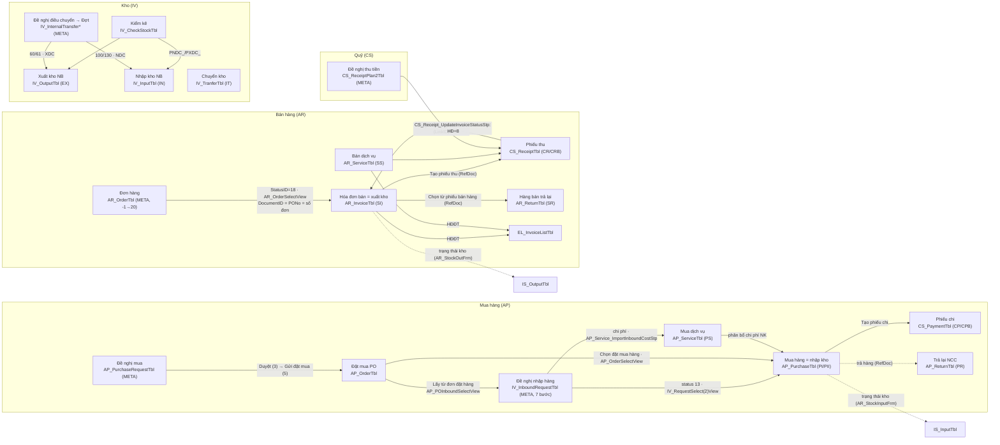
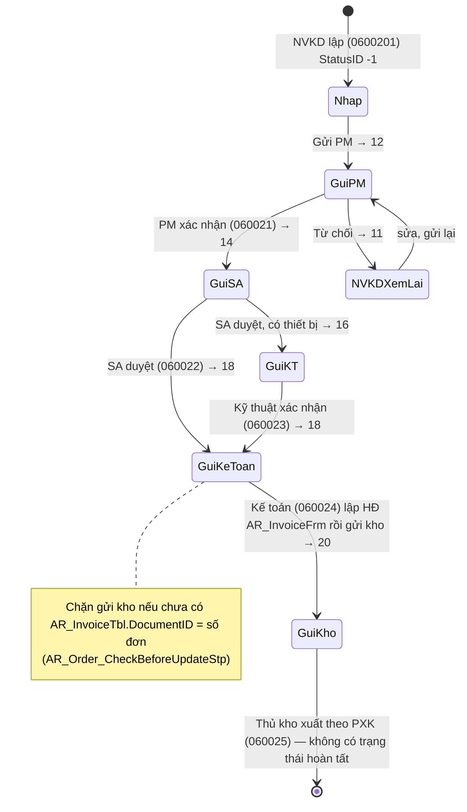
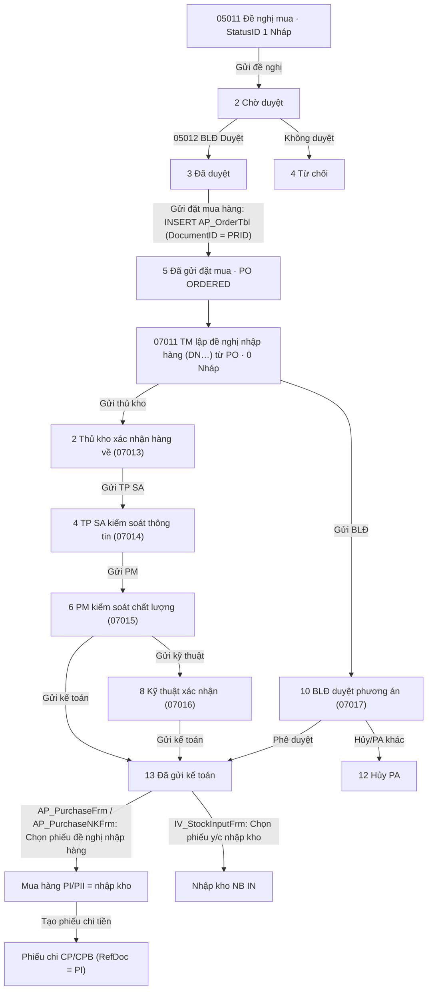

# 20 — Nghiệp vụ Mua hàng · Bán hàng & Công nợ · Kho · Quỹ · Tích hợp (ERP.NET)

Ngày khảo sát: 2026-11-11. Đọc trước: `00-nguon-du-lieu.md`. Tài liệu này chỉ mô tả **nghiệp vụ** của các form viết tay
và các quy trình cấu hình bằng metadata trong phạm vi AP/AR/IV/CS + hóa đơn điện tử, vận chuyển, đồng bộ thuế.
Engine (FormControler, LayoutX, Storer, GridX…) do tài liệu khác phân tích; ở đây chỉ nhắc đến ở mức cần để hiểu nghiệp vụ.

## 0. Quy ước, nguồn và mức tin cậy

**Dẫn nguồn**

| Tiền tố trong tài liệu | Thư mục thật |
|---|---|
| `ERP/…`, `ERP.eInvoice/…`, `ERP.ePOST/…`, `ERP.Taxsync/…`, `ERP.DMS/…`, `F4Bp…/…` | `D:\Data\Web-ERP\.legacy\decompiled\ERP.NET\` |
| `H:<dòng>` | lớp phụ trợ bị obfuscate `ERP.NET/F4BpNmydKqv0nTjyQU/lW25dKpyasKwWc3oY1.cs` (kiểm tra tồn, công nợ, hóa đơn, TK…) |
| `Tools/…` | `D:\Data\Web-ERP\.legacy\decompiled\Tools\` (engine) |
| `evidence-sql/dbo.X.sql` | `D:\Data\Medcom\TechnicalDocs\db-audit\evidence-sql\` (định nghĩa SP/view/trigger của DB MedData, 19/10/2026) |
| `wf/x.json` | `D:\Data\Medcom\TechnicalDocs\db-audit\workflow-config-20261019\` (menus, forms, form_config, option_buttons, grid_actions, form_actions, các bảng trạng thái) |
| `cfgB` | `D:\Data\Medcom\TechnicalDocs\help-site-review-20261022\before-config.json` (bản dump SY_FrmCfg đầy đủ hơn, 22/10/2026) |
| `P1023` | `D:\Data\Medcom\TechnicalDocs\inbound-workflow-reorder-20261023\` (patch luồng nhập hàng 23/10/2026) |
| `run/…` | `D:\Data\Medcom\TechnicalDocs\db-audit\run-20261019\` (columns, objects, row_counts) |

**Nhãn**: **[XM]** = đã đọc thấy trong mã/SQL/cấu hình; **[SĐ]** = suy đoán (từ tên, từ schema, từ logic gián tiếp).

**Lưu ý chung về dữ liệu đối chiếu**

- Medcom là khách hàng duy nhất có đủ metadata + SP để đối chiếu. Dữ liệu là dữ liệu thử, rất ít dòng
  (ví dụ `AR_InvoiceTbl` 38, `AR_OrderTbl` 155, `AP_PurchaseTbl` 14, `IV_InputTbl` 11, `IV_OutputTbl` 9,
  `CS_ReceiptTbl` 0, `AR_ReturnTbl` 0, `EL_InvoiceListTbl` 0 — `run/row_counts.json`).
- Có **ba thế hệ cấu hình** Medcom: snapshot `wf/` (19/10), `cfgB` (22/10) và patch `P1023`. Các quy trình mới (đề nghị
  mua, đề nghị nhập hàng) đã đổi giữa các mốc này → khi dựng web phải chốt mốc "hiện hành" (xem §9).
- Các form viết tay được dùng cho nhiều khách hàng (TinPhong, Thành Tâm, Việt Đức, FDN/HSING, Wabo, KEIKO…); biến thể
  nào thuộc khách nào phần lớn là **[SĐ]** theo tên lớp, vì thư mục khách hàng khác chỉ có binary, không có metadata.

---

## 1. Kiến trúc nghiệp vụ dùng chung (áp dụng cho mọi phân hệ)

### 1.1 Mở form, biến thể và layout

- Menu (`SY_Menu`) gọi `MainFrm.MenuClick(FormName, row)`: đặt SharePara `Para`, đặt `App.Cn.Filter` = cột Filter của
  menu, và đặt **`form.Name = FormName` hoặc `FormName + "_" + Para`** (`ERP/MainFrm.cs:1231-1310`). Layout (SY_FrmCfg),
  quyền, caption đều tra theo Name → mỗi Para là một "màn hình" riêng (ví dụ `CS_ReceiptFrm_Bank`, `AP_PurchaseFrm_IMPORT`,
  `AR_InvoiceFrm_EXPORT`) [XM].
- Thứ tự tìm form: danh sách cứng `MainFrm.GetFormAcc` (AP_*, AR_InvoiceFrm, AR_Invoice2017Frm, AR_ServiceFrm, AR_ReturnFrm,
  CS_*, IV_*, GJ_EntryFrm…) → reflection theo tên lớp (`Tools/Tools/App.cs:490`, `Tools/Tools/SysObject.cs`) → chỉ khi
  không có lớp mới sinh form động từ `SY_FrmLstTbl` (`App.cs` `GetFormFromSQL`). **Form viết tay luôn thắng khi trùng tên**:
  dòng `SY_FrmLstTbl` tên `AR_ServiceFrm`/`AR_ReturnFrm` của Medcom chỉ còn tác dụng caption, còn SY_FrmCfg vẫn được form
  viết tay đọc qua `LoadLayout(Name)` [XM].
- Các lớp "stub" `X2Frm/X3Frm/X4Frm/X5Frm`, `AR_Invoice2025Frm`, `AR_Invoice2026Frm`, `CS_ReceiptBankFrm`… chỉ kế thừa
  lớp gốc, không thêm mã; chúng tồn tại để có **tên khác → layout/quyền/caption khác** (ví dụ `ERP/IV_StockInput2Frm.cs`,
  `ERP/AR_Invoice2025Frm.cs` = `class AR_Invoice2025Frm : AR_InvoiceFrm`) [XM].
- Form viết tay vẫn cho layout ghi đè bảng: nếu `Lyt.TableMaster/TableDetail.isValid()` thì dùng bảng/cột/filter của
  metadata, ngược lại dùng mặc định cứng; thêm tối đa Detail05–07 và tab master 2/3 từ cấu hình
  (`ERP/AR_InvoiceFrm.cs:2223-2257, 2285-2336`) [XM].
- **UserBaseClass** (khóa `UCC` trong SY_FrmCfg) = plugin theo khách hàng, nạp bằng `Layout.LoadUserBaseClass()`
  (`Tools/Tools.Layout/LayoutX.cs:886, 3684`): `AR_OrderVietDucBaseClass`, `AR_OrderFDNBaseClass`,
  `AP_PurchaseLotWaboBaseClass`, `AP_OrderBaseClass`, `IV_StockOutputBaseClass`, `IV_CheckStockFDNBaseClass`,
  `CS_ReceiptFDNBaseClass`/`CS_PaymentFDNBaseClass` [XM].

### 1.2 Khung chứng từ chuẩn

| Thành phần | Mô tả | Nguồn |
|---|---|---|
| Master | Bảng `<X>Tbl`, khóa `DocumentID` (chuỗi), `DocumentDate`, `ObjectID`, `Memo`, `Notes`, `CurrencyID`/`RateExchange`, `BranchID`, `isLock`, `Status`, `LinkID`, `PONo`, `RefDoc`, `SearchField`, `BaseTotal`, `UserCreate/DateCreate/UserUpdate/DateUpdate` | `ERP/AR_InvoiceFrm.cs:2229` |
| Detail | `<X>DetailTbl`, khóa `UserAutoID` (GUID), nối `DocumentID`; có TK hạch toán theo dòng (`IncomeAccID`, `InvAccID`, `CostOfSaleAccID`, `ExpenseAccID`…) | `ERP/AR_InvoiceFrm.cs:2238` |
| DetailVAT | `AR_/AP_/CS_/IV_VATInvoiceTbl` — hóa đơn GTGT gắn chứng từ, nối bằng cột riêng (`InvoiceID`, `ReturnID`, `ServiceID`, `TrustInvoiceID`, `PurchaseID`, `ReceiptID`, `PaymentID`, `InOutID`) | `ERP/AR_InvoiceFrm.cs:2241` |
| Acc | View chỉ đọc `<X>Acc2View` (Nợ/Có/Số tiền), nạp lại sau lưu = tab "Định khoản" | `ERP/AR_InvoiceFrm.cs:2242-2244` |
| Log/Coupon | `<X>LogTbl`/`<X>StatusLogTbl` (lịch sử trạng thái, chỉ khi bảng tồn tại), `<X>CouponTbl` (phiếu mua hàng/giảm giá, chỉ khi `SystemPara.isDiscountVoucher`) | `ERP/IV_StockOutputFrm.cs:1204-1216` |

**Quy tắc chung khi lưu/sửa/xóa** (lặp lại ở gần như mọi form chứng từ) [XM, ví dụ `ERP/AR_InvoiceFrm.cs:2273-2279, 2520-2528`]:

1. **Khóa sổ**: chặn lưu nếu `SY_CheckDateOfPeriodOpeningFnc(DocumentDate)` trả `isClosed=1`. Hàm coi là khóa nếu kỳ đó
   hoặc **bất kỳ kỳ sau** có `IsLock`, hoặc kỳ đó có `IsLockData`, hoặc kỳ chưa tồn tại (`evidence-sql/dbo.SY_CheckDateOfPeriodOpeningFnc.sql`).
2. **Chủ phiếu**: người không phải Admin chỉ sửa/xóa phiếu có `UserCreate = mình`; danh sách chỉ hiện phiếu của mình trừ Admin/Manager.
3. **`isLock = 1`** cấm sửa/xóa (Medcom tự khóa hóa đơn khi `StatusID>0` trong `AR_Invoice_UpdateOnOpenCloseStp`).
4. **Chi nhánh**: `BranchID` mặc định theo chi nhánh đăng nhập và khóa không cho đổi.
5. **Số chứng từ**: `Functions.GetDocPreFix(DocType, tiềnTốMặcĐịnh)` đọc `SY_DocSetup.PreFix` (tự INSERT nếu thiếu; khi đăng
   nhập ADMIN còn UPDATE TableName/FormID — tác dụng phụ, `Tools/Tools.Utils/Functions.cs:8188`); layout `DocumentPrefix`
   thắng nếu có. Ba kiểu đánh số (`Tools/Tools.Data/DefaultValueSQL.cs:14`): `DocumentID` (đếm theo tháng của ngày CT),
   `CF_Table` (toàn cục theo tiền tố), `AutoNumber` (max+1). Trùng số → `SetToolTipDataCheck` chặn cứng "Số chứng từ này đã tồn tại".
6. **Tổng tiền tính ở client** trước khi lưu: `BaseTotal = Σ TotalAmount`, `AmountTotal`, `VATAmountTotal`, `SearchField`
   (nối ItemID;ItemName;Lot ≤ 500 ký tự), `InvoiceNo` = nối số HĐ ở tab hóa đơn (`ERP/AR_InvoiceFrm.cs:2879-2900`).
   Medcom còn tính lại phía server (`AR_InvoiceAfterUpdateStp`, `AR_Invoice_UpdateOnOpenCloseStp`).
7. **Hook cấu hình** (không phải quy ước tên): SY_FrmCfg khai SQL chạy ở các thời điểm `Do_ExecSQLCheckBeforeSave/AddNew/Edit/Delete`,
   `AfterSaveData`, `OnFormLoad/Closed`… (khóa `EBS/ESS/ESL/ESC/EBE/EBD` theo cfgB). Tham số kiểu `{0}`=khóa gốc,
   `{XML}/{JSON}`=toàn bộ dữ liệu form, `{User}`, `{isManager}`… (`Tools/Tools.Layout/ExecSQLCommand.cs:290-307`) [XM].
   SP trả rowset có `Title`, `MsgType` (0 cảnh báo, 1 chặn). Tên `*_BeforeSaveStp/_AfterSaveStp/_CheckSaveStp` chỉ là thói quen
   đặt tên; Medcom có `AR_Order_*Stp`, `CS_ReceiptPlan2_*Stp` nhưng **không có** hook tên chuẩn cho IV_Input/Output/Tranfer [XM].
   Theo `10-engine-form-dong.md`: EBS chạy **trước** transaction lưu, ESS/ESS2 chạy **sau commit** và lỗi của chúng không rollback →
   các SP "sau lưu" của Medcom (tính tổng, đồng bộ trạng thái, hạn nợ) hiện **không nguyên tử** với chứng từ.
8. **"Lấy dữ liệu từ…"**: phần lớn KHÔNG nằm trong mã C# mà là `option_buttons.json` (nút "Chọn …" mở form chọn từ một view,
   map cột nguồn→đích, `BeforeAction=Save/SaveSkipErr`), `grid_actions.json` (đổi cột → chạy SP điền giá/lô/tồn),
   `form_actions.json` (đổi trường master → chạy SP) [XM].

**Trường `Status` (0/1/2/3) khác `StatusID` (quy trình)**: combo Status = 1 Hoàn tất, 0 Treo, 2 Không HĐơn, 3 Chưa hạch toán,
mặc định đọc `STATUS=n` từ filter menu (`H:731-781`). **Status không loại chứng từ khỏi sổ**: điều kiện `Status <> 3` trong
`vGeneralAcc`, `vItemInput`, `vItemOutput` đã bị comment → phiếu "Treo/Chưa hạch toán" vẫn lên sổ và vẫn tính tồn [XM].
`StatusID` là trạng thái quy trình riêng từng loại chứng từ (bảng `*StatusTbl`, xem §3.10, §4, §5).

### 1.3 Hạch toán, tồn kho, công nợ đều là "view động"

- **Sổ cái**: mỗi loại chứng từ có `<X>AccView` (bút toán chi tiết) → `<X>Acc2View` (gom Nợ/Có) → `vGeneralAcc` (UNION toàn
  bộ). Không có bảng bút toán vật lý; báo cáo tài chính/công nợ đọc thẳng view [XM].
- **Tồn kho**: `SY_GetBalanceItemLotFnc` = số dư đầu kỳ `SY_BalanceItemTbl` + `vItemInput` − `vItemOutput`.
  `vItemInput` gom PI (AP_Purchase), IO, SR (AR_Return), IN (IV_Input), IT (kho đích), IA, CP; `vItemOutput` gom SI (AR_Invoice),
  ST, SH (AR_BanHo), PR (AP_Return), IO, EX (IV_Output), IT (kho nguồn), IA `Type='X'` [XM, `evidence-sql/dbo.vItemInput.sql`,
  `dbo.vItemOutput.sql`]. Hệ quả: **hóa đơn bán (SI) chính là phiếu xuất kho**, **phiếu mua hàng (PI) chính là phiếu nhập kho**,
  hàng bán trả lại (SR) là phiếu nhập; không có phiếu kho riêng cho mua/bán.
- **Công nợ theo chứng từ**: `SY_GetDebitDocFnc` / `SY_GetCreditDocFnc` đọc `SY_BalanceObjectTbl` + `vGeneralAcc`, dòng thanh
  toán có `RefDoc` được gán về chứng từ gốc, cộng các cặp đối trừ thủ công `GJ_RefDocSetupTbl` [XM].

### 1.4 Bộ kiểm tra dùng chung (lớp phụ trợ H)

| Hàm (H:dòng) | Nghiệp vụ | Tham số hệ thống | Mức xử lý |
|---|---|---|---|
| `Gh0CmaW1IT4(SourceID,…)` (H:1016) | **Kiểm tra tồn khi xuất**: gom SL trên lưới theo kho+TK+lô+mã+thuộc tính, gọi `SY_GetItemBalanceByDocStp` (cộng lại SL của chính phiếu đang sửa theo SourceID: EX, SI, SH, PR) | `CheckStockOut` = NoCheck/Warning/Cancel; `CheckStockDate` 1 ngày CT / 2 cuối tháng / 3 ngày server / 4 cuối năm; `isLotDate` (so theo lô hay gộp) | Bỏ qua dịch vụ, dòng không có InvAccID; **> 500 dòng mà không ở Cancel thì bỏ qua toàn bộ** |
| `oCtCmYHwNif` (H:783) | **Hạn mức công nợ & nợ quá hạn**: lấy `CF_ObjectTbl.CreditMax2` (rỗng thì `CreditMax`), chạy `AR_DebtAgingReceivableReportStp`, cảnh báo "Quá định mức nợ" (tổng nợ + phiếu này > hạn mức) hoặc "Công nợ quá hạn" (nợ có số ngày ≥ `OverDeptDay`) | `OverDeptDay` (rỗng = tắt); chỉ khi TK phải thu có `isObject=1` | MsgType=1 chặn, ngược lại "Ngừng/Tiếp tục" |
| `JkLCm3LVxSa` (H:902) | **Lô date xa hơn lô tồn sớm nhất** (ép FEFO): so ExpireDate dòng với lô hết hạn sớm nhất `SY_GetItemLotBalanceByDocStp`, quá `OverLotDay` ngày thì cảnh báo | `OverLotDay` | Non-Admin chặn, Admin được tiếp |
| `kfiCmIEAVNr` (H:389) | **Khớp tab hóa đơn GTGT với chi tiết** (VAT, tiền hàng sau CK + thuế NK + phí khác) rồi kiểm tra **trùng hóa đơn** `TaxCode+InvoiceDate+InvoiceNo` trên 5 bảng VAT (`YrZCmmpVXXj`, H:577) | `SkipNoInvoice=1` bỏ qua | "Nhập hóa đơn / Lưu tiếp / Ngừng"; trùng chỉ hỏi |
| `I53CmPOOf5I` (H:1429) | Bắt buộc `CostCenterID`/`CostID` theo cờ `IsCostCenter/IsCost` của TK | `CheckCostCenter`/`CheckCost` | NoCheck/Warning/Cancel |
| `Ka5Cm6xZWc2` (H:1203) | TK có `isObject=1` (TK công nợ) bắt buộc có ObjectID | — | chặn |
| `QwrCmB13yEI` (H:1287) | Sau lưu: dòng TK 211/212/213 gợi ý tạo TSCĐ; 142/242… gợi ý tạo phân bổ chi phí trả trước (`GJ_ThietLapPhanBoChiPhi_211_242Frm`) | — | tùy chọn |
| `u8JCm1oepHY` (H:1589) | Nút "Cập nhật hóa đơn": gom chi tiết theo VATID/% thành dòng hóa đơn GTGT | — | — |

### 1.5 Bảng loại chứng từ (SY_DocSetup của Medcom, `wf/document_types.json`)

| DocType | Tên | Tiền tố | Bảng master | Form | Hạch toán |
|---|---|---|---|---|---|
| SO | Đơn đặt hàng | DH (Medcom dùng `DMB…` qua layout) | AR_OrderTbl | AR_OrderVietDucFrm (META) | 0 |
| SB | Đơn đặt hàng (Tỉnh) | BC | AR_Order2Tbl | AR_OrderThanhTam2Frm | 0 |
| S1 / S2 | Bảng giá bán / theo khách hàng–khu vực | GB / BG | AR_PriceTbl | AR_StandardPriceFrm / AR_CustomerPriceFrm | 0 |
| S3 | Phiếu đề nghị xuất hàng | YXH | AR_InvoiceOrderTbl | AR_InvoiceOrderFrm | 0 |
| S4 | Hủy đơn đặt hàng | HDH | AR_OrderCancelTbl | AR_OrderCancelFrm | 0 |
| S5 | Bảng điểm tích lũy | BD | AR_DiemTbl | AR_BangDiemTichLuyFrm | 0 |
| **SI** (SII khi xuất khẩu) | Bán hàng | BH | AR_InvoiceTbl | AR_InvoiceFrm | 1 |
| SS | Bán dịch vụ | BD | AR_ServiceTbl | AR_ServiceFrm | 1 |
| SR | Hàng bán trả lại | BT | AR_ReturnTbl | AR_ReturnFrm | 1 |
| SH | Bán hộ – Xuất hộ | XBH | AR_BanHoTbl | AR_BanHoFrm | 0 |
| ST | Xuất ủy thác (mã chỉ có trong code) | XU | AR_TrustInvoiceTbl | AR_TrustInvoiceFrm | — |
| KM | Phiếu MH/giảm giá/KM | KM | AR_PhieuGiamGiaTbl | AR_PhieuGiamGiaFrm | 0 |
| PO | Đơn đặt hàng NCC | PO | AP_OrderTbl | (META AP_OrderFrm) | 0 |
| P2 | Phiếu đề nghị nhập hàng (cũ) | YNH | AP_InputRequestTbl | AP_InputRequestFrm | 0 |
| **PI** / PII | Mua hàng nội địa / nhập khẩu | MH / MNK | AP_PurchaseTbl | AP_PurchaseFrm(_IMPORT) | 1 |
| PS | Mua dịch vụ | MD | AP_ServiceTbl | AP_ServiceFrm | 1 |
| PR | Hàng trả lại NCC | MT | AP_ReturnTbl | AP_ReturnFrm | 1 |
| IN / EX | Nhập / Xuất kho nội bộ | PN / PX | IV_InputTbl / IV_OutputTbl | IV_StockInputFrm / IV_StockOutputFrm | 1 |
| IT | Chuyển kho | CK | IV_TranferTbl | IV_StockTranferFrm | 1 |
| IA | Phân rã – lắp ghép | PL | IV_AdjustTbl | IV_StockAdjustFrm | 0 |
| IO | Nhập xuất thẳng | NXT | IV_InOutTbl | IV_InOutFrm | 1 |
| CI | Kiểm kê kho | KK | IV_CheckStockTbl | IV_CheckStockFrm | 0 |
| CR / CRB | Phiếu thu / thu ngân hàng | PT / BC | CS_ReceiptTbl | CS_ReceiptFrm(_Bank) | 1 |
| CP / CPB | Phiếu chi / chi ngân hàng | PC / BN | CS_PaymentTbl | CS_PaymentFrm(_Bank) | 1 |
| TC | Tham chiếu/đối trừ chứng từ công nợ | TC | GJ_RefDocSetupTbl | GJ_RefDocumentSetupfrm | 0 |

Các bảng quy trình mới của Medcom (IV_InboundRequest, IV_InternalTransfer*, IV_ReturnRequest, AP_PurchaseRequest,
CS_ReceiptPlan2) **không có dòng DocSetup**; tiền tố nằm trong layout (`DPR`): `DN`, `DCNB`, `DCT`, `NTL`, `PO`, `WT`, `DMB` [XM].

---

## 2. Sơ đồ luồng chứng từ tổng thể

### 2.1 Bức tranh chung (form viết tay + cầu nối)

### 2.2 Quy trình đơn hàng bán Medcom (metadata) → hóa đơn → kho → tiền

Sau khi có hóa đơn: trạng thái hóa đơn `AR_InvoiceStatusTbl` (0 Lập HĐ → 1/2 chuyển kho → 3 đã xuất → 6 đã gửi → 7 KH nhận →
8 đã thu tiền → 9/10 trả lại → 11 KH từ chối) được đẩy bởi AR_StockOutFrm (kho thực tế), CS_Receipt, GJ_Entry, AR_Return
(§3.10). Lưu ý: các SP này chỉ nâng trạng thái đơn khi `AR_OrderTbl.StatusID < OrderStatusID (1..5)` nên **đơn theo luồng mới
(11–20) không bao giờ được nâng tiếp** [XM theo logic SQL].

### 2.3 Mua hàng – nhập hàng Medcom

Patch `P1023` đổi thứ tự: TP SA → **Kỹ thuật (8, chỉ khi có hàng CategoryID='TB')** → PM (6) → Kế toán (13) [XM, `P1023/change-workflow.sql:20-41`].

### 2.4 Điều chuyển nội bộ Medcom

```mermaid
flowchart LR
  R0["Đề nghị ĐC (NVKD) 0"] -->|"Gửi PM"| R10["10"] -->|"PM đồng ý"| R20["20"] -->|"Đồng bộ vào đợt"| R40["40 Đã vào đợt"]
  R40 --> B0["Đợt DCT 0 Đang lập"] -->|"Gửi kỹ thuật"| B20["20 Chờ KT (nếu có thiết bị)"] -->|"KT xác nhận"| B40["40 Chờ TP SA"]
  B0 -->|"không có thiết bị"| B40
  B40 -->|"SA duyệt"| B60["60 Chờ KT ra PXK"]
  B60 -->|"IV_StockOutputFrm XDC + kế toán xác nhận"| B70["70 Đã liên kết PXK"]
  B70 -->|"Kho nguồn xuất"| B100["100 Đang điều chuyển"]
  B100 -->|"IV_StockInputFrm NDC + kho đích nhận"| B120["120 Hoàn tất / 130 Nhận thiếu"]
```

---

## 3. Phân hệ Bán hàng & Công nợ phải thu (AR)

### 3.1 Danh sách màn hình (menu Medcom ↔ form ↔ bảng)

| Menu Medcom | Form | Loại | Bảng chính | Ghi chú |
|---|---|---|---|---|
| 060001 / 060002 Bảng giá chung / theo khách | AR_StandardPriceZoneFrm / AR_StandardPrice2017Frm | META | AR_PriceTbl (+AR_PriceObjectTbl) / AR_PriceDetailTbl | thay cho AR_StandardPriceFrm/AR_CustomerPriceFrm viết tay |
| 060003 % chiết khấu đại lý | AR_PhanTramChietKhauFrm | META | AR_PhanTramChietKhauTbl | chỉ dùng cho báo cáo chiết khấu |
| 060060 / 060064 Trạng thái đơn / hóa đơn | AR_OrderStatusListFrm / AR_InvoiceStatusListFrm | META | AR_OrderStatusTbl / AR_InvoiceStatusTbl | |
| 060012 / 060013 Hợp đồng / nghiệm thu | ContractListFrm / CF_ContractBBNTFrm | META | CF_ContractTbl | |
| 0600201 → 060025 Quản lý / xác nhận / duyệt / tình trạng hàng / duyệt PXK-HĐ / xuất hàng | AR_OrderByContractFrm, AR_OrderComfirmFrm, AR_OrderAproveFrm, AR_OrderConfirmConditionFrm, AR_OrderApproveShipBillFrm, AR_OrderShipFrm | META | AR_OrderTbl / AR_OrderDetailTbl / AR_OrderLogTbl | quy trình đơn hàng mới (§3.7.1) |
| 06022 Quản lý đơn đặt hàng | AR_OrderVietDucFrm | META | AR_OrderTbl (+AR_OrderStockTbl) | SRC=SO |
| **06035 Hóa đơn bán hàng (xuất bán)** | **AR_InvoiceFrm** | Viết tay | AR_InvoiceTbl / AR_InvoiceDetailTbl / AR_VATInvoiceTbl / AR_InvoiceAcc2View | §3.2 |
| 06037 Hóa đơn nội bộ (tắt) | AR_InvoiceLocalFrm | Viết tay | AR_InvoiceTbl `isLocal=1` | §3.3 |
| 0604 Hóa đơn dịch vụ | AR_ServiceFrm | Viết tay (+META trùng tên) | AR_ServiceTbl | §3.5 |
| 0605 Hàng bán trả lại | AR_ReturnFrm | Viết tay (+META trùng tên) | AR_ReturnTbl | §3.4 |
| 0702010 Quét QR xuất bán | AR_Invoice_QRCodeFrm | META | AR_InvoiceTbl / AR_InvoiceQRCodeTbl | `CF_QRcodeStp … 'AR_INVOICE'` |
| 0814 / 0816 Theo dõi phiếu nhập / xuất kho | AR_StockInputFrm / AR_StockOutFrm | Viết tay | vIS_Input* / vIS_Output* + IS_InputTbl / IS_OutputTbl | "Kho thực tế" (§5.9) |
| 4003 Chương trình KM (hóa đơn) | AR_ChieuKhauHopDongFrm | META | AR_ChietKhauHopDongTbl | chỉ dùng trong view báo cáo |
| 4007xx Chỉ tiêu KD | AR_ChiTieu*2022Frm (META); bản cũ AR_ChiTieuQuanLyFrm/NhanVienFrm (tắt) | META/Viết tay | AR_SalesTargetTbl | |
| 4076 Yêu cầu thêm KH mới | AR_ObjectNewRequireFrm | META | — | thay AR_ObjectTempFrm |
| 0607…06608, 0680xx | Báo cáo bán hàng / công nợ phải thu / doanh thu | Report | SP `<Report>Stp` | ngoài phạm vi chi tiết |

Form viết tay không có trên menu Medcom (dùng cho khách khác): AR_OrderFrm, AR_OrderThanhTamFrm, AR_OrderThanhTam2Frm (4038, tắt),
AR_OrderCancelFrm, AR_InvoiceOrderFrm, AR_InvoiceRequestInfoFrm, AR_BanHoFrm, AR_TrustInvoiceFrm, AR_PhieuGiamGiaFrm,
AR_BangDiemTichLuyFrm, AR_ChonTuThuNganFrm, AR_ComaySettingFrm, AR_StandardPriceFrm, AR_CustomerPriceFrm, AR_ItemGroupFrm,
AR_ObjectGroupFrm, AR_ObjectTempFrm, AR_HoSoKhachHangFrm, AR_HoSoNhanVienFrm, AR_Invoice2017Frm, AR_Invoice2OldFrm,
AR_InvoiceTinPhongMNFrm.

### 3.2 AR_InvoiceFrm — Hóa đơn bán hàng (phiếu bán kiêm xuất kho)

**Mục đích**: ghi nhận bán hàng hóa: doanh thu, thuế GTGT đầu ra, công nợ phải thu, **xuất kho và giá vốn** (SI là nguồn xuất
trong `vItemOutput`); kèm thông tin hóa đơn GTGT và phát hành HĐĐT. Chế độ **xuất khẩu** khi Para khác rỗng hoặc bản ghi có
`isExport=1`: tiêu đề "Hóa đơn bán hàng xuất khẩu", Name `AR_InvoiceFrm_EXPORT`, mã CT `SII`, hiện TK thuế xuất khẩu
`VATAccExID` (mặc định 3333) và cột `ExportPercent/ExportAmount` (`ERP/AR_InvoiceFrm.cs:2188-2204, 2396-2400, 2437`) [XM].

**Bảng** (`ERP/AR_InvoiceFrm.cs:2223-2257`) [XM]:

| Tập dữ liệu | Bảng | Khóa/nối | Vai trò |
|---|---|---|---|
| Master | AR_InvoiceTbl (join CF_ObjectTbl lấy ObjectName, Address) | DocumentID | phiếu bán |
| Detail | AR_InvoiceDetailTbl (join CF_ItemTbl) | UserAutoID / DocumentID | dòng hàng |
| DetailVAT | AR_VATInvoiceTbl | `InvoiceID` = DocumentID | tab "3. Thông tin hóa đơn" (số/ký hiệu/ngày HĐ, tên–địa chỉ–MST người mua, tiền theo thuế suất, `IsOff`) |
| Acc | AR_InvoiceAcc2View | DocumentID | tab "4. Định khoản" (chỉ đọc; ẩn khi `Permiss.HideAmount`) |
| Detail5–7 | theo layout | | mở rộng tùy khách hàng |

**Trường quan trọng** (form + schema Medcom 71 cột, `run/columns.json`):
- Master: `ObjectID` (khách), `ObjectNameHD/AddressHD/TaxCodeHD/NguoiMuaHangHD` (thông tin in trên hóa đơn, có thể khác danh mục),
  `TenKhachLe/MSTKhachLe`, `Receiver`, `EmployeeID/ManagerID/CeoID`, `CurrencyID/RateExchange`, `PaymentTypeID`, `PaymentTermID`,
  `DueDate` ("Ngày tính nợ"), `DebtDueDate` (hạn nợ, Medcom tính bằng trigger), `PONo` (số đặt hàng), `ContractID`,
  `RefDoc` ("Chứng từ ứng tiền"), `CostCenterID/CostID`, `RevAccID` (131x), `VATAccID` (33311), `VATAccID2` (TK đối ứng thuế),
  `NoiDungHoaDon`, `isExport`, `isLocal`, `Status`, **`StatusID`** (quy trình, §3.10), `isLock`, `InvoiceNo`, `InvoiceKey`,
  `RefInvoiceKey` (HĐĐT; `"Huy"` = đã hủy), `AgencyID` (đại lý — nếu có thì công nợ ghi cho đại lý), `CTKM/SoTienKM`,
  `MaVanDon/PhiVanChuyen`, `PhiKhacTotal`, `DiscountTotal`, `ThuHo`, `isScanQRCode`, `LinkID`.
- Detail: `ItemID`, `StoreHouseID`, `Lot`, `ExpireDate`, `Quantity` (+`Quantity2`, `UnitFactor`, `QuyCach/SLTheoQuyCach`), `UnitPrice`,
  `SourceAmount/Amount`, `DiscountPercent/DiscountAmount`, `DiscountPercentTT/DiscountAmountTT` (CK thanh toán), `DiscountAmount2`
  (KM tiền), `VATID/VATPercent/VATAmount`, `TotalAmount`, `PhiKhac`, `ExportPercent/ExportAmount`, `IncomeAccID` (511x),
  `InvAccID` (156x), `CostOfSaleAccID` (632x), `DiscountAcctID` (521x/5321), `UnitCost/AmountCost` (giá vốn do SP tính giá ghi đè),
  `isKM` (dòng hàng tặng), `CostID` (Medcom: 'XB' bán / 'KM' khuyến mãi), `DienGiai`, `Property/Property2`.
- Mặc định TK lấy TK chi tiết đầu tiên theo tiền tố (`H.wbRCmLlhYnc`) hoặc mã setup `THUERA`, `CHIEUKHAU`, `THUEXNK`
  (`ERP/AR_InvoiceFrm.cs:2399-2406`). Giữ giá trị `StoreHouseID/CostCenterID/CostID` khi thêm dòng (`:2446`).

**Kiểm tra trước khi lưu** (`ERP/AR_InvoiceFrm.cs:2838-2913`) [XM], theo thứ tự:
1. Ngày hóa đơn ở tab 3 khác ngày chứng từ → hỏi "Lưu tiếp/Ngừng".
2. **Tồn kho** `Gh0CmaW1IT4("SI", số gốc, ngày, lưới)`; nếu master có cột `isKiemXuatKho` thì chỉ kiểm khi cờ bật (cho phép hóa đơn
   không xuất kho).
3. Khoản mục/hạng mục theo `IncomeAccID` (`I53CmPOOf5I`).
4. Tính `BaseTotal/AmountTotal/VATAmountTotal/PhiKhacTotal/DiscountTotal`, `InvoiceNo` = nối số HĐ tab 3.
5. **Hạn mức công nợ / nợ quá hạn** `oCtCmYHwNif("SI", …, RevAccID, ngày, BaseTotal)` (§1.4).
6. Hook layout `CheckBeforeSave` → Medcom `EBS = AR_InvoiceCheckStockBalanceStp`: **bắt buộc chọn Lô** với mặt hàng `CF_ItemTbl.isLot=1`
   (MsgType 1) (`evidence-sql/dbo.AR_InvoiceCheckStockBalanceStp.sql`).
7. Hóa đơn đã phát hành HĐĐT (`InvoiceKey` khác rỗng): chỉ Manager/Admin được sửa/xóa; nếu đã có trong `EL_InvoiceListTbl` thì xóa bị
   chặn khi còn chi tiết, sửa phải xác nhận (`:2799-2829`).
Lưu ý: bản AR_InvoiceFrm hiện tại **không gọi** kiểm tra lô-date FEFO (`JkLCm3LVxSa`), các bản 2017/2Old/Local/TinPhong thì có [XM].

**Sau khi lưu**: cập nhật `EL_InvoiceListTbl.RefDoc` khi đổi số; hook `ESS = AR_InvoiceAfterUpdateStp` (Medcom) [XM SQL]:
mặc định `CostID` = 'KM' nếu `isKM=1` ngược lại 'XB'; `LinkID = PONo`; `TotalAmount = Amount − (DiscountAmount + DiscountAmountTT +
DiscountAmount2) + VATAmount`; `BaseTotal = Σ TotalAmount`; ghi log trạng thái lần đầu (`AR_InvoiceLog_Stp`); tính `DueDate/DebtDueDate`
theo `CF_PaymentTermTbl.BalanceDueDays`; `sp_refreshview` các view sổ. `ESL/ESC = AR_Invoice_UpdateOnOpenCloseStp` chạy khi mở/đóng form:
**khóa mọi hóa đơn có StatusID>0**, tính lại tổng 30 ngày gần nhất, trước 9h sáng gán `CostCenterID` = phân loại nhóm khách, xóa log > 90 ngày.

**Trigger Medcom trên AR_Invoice*** [XM]: `AR_InvoiceDetail_CheckDelete` (cấm xóa dòng của hóa đơn `isLock=1`),
`AR_InvoiceDetail_AmountCostGuard` (tự sửa `AmountCost = round(Quantity×UnitCost)` nếu lệch > 100), `AR_Invoice_DebtDueDateGuard`
(luôn tính lại hạn nợ), `AR_InvoiceTbl_UpdateRefDoc` (đổi số → `SY_UpdateSystemRefDocStp` cập nhật RefDoc ở AP/AR/CS/GJ);
`AR_Invoice_CheckUpdate` và `AR_InvoiceDetail_CheckUpdate` đã bị vô hiệu bằng `RETURN` ("chạy rất chậm khi tính giá vốn").

**Bút toán** `AR_InvoiceAccView` (Medcom) [XM]: Nợ `RevAccID` / Có `IncomeAccID` = Σ`Amount`; Nợ `VATAccID2` hoặc `RevAccID` / Có `VATAccID`
= Σ`VATAmount`; Nợ `CostOfSaleAccID` (dòng KM → **64210**) / Có `InvAccID` = Σ`AmountCost` (bỏ mặt hàng dịch vụ); Nợ `IncomeAccID` /
Có `VATAccExID` = Σ`ExportAmount`. Đối tượng công nợ = `AgencyID` nếu có, ngược lại `ObjectID`.
⚠ View **không có vế chiết khấu** dù `TotalAmount/BaseTotal` đã trừ chiết khấu → nếu hóa đơn có DiscountAmount, sổ 131 sẽ lệch
BaseTotal (ngược với `AR_ReturnAccView` có trừ chiết khấu) [XM view; hệ quả SĐ — cần hỏi Medcom có dùng chiết khấu trên hóa đơn không].

**Nút/hành động** [XM]:

| Nút | Handler | Nghiệp vụ |
|---|---|---|
| Tạo phiếu thu tiền | `lsdOorNNpQ` (`:3077`) → `ToolBarEx.Convert_MakeReceiptDocument` (`Tools/Tools/ToolBarEx.cs:6124-6290`) | Lưu rồi mở hộp nhập (loại phiếu thu PT/BC theo `SY_DocSetup`/`SY_DocumentCashTbl`, ngày, đối tượng, TK tiền 111x/112x, TK đối ứng = `RevAccID`, số tiền = BaseTotal); INSERT `CS_ReceiptTbl` (LinkID = số hóa đơn) + `CS_ReceiptDetailTbl` (**RefDoc = số hóa đơn**). Cảnh báo nếu đã có phiếu thu cùng LinkID/RefDoc |
| Cập nhật / Xóa thông tin hóa đơn | `ANqA8sA1vn`, `oLMOFjigQJ` | Sinh/xóa dòng AR_VATInvoiceTbl từ chi tiết (gom theo thuế suất) |
| Hóa đơn điện tử | `JhmOJfNMxO` (`:3085`) | Phát hành/điều chỉnh/thay thế/hủy (§7.1). Chỉ hiện khi `EI_SettingTbl.SuplierType ≠ 0` |
| Phát hành hàng loạt / Tải PDF / In hóa đơn | `LZhOfQ27H8`, `MB9OAy3far`, `qmqOXe0SsQ` | In dùng report `AR_InvoiceReport` + SP `AR_InvoiceReportStp`, mẫu in lưu ở `SY_ReportParaDetail` |
| "Chọn khác" (menu) | `kH6OOHPTRJ` (`:4013`) | `SYN` đồng bộ với web NCC (`eInvoiceSynFrm`); `PRN/PDF/VIEW/HTML` in/tải hàng loạt; `GETINFO` lấy lại số + MCCQT; `UPDATE` tạo lại tab 3 hàng loạt (Amount − CK + PhiKhac theo thuế suất, `:4113-4204`); `RST` reset về chưa phát hành (xóa InvoiceKey) |
| Tìm/cập nhật khách theo MST | `TimKhachHangMSTCtl1` | §7.3 |

**Hủy / thay thế HĐĐT tác động ngược vào chứng từ** [XM]: hủy → `AR_InvoiceTbl` tổng = 0, Notes "Hủy hóa đơn", **mọi dòng chi tiết
SL/giá/tiền/giá vốn = 0**, `AR_VATInvoiceTbl.isOff=1` (`:3376-3382`); bỏ hủy chỉ bật lại `isOff=0` (không khôi phục số liệu, `:3413`).
Thay thế → hỏi "xóa hóa đơn gốc về 0": `BaseTotal=0`, **xóa chi tiết và tab VAT của hóa đơn gốc**, chuyển `CS_ReceiptDetailTbl.RefDoc`
và `GJ_EntryDetailTbl.RefDoc/RefDoc2` từ hóa đơn gốc sang hóa đơn mới (`:3502-3517`). Tùy chọn `isUpdateDocumentID` đổi số phiếu thành
`ký hiệu + số HĐ` (`:3477-3480`).

**Liên kết chứng từ (Medcom)** [XM]: option 005 "Chọn đề nghị bán hàng" → `AR_OrderSelectView` (đơn `StatusID=18`, ≤ 90 ngày, chưa nằm
trong `AR_InvoiceRequestTbl.SoDonHang`, trả `DocumentID` và `PONo` = số đơn, `DebtDueDate` theo hợp đồng —
`evidence-sql/dbo.AR_OrderSelectView.sql`) → **số hóa đơn = số đơn hàng**. Option 004 "Chọn đơn đặt hàng" trỏ `AP_OrderSelectView`
(view **đơn mua NCC**) — nghi cấu hình sai. grid_action Lot/ItemID: `WA_OrderByContract_GetStockByItemStp`, `SY_GetBalanceItemLotInvoiceStp`
(gợi ý lô/tồn); form_actions: `AR_InvoiceDebtDate_*Stp`, `AR_InvoiceGetObjectManagerAndEmployeeStp`; nút "Xem thông tin hợp đồng"
`AR_Invoice_XemHopDongStp` (`wf/option_buttons.json`, cfgB).

### 3.3 Biến thể hóa đơn bán

| Form | Quan hệ | Khác biệt nghiệp vụ | Khách hàng |
|---|---|---|---|
| AR_Invoice2/3/4/5Frm, **AR_Invoice2025Frm, AR_Invoice2026Frm** | stub kế thừa AR_InvoiceFrm | chỉ khác Name → layout riêng (ví dụ mẫu theo năm, theo chi nhánh) | chung [XM] |
| AR_InvoiceFrm_EXPORT | cùng lớp, Para | xuất khẩu: SII, VATAccExID, cột thuế XK, trường vận tải (ConsigneeID, PortOfLoading, BLNumber…) | chung |
| **AR_Invoice2017Frm** (`ERP/AR_Invoice2017Frm.cs`) | bản sao cũ | tách 2 lưới: hàng bán (`isKM=0`) và **hàng tặng** (`isKM=1`) (`:2023, 2031`); tab trạng thái `AR_InvoiceLogTbl`; tab **"dữ liệu đã xóa"** `AR_InvoiceDetailDelete` + nút "Lấy lại dữ liệu xóa" → `AR_InvoiceDetail_GetDeleteData_Stp` (`:2036, 2562`); nút "Cập nhật lại CTKM, tặng…" → `AR_Invoice_TinhKhuyenMai_Stp` (AR_GiftsTbl: theo khách, theo ngày, theo SL tối thiểu → xóa và chèn lại dòng tặng, cập nhật % CK thanh toán) (`:2505`); kiểm tra lô-date + công nợ; không có HĐĐT | có trong GetFormAcc; Medcom có SP nhưng menu 400210 tắt [XM] |
| **AR_Invoice2OldFrm** (tên cũ "AR_Invoice2Frm") | bản sao lớn | thêm **coupon** `AR_InvoiceCouponTbl` + `AR_KiemTra_CouponSeri_Stp` (kiểm tra seri phiếu giảm giá); "Tính điểm" (AR_Invoice2TinhDiemFrm), "Tính K.Mại" (AR_Invoice2TinhKhuyenMaiFrm → `SY_GetItemPromotionStp`); "Chuyển trạng thái sang DMS" (`DMSService.Push_Invoice/Push_InvoiceReject`); HĐĐT đầy đủ; tự ALTER thêm cột CK | nhóm bán lẻ/DMS [SĐ] |
| **AR_InvoiceTinPhongMNFrm** "Hóa đơn bán hàng (TP Miền Nam)" | bản sao của 2Old | gần như giống 2Old; bỏ kiểm tra tồn (`Gh0…`) và khoản mục, thêm khớp hóa đơn `kfiCmIEAVNr`; đẩy hóa đơn sang DMS | TinPhong [SĐ theo tên] |
| **AR_InvoiceLocalFrm** "Hóa đơn nội bộ" | bản rút gọn | `AR_InvoiceTbl` lọc/mặc định `isLocal=1`, tiền tố cứng **"BN"** (`:1212, 1269, 1284`), tab log trạng thái, kiểm tra lô-date + công nợ; không HĐĐT | Medcom 06037 (tắt) |

Hai dialog phụ: **AR_Invoice2TinhDiemFrm** (điểm = Σ điểm mặt hàng × SL theo bảng điểm `AR_DiemTbl` đang hiệu lực, bỏ dòng `CostID='KM'`) và
**AR_Invoice2TinhKhuyenMaiFrm** (mỗi dòng gọi `SY_GetItemPromotionStp @Ngày,@ObjectID,@ItemID,@SL` → hàng tặng từ `AR_PromotionTbl`
theo khoảng SL, khách áp dụng, `ByOrder=1`; chèn dòng tặng giá 0, `CostID='KM'`) [XM].

### 3.4 AR_ReturnFrm — Hàng bán trả lại (SR)

**Mục đích**: nhận lại hàng đã bán (nhập kho lại, `vItemInput` SR), giảm doanh thu/công nợ, giảm thuế đầu ra, hoàn giá vốn.
**Bảng** (`ERP/AR_ReturnFrm.cs:1474-1494`): AR_ReturnTbl / AR_ReturnDetailTbl; AR_VATInvoiceTbl nối `ReturnID`; AR_ReturnAcc2View;
`AR_ReturnCouponTbl` "Thu hồi phiếu mua hàng / phiếu giảm giá" (khi bật voucher). Mã **SR → BT** (`:1585`).
**Trường**: `ObjectID`, `InvoiceNo`, `CalPrice` ("Tính giá vốn bằng giá xuất kho"), `DiemTichLuy` ("Trừ điểm tích lũy" + nút "Tính điểm trừ"),
`RevAccID` 131, `VATAccID` 33311; dòng: `RefDoc` (hóa đơn gốc), `ReturnAccID` (mặc định setup `BANTL`/5212), `DiscountAcctID`
(`CHIEUKHAU`/5211), `InvAccID` 156, `CostOfSaleAccID`, `TienChietKhau1..9` + `ChietKhau1..4AccID` (Medcom) (`:1551-1557`).
**Kiểm tra khi lưu**: chỉ khoản mục theo `ReturnAccID` + hook layout; tính tổng; `AttachDate` = ngày HĐ đầu tiên (`:1730-1778`).
**Không kiểm tra** SL trả ≤ SL đã bán [XM].
**Nút**: "Tạo phiếu chi tiền" → `Convert_MakePaymentDocument` (hoàn tiền cho khách) (`:1944`); Cập nhật/Xóa HĐ; Tính điểm trừ.
**Medcom**: nút "Chọn từ phiếu bán hàng" → `AR_ReturnSelectInvoiceView` (mọi dòng hóa đơn, RefDoc = số HĐ, kèm giá vốn, điểm, chiết khấu,
`ThamGiaHopDongBan`; không lọc SL đã trả); option 005 "Chọn phiếu y/c nhập kho" trỏ `IV_RequestSelectView` (đề nghị nhập **mua**) — nghi sai;
`ESS = AR_Return_UpdateInvoiceStatusStp` đặt hóa đơn gốc **StatusID=10 "Trả lại hàng"** (bản tính "trả 1 phần = 9" bị comment).
**Bút toán** `AR_ReturnAccView`: Nợ `ReturnAccID` / Có `RevAccID` = Amount − CK; Nợ `VATAccID` / Có `RevAccID` = VAT; Nợ `InvAccID` / Có
`CostOfSaleAccID` (hàng giá 0 sau 2022 → 64210) = AmountCost; các dòng giảm chiết khấu `ChietKhau1..4AccID` / `DiscountAcctID` [XM].
Trigger: `AR_ReturnTbl_Delete_Triger` (xóa VAT theo ReturnID), `AR_ReturnTbl_UpdateRefDoc`.

### 3.5 AR_ServiceFrm — Bán dịch vụ (SS) (+ stub 2–5)

**Bảng**: AR_ServiceTbl / AR_ServiceDetailTbl (dòng có `ObjectID` riêng, `IncomeAccID`, `Memo`); AR_VATInvoiceTbl nối `ServiceID`; AR_ServiceAcc2View;
mã **SS → BD** (`ERP/AR_ServiceFrm.cs:2018-2029, 2103`). Không xuất kho, không kiểm tra tồn/công nợ; trước lưu: ngày HĐ ≠ ngày CT, khoản mục theo
IncomeAccID, hook layout, tổng tiền (`:2323-2367`). Nút: Tạo phiếu thu, HĐĐT (phát hành/hủy/thay thế giống AR_InvoiceFrm — hủy đưa chi tiết về 0,
thay thế xóa chi tiết hóa đơn gốc và chuyển RefDoc phiếu thu, `:2749-2875`), phát hành hàng loạt. Nếu thiếu SP dữ liệu HĐĐT, form **tự CREATE
PROCEDURE** `AR_Service_eInvoiceData_Stp` (`:3009`). Lỗi nhỏ: một nhánh cập nhật `AR_VATInvoiceTbl.InvoiceID` thay vì `ServiceID` (`:3186`) [XM].
Bút toán `AR_ServiceAccView`: Nợ RevAccID / Có IncomeAccID; Nợ RevAccID / Có VATAccID; đối tượng = ObjectID dòng nếu có [XM]. Medcom: 0 dòng dữ liệu.

### 3.6 AR_TrustInvoiceFrm (Xuất ủy thác) và AR_BanHoFrm (Bán hộ – xuất hộ)

- **AR_TrustInvoiceFrm** (ST/XU): master có `RevAccID` 131, `VATAccID` 33311, `PaymentTypeID/TermID`, `ContractID`, `DueDate`, `PONo`, `Receiver`;
  AR_VATInvoiceTbl nối `TrustInvoiceID`; tab Định khoản `AR_TrustInvoiceAcc2View` (Nợ RevAccID/Có InvAccID tiền hàng + Nợ RevAccID/Có VATAccID) —
  **xuất kho ghi thẳng vào phải thu, không qua doanh thu** (ủy thác); kiểm tra tồn nhưng truyền mã **"SI"** nên khi sửa phiếu không cộng lại SL của
  chính phiếu (nghi lỗi) [XM]; trigger xóa VAT và `SY_UpdateSystemRefDocStp …'ST'`. Tự ALTER thêm `Attach/AttachDate`.
- **AR_BanHoFrm** (SH/XBH): bán thay/xuất hộ có tích điểm và coupon (`AR_BanHoCouponTbl` "Tặng phiếu giảm giá – dùng cho lần sau"), kiểm tra tồn
  "SH", tính điểm. Là nguồn xuất (`vItemOutput` SH). Khách bán lẻ có tích điểm [SĐ: TinPhong].

### 3.7 Đơn đặt hàng và các chứng từ trước hóa đơn

#### 3.7.1 Quy trình đơn hàng Medcom (META, cfgB)

- Bảng: `AR_OrderTbl` (tiền tố `DMB`, ví dụ `DMB0526/0002`; cột `ContractID`, `SendTo`, `StatusID`, `EmployeeID/ManagerID/CeoID`, giao hàng
  `DeliveryStatusID`, `Vehicle`, `BBBGUrl`, `BeforeOutStockUrl`, `SoPhieu/SoHoaDon`…), `AR_OrderDetailTbl` (`SoLuongHopDong`, `DeliveryQuantity`,
  CK, VAT, `StoreHouseID`), `AR_OrderLogTbl`, `AR_OrderDeliveryStoreHouseTbl`, `AR_OrderStockTbl` ("Tồn kho khi đặt hàng").
- Trạng thái `AR_OrderStatusTbl` (`wf/sales_order_status.json`): -1 Nháp · 11 NVKD xem lại · 12 Đã gửi PM · 13 PM xem lại · 14 Đã gửi SA · 15 SA xem lại ·
  16 Đã gửi Kỹ thuật · 17 KT xem lại · 18 Đã gửi Kế toán · 19 KToán xem lại · 20 Đã gửi Thủ kho · 10 Hủy (isCancel); còn sót mã cũ -2, 0..5.
- Mọi nút gọi `AR_OrderTbl_UpdateStatusStp(Doc, User, Status, Notes, SendTo)` (UPDATE StatusID + log từng người nhận) với kiểm tra chung
  `AR_Order_CheckBeforeUpdateStp` (sai trạng thái → chặn; không có dòng → chặn; **đang 18 mà chưa có AR_InvoiceTbl cùng số → chặn "phải tạo phiếu
  xuất kho trước khi gửi thủ kho"**) [XM].

| Bước (menu, vai trò) | Lọc/hook | Nút → trạng thái |
|---|---|---|
| 0600201 AR_OrderByContractFrm (NVKD) | `UserCreate='{User}'`; EBS `AR_OrderDetail_WarningOverQuantityStp` (cảnh báo vượt SL hợp đồng); ESS `AR_Order_UpdateBBBGStp` | Gửi PM -1/11→12 (chọn PM); Thu hồi để sửa 12→11 (`AR_Order_SalesRecallFromPMStp`); Xem hợp đồng |
| 060021 AR_OrderComfirmFrm (PM) | `SendTo` chứa `{User}`; CS4 `AR_Order_CheckPMBeforeUpdateStp` | Gửi SA →14; Từ chối →11 |
| 060022 AR_OrderAproveFrm (SA) | không lọc | Gửi Kế toán →18; Gửi Kỹ thuật →16; Từ chối →13; Chọn bước gửi về |
| 060023 AR_OrderConfirmConditionFrm (Kỹ thuật) | không lọc | Gửi Kế toán →18; Từ chối →15 |
| 060024 AR_OrderApproveShipBillFrm (Kế toán) | tab hóa đơn liên quan | Gửi Thủ kho →20; Từ chối →17 |
| 060025 AR_OrderShipFrm (Thủ kho) | tab kho giao, log | Từ chối →19; in PXK `AR_InvoiceRequestReportStp`, BBBG, QR. **Không có nút hoàn tất** |

- Hook cũ trên AR_Order: `AR_Order_AfterSaveStp` (dòng Amount<0 thành chiết khấu, tính TotalAmount, điền CeoID/Phone, log), `AR_Order_BeforeSaveStp`
  (duyệt kiểu quản lý trực tiếp, StatusID ≤ 1), `AR_Order_CheckSaveStp` (RETURN), trigger `AR_OrderDetail_CheckStock` (RETURN),
  `AR_Order_UpdateOnOpenCloseStp` (xóa đơn nháp -1 quá 26 giờ, xóa log > 90 ngày), EBE/EBD trên AR_OrderVietDucFrm chặn sửa khi StatusID>0 [XM].
  ⚠ Nếu các hook EBE/EBD cũ áp cho cả form mới thì xung đột với trạng thái 11–20 (đều > 0) [SĐ].

#### 3.7.2 Form đơn hàng viết tay (khách hàng khác)

| Form | Bảng / mã | Điểm nghiệp vụ |
|---|---|---|
| AR_OrderFrm | AR_OrderTbl / Detail · SO/DH | Bản lõi: khách, ngày giao, dòng hàng; không trạng thái; ghi `SearchField` (cột này **không có** ở Medcom → lệch schema) (`ERP/AR_OrderFrm.cs:625-692`) |
| AR_OrderThanhTamFrm | AR_OrderTbl (đổi được qua layout) · SO/DH | thêm đại lý `AgencyID`, CTV `CollaboratorID`, `isVAT`, `TaxCode`, `FinishDate`; nút "Chuyển trạng thái" (Admin/Manager) UPDATE `MaTrangThai/TrangThai` theo `CF_StatusTbl`; nút "Tính khuyến mại" (xóa/chèn dòng KM) |
| AR_OrderThanhTam2Frm "Đơn đặt hàng (Tỉnh)" | AR_Order2Tbl · SB/BC | màu theo trạng thái; "Refresh" chạy `SY_Syn_BMS_OrderStp` — **kéo đơn từ hệ thống "BMS"** (app đặt hàng tỉnh/mobile [SĐ]) |
| AR_OrderVietDucBaseClass (UCC) | gắn form META | chuyển trạng thái + INSERT `AR_OrderLogTbl`, đồng bộ **DMS** theo `AR_StatusTbl.DMSStatus/DMSApprove` (`ERP.DMS/DMSService.cs:471-600`: SOReject / DOApprove "chốt kho DMS"); tính KM. Medcom gắn UCC ở AR_OrderVietDuc2Frm/DaiLyFrm (không ở form trên menu); Medcom không có AR_StatusTbl/CF_StatusTbl → di sản |
| AR_OrderFDNBaseClass (UCC) | — | trước lưu: gộp dòng diễn giải không có STT vào dòng trên rồi xóa (dán từ Excel) |
| AR_OrderCancelFrm | AR_OrderCancelTbl / Detail · **S4/HDH** | hủy một phần/toàn bộ đơn: dòng có `StoreHouseID`, `Lot`, `OrderNo` (đơn gốc); quét barcode; in `AR_OrderCancelReportStp` |
| AR_InvoiceOrderFrm "Phiếu đề nghị xuất hàng" | AR_InvoiceOrderTbl / Detail · S3/YXH | `DepositAmount` (tiền cọc), xe, nhân viên; dòng `OrderNo` → đơn; là nguồn cho hóa đơn qua `AR_InvoiceOrderSelectView(Detail)` (đơn giá = Amount/(1+VAT%)/SL ⇒ tiền trên phiếu đề nghị **đã gồm VAT**). Luồng cũ SO → S3 → SI |
| AR_InvoiceRequestInfoFrm "Thông tin xuất hóa đơn" | AR_InvoiceRequestInfoTbl · SRR/DXH | ghi pháp nhân xuất hóa đơn đỏ cho một đơn/phiếu đề nghị (`SoBienNhan`, `TenCongTy`, `DiaChiCongTy`, `TaxCode`, `DaXuat`) — nguồn `AR_InvoiceRequestInfoBienNhanView` |
| AR_ComaySettingFrm "Chuyển dữ liệu online" | AR_DMSConfigTbl → AR_OrderTbl | kéo đơn từ web shop (`/api/erp/orders`, số `ONL_<id>`, chống trùng `WebOrderID`, thêm dòng phí ship) và đẩy tồn (`AR_DMS_GetStockStp` → `/api/erp/inventories/adjust`) |
| AR_ChonTuThuNganFrm | AR_ChonDuLieuThuNganTbl (staging) | kéo doanh thu thu ngân/POS theo ngày rồi "Cập nhật vào kế toán" qua `AR_ChonDuLieuThuNgan_UpdateStp` (mode 1/2) |

### 3.8 Giá bán, khuyến mãi, điểm, phiếu giảm giá

- **Bảng giá**: viết tay `AR_StandardPriceFrm` (S1, `isStandard=1`, FromDate/ToDate, PaymentMode/TranferMode) và `AR_CustomerPriceFrm` (S2,
  `isStandard=0`, theo nhân viên/nhóm KH/khu vực/khách, ghi cả đối thủ, phản hồi; sau lưu chép Notes sang CF_ObjectTbl). Medcom dùng META:
  `AR_StandardPriceZoneFrm` (`isObjectPrice=0`) và `AR_StandardPrice2017Frm` (`isObjectPrice=1` + `AR_PriceObjectTbl` nhiều khách); dòng có 9 bậc
  `PhanTramChietKhau/ChietKhau`, `DiemSanPham`, `TangHang`. Hàm tra giá `AR_LayGiaSanPhamFnc`: giá theo khách trước, rồi giá chung; FromDate mới
  nhất, UnitPrice cao nhất, theo chi nhánh khách; **dùng GETDATE() thay vì ngày chứng từ** [XM] (`evidence-sql/dbo.AR_LayGiaSanPhamFnc.sql`).
- **Khuyến mãi**: ba cơ chế tách biệt — (1) `SY_GetItemPromotionStp` (AR_PromotionTbl, tặng hàng theo SL, dialog tính KM); (2)
  `AR_Invoice_TinhKhuyenMai_Stp` (AR_GiftsTbl, theo khách, chèn dòng `isKM=1`); (3) `AR_InvoiceCTKM_Stp` (Medcom: phân bổ `SoTienKM` của hóa đơn vào
  `DiscountAmount2` từng dòng theo tỷ lệ giá trị, dồn số lẻ). Medcom 4003 `AR_ChieuKhauHopDongFrm` chỉ để báo cáo (`vInvoiceAndReturnItem` theo `CTKM`).
  KEIKO dùng `AR_OrderCTKM_Stp` ở **đơn hàng** (DiscountAmount2, SoTienKM, SoLuongTang) — không đồng nhất với Medcom [XM theo `D:\Data\Agent\db-fixes\2026-11-06_ctkm_fix.sql`].
- **Điểm tích lũy**: `AR_DiemTbl/AR_DiemDetailTbl` (S5, theo tháng/quý/năm, điểm theo mặt hàng); điểm hóa đơn = Σ điểm × SL trừ dòng KM; trả hàng trừ điểm.
- **Phiếu giảm giá** `AR_PhieuGiamGiaFrm` (KM): phát hành dãy seri `KyTuDau + số + KyTuCuoi`, trị giá, hạn dùng; seri duy nhất toàn cục. Vòng đời: phát
  hành +1 → dùng ở `AR_InvoiceCouponTbl`/`AR_BanHoCouponTbl`/`IV_OutputCouponTbl` −1 → hoàn ở `AR_ReturnCouponTbl`/`IV_InputCouponTbl` +1
  (`AR_PhieuGiamGiaSuDungReportStp`); kiểm tra seri khi dùng `AR_KiemTra_CouponSeri_Stp`.

### 3.9 Danh mục kinh doanh, CRM, chỉ tiêu (ngắn)

`AR_ItemGroupFrm` / `AR_ObjectGroupFrm` (nhóm sản phẩm / nhóm khách KD + nhân viên phụ trách + đại lý; thêm dòng là lưu ngay), `AR_HoSoKhachHangFrm`
(CRM mini: khách `isCustomer=1`, 3 tab chỉ đọc chào giá/đặt hàng/xuất hàng, mở nhanh bảng giá/đơn/phiếu đề nghị theo khách), `AR_HoSoNhanVienFrm`,
`AR_ObjectTempFrm` (yêu cầu thêm khách mới → Admin/Manager duyệt thành CF_ObjectTbl, gán nhóm KD, đẩy sang BMS `SY_Syn_BMS_DataStp/ConfigStp`),
`AR_ChiTieuNhanVienFrm/QuanLyFrm` (`AR_SalesTargetTbl`, `SalesTargetType` 2/1, doanh số theo nhóm SP + SL theo mặt hàng). Medcom đã thay bằng các
form META `AR_*KDFrm`, `AR_ObjectNewRequireFrm`, `AR_ChiTieu*2022Frm` [XM].

### 3.10 Trạng thái hóa đơn và đồng bộ chéo

| `AR_InvoiceStatusTbl` (`wf/sales_invoice_status.json`) | OrderStatusID | StockStatusID | isReceiptStatus |
|---|---|---|---|
| 0 Lập hóa đơn | 1 | — | |
| 1 Đơn đã xử lý chưa chuyển kho · 2 Đã chuyển xuống kho/chưa đóng hàng | 1 | 4 | |
| 3 Đã xuất hàng | 2 | 6 | |
| 6 Đã đi gửi hàng · 7 Khách đã nhận hàng | 2 · 3 | — | |
| 8 Đã thu tiền | 3 | — | ✔ |
| 9 Trả lại 1 phần · 10 Trả lại hàng · 11 Khách từ chối nhận | 4 · 5 · 10 | — | |

| SP đồng bộ | Ai gọi | Tác dụng |
|---|---|---|
| `AR_StockOutStatus_UpdateStp` | AR_StockOutFrm khi kho chuyển trạng thái ≥ 4 | `isLock=1`; map trạng thái kho → `AR_InvoiceTbl.StatusID` → `AR_OrderTbl.StatusID` (chỉ tăng) |
| `CS_Receipt_UpdateInvoiceStatusStp` | ESS của CS_ReceiptFrm | HĐ được thu (RefDoc) → 8; đơn → 3 |
| `GJ_Entry_UpdateInvoiceStatusStp` | phiếu kế toán ghi Có 131 | tương tự |
| `AR_Return_UpdateInvoiceStatusStp` | ESS của AR_ReturnFrm | HĐ gốc → 10 |
| `AR_InvoiceLog_Stp` | AR_InvoiceAfterUpdateStp | ghi `AR_InvoiceLogTbl`; đồng bộ đơn chỉ khi trạng thái mới lớn hơn ("không kéo lùi workflow") |

### 3.11 Công nợ phải thu

- **Hạn nợ**: `DebtDueDate = DueDate (mặc định = ngày CT) + CF_PaymentTermTbl.BalanceDueDays` (hoặc PaymentTermID là số ngày) — tính trong
  `AR_InvoiceAfterUpdateStp` và trigger `AR_Invoice_DebtDueDateGuard`; form_actions `AR_InvoiceDebtDate_*Stp` theo nguồn (ngày CT / ngày tính nợ / điều khoản) [XM].
- **Kiểm soát khi bán**: hạn mức `CreditMax2/CreditMax` + nợ quá hạn `OverDeptDay` qua `AR_DebtAgingReceivableReportStp` (§1.4) — chạy ở client trước lưu.
- **Theo dõi/đối trừ**: phiếu thu ghi `RefDoc` theo dòng; `SY_GetDebitDocFnc` tính số còn nợ từng hóa đơn; đối trừ thủ công ở `GJ_RefDocumentSetupfrm` (TC);
  báo cáo 06601–06608 (chi tiết, tổng hợp, theo chứng từ, đối chiếu, đến hạn, tuổi nợ) đọc cùng nguồn.

---

## 4. Phân hệ Mua hàng (AP)

### 4.1 Danh sách màn hình

| Menu Medcom | Form | Loại | Bảng | Mã CT |
|---|---|---|---|---|
| 050010 / 050011 trạng thái | AP_OrderStatusListFrm / AP_PurchaseStatusListFrm | META | AP_OrderStatusTbl / AP_PurchaseStatusTbl | |
| 05011 Đề nghị mua hàng | AP_PurposeRequestListFrm | META | AP_PurchaseRequestTbl / DetailTbl | tiền tố PO |
| 05012 Duyệt đề nghị mua | AP_ApprovePurchaseRequestListFrm | META | AP_PurchaseRequestTbl | |
| 050129 Đặt mua hàng | AP_OrderFrm | META | AP_OrderTbl / AP_OrderDetailTbl (+AP_POExtTbl) | PO |
| 0502 Đề nghị nhập hàng (tắt) | AP_InputRequestFrm | Viết tay | AP_InputRequestTbl | P2/YNH |
| **0503 Mua hàng nội địa** | **AP_PurchaseFrm** | Viết tay | AP_PurchaseTbl / Detail / AP_PurchaseAllocateTbl / AP_VATInvoiceTbl / AP_PurchaseAcc2View | PI/MH |
| 0504 (tắt) / **0505 Mua hàng nhập khẩu** | AP_PurchaseFrm `Para=Import` / AP_PurchaseNKFrm | Viết tay / META | AP_PurchaseTbl `isImport=1` | PII/MNK |
| 0507 Mua dịch vụ | AP_ServiceFrm | Viết tay | AP_ServiceTbl / Detail / AP_VATInvoiceTbl | PS/MD |
| 0508 Hàng trả lại NCC | AP_ReturnFrm | Viết tay | AP_ReturnTbl / Detail / AP_VATInvoiceTbl | PR/MT |
| 0509 Phân bổ chi phí mua hàng | AP_PurchaseAllocateFrm | Viết tay | IV_InputTbl `InputType='PB'` + RefDoc/RefExp | PB |
| 0510…05608 | Báo cáo mua hàng / công nợ phải trả | Report | | |
| 059901–059914 BPTM | AP_BPTM*Frm | META | AP_POShipmentTbl + views + bảng nhập | §4.9 |
| 1642xx | Bảng kê thuế NK, GTGT đầu vào (`AP_ListOfInputVATInvoiceReport_Export` xuất XML/Excel HTKK) | Report | | |

### 4.2 Đề nghị mua → duyệt → đặt mua (META)

- `AP_PurchaseRequestTbl` (khóa `PurchaseRequestID`, `StatusID`, `isLock`, `ObjectID`=NCC, tiền tệ, `PurposeID`, chi nhánh) + detail (ItemID, SL, đơn giá,
  `Budget`, `TimeRequired`, `Model`). Trạng thái `AP_PurchaseStatusTbl`: 1 Nháp · 2 Chờ duyệt · 3 Đã duyệt · 4 Từ chối · 5 Đã gửi đặt mua.
- 05011: "Gửi đề nghị" → 2 (khóa phiếu); **"Gửi đặt mua hàng" INSERT `AP_OrderTbl` với `DocumentID = PurchaseRequestID`** + dòng (Notes = TimeRequired) →
  PR = 5; 5 nút in biểu mẫu (BBGN, BB không phù hợp, đề nghị phê duyệt HĐ/ĐH, BB kiểm nhập…). 05012 (BLĐ): Duyệt → 3, Không duyệt → 4.
- Lỗi snapshot 19/10: kiểm tra trước của "Gửi đặt mua" chỉ chặn khi đã có PO hoặc StatusID=4 → **tạo được PO từ phiếu nháp**; "Duyệt" duyệt lại được phiếu 4/5.
  cfgB (22/10) đã chuyển sang `AP_PurchaseRequest_ApproveOrRejectStp` (yêu cầu 2) và `AP_PurchaseRequest_CreatePOStp` (yêu cầu 3) — SP chưa có trong evidence-sql [XM].
- PO: `AP_POExtTbl` + `AP_POProcessStatusTbl` DRAFT→ORDERED→PARTIAL→COMPLETED/CANCELLED (`AP_POExt_EnsureStp`, `AP_PO_SetOrderedStp`, `AP_POWorkflow_RefreshStp`
  tính theo SL nhận `AP_POReceiptLineView`), thanh toán UNPAID/PARTIAL/PAID/NOT_REQUIRED. Không thấy metadata nào gọi 3 SP này [SĐ: job/thủ công].
  `AP_OrderStatusTbl` (0 Chờ sản xuất/3/6/9 Hủy) là di sản. grid_action ItemID → `AP_OrderGetItemPriceStp` (giá NCC). PO không hạch toán.

### 4.3 AP_PurchaseFrm — Mua hàng nội địa / nhập khẩu (PI/PII) (+ stub AP_Purchase2Frm)

**Mục đích**: hóa đơn mua hàng hóa **đồng thời là phiếu nhập kho** (`vItemInput` PI qua `AP_PurchaseInventoryValueView`, chỉ TK `isItem=1` và mặt hàng không
dịch vụ); ghi công nợ NCC, VAT đầu vào, thuế NK/TTĐB/BVMT, chi phí mua phân bổ vào giá nhập. **Không sinh IV_InputTbl** [XM].

- Biến thể: `isImport=1` khi Para khác rỗng hoặc bản ghi `isImport=1` → "Mua hàng nhập khẩu", Name `AP_PurchaseFrm_IMPORT`, mã PII, hiện cột thuế NK
  (`ERP/AP_PurchaseFrm.cs:1232, 1891-1901`).
- Bảng (`:1926-1939`): master (join CF_ObjectTbl), detail (join CF_ItemTbl), "Allocate" `AP_PurchaseAllocateTbl` (tab chi phí mua), "DetailVAT"
  `AP_VATInvoiceTbl` (`PurchaseID`), "Acc" `AP_PurchaseAcc2View`, Detail6/7 theo layout.
- Mặc định TK (`:2068-2087`): PayAccID 331x; ImportAccID 33312 (VAT hàng NK), ImportAccID2 3333 (thuế XNK), ImportAccID4 3332 (TTĐB); VATAccID 1331 nội địa,
  **1332 khi nhập khẩu** (nghi lỗi, xem §9); InvAccID 156x.
- Trường Medcom thêm: `IncotermID`, `CustomsDeclarationNo/Date`, `AddPreCustomsToTaxBase`, `RequestDocumentID`, `TaxBaseOverrideReason`; dòng: `FOB*`,
  `PreCustomsFee*`, `CustomsValue`, `ImportVATBase`, `WarehouseFeeLC`, `AllocationVersion`.
- **Kiểm tra trước lưu** (`npuCg1Qojh`, `:2376`): khớp hóa đơn + trùng HĐ NCC (`kfiCmIEAVNr`) → khoản mục theo InvAccID → **`PhanBoChiPhi()`** trên client
  (`:2547`: chia chi phí tab Allocate theo tiền (`ST`) hoặc SL cho dòng 15x, ghi `PurchaseCost/CostAccID`; chỉ một TK chi phí; lỗi thì **vẫn lưu**) → hook
  layout → tổng tiền, InvoiceNo/AttachDate từ tab HĐ.
- Nút: "Tạo phiếu chi tiền" (`Convert_MakePaymentDocument`, `:2750`), "Chọn chứng từ chi phí" (selector cột RefDoc), "Xem chứng từ gốc chi phí", Cập nhật/Xóa HĐ;
  sau lưu gợi ý TSCĐ/242.
- Medcom option_buttons: "Chọn đặt mua hàng" `AP_OrderSelectView` (PO ≤ 90 ngày, **không lọc trạng thái**, không loại PO đã nhận đủ); "Chọn phiếu đề nghị
  nhập hàng" `IV_RequestSelectView` (inbound status 13, loại nội địa) / `IV_RequestSelect2View` (loại NK) trả `LinkID/RequestDocumentID`, `PONo`, số tờ khai;
  "Chọn tham chiếu phiếu nhập kho NB" `IV_InputPurchaseSelectView`; "Tạo phiếu xuất kho" `AP_Purchase_Make_Output_Stp` (tắt); in QR.
- **Bút toán** `AP_PurchaseAccView` (Medcom viết lại): Nợ InvAccID/Có PayAccID (Amount − CK); chi phí mua đã phân bổ Nợ InvAccID/Có `AP_PurchaseCostTbl.ExpenseAccID`
  (`AP_PurchaseAllocateTbl` IsActive=1); VAT nội địa Nợ VATAccID/Có PayAccID; thuế NK Nợ InvAccID/Có ImportAccID2; TTĐB Nợ InvAccID/Có ImportAccID4; phí khác;
  VAT hàng NK Nợ VATAccID/Có ImportAccID. View **không dùng** `PurchaseCost/CostAccID` mà form ghi → hai mô hình phân bổ song song [XM].
- Trigger: `AP_PurchaseTbl_UpdateRefDoc` (đổi số → RefDoc toàn hệ thống). `AP_PurchaseStp` (xóa PI có LinkID='Import' rồi kéo lại từ IV_Input) — tiện ích nguy hiểm, không port.

### 4.4 Đề nghị nhập hàng (menu 0701, META, bảng `IV_InboundRequestTbl`)

- Bảng: master (`DocumentID` tiền tố `DN`, `OrderNumber` = PO, `OrderTypeID` 1 NK / 2 nội địa, `ObjectID`, `InvoiceNo`, `DeclarationNumber`, `StatusID`, `SendTo`,
  `LinkID`, `BBKCUrl`); `IV_InboundRequestDetailsTbl` (Lot/SL/HSD **theo chứng từ** và **thực tế**, `RandomTestQuantity`, `TestStatus`); `IV_InboundRequestCTCPTbl`
  (chi phí: CostType, AllocateKind, ServiceDocumentID, Status); `IV_InboundRequestNoSuitableTbl` (hàng không phù hợp); `IV_InboundRequestLogTbl`.
- Trạng thái (`wf/inbound_status.json`, R = từ chối): 0 Nháp · 1 TM xem lại (R) · 2 Đã gửi thủ kho · 3 Thủ kho xem lại (R) · 4 Đã gửi TP SA · 5 SA xem lại (R) ·
  6 Đã gửi PM · 7 PM xem lại (R) · 8 Đã gửi Kỹ thuật · 9 KT xem lại (R) · 10 Đã gửi BLĐ · 11 BLĐ từ chối (R) · 12 Hủy PA (R) · 13 Đã gửi kế toán.
- Bước & nút (snapshot 19/10, SQL inline `UPDATE … StatusID` + `INSERT …LogTbl`): 07011 TM (lấy từ PO `AP_POInboundSelectView`; Gửi thủ kho bắt buộc Lot/SL/HSD theo
  chứng từ; Gửi BLĐ) → 07013 Thủ kho (bắt buộc số thực tế; Gửi TP SA; Từ chối; in QR) → 07014 TP SA (Gửi PM, chọn PM) → 07015 PM (lọc `SendTo='{User}'`; Gửi kỹ thuật
  / Gửi kế toán) → 07016 Kỹ thuật (Gửi kế toán) → 07017 BLĐ (Phê duyệt → 13 / Hủy-PA khác → 12, `SET CancelReason` — **cột không tồn tại** → lỗi SQL). 07012 = màn chứng từ
  chi phí. Màn hình bước N lọc "**đã từng** tới bước N" qua log (`TN3 … LogTbl WHERE StatusID=N`), không phải trạng thái hiện tại [XM].
- cfgB: mọi nút gọi `IV_InboundRequest_ChangeWorkflowStatusStp @Action=TM_SENDWH|TM_SENDBLD|WH_SENDSA|…|BLD_APPROVE|BLD_CANCEL`; thêm "Hủy đợt nháp"
  `AP_POInboundPartial_CancelStp`. P1023: kiểm tra vai trò `SY_Workflow_RequireUserRoleStp`, applock, audit `WF_ActionAudit658Tbl`, đổi thứ tự (KT trước PM) [XM].
- Cầu nối hạch toán: status 13 → AP_PurchaseFrm/AP_PurchaseNKFrm (chọn đề nghị nhập) hoặc IV_StockInputFrm (chọn y/c nhập kho, `IV_StockInputRequestSelectView`).
  Các view **không loại phiếu đã kéo** → có thể kéo trùng [XM]. Status 13 không bao giờ tiến tiếp (không có "Đã nhập kho").

### 4.5 Chi phí mua & phân bổ: AP_PurchaseAllocateFrm và mô hình chi phí nhập khẩu Medcom

- **AP_PurchaseAllocateFrm** (0509) [XM `ERP/AP_PurchaseAllocateFrm.cs:664-810`]: chứng từ "nhập kho chỉ giá trị" `IV_InputTbl` `InputType='PB'` (CalPrice=0),
  tab "Chứng từ mua hàng" `IV_InputRefDocTbl` (RefDoc, Item, kho, lô, SL, tiền, InvAccID) và "Chứng từ chi phí" `IV_InputRefExpTbl` (RefDoc, Amount, AllocateKind,
  CostAccID). Nút "Tính toán và phân bổ" → `IV_Purchase_Allocate_Stp` (xóa detail; theo từng TK chi phí & tiêu thức tiền/SL chia tỷ lệ, dồn số lẻ; dòng SL=0,
  UnitPrice=Amount, AccountID2=CostAccID) → bút toán Nợ InvAccID / Có TK chi phí. Medcom chưa dùng (bảng RefDoc/RefExp 0 dòng).
- **Mô hình Medcom (mới)**: AP_ServiceFrm "Lấy chi phí đề nghị" → `AP_Service_ImportInboundCostStp` (applock; một CT dịch vụ chỉ lấy chi phí của một đề nghị nhập, cùng NCC,
  cùng tiền tệ; THROW 51100–51111) → `AP_InboundCost_RefreshStatusStp`; AP_PurchaseNKFrm "Lấy phí trước HQ / về kho" `AP_ImportCost_SelectStp`, "Phân bổ…"
  `AP_ImportCost_AllocateStp` (+`RebuildStp`/`UnallocateStp`); grid thuế `AP_ImportGrid_TinhThueStp`. Trạng thái chi phí (`wf/inbound_cost_status.json`):
  0 Chưa tạo CT mua DV · 1 Đã tạo · 2 Phân bổ một phần · 3 Phân bổ hết · 4 Hủy theo dõi [XM].

### 4.6 AP_ServiceFrm — Mua dịch vụ (PS) (+ stub)

AP_ServiceTbl / AP_ServiceDetailTbl (`ExpenseAccID` theo dòng); AP_VATInvoiceTbl (`ServiceID`); mặc định PayAccID 331, VATAccID 1331; kiểm tra như AP_Purchase nhưng
không phân bổ; nút "Tạo phiếu chi tiền"; gợi ý TSCĐ/242 theo ExpenseAccID (`ERP/AP_ServiceFrm.cs:1607-2031`). Bút toán: Nợ ExpenseAccID/Có PayAccID; VAT Nợ VATAccID/Có
PayAccID; nhánh "nhập khẩu" khi `ImportPercent IS NOT NULL`. Medcom mở rộng dòng: `CostType`, `IsAllocatable`, `RequestCostID`, `AllocateKind`, `IsActive` + master
`RequestDocumentID`; kiểm tra `AP_Service_ValidateInboundCostStp`/`AP_Service_PrePostStp` (THROW 51120) [XM; người gọi SĐ].

### 4.7 AP_ReturnFrm — Hàng trả lại NCC (PR) (+ stub)

AP_ReturnTbl (có `InvoiceKey/RefInvoiceKey/UID` cho HĐĐT) / AP_ReturnDetailTbl (`RefDoc` = phiếu mua gốc); AP_VATInvoiceTbl (`ReturnID`); PR → MT. Là nguồn **xuất kho**
(`vItemOutput` PR) → **kiểm tra tồn** `Gh0CmaW1IT4("PR")` (`ERP/AP_ReturnFrm.cs:1670`), khớp hóa đơn, khoản mục. Có **phát hành HĐĐT** (hóa đơn trả lại hàng mua) qua
`AP_Return_eInvoiceData_Stp` (`:1917`) — chặn sửa/xóa sau phát hành như AR_Invoice. Nút "Tạo phiếu thu tiền" (NCC hoàn tiền, `:2190`). Bút toán: Nợ PayAccID/Có InvAccID;
Nợ PayAccID/Có VATAccID. Medcom: không có SP HĐĐT trả hàng, `AP_ReturnSelectPurchaseView` có nhưng không nút nào dùng; 0 dòng [XM].

### 4.8 Các form/plug-in mua hàng khác

- **AP_OrderTestFrm** "Đặt mua hàng" (PO/PO, AP_OrderTbl/Detail, chỉ tính BaseTotal) + **APGetSOFrm** "Lấy đơn hàng bán" (`AP_GetSOStp`: đặt mua theo đơn bán của khách,
  giá = UnitCost) — Medcom không có SP → chức năng chết [XM].
- **AP_OrderBaseClass** (UCC): bắt buộc NCC; so dòng với báo giá NCC mới nhất `AP_PriceTbl/DetailTbl` về `SLToiThieu` và bội số `SLDongGoi` (Medcom thiếu cột → bắt lỗi rồi vẫn lưu [SĐ]).
- **AP_PurchaseLotWaboBaseClass** (UCC, khách Wabo): tự đặt `Lot = DocumentID-STT`, chặn lô trùng với phiếu mua khác.

### 4.9 BPTM — theo dõi đợt hàng, hạn thanh toán, thuế (META 0599xx)

`AP_POShipmentTbl` (OrderDocumentID, ShipmentNo, InboundRequestDocumentID, ShipmentStatusCode PLANNED/READY/IN_TRANSIT/INBOUND_REQUEST/RECEIVED/CANCELLED, DueDate,
PaymentStatusCode, EstimatedImportTax, ImportTaxDueDate) → views `AP_BPTMShipmentsListView` (mã cảnh báo REVIEW/NO_OUTSTANDING/NO_DUE_DATE/OVERDUE/DUE_7_DAYS/NOT_YET_DUE).
Nút chuẩn bị nhập liệu `AP_BPTMUI_PrepareShipmentEntryV13Stp(…,'DUE'|'TAX_PLAN'|'TAX_PAID')` → form nhập `AP_BPTMDueEntryTbl/TaxPlanEntryTbl/TaxPaidEntryTbl` → "Lưu và áp
dụng" `AP_BPTMUI_Apply*Stp` → `AP_POShipment_SetDeliveryDueStp / SetTaxForecastStp / SetTaxPaymentStatusStp` (audit, IsApplied, trigger cấm sửa dòng đã áp dụng). Quyền:
nhóm TPTMHCM/TPTMHN hoặc Admin; TAX_PAID chỉ Admin. SP không thấy người gọi: `AP_BPTMNotify_DispatchStp` (thông báo theo `AP_BPTMNotifyRecipientRuleTbl`),
`AP_POShipment_LinkInboundStp`, `AP_POShipmentPayment_AllocateStp` (phân bổ phiếu chi vào đợt), `AP_POShipment_RefreshStatusStp` [XM nội dung, SĐ người gọi].

### 4.10 Công nợ phải trả

Phiếu chi ghi `CS_PaymentDetailTbl.RefDoc` = PI/PS; số còn phải trả theo `SY_GetCreditDocFnc` (Medcom: nút "Chọn thanh toán NCC" `SY_GetCreditDocRefFnc(…,'3311'/'331')`);
báo cáo 05601–05608. Đổi số chứng từ → `SY_UpdateSystemRefDocStp` cập nhật RefDoc, nhưng **không** đổi `AP_VATInvoiceTbl.PurchaseID`/`CS_VATInvoiceTbl.*ID` (nghi mất liên kết) [XM].

---

## 5. Phân hệ Kho (IV)

### 5.1 Danh sách màn hình

| Menu Medcom | Form | SourceID / tiền tố | Master / Detail (+ phụ) |
|---|---|---|---|
| 07011–07017 | Đề nghị nhập hàng (META) | DN | IV_InboundRequestTbl (§4.4) |
| 07010100–07010170 | Điều chuyển nội bộ (META, 8 màn) | DCNB / DCT | IV_InternalTransferRequestTbl / BatchTbl (§5.6) |
| 0702001 / 0702010 | Quét QR xuất kho / xuất bán (META) | — | IV_OutputQRCodeTbl / AR_InvoiceQRCodeTbl |
| **07025 Nhập kho nội bộ** | IV_StockInputFrm (+2/3/4) | IN / PN | IV_InputTbl / IV_InputDetailTbl; IV_InputRefDocTbl, IV_InputRefExpTbl (gia công), IV_InputCouponTbl, IV_InputAcc2View |
| **0703 Xuất kho nội bộ** | IV_StockOutputFrm (+2/3/4) | EX / PX | IV_OutputTbl / Detail; IV_OutputCouponTbl, IV_OutputStatusLogTbl/LogTbl (nếu có), IV_OutputAcc2View |
| **0705 Chuyển kho – ký gởi** | IV_StockTranferFrm (+2/3/4) | IT / CK | IV_TranferTbl / IV_TranferDetailTbl |
| — | IV_StockOutputVDFrm / VD2Frm | EX2 (XK) / EX3 (KG) | IV_TranferTbl + EL_Invoice2/3ListTbl (phiếu điện tử) |
| 0706 Lắp ghép – phân rã | IV_StockAdjustFrm | IA / PL | IV_AdjustTbl / Detail; IV_AdjustAcc2View |
| 0707 Nhập xuất thẳng (tắt) | IV_InOutFrm | IO / NXT | IV_InOutTbl / Detail; IV_VATInvoiceTbl (InOutID) |
| 0708 Kiểm kê | IV_CheckStockFrm | CI / KK (SourceID nội bộ M1) | IV_CheckStockTbl / Detail |
| 0710 Tính giá xuất kho | IV_UnitCostProcessFrm | — | chạy SP |
| 07090–07094 Đề nghị nhập hàng trả lại (tắt) | META | NTL | IV_ReturnRequestTbl (§5.10) |
| 0712 Định mức tồn | IV_ItemLevelFrm (META) | — | IV_ItemLevelTbl |
| 0714…0742 | Sổ chi tiết, thẻ kho, NXT (theo lô, SL+tiền), cảnh báo tồn, vượt/dưới định mức | Report | |
| 0814 / 0816 Theo dõi phiếu nhập/xuất | AR_StockInputFrm / AR_StockOutFrm | — | vIS_* + IS_InputTbl / IS_OutputTbl (§5.9) |

Medcom chỉ dùng form gốc với Para rỗng; `forms.json`/`form_config.json` không có layout cho IV_Stock* → dùng mặc định cứng trong code [XM].

### 5.2 Quy tắc chung kho

- Master: `InputType/OutputType/ImpExpID` (loại nhập xuất `CF_ImpExpTbl`: ImpExpID, Type 1 nhập/2 xuất, `CalPrice`, `CalCost`, `isPacket`, `AccountID2`), `CalPrice`
  ("Tính giá tự động": phiếu xuất = giá vốn do SP ghi đè; phiếu nhập = giá bình quân), `CalCost`, `isPacket` (gia công), `LinkID` (đa nghĩa, §5.11), `PONo`, `BaseTotal`.
  Ba cờ mặc định lấy từ dòng `CF_ImpExpTbl isDefault=1` (`ERP/IV_StockInputFrm.cs:1399-1404`).
- Detail: `ItemID`, `StoreHouseID`, `Lot`, `ExpireDate`, `Quantity/Quantity2`, `UnitPrice`, `Amount`, `InvAccID` (mặc định 156x), `AccountID2` (TK đối ứng),
  `CostCenterID/CostID`, `Property/Property2`.
- **Phiếu nhập không kiểm tra tồn/lô/hạn dùng**; phiếu xuất/chuyển kho/trả NCC/hóa đơn bán kiểm tra tồn theo tham số (§1.4). Không form nào chặn xuất **lô đã hết hạn**;
  FEFO chỉ là gợi ý (grid_action Medcom lấy lô hết hạn sớm nhất từ `SY_GetBalanceItemLotEndFnc`) và cảnh báo `OverLotDay` ở một số form hóa đơn [XM].
- Lô là text trên dòng; `CF_LotTbl` (danh mục lô, `AddNewLotFrm` sinh mã theo `CF_ItemTbl.LotPrefix`) có nhưng Medcom 0 dòng.
- Chuyển kho trừ nguồn và cộng đích **cùng ngày** — không có trạng thái "đi đường" (trừ mô hình điều chuyển nội bộ mới §5.6).
- Bút toán: `IV_OutputAccView` Nợ AccountID2/Có InvAccID; `IV_TranferAccView` chỉ khi `InvAccID ≠ ToInvAccID` (ví dụ 156→157 gửi bán) [XM].

### 5.3 IV_StockInputFrm — Phiếu nhập kho nội bộ (IN)

Nhập không qua mua hàng: thành phẩm, gia công, nhập điều chuyển (`NDC`), điều chỉnh kiểm kê, trả từ sản xuất. Tab "Thông tin gia công": các phiếu xuất vật tư gia công
(`IV_InputRefDocTbl`) và chi phí gia công (`IV_InputRefExpTbl`). Trước lưu: TK đối tượng → `KiemTraTKGiaCong` (có RefDoc mà chưa tích isPacket thì hỏi; AccountID2 nên
là 154) → khoản mục → hook (`ERP/IV_StockInputFrm.cs:1722-1812`). Medcom: cột linh kiện thu hồi (`IsRecoveredPart`, `SourceAssetID`, `DismantleDocumentID`, `PartSerialNo`,
`PartCondition`) với trigger `TR_IV_InputDetail_MachineRecoveredPart_Guard` (bắt buộc máy nguồn + phiếu rã máy `FA_MoveTbl` DISASSEMBLE đã khóa, kho LK_NB/LK_THUE);
trigger `TR_IV_InputTbl_InternalTransfer_AutoLink` (NDC → ghi `Batch.InputDocumentID`, chặn gắn trùng); option "Chọn phiếu y/c nhập kho" (`IV_StockInputRequestSelectView`:
inbound 13 + hàng trả lại 10), "Chọn phiếu đề nghị điều chuyển" (`IV_InternalTransfer_InputRequestView`: đợt 100/130, InputType NDC); EBE/EBD
`FA_PartCheckDocumentMutationStp 'INPUT'` [XM].

### 5.4 IV_StockOutputFrm — Phiếu xuất kho nội bộ (EX) (+ IV_StockOutputBaseClass)

Xuất dùng nội bộ, sản xuất, gia công, xuất điều chuyển (`XDC`), điều chỉnh kiểm kê. Trước lưu: **tồn kho "EX"** (`ERP/IV_StockOutputFrm.cs:1459`) → TK đối tượng →
khoản mục → gia công → hook. Tab trạng thái chỉ hiện nếu có `IV_OutputStatusLogTbl/LogTbl` (Medcom không có). Medcom: `isScanQRCode`, `InternalTransferBatchID`, cột sửa
chữa/linh kiện (`AssetID`, `RepairDocumentID`, `SourceInputDetailID`, `PartSerialNo`) + trigger `TR_IV_OutputDetail_RecoveredPart_Guard` (xuất ≤ số thu hồi), trigger
AutoLink XDC; option "Chọn phiếu y/c xuất kho" (`IV_RequestOutSelectView`), "Chọn từ đề nghị điều chuyển" (đợt 60/61, `ApprovedQty>0`). **Quét QR** (0702001,
`CF_QRcodeStp(Barcode, DocID, 'IV_OUTPUT', ADD|DELETE)`): đọc kiện `CF_QRPackageTbl`, Item+Lot phải có trên phiếu, tổng quét ≤ SL chứng từ, không quét trùng kiện,
`UPDLOCK` theo phiếu, ghi `IV_OutputQRCodeTbl` và `isScanQRCode=1` [XM]. `IV_StockOutputBaseClass` = cùng bộ kiểm tra dạng plug-in cho form META.

### 5.5 IV_StockTranferFrm — Chuyển kho / ký gởi (IT) và phiếu điện tử VD/VD2

- IV_TranferTbl: `FromStoreHouseID`, `ToStoreHouseID`, `ImpExpID`, `BranchID/BranchID2`, `EmployeeID`, `LinkID`; dòng `InvAccID`, **`ToInvAccID`**, `isFix` (giữ giá).
  Trước lưu: cùng kho → hỏi; khoản mục; **tồn kho nguồn "IT"** (tự cộng lại SL phiếu đang sửa vì SP không có nhánh IT) (`ERP/IV_StockTranferFrm.cs:1109-1385`). Medcom option
  "Chọn từ phiếu chuyển kho khác" (`IV_TranferSelectView`); "Tạo phiếu xuất kho" (`IV_Tranfer_Make_Output_Stp`) tắt.
- **IV_StockOutputVDFrm** "Phiếu xuất kho kiêm vận chuyển nội bộ điện tử" và **VD2** "Phiếu xuất kho gởi bán đại lý điện tử": bản chất là phiếu chuyển kho (`IV_TranferTbl`) +
  phát hành chứng từ điện tử qua VNPT (engine 2/3, §7.1.6) với trường lệnh điều động (`LenhDieuDongSo/Ngay/Cua`, `VeViec`, `NguoiVanChuyen`, `SoHopDong`, `PhuongTienVC`,
  `KhoXuat/KhoNhap`); hủy → SL/giá/tiền = 0; đã phát hành → chỉ Manager/Admin sửa. Form_Load tự ALTER thêm cột (`isInvoiceOut`, `LoaiPhieu`, `InvoiceKey`…). Medcom chưa dùng [XM].

### 5.6 Điều chuyển nội bộ Medcom (META, 8 màn hình)

- Đề nghị `IV_InternalTransferRequestTbl` (DCNB; SalesUser, From/ToBranchID, AssignedPM, SendTo, StatusID) + detail (RequestedQty, PMApprovedQty, IsEquipment, RequestedAssetID)
  + log. Đợt `IV_InternalTransferBatchTbl` (DCT; From/ToStoreHouseID, AssignedPM/Technician/SA, HasEquipment, **OutputDocumentID**, **InputDocumentID**) + BatchRequest +
  BatchDetail (ApprovedQty, Lot, Expire, TechStatus, BBKCUrl, ActualIssueQty, ActualReceiveQty) + BatchAsset.
- Trạng thái đề nghị: 0 Nháp · 10 Đã gửi PM · 20 PM đã xác nhận · 30 PM yêu cầu sửa (R) · 40 Đã vào đợt · 90 Hủy. Trạng thái đợt: 0 Đang lập · 10 PM xem lại (R) · 20 Chờ KT ·
  21 KT xem lại (R) · 40 Chờ TP SA · 41 SA xem lại (R) · 60 Chờ KT ra PXK · 61 KToán xem lại (R) · 70 Đã liên kết PXK · 100 Đang điều chuyển · 120 Hoàn tất · 130 Nhận thiếu · 900 Hủy.
- SP chuẩn hóa (mỗi SP kiểm vai trò qua Assigned*/SendTo, ghi log): `RequestSendPMStp` (PM chính bắt buộc, cùng chi nhánh), `RequestRecallFromPMStp`, `RequestPMConfirmStp`
  (0 ≤ PMApprovedQty ≤ RequestedQty), `RequestPMReturnStp` (bắt buộc lý do), `BatchSyncRequestsStp` (gom đề nghị cùng hướng vào đợt, sinh BatchDetail/Asset), `BatchSubmitStp`
  (có thiết bị → 20, không → 40; kho nguồn ≠ đích), `BatchTechConfirmStp` (SA chính + phối hợp khác miền, thiết bị TechStatus OK + có BBKC), `BatchSAApproveStp` → 60,
  `BatchAccountingConfirmStp` (cần PXK XDC đúng kho nguồn, khớp ApprovedQty theo Item/Lot/HSD) → 70, `BatchDispatchStp` (ActualIssueQty khớp PXK) → 100, `BatchReceiveStp`
  (cần PNK NDC đúng kho đích; Receive ≠ Issue → 130), `BatchQuickRejectStp`, `BatchUpdateStatusStp` (chỉ về 10/21/41/61, cấm khi ≥ 100) [XM].
- Luồng này **không dùng IV_TranferTbl**: hàng đi bằng cặp PXK `XDC` + PNK `NDC` (§5.3–5.4), trạng thái "đang đi đường" = đợt 100.

### 5.7 Lắp ghép/phân rã, nhập xuất thẳng, kiểm kê

- **IV_StockAdjustFrm** (IA): dòng `Type='X'` = xuất linh kiện/bộ, còn lại = nhập; nhóm theo `AdjustGroup`; `BaseTotal = ΣAmount/2`; không kiểm tra tồn ở client; giá dòng
  nhập = tổng tiền xuất của nhóm (SP tính giá), `SY_Calculate_UnitCost_CheckStp` báo bộ lệch [XM].
- **IV_InOutFrm** (IO, Medcom tắt): mua xuất thẳng vào chi phí/công trình; NCC, tiền tệ, thuế NK, tab hóa đơn `IV_VATInvoiceTbl`; `DirectPrice` giá xuất = giá nhập; kiểm tra khớp
  hóa đơn + khoản mục theo ExpenseAccID.
- **IV_CheckStockFrm** (CI): master kho/nhóm/mã (phạm vi), TK điều chỉnh `TKDCNhap` (3381) / `TKDCXuat` (1381), `CalPriceIN/OUT`; dòng SL đếm, SL tồn, chênh lệch.
  "So sánh dữ liệu tồn kho" → `IV_CheckStock_UpdateStockStp` (lấy tồn, `Diff = Tồn − Đếm`, chèn dòng tồn chưa đếm, báo trùng mã/lô). "Tạo phiếu điều chỉnh" INSERT trực tiếp
  **`IV_InputTbl` `PNDC_<số KK>`** (thừa) và **`IV_OutputTbl` `PXDC_<số KK>`** (thiếu) — không LinkID, không qua kiểm tra lưu; "Xóa phiếu điều chỉnh cũ" chỉ xóa master
  (`ERP/IV_CheckStockFrm.cs:916-964`) [XM]. `IV_CheckStockFDNBaseClass` (khách FDN): phân bổ chênh lệch 12 tháng theo doanh số, kiểm định mức BOM.

### 5.8 IV_UnitCostProcessFrm — Tính giá xuất kho

Phương pháp lấy từ `SY_InitSetup.CostMethod` (UI chỉ hiển thị): AVG (bình quân cuối kỳ), AVGD (theo ngày), AVGS (theo kho), FIFO, LOT (đích danh theo lô).
Theo tháng: chặn kỳ khóa; mỗi kỳ chạy `SY_Calculate_UnitCostStp kỳ, mã, user` **N vòng** (mặc định 3, "số lần chuyển giữa các kho"); FIFO xóa trước `SY_BalanceFIFO(2)Tbl`;
cuối cùng `SY_Calculate_UnitCost_CheckStp` + báo cáo `SY_InvalidCostItemReport`. `IV_Cost_AVGD_Stp` (mặc định Medcom "bình quân tổng kho"): gom theo **InvAccID + ItemID trên
toàn bộ kho**, (tồn đầu + nhập CalPrice=0 trừ SR/IO − trả NCC − xuất CalPrice=0) / SL; **ghi đè** giá vào `IV_TranferDetailTbl` (isFix=0), `IV_OutputDetailTbl` (CalPrice=1),
`IV_InputDetailTbl`, **`AR_InvoiceDetailTbl.UnitCost/AmountCost`**, `AR_BanHoDetailTbl`, `AR_ReturnDetailTbl`, `EQ_EquipTbl`, `IV_AdjustDetailTbl`; gia công
`IV_Cost_Packet_Stp`. Lỗi: tab Quý/Năm luôn gọi `IV_Cost_LOT_Stp` vì biến phương pháp không được gán (`ERP/IV_UnitCostProcessFrm.cs:609, 1196`) [XM].

### 5.9 "Kho thực tế": AR_StockOutFrm / AR_StockInputFrm

Lớp thực thi kho tách khỏi chứng từ kế toán [XM `ERP/AR_StockOutFrm.cs:1222-1615`, `ERP/AR_StockInputFrm.cs:1168-1442`]:
- `vIS_Output` gom SI, PR, EX, IT, IA; LEFT JOIN `IS_OutputTbl ON LinkID = OutputID` (mặc định "Chờ xuất"); `vIS_Input` gom PI, IO, SR, IN, IT, IA. Danh sách chỉ đọc, chọn
  nhiều, tự refresh 5 phút; Medcom ESL `vIS_Output_LoadDataStp`.
- Trạng thái xuất: 0 Đã xem phiếu · 3 ĐH chờ giao lại · 4 Đã đóng hàng · 6 Đã xuất hàng/Đi giao · 7 Hoàn tất; nhập: 0 Đã xem · 2 Nhập kho.
- "Chuyển trạng thái": nếu chứng từ chưa có LinkID → tạo GUID, INSERT IS_*; tham số `OUTPUTDATE`=0: **không cho lùi/giữ nguyên trạng thái** (trừ về 3), ngày xuất = ngày
  server; `OUTPUTDATE`=N (≤30): chọn ngày nhưng ngày + N ≥ ngày CT; ghi `IS_OutputTbl.TrangThai/MaTrangThai/NguoiDuyet/NgayXuat`, ghi ngược LinkID vào bảng nguồn; với SI và
  trạng thái ≥ 4: nâng `AR_OrderTbl/AR_Order2Tbl.MaTrangThai` và chạy `AR_StockOutStatus_UpdateStp` (khóa hóa đơn, đồng bộ StatusID HĐ/đơn); cuối cùng `IS_Output_UpdateStatusStp`
  (Medcom không có, lỗi bị nuốt); in tem `AP_StockOutTemReport`.

### 5.10 Đề nghị nhập kho hàng trả lại (META, menu tắt)

`IV_ReturnRequestTbl` (NTL; ObjectID, InvoiceNo, người giao, người kiểm, `ItemStatus`, `ResultAndSolution`, `CollectedInformation`, `InputDocumentID`, `WarningNote`) + detail
(SL theo chứng từ/thực tế, lô, HSD) + log. Trạng thái 0 Nháp … 10 Đã gửi kế toán · 11 Đã nhập kho. Mọi nút `IV_ReturnRequestTransitionStp(Doc, ACTION, User, Note)`:
SEND_PM/SEND_TECH (bắt buộc khách + số HĐ, SL thực ≤ SL chứng từ, lô/HSD còn hạn) → SEND_SALES (bắt buộc kết quả kiểm tra) → SEND_LEADERSHIP (thông tin tập hợp) → APPROVE/
REJECT → COMPLETE (cần `IV_InputTbl.LinkID = Doc`, isLock=1, Status=1). PNK lập ở IV_StockInputFrm; **không sinh AR_ReturnTbl** (hàng bán trả lại có hạch toán) [XM].
Cấu hình lọc dùng alias `C.` mà thiếu bảng nối → nhiều khả năng lỗi SQL, khớp với việc menu đang tắt.

### 5.11 Ghi chú dữ liệu kho

- `LinkID` bị dùng đa nghĩa: số yêu cầu nguồn; khóa sang `IS_*Tbl.OutputID/InputID`; nhãn `'NX'`, `'ImportExcel'` (`IV_InportExcelFDNFrm` sinh phiếu từ Excel).
- Sơ đồ kho `IV_StockMapSetupFrm/ViewFrm` (`IV_StockMapTbl`: ô pX/pY, kho, vị trí = Lot, mặt hàng) — Medcom không có bảng.
- `ItemBarcodeInputCtl`: quét mã hàng/lô/SL, cộng dồn nếu đã có dòng (dùng ở AR_OrderCancel, AR_InvoiceOrder, ER_StockInput2…).

---

## 6. Phân hệ Quỹ tiền mặt / ngân hàng (CS)

### 6.1 Danh sách màn hình

| Menu Medcom | Form (Name) | Mã CT | Bảng |
|---|---|---|---|
| 0912 Đề nghị thu tiền (Web KD) | CS_ReceiptPlan2Frm (META) | WT | CS_ReceiptPlan2Tbl / DetailTbl (§6.5) |
| 0906/0908/0910 Kế hoạch thu/chi (tắt) | CS_PaymentPlan(2)Frm, CS_ReceiptPlanFrm (META) | | CS_*PlanTbl |
| **0916 / 0920 Phiếu thu tiền mặt / ngân hàng (báo có)** | CS_ReceiptFrm / CS_ReceiptFrm_Bank | CR→PT / CRB→BC | CS_ReceiptTbl / CS_ReceiptDetailTbl / CS_VATInvoiceTbl (ReceiptID) / CS_ReceiptAcc2View |
| **0924 / 0926 Phiếu chi tiền mặt / ngân hàng (báo nợ)** | CS_PaymentFrm / CS_PaymentFrm_Bank | CP→PC / CPB→BN | CS_PaymentTbl / Detail / CS_VATInvoiceTbl (PaymentID) / CS_PaymentAcc2View |
| 1006 / 1012 Theo dõi phiếu thu/chi (tắt) | CS_InputFrm / CS_OutputFrm | | CS_ReceiptTbl/CS_PaymentTbl + CS_InputTbl/CS_OutputTbl |
| 0932…0950 | Sổ nhật ký thu/chi, sổ quỹ, thu theo nhân viên | Report | |
| 1607 Đối trừ chứng từ công nợ | GJ_RefDocumentSetupfrm | TC | GJ_RefDocSetupTbl |

### 6.2 CS_ReceiptFrm — Phiếu thu (+ Receipt2/3, ReceiptBank)

- `isBank=1` khi Para khác rỗng (`_Bank`): "Phiếu thu ngân hàng", TK tiền mặc định 1121x (tiền mặt 1111x), mã CRB; danh sách lọc theo isBank (`ERP/CS_ReceiptFrm.cs:928, 1436-1458, 1604`).
  `CS_ReceiptBankFrm` không tự đặt isBank — vẫn phụ thuộc Para.
- Master: `ObjectID` (+ObjectName/Address lưu text), `Payor`, tiền tệ/tỷ giá, `CashAccountID`, `VATAccID` (33311), `AccountID2` (gom TK chi tiết), `isBank`, `Status`, `InvoiceNo`,
  `LinkID`, Medcom `EmployeeID/ManagerID`, `MaVanDon`. Detail: `AccountID` (TK Có), `DiffAccID` (thay TK tiền vế Nợ), `SourceAmount/Amount`, `VATID/VATAmount/TotalAmount`,
  **`RefDoc`** (chứng từ công nợ được thu), `RefDoc2/ObjectID2`, `ItemID/Quantity`, `CostCenterID/CostID/ContractID/BankContractID/CSType`.
- Trước lưu: khớp hóa đơn → **đối tượng bắt buộc cho TK công nợ** (`Ka5Cm6xZWc2`) → khoản mục → tổng tiền → cảnh báo nếu TK dòng = TK tiền mà thiếu DiffAccID → hook. Sau lưu:
  `BaseTotal = Σ Nợ TK tiền − Σ Có TK tiền` từ `CS_ReceiptAccView` rồi UPDATE trực tiếp; hook AfterSaveData **bị gọi hai lần** (`:1829, :1850`) [XM].
- Nút: "Chọn hóa đơn TT" (selector cột RefDoc — danh sách chứng từ còn nợ, cấu hình chưa export), "Cập nhật lại tên đối tượng theo danh mục" (Admin, UPDATE hàng loạt).
- Medcom: ESS `CS_Receipt_UpdateInvoiceStatusStp` (HĐ → 8, đơn → 3); form_actions ObjectID → nhân viên/quản lý, MaVanDon → đối tượng (`AR_InvoiceGetMaVanDonObjectStp`);
  bút toán `CS_ReceiptAccView`: Nợ (DiffAccID|CashAccountID) / Có AccountID; Nợ tiền / Có VATAccID; trigger `CS_Receipt_Delete_Triger`, `CS_ReceiptTbl_UpdateRefDoc`.
- Tích hợp **Dochub (VNPT)** "Tạo xác nhận điện tử" cho phiếu thu (§7.2).

### 6.3 CS_PaymentFrm — Phiếu chi (+ Payment2/3, PaymentBank)

Giống phiếu thu (CP/CPB, VATAccID 1331), thêm: `Receiver`, `AccountNo` (TK ngân hàng người nhận, tự điền TK mới nhất của đối tượng, tự INSERT `CF_AccountBankTbl` nếu mới);
dòng `TienChietKhau1..9/ChietKhau1..9` (chi chiết khấu theo hóa đơn bán, Medcom), `StoreHouseID/UnitPrice`. **Kiểm tra vượt quỹ**: `CheckCashOut ≠ NoCheck` và TK tiền
bắt đầu "11" → số dư `SY_GetBalanceAccountEndFnc(ngày,'VND',TK)` + số đã chi cũ của chính phiếu < Σ chi → Cancel chặn / Warning hỏi "Phiếu chi vượt tiền quỹ hiện tại"
(`ERP/CS_PaymentFrm.cs:2369`) — luôn tính theo VND. Tab "Thông tin ủy nhiệm chi" (ngân hàng): bên trả theo `CF_AccountBankTbl.CashAccountID` (rỗng → `COM1`), bên nhận theo
AccountNo; lưu/xóa thông tin TK ngân hàng đối tượng. Form_Load ghi cấu hình (UPDATE caption, DELETE+INSERT combo, ALTER `CF_AccountBankTbl.BankBranch`). Bút toán
`CS_PaymentAccView`: Nợ AccountID / Có (DiffAccID|CashAccountID) = Amount + ΣTienChietKhau; VAT Nợ VATAccID / Có tiền. Medcom nút "Chọn thanh toán NCC"
`SY_GetCreditDocRefFnc(…,'3311'/'331')`, "Chọn thanh toán CK" `vCS_PaymentChonTTCK` [XM].

### 6.4 Biến thể và form theo dõi

- `CS_ReceiptFDNBaseClass`/`CS_PaymentFDNBaseClass` (UCC "thu chi dùng chung số CT tăng dần"): số `{3 ký tự tiền tố}{YY}{MM}{3 số}` lấy max trên **cả** CS_Payment ∪ CS_Receipt
  cùng năm, lặp đến khi không trùng (≤ 1500 lần) — có race condition [XM].
- `CS_InputFrm`/`CS_OutputFrm` (quỹ thực tế): thủ quỹ xác nhận "0 Đã xem / 6 Đã thu (chi) tiền" vào `CS_InputTbl/CS_OutputTbl` (TrangThai, NgayDuyet, NguoiDuyet) — tách khỏi sổ.
- `SY_MakeDocumentCSFrm` "Đánh lại số chứng từ (ngân hàng)" theo kỳ + tiền tố theo CashAccountID; UPDATE trực tiếp bảng và RefDoc liên quan.

### 6.5 Đề nghị thu tiền Medcom (META, CS_ReceiptPlan2)

`CS_ReceiptPlan2Tbl` (WT; `isBank/isCash`, `CashAccountID`, `StatusID`, nhân viên/quản lý) + detail (`ObjectID`, **`RefDoc` = số hóa đơn**, ItemID, SL, tiền, AccountID).
BeforeSave: bắt buộc chọn đúng một trong tiền mặt/chuyển khoản; AfterSave: gán TK 111%/112%; DetailAfterSave: tính tiền, đối chiếu công nợ còn phải thu
`SY_GetDebitDocRefFnc(…,'1311')` trừ các đề nghị khác chưa hoàn tất (<6), làm tròn lệch < 10.000; EBE/EBD chặn khi StatusID>0. Nút "Duyệt chi"/"Không duyệt" cập nhật **nhầm bảng
`CS_ReceiptPlanTbl`** (bản cũ) — lỗi; "Chuyển thành phiếu thu" mở form con ghi `CS_ReceiptTbl` (PT, LinkID = mã đề nghị, chặn nếu đã có) rồi đặt đề nghị StatusID=6, isLock=1 [XM].

---

## 7. Tích hợp bên ngoài

### 7.1 Hóa đơn điện tử (HĐĐT)

#### 7.1.1 Kiến trúc

- Engine 1 `ERP.eInvoice/eInvoiceEngine.cs` (đa nhà cung cấp, rẽ nhánh theo `SuplierType`; điều phối `PublishInvoice` `:734-918`, `CancelInvoice` `:2275`, `SyncThisInvoice`
  `:1934`, `DownloadPdfBase64String` `:2389`), mỗi NCC một adapter tĩnh; hộp thoại `eInvoicePublichFrm` (sửa thông tin người mua, chọn loại: mới / điều chỉnh / thay thế /
  chiết khấu; phát hành, in, email, menu "Chọn khác"). Proxy SOAP VNPT: `ERP.VNPT` (PublishService.asmx), `ERP.VNPT1` (BusinessService), `ERP.VNPT2` (PortalService) — sinh
  từ WSDL, mã chỉ dùng một phần nhỏ [XM].
- Engine 2/3 (`eInvoice2Engine.cs`, `eInvoice3Engine.cs`): chỉ VNPT, cho **phiếu xuất kho kiêm vận chuyển nội bộ** và **phiếu xuất gửi bán đại lý** (§5.5).

#### 7.1.2 Nhà cung cấp × chức năng (`ERP.eInvoice/SuplierTypes.cs:5-15`) [XM]

| Mã | NCC | Giao thức | Phát hành | Nháp/xem trước | Điều chỉnh | Thay thế | Hủy trên web | Tra theo khóa | Tra theo số/ngày | PDF/XML | Ký số |
|---|---|---|---|---|---|---|---|---|---|---|---|
| 1 | VNPT (TT32) | SOAP `{MST}.vnpt-invoice.com.vn` | ✓ | ✓ | ✓ | ✓ | có mã, ẩn menu | ✓ | số | ✓ / ✓ | server hoặc USB→nháp |
| 4 | VNPT TT78 | SOAP | ✓ (kiểm tra Fkey trước/sau) | ✓ | ✓ | ✓ | có mã, ẩn menu | ✓ (+MCCQT) | số | ✓ / ✓ | như trên |
| 2 | Viettel sInvoice | REST `api-sinvoice.viettel.vn` | ✓ | ✓ | ✓ | ✓ | có mã, ẩn menu | ✓ | ngày | ✓ / ✓ | server [SĐ] |
| 3 | Viettel vInvoice TT78 | REST `api-vinvoice.viettel.vn` | ✓ | ✓ | ✓ | ✓ | có mã, ẩn menu | ✓ | số + ngày | ✓ / ✓ | server [SĐ] |
| 6/7 | M-Invoice v1/v2 | REST `{MST}.minvoice.com.vn/.pro` | ✓ | ✓ | ✗ | ✗ | ✗ (hàm gọi nhầm URL Viettel) | ✓ | ngày | ✓ / (có hàm) | — |
| 10 | BKAV | SOAP `ws.ehoadon.vn` (lệnh 110) | ✓ | ✓ | ✗ | ✗ | ✗ | ✓ | số | ✓ / (có hàm) | server [SĐ] |
| 12 | MISA meInvoice | REST `api.meinvoice.vn` | ✓ (HSM, SignType 2) | ✓ | ✓ | ✓ | ✗ | ✗ | ✗ | PDF | HSM; từ chối USB |
| 14 | Bizzi | REST `api-hddt.bizzi.vn` | ✓ (`/hsm-sign`) | ✓ | ✗ | ✗ | ✗ | ✓ | ✗ | ✓ / ✓ | HSM |
| 16 | Fast | chỉ có trong enum → "Chưa hỗ trợ" | | | | | | | | | |

#### 7.1.3 Cấu hình (chỉ tên trường)

`EI_SettingTbl` (mỗi chi nhánh một dòng: SuplierType, ServiceURL, AccountAdmin/PasswordAdmin, AccountUser/PasswordUser, XMLType, thông tin người bán, isUSBToken, isV5Api,
SearchPrefix, BranchID, TokenString/TokenDate — mật khẩu chỉ mã hóa thuận nghịch); `EI_PatternTbl` (+`EI_Pattern2/3Tbl`: mẫu số, ký hiệu, dải số, ngày dùng, isDefault,
`isUpdateDocumentID`, `isLockDoc`, `isMTT`, TemplateID); `EI_PaymentTypeTbl`; `EI_XMLTypeTbl`; ánh xạ trường `EI_ConfigTbl/2/3` (InvoiceColumn ↔ DatabaseColumn, DataType,
`ValueFromSQL` = SQL tùy ý, chỉ adapter VNPT dùng) (`ERP/eInvoiceSettingFrm.cs:1384-1438`, `ERP/eInvoiceFieldConfigFrm.cs:610-654`). Medcom: EI_Setting 1 dòng, EI_Pattern 1,
EI_Config 0, **EL_InvoiceListTbl 0 dòng** → chưa phát hành qua ERP [XM].

#### 7.1.4 Nguồn dữ liệu và luồng phát hành

1. Quyền Manager/Admin; lưu chứng từ.
2. Dữ liệu: SP `<Bảng bỏ "Tbl">_eInvoiceData_Stp '<DocumentID>'` trả **một rowset phẳng** (mỗi dòng một dòng hàng, cột header lặp: thông tin người mua `*HD`, email nhiều
   địa chỉ, `PaymentType`, `PhanLoaiHoaDon` 0 mới / 1–2 điều chỉnh / 3 thay thế / 4 chiết khấu, `SoHoaDonThamChieu`…; cột dòng: ItemName, Unit, Qty, Price, Amount, CK, VAT%
   (NULL = KCT), Lot, ExpireDate…) (`ERP/EinvoiceButtonCommandCtl.cs:417-421`, `eInvoiceEngine.cs:1414-1542, 593-632`). Medcom `AR_Invoice_eInvoiceData_Stp` chỉ trả cột hàng;
   AR_InvoiceFrm tự dựng thêm người mua từ chứng từ + CF_ObjectTbl (`ERP/AR_InvoiceFrm.cs:3165-3333`).
3. Kiểm tra: tối đa 1 điện thoại + 1 email; điều chỉnh/thay thế phải cùng dãy ký hiệu; **ngày hóa đơn ≥ ngày lớn nhất đã có của mẫu/ký hiệu** (`eInvoicePublichFrm.cs:2773`);
   cảnh báo ngày ≠ hôm nay.
4. Chống trùng: sinh `InvoiceKey` (Fkey) = `SearchPrefix + yyMMddHHmmss`; ghi trước dòng `EL_InvoiceListTbl` rồi mới gọi API; nếu Fkey đã có thì tra NCC trước; VNPT TT78 kiểm
   `GetInvoiceNumberByFkey` trước/sau lỗi; MISA xử lý `DuplicateInvoiceRefID`.
5. Ghi về: `EL_InvoiceListTbl` (sổ HĐĐT dùng chung: InvoiceKey, mẫu, ký hiệu, số, ngày, người mua, tiền, `TrangThai`, `RefDoc`, `RefInvoiceKey`, `reservationCode`, `MCCQT`…);
   chứng từ gốc (`InvoiceKey`, `RefInvoiceKey`, `InvoiceNo`, `InvoiceSerial`, `InvoiceError`), tab VAT (ngày/ký hiệu/số); tùy chọn đổi `DocumentID` = ký hiệu + số, khóa
   `isLock=1`; gọi `<X>_eInvoiceFinish_Stp` (Medcom không có, lỗi bị nuốt).
6. `TrangThai`: 1 phát hành · 2 điều chỉnh · 3 thay thế · 4 chiết khấu · 5–8 nháp (mã + 4) · 9 hủy; trên chứng từ `RefInvoiceKey="Huy"` = đã hủy.

#### 7.1.5 Nghiệp vụ sau phát hành

- **Hủy**: chỉ VNPT/Viettel có mã gọi web nhưng menu chỉ lộ "Ghi hủy/Bỏ hủy" (đổi trạng thái trên phần mềm). Tác động chứng từ: xem §3.2 (AR_Invoice đưa số liệu về 0).
- **Điều chỉnh**: chỉ điều chỉnh tiền (tăng/giảm theo dấu); **không có điều chỉnh thông tin**. **Thay thế**: VNPT/Viettel/MISA; xóa số liệu hóa đơn gốc và chuyển RefDoc thanh toán (§3.2).
- **Chưa làm**: thông báo sai sót mẫu 04/SS-HĐĐT, HĐ khởi tạo từ máy tính tiền, chuyển đổi bản giấy (có trong proxy, không có lời gọi) [XM].
- Email qua SMTP nội bộ đính kèm PDF tải từ NCC; in PDF ra máy in cục bộ; bản nháp in từ report `EL_InvoiceTemp_<DataName>_Report`.
- `EinvoiceButtonCommandCtl` (control gắn qua layout cho form bất kỳ): tự ALTER thêm cột HĐĐT vào bảng chính, chặn sửa/xóa khi đã phát hành, menu PDF / phát hành hàng loạt (chứng
  từ chưa có InvoiceKey) / lấy lại số hàng loạt.
- **Đồng bộ** `eInvoiceSynFrm` "Kiểm tra và đồng bộ lại hóa đơn": lấy danh sách từ NCC theo ngày hoặc dải số, đối chiếu với AR_Invoice/AR_Service/AP_Return, sửa liên kết, hoặc
  **tải hóa đơn từ web về thành chứng từ mới** (có thể tự thêm khách nhóm `CHUAXACDINH` và hàng hóa, gọi `AR_Invoice_eInvoiceAfterSynStp`) (`ERP/eInvoiceSynFrm.cs:940-1429`).
  `eInvoice2/3SynFrm`: đối chiếu và tạo `IV_TranferTbl` từ phiếu điện tử VNPT.

#### 7.1.6 Phiếu xuất kho điện tử (engine 2/3)

VNPT; trường lệnh điều động, kho xuất/nhập, người/phương tiện vận chuyển, hợp đồng; đơn giá/thành tiền = 0 (VCNB) hoặc có giá (gửi đại lý); sổ `EL_Invoice2ListTbl`/
`EL_Invoice3ListTbl`, mẫu `EI_Pattern2/3Tbl`; menu PDF, XML, Hủy, TEST kết nối (`eInvoice2PublichFrm.cs:1218`) [XM].

### 7.2 Vận chuyển và xác nhận điện tử

| Đơn vị | Thao tác có trong mã | SP dữ liệu (theo khóa chứng từ) | Ghi kết quả | Cấu hình/log |
|---|---|---|---|---|
| GHN | tạo đơn, lấy danh sách shop, tải danh mục tỉnh/huyện/xã | `AR_InvoiceGHNPostStp` | `MaGHN` | GHN_SettingTbl (×6 tài khoản/chi nhánh), GHN_OrderListTbl, GHN_Province/District/WardTbl |
| GHTK | tạo đơn | `AR_InvoiceGHTKPostStp` | `MaGHTK` | GHN_GHTK_SettingTbl, GHN_GHTK_OrderListTbl |
| Ninja Van | OAuth client credentials (cache 6 giờ), tạo đơn | `AR_InvoiceNJVPostStp` | `MaNJV` | GHN_Ninja_SettingTbl, GHN_Ninja_OrderListTbl |
| ViettelPost | đăng nhập, danh sách dịch vụ, tạo đơn (địa chỉ dạng văn bản) | `AR_InvoiceViettelPostStp` | `MaVanDon`, `PhiVanChuyen` | EP_SettingTbl, EP_SenderListTbl, EP_Order_ServiceTbl, EP_OrderListTbl |
| Dochub (VNPT) | **không phải vận chuyển**: "Tạo xác nhận điện tử" (giấy xác nhận) cho phiếu thu | `CS_ReceiptDochubPostStp` | `MaXacNhan` | CS_ReceiptGiayXacNhanTbl, CS_ReceiptGiayXacNhanSettingTbl |

- Dữ liệu lấy từ **hóa đơn bán** (SP nhận DocumentID, bảng 1 header, bảng 2 dòng hàng). Medcom `AR_InvoiceViettelPostStp`: người nhận/địa chỉ/điện thoại nhận từ CF_ObjectTbl
  (fallback thông tin khách), tên hàng (tối đa 2), tổng SL, khối lượng `CF_ItemTbl.KhoiLuongGram`, **COD = tổng tiền**, dịch vụ 'LCOD' [XM].
- **Không có**: tính phí trước, hủy vận đơn trên hãng, in nhãn, tra trạng thái, webhook; "Reset" chỉ xóa log + mã trên phần mềm. Ghép địa chỉ GHN/GHTK/Ninja bằng so chuỗi với danh
  mục 3 cấp (dễ sai, danh mục cũ sau sắp xếp đơn vị hành chính 2025 [SĐ]). `VanChuyenButtonCtl` (bộ chọn hãng) làm dở: luôn gọi GHN. Cả 5 nút cần Manager/Admin và lưu trước.
- Medcom chỉ cấu hình ViettelPost (EP_Setting 4 dòng, EP_OrderList 0) [XM].

### 7.3 Zalo, Haravan, FCM, tra MST, DMS/BMS/web shop

- **Zalo ZNS** qua trung gian **VoIP24h** (HTTP không TLS), cấu hình `SY_ZNSSetup` (api_key, template_id…); dữ liệu `SY_ZaloPostStp '{DocID}'` (cột `DienThoai` chuẩn hóa 84…,
  mọi cột khác thành tham số template), log `SY_ZaloLogStp`; gửi khi bấm tay (cờ tự gửi sau in/đổi trạng thái khai báo nhưng không nối sự kiện) (`ERP/ZaloAPI.cs`, `ERP/ZaloButtonCtl.cs`).
  Medcom không có bảng.
- **Haravan**: khung rỗng (chép từ ZaloAPI, nút "Kết nối" không làm gì) — không có đồng bộ đơn/sản phẩm/tồn.
- **Google FCM** (`ERP/GoogleFCMNotifyCtl.cs`): "Gởi thông báo" tới `SY_User.tokenFirebase` của người trong `SY_NotifyUser`, API legacy `key=` (đã ngừng), ghi `SY_NotifyMsg`.
- **Tra MST online** (`Tools/Tools/TaxCodeFinder.cs:56-80`): lần lượt vietqr.io → minvoice → xinvoice; `TimMSTOnlineCtl/ThemKhachHangMSTCtl` thêm khách (ObjectID = MST),
  `TimKhachHangMSTCtl` (nhúng trong AR_InvoiceFrm) cập nhật tên/địa chỉ hóa đơn.
- **DMS** (`ERP.DMS/DMSService.cs`): API riêng (`/SOReject_API`, `/DOApprove_API`, `/Stock_API`, `/Invoice_API`), cấu hình `AR_DMSConfigTbl` (mật khẩu lưu rõ); dùng bởi
  AR_OrderVietDucBaseClass (đơn) và AR_Invoice2Old/TinPhongMN (hóa đơn). **BMS**: đồng bộ qua SP SQL `SY_Syn_BMS_*` (đơn tỉnh, danh mục khách). **Web shop** (AR_ComaySettingFrm):
  `/api/erp/orders`, `/api/erp/inventories/adjust`. Medcom không dùng cả ba.

### 7.4 Đồng bộ hóa đơn từ cổng Tổng cục Thuế (Taxsync)

- Điểm gắn: `ERP/TaxSynButtonCtl.cs` "Đồng bộ với TCT" (MuaVao=1 / BanRa=2, Manager/Admin), dự kiến đặt trên form META `GJ_InvoiceInFrm/GJ_InvoiceOutFrm` (menu 160010/160020) [SĐ].
- Đăng nhập cổng hóa đơn điện tử bằng tài khoản doanh nghiệp (`GJ_InvoiceCfgTbl`: UserName = MST, Password, Token, TokenDate — **lưu rõ**), token coi còn hạn 900 giây; captcha:
  phần mềm cũ **tự nhận dạng captcha SVG** và điền sẵn (người dùng có thể sửa), lần tải hóa đơn máy tính tiền thì **tự giải hoàn toàn**; còn đổi User-Agent ngẫu nhiên
  (`ERP.Taxsync/frmDangNhap.cs:679-681`, `InvoiceService.cs:346-360`, `HttpService.cs:68-104`) — chỉ ghi nhận, **không** mang sang bản web (§8.3).
- Tải danh sách hóa đơn mua vào/bán ra (nguồn thường và máy tính tiền), theo tháng, phân trang 15 bản ghi, nghỉ 3–4 giây/trang, trong cùng một năm; ghi `GJ_InvoiceInTbl/OutTbl`
  (khóa `InvoiceID = MST người bán + mẫu + ký hiệu + số`, upsert), chi tiết `GJ_InvoiceIn/OutDetailTbl`, sau mỗi hóa đơn gọi `GJ_InvoiceIn/Out_AfterSynStp`, log `GJ_InvoiceSynLogTbl`.
  Medcom có thêm SP xử lý: `GJ_InvoiceIn_XuLyDuLieuStp` (khớp với chứng từ đã hạch toán qua `GJ_InvoiceVATView`) và bộ `GJ_InvoiceIn_Copy{MuaHang|KeToan|PhieuChi|DichVu}*`,
  `GJ_InvoiceOut_Copy{BanHang|DichVu}*`, `*_KiemTraTaoPhieuStp` (sinh chứng từ từ hóa đơn thuế) — không lớp C# nào gọi [SĐ: lệnh cấu hình]. Medcom 0 dòng dữ liệu.

---

## 8. Hàm ý cho bản web

### 8.1 Thứ tự ưu tiên dựng màn hình

| Đợt | Nội dung | Lý do |
|---|---|---|
| 0 — Nền tảng | Danh mục tối thiểu (đối tượng, mặt hàng, kho, TK, kỳ kế toán, DocSetup), **dịch vụ chứng từ dùng chung** (đánh số, khóa sổ, chủ phiếu, isLock, chi nhánh, log, audit), **dịch vụ tồn kho** (số dư theo kho/TK/lô/thuộc tính tại ngày) và **dịch vụ công nợ theo chứng từ** | Mọi form AP/AR/IV/CS dựa trên ba dịch vụ này (§1.2–1.4) |
| 1 — Bán hàng cốt lõi | Hóa đơn bán (SI) + tab hóa đơn GTGT + định khoản chỉ đọc; Phiếu thu/thu NH với chọn hóa đơn còn nợ; Hàng bán trả lại; Báo cáo công nợ phải thu, sổ chi tiết bán hàng | Luồng tiền chính; Medcom đang dùng 06035/0916/0605 |
| 2 — Quy trình đơn hàng Medcom | Workflow engine theo dữ liệu (trạng thái + bước + hành động + log + người nhận) áp cho đơn bán 0600201→060025, rồi nối "Lập hóa đơn từ đơn 18" | Đã có SP chuẩn hóa `AR_OrderTbl_UpdateStatusStp`; web cũ đã làm một phần |
| 3 — Mua hàng & nhập hàng | Đề nghị mua → duyệt → PO; Đề nghị nhập hàng (7 bước, theo P1023); Mua hàng nội địa/nhập khẩu (= nhập kho) + chi phí nhập khẩu + phân bổ; Phiếu chi/chi NH; công nợ phải trả | Dùng lại workflow engine của đợt 2 |
| 4 — Kho | Xuất/nhập kho nội bộ, quét QR, điều chuyển nội bộ 8 bước (PXK XDC/PNK NDC), chuyển kho, kiểm kê + phiếu điều chỉnh, kho thực tế (trạng thái xuất), báo cáo NXT/thẻ kho | Phụ thuộc dịch vụ tồn kho |
| 5 — Tính giá & khóa sổ | Job tính giá xuất (giữ SP `SY_Calculate_UnitCostStp`), duyệt/khóa chứng từ, đối trừ công nợ | Chạy theo kỳ |
| 6 — Tích hợp | HĐĐT (adapter + reconciler), ViettelPost, đồng bộ hóa đơn đầu vào/đầu ra qua kênh chính thức, thông báo | Phụ thuộc chứng từ ổn định |
| 7 — Biến thể khách hàng khác | Khuyến mãi/điểm/coupon, bán hộ, ủy thác, DMS/BMS/web shop, FDN/Wabo… dưới dạng plug-in/feature flag | Không cần cho Medcom |

### 8.2 Logic phải giữ ở server / SP (trong cùng transaction lưu)

1. **Khóa sổ** (`SY_CheckDateOfPeriodOpeningFnc`, gồm "kỳ sau đã khóa"), **chủ phiếu**, **isLock**, **chi nhánh**, quyền Manager/Admin cho thao tác đặc biệt — áp ở API, không chỉ UI.
2. **Đánh số chứng từ** có khóa (DocSetup + layout prefix/mask, ba chế độ đếm); kiểm tra trùng; cấm đổi khóa chính sau khi có liên kết (thay cho trigger `*_UpdateRefDoc`).
3. **Tính tổng** (`TotalAmount`, `BaseTotal`, `AmountTotal`, `VATAmountTotal`, `DiscountTotal`, `PhiKhacTotal`, `SearchField`, `InvoiceNo/AttachDate` từ tab HĐ) — hiện vừa tính ở
   client vừa sửa lại bằng SP sau lưu.
4. **Kiểm tra tồn khi xuất** theo SourceID (SI, SH, PR, EX, IT, ST…), tham số `CheckStockOut/CheckStockDate/isLotDate`, loại trừ phiếu đang sửa, khóa theo (kho, mặt hàng, lô) —
   bỏ ngưỡng 500 dòng; sửa lỗi xuất ủy thác truyền "SI".
5. **Hạn mức công nợ & nợ quá hạn** (`OverDeptDay`, `CreditMax2/CreditMax`, `AR_DebtAgingReceivableReportStp`), **lô bắt buộc** (`isLot`), **FEFO** (`OverLotDay`, gợi ý lô hết hạn
   sớm nhất), **khớp hóa đơn GTGT** và **trùng hóa đơn NCC**, **khoản mục theo TK**, **đối tượng cho TK công nợ**, **vượt quỹ** (`CheckCashOut`).
6. **Hạch toán**: giữ các view `*AccView/*Acc2View/vGeneralAcc` làm nguồn chân lý (web chỉ đọc), hoặc thay bằng bút toán vật lý sinh khi duyệt và đối soát với view cũ.
7. **Tồn kho/giá vốn**: giữ `SY_GetBalanceItemLotFnc`, `vItemInput/vItemOutput`, `SY_Calculate_UnitCostStp`/`IV_Cost_*` dạng job có khóa (SP ghi đè giá vào AR/IV/EQ).
8. **Chuyển trạng thái quy trình** qua SP chuẩn hóa (`AR_OrderTbl_UpdateStatusStp`, `IV_InboundRequest_ChangeWorkflowStatusStp`, `IV_InternalTransfer_*Stp`,
   `IV_ReturnRequestTransitionStp`, `AP_PurchaseRequest_*Stp`) và các trigger ràng buộc (AutoLink XDC/NDC, linh kiện thu hồi, QR `CF_QRcodeStp` với UPDLOCK).
9. **Đồng bộ trạng thái chéo** (kho → hóa đơn → đơn; thu tiền → hóa đơn → đơn; trả hàng → hóa đơn) trong cùng transaction với chứng từ gây ra.
10. **Sinh chứng từ từ chứng từ** (tạo phiếu thu/chi từ hóa đơn, phiếu điều chỉnh kiểm kê, lập hóa đơn từ đơn, PNK/PXK từ đợt điều chuyển, phiếu thu từ đề nghị thu) phải idempotent,
    có liên kết khóa thật (không suy theo tiền tố tên như `PNDC_`), chống kéo trùng nguồn.
11. **HĐĐT**: sinh Fkey phía server một lần, ghi "pending" trước khi gọi NCC, reconciler định kỳ; giữ kiểm tra ngày/ký hiệu; tác động phụ khi hủy/thay thế cần quyết định lại (không xóa số liệu).
12. **Mọi bí mật tích hợp** (HĐĐT, vận chuyển, ZNS, FCM, cổng thuế, DMS) ở secret store phía server.

### 8.3 Không mang sang

- DDL/DML chạy khi mở form (`ALTER TABLE`, `CREATE PROCEDURE`, ghi `SY_FrmDrdwTbl`/`SY_ReportParaDetail`/`SY_DocSetup`) → migration.
- SQL ghép chuỗi khắp nơi (nguy cơ injection) → tham số hóa; `EI_ConfigTbl.ValueFromSQL` (SQL tùy ý trong cấu hình).
- Tự đổi `DocumentID` thành ký hiệu+số HĐĐT (`isUpdateDocumentID`) → dùng cột số hóa đơn riêng.
- Hủy HĐĐT bằng cách đưa số liệu về 0 / xóa chi tiết hóa đơn gốc khi thay thế → mô hình trạng thái + chứng từ điều chỉnh có audit.
- Tự giải captcha / giả User-Agent cổng thuế; tắt kiểm tra chứng chỉ TLS (đang `return true` ở hầu hết adapter); HTTP không TLS (VoIP24h); FCM legacy key.
- "Hộp thư bước N" theo log lịch sử → hiển thị theo **trạng thái hiện tại** + người được giao.
- Trường `MaTrangThai/TrangThai`, `CF_StatusTbl`, `AR_StatusTbl` (di sản) → một bảng trạng thái cấu hình được + log bắt buộc.

### 8.4 Gợi ý mô hình

- **Aggregate chứng từ** chung: header + lines + vat_invoices + attachments + status_log, kèm `doc_type` (SI, SR, PI…) và `variant` (export, bank, local…) thay cho hàng chục lớp form.
- **Workflow theo dữ liệu**: (doc_type, status, step=màn hình+bộ lọc+vai trò, actions{from→to, pre-check SP, post SP, tham số người nhận/ghi chú}); mẫu chung "Gửi X / Từ chối nhanh / Chọn bước gửi về (IsReject < bước)".
- **Liên kết chứng từ** bằng bảng `document_links(source_type, source_id, target_type, target_id, kind)` thay cho LinkID/PONo/RefDoc/OrderNo/SoBienNhan đa nghĩa; vẫn giữ `RefDoc`
  theo dòng cho đối trừ công nợ để tương thích báo cáo.
- **Plug-in theo khách** (thay UCC): hook beforeSave/afterSave/onStatusChange/action, đăng ký theo tenant.

---

## 9. Câu hỏi còn mở

**Phạm vi & mốc cấu hình**
1. Mốc cấu hình Medcom nào là chuẩn để dựng web: `wf/` 19/10, `cfgB` 22/10 hay sau P1023 (23/10)? Chưa có evidence-sql cho `IV_InboundRequest_ChangeWorkflowStatusStp`,
   `AP_PurchaseRequest_*Stp`, `AP_POInboundPartial_CancelStp`, `AP_PurchaseOrderWorkflowStatusView`.
2. Bản web phục vụ riêng Medcom hay đa khách hàng? Nếu đa khách: cần SY_Menu/SY_FrmCfg của TinPhong, Meracine-VietDuc, KEIKO… để biết biến thể nào còn sống
   (AR_Invoice2Old/TinPhongMN, AR_OrderThanhTam*, BanHo, TrustInvoice, coupon/điểm, DMS/BMS).
3. Dump thêm từ DB: `SY_FrmDrdwTbl` (selector "Chọn hóa đơn TT", "Chọn chứng từ chi phí", lấy dữ liệu cho OrderCancel/InvoiceOrder), các bảng layout (ExecSQL hook của
   IV_Stock*/CS_*/AP_*), `SY_UserPermisstion`, `CS_ReceiptPlanStatusTbl`, `AR_OrderDeliveryStatusTbl`, tham số hệ thống (`CostMethod`, `CheckStockOut`, `CheckStockDate`, `isLotDate`,
   `OverDeptDay`, `OverLotDay`, `CheckCashOut`, `OUTPUTDATE`, `isDiscountVoucher`), danh sách `CF_ImpExpTbl`.

**Bán hàng**
4. Hóa đơn Medcom có dùng chiết khấu trên dòng không? `AR_InvoiceAccView` ghi doanh thu = Amount gộp và không có vế chiết khấu, trong khi BaseTotal đã trừ chiết khấu (§3.2).
5. Trạng thái cuối của đơn bán: cần "Đã xuất / Đã giao / Khách nhận / Đã thu" không? Hiện đơn dừng ở 20 và các SP đồng bộ không nâng được đơn 11–20.
6. Option "Chọn đơn đặt hàng" trên AR_InvoiceFrm trỏ view đơn mua NCC (`AP_OrderSelectView`) và "Chọn phiếu y/c nhập kho" trên AR_ReturnFrm trỏ view đề nghị nhập mua: cấu hình sai hay chủ ý?
7. Hàng bán trả lại có cần kiểm tra SL trả ≤ SL đã bán và trạng thái "trả 1 phần" (9) không? Quy trình 07090–07094 (đang tắt) có thay AR_ReturnFrm không — hiện nó không sinh chứng từ hạch toán.
8. Ba cơ chế khuyến mãi (Promotion, Gifts, CTKM theo số tiền) — Medcom áp dụng cái nào, có tự động không?
9. Hook cũ `AR_Order_CheckEditStp`/EBE "chặn sửa khi StatusID>0" có còn được engine gọi trên các form quy trình mới không (xung đột với trạng thái 11–20)?

**Mua hàng**
10. VATAccID mặc định 1332 cho hàng nhập khẩu (thay vì 1331) là lỗi hay chủ ý?
11. Hai mô hình phân bổ chi phí mua song song (client `PhanBoChiPhi` ghi `PurchaseCost/CostAccID` vs Medcom `AP_ImportCost_*` + `AP_PurchaseAllocateTbl` mới mà AccView dùng) — chốt giữ mô hình Medcom?
    Cột `AP_PurchaseAllocateTbl` của Medcom đã đổi (không còn AccountID/AllocateKind/RefDoc) → form cũ và `SY_UpdateSystemRefDocStp` có thể lỗi khi đổi số.
12. Ai/khi nào chạy `AP_PO_SetOrderedStp`, `AP_POWorkflow_RefreshStp`, `AP_POShipment_LinkInboundStp`, `AP_POShipmentPayment_AllocateStp`, `AP_BPTMNotify_DispatchStp` (SQL Agent job?).
13. Đề nghị nhập hàng status 13 có cần trạng thái "Đã nhập kho/Đã lập hóa đơn mua" và chặn kéo trùng không?

**Kho**
14. `IV_Output_QRCodeFrm` có bắt buộc quét đủ (`isScanQRCode`) trước khi xác nhận xuất/chuyển trạng thái không? `IS_Output_UpdateStatusStp` không có ở Medcom — có cần hiệu ứng nào?
15. Chuyển kho "ký gởi" dùng `ToInvAccID` nào (157?) và nhận diện kho ký gởi thế nào? Có cần phiếu xuất điện tử (VCNB, gửi đại lý) không?
16. Có thêm quy tắc mới về lô/hạn dùng (chặn lô hết hạn, ExpireDate khớp lô) — hiện phần mềm cũ không chặn?

**Quỹ & công nợ**
17. Ý nghĩa nghiệp vụ chuẩn của `DiffAccID`, `RefDoc2`, `ObjectID2`, `CSType`; xử lý chênh lệch tỷ giá; kiểm tra vượt quỹ ngoại tệ.
18. `CS_Receipt_UpdateInvoiceStatusStp` được gắn ở đâu (ESS layout?) và có chạy khi phiếu thu tạo từ "Tạo phiếu thu tiền" (INSERT trực tiếp, không qua form) không?
19. Medcom có bật dãy số thu–chi chung (FDN) không? Định dạng số thực tế PT/PC/BC/BN?

**Tích hợp**
20. Medcom phát hành HĐĐT bằng gì (EL_InvoiceListTbl rỗng): portal NCC hay chưa triển khai? NCC nào (giá trị SuplierType)? Phạm vi pháp lý cần có: hủy, thay thế, điều chỉnh thông tin,
    mẫu 04/SS, HĐ máy tính tiền?
21. Ký số: chỉ hỗ trợ ký phía NCC (HSM/ký từ xa) hay cần USB token (nháp → ký trên portal, hoặc agent ký cục bộ)?
22. Kênh lấy hóa đơn đầu vào/đầu ra cho bản web (API NCC/T-VAN được cấp phép thay cho đăng nhập cổng thuế bằng captcha)? Ai gọi các SP `GJ_InvoiceIn/Out_Copy*`?
23. ViettelPost ở Medcom: quy tắc chọn 1 trong 6 tài khoản, COD và phí ghi vào `AR_InvoiceTbl.PhiVanChuyen` có giữ không? Dochub, Haravan, Zalo, FCM: giữ hay bỏ?
