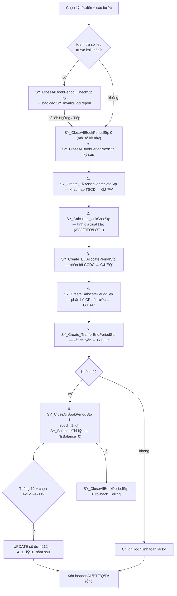
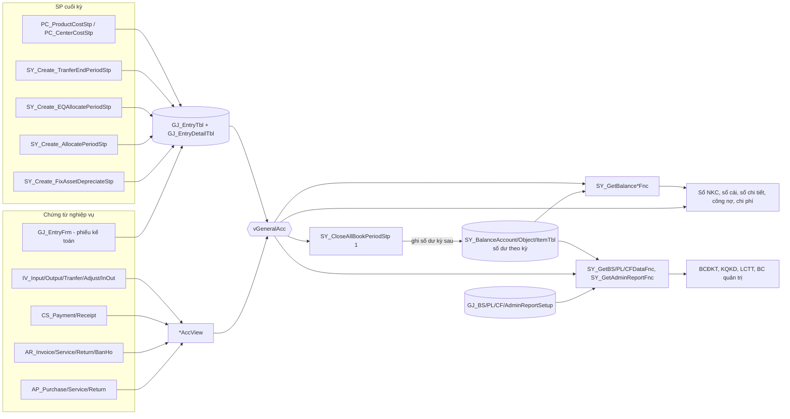
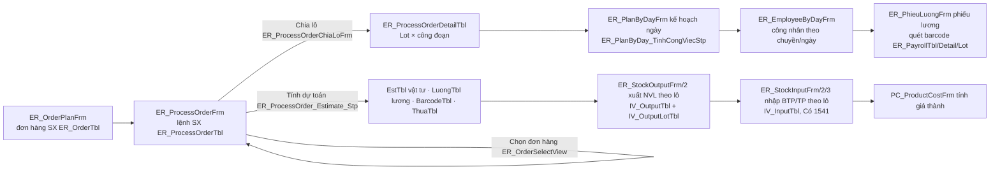

# 21 — Nghiệp vụ kế toán tổng hợp, tài sản, sản xuất & các phân hệ còn lại

Ngày khảo sát: 2026-11-11. Đọc trước: `00-nguon-du-lieu.md`. Tài liệu này **chỉ đọc mã/metadata**, không kết nối DB.

Phạm vi: Kế toán tổng hợp (GJ/GL), Tài sản cố định (FA), Công cụ dụng cụ (EQ), Sản xuất (ER) + định mức (BOM),
Giá thành (PC), Nhân sự (HR — chỉ metadata), Văn phòng điện tử (OF, lịch), Nhà hàng (TN), Hệ thống nghiệp vụ
(SY_*, AD_*), tiện ích khác. Phân hệ AR/AP/IV/CS và engine `Tools.dll` do tài liệu khác phụ trách — ở đây chỉ nhắc
khi cần để giải thích cách chúng ghi sổ.

## 0. Quy ước dẫn nguồn & mức tin cậy

| Ký hiệu | Ý nghĩa |
|---|---|
| `ERP/GJ_EntryFrm.cs:1173` | Mã dịch ngược, đường dẫn tương đối trong `.legacy/decompiled/ERP.NET/` |
| `Tools/Tools/ToolBarX.cs:1385` | Mã engine, tương đối trong `.legacy/decompiled/Tools/` |
| `helper:1287` | Lớp phụ trợ dùng chung (tên obfuscate) `F4BpNmydKqv0nTjyQU/lW25dKpyasKwWc3oY1.cs:1287` |
| `sql:dbo.vGeneralAcc.sql:11` | Định nghĩa SP/view/function của DB MedData, trong `D:\Data\Medcom\TechnicalDocs\db-audit\evidence-sql\` |
| `menu 1602` | `MenuID` trong `workflow-config-20261019/menus.json` (Medcom). `X` = menu đang `isDisable` |
| `(n dòng)` | Số dòng ước lượng của bảng ở MedData (`run-20261019/row_counts.json`, approximate_rows) |
| **[XM]** | Đã xác minh trực tiếp trong mã/SQL |
| **[SĐ]** | Suy đoán từ tên, caption, cấu trúc — cần kiểm chứng trên DB thật |

Lưu ý triển khai: MedData **không có** bảng `ER_*`, `TN_*`, `CR_*`, `EM_*`, `EQ_InputTbl/OutputTbl/TranferTbl`,
`OF_DocumentEditTbl` → các form tương ứng là mã chung của sản phẩm, dùng cho khách hàng khác (DIM-GiaThanh, nhà hàng...)
**[XM]** (objects.json). Ở Medcom, `GJ_EntryTbl` chỉ ~3 dòng, `FA_AssetDepreTbl` = 0, `GJ_AllocatePeriodTbl` = 0 →
Medcom **gần như chưa chạy** kế toán tổng hợp/khóa sổ/khấu hao trong ERP này **[XM số liệu, SĐ về nguyên nhân]**.

---

## 1. Cách chứng từ ghi sổ kế toán

### 1.1 Phát hiện cốt lõi: không có bảng sổ cái vật lý — sổ cái là VIEW `vGeneralAcc`

Không tồn tại bảng "định khoản đã post". Mọi báo cáo kế toán (nhật ký chung, sổ cái, CĐPS, BCTC, công nợ, kết chuyển,
giá thành) đọc từ view **`vGeneralAcc`** = `UNION ALL` của các view định khoản `*AccView` của từng loại chứng từ
cộng với bảng bút toán tổng hợp `GJ_EntryTbl ⨝ GJ_EntryDetailTbl` **[XM]** (`sql:dbo.vGeneralAcc.sql:11-87`).

- Mỗi `*AccView` "suy ra" bút toán Nợ/Có từ các cột tài khoản lưu trên chứng từ gốc (vd `AR_InvoiceAccView`:
  doanh thu `RevAccID/IncomeAccID`, thuế `VATAccID`, giá vốn `CostOfSaleAccID/InvAccID`, thuế XK `VATAccExID`)
  (`sql:dbo.AR_InvoiceAccView.sql`). Chi tiết từng view thuộc tài liệu AR/AP/IV/CS.
- **Lọc `isLock = 1` và `Status <> 3` đều bị comment** ở mọi nhánh → chứng từ **vừa lưu là đã vào sổ**, kể cả chưa duyệt;
  duyệt/khóa chứng từ không ảnh hưởng số liệu sổ **[XM]** (`sql:dbo.vGeneralAcc.sql:12,15,...,87`).
- Quy tắc ghi trong view: *"không được hạch toán 2 chi nhánh trên 1 chứng từ, phải làm 2 phiếu riêng, dùng TK trung
  gian (136, 336)"* — báo cáo theo chi nhánh lọc theo `BranchID` của chứng từ **[XM]** (`sql:dbo.vGeneralAcc.sql:8`).
- `vGeneralSumAcc` = `vGeneralAcc` gộp theo chứng từ + cặp TK (`sql:dbo.vGeneralSumAcc.sql`).
- Hệ quả: một bút toán = **một dòng có cả `DebitAccID` và `CreditAccID`** (kiểu "định khoản đơn cặp"), không phải
  hai dòng Nợ/Có riêng.

Cột chuẩn của một dòng `vGeneralAcc` **[XM]**: `SourceID, BranchID, BranchID2, DocumentID, DocumentDate, InvoiceNo,
ObjectID (đối tượng bên Nợ), ObjectID2 (bên Có), RefDoc, RefDoc2 (chứng từ công nợ tham chiếu Nợ/Có), CurrencyID,
RateExchange, Memo, MasterMemo, CostCenterID (hạng mục/kênh), CostID (mục phí/khoản mục), DebitAccID, CreditAccID,
SourceAmount (nguyên tệ), Amount (VND), Status, ItemID, Quantity, ContractID, BankContractID (khế ước vay), CSType
(loại thu chi — dùng cho LCTT), DocBatch (chứng từ ghi sổ), EmployeeID, ManagerID`.

### 1.2 Bảng nguồn sinh định khoản (SourceID)

| SourceID | Nguồn trong `vGeneralAcc` | Form nhập | Ghi chú |
|---|---|---|---|
| PI / PS / PR | `AP_PurchaseAccView` / `AP_ServiceAccView` / `AP_ReturnAccView` | AP_PurchaseFrm / AP_ServiceFrm / AP_ReturnFrm | mua hàng, mua DV, trả NCC |
| SI / ST / SS / SR | `AR_InvoiceAccView` / `AR_TrustInvoiceAccView` / `AR_ServiceAccView` / `AR_ReturnAccView` | AR_InvoiceFrm... | bán hàng, ủy thác, DV, trả lại |
| SH | trực tiếp `AR_BanHoTbl ⨝ AR_BanHoDetailTbl` (Nợ `AccountID2`/Có `InvAccID`, `AmountCost`) | AR_BanHoFrm | bán hộ |
| CP / CR | `CS_PaymentAccView` / `CS_ReceiptAccView` | CS_PaymentFrm / CS_ReceiptFrm | có `CSType`, `BankContractID` |
| IO / IN / EX / IT / IA | `IV_InOutAccView` / `IV_InputAccView` / `IV_OutputAccView` / `IV_TranferAccView` / `IV_AdjustAccView` | IV_* | kho luôn VND, tỷ giá 1 |
| **= `EntryType`** | `GJ_EntryTbl ⨝ GJ_EntryDetailTbl` | GJ_EntryFrm + các SP tự động | xem 1.4 |

Danh sách nguồn hiển thị cho người dùng nằm ở `vSourceListFull` (SourceID, tên, FormID, `type`=1 là chứng từ kế toán);
các nguồn sản xuất E5–E8, M2–M7 (EM_*) và PC/PC2 bị **comment** **[XM]** (`sql:dbo.vSourceListFull.sql`). Bảng
`SY_DocSetup` (44 dòng) cấu hình loại chứng từ: `DocType, DocName, PreFix, TableName, TableDetail, FormID, isAcc`
(vd `GJ | Tổng hợp (nhật ký chung) | TH | GJ_EntryTbl | GJ_EntryDetailTbl | GJ_Entryfrm | isAcc=1`; FA/EQ/OF đều
`isAcc=0`) **[XM]** (`workflow-config/document_types.json`).

### 1.3 Số dư đầu kỳ và cách tính số dư

- 3 bảng số dư theo kỳ, cột `PeriodID` (YYYYMM), `IsBalance` (1 = người dùng nhập; 0 = máy kết chuyển khi khóa sổ)
  **[XM]**:
  - `SY_BalanceAccountTbl` — TK thường (không theo đối tượng, không tồn kho): `AccountID, BranchID, CurrencyID,
    SourceAmount, Amount, isDebit, CostCenterID`, + cột nhập 2 bên `SourceDebit/SourceCredit/AmountDebit/AmountCredit`.
  - `SY_BalanceObjectTbl` — TK công nợ (`CF_ChartAccTbl.isObject=1`), có thể chi tiết đến chứng từ/hóa đơn:
    `ObjectID, DocumentID, DocumentDate, InvoiceNo, RefDoc, PaymentTermID, ContractID, EmployeeID, ItemID, Quantity...`.
  - `SY_BalanceItemTbl` — TK tồn kho (`isItem=1`): `StorehouseID, ItemID, Lot, ExpireDate, Property(2), InvAccID,
    Quantity(2), UnitPrice, Amount`.
- `SY_InitSetup(PeriodID, BalancePeriodID, StartDate, CostMethod, CostBranchID)`: kỳ bắt đầu và **phương pháp giá xuất**
  (AVG/AVGD/AVGS/FIFO/LOT) **[XM]** (`sql:dbo.SY_Calculate_UnitCostStp.sql`).
- **Kỳ gốc số dư** `SY_GetBalancePeriodFnc(@Date)` = kỳ kế tiếp của kỳ **đã khóa sổ** gần nhất trước ngày đó, nếu chưa
  khóa kỳ nào thì = `SY_InitSetup.BalancePeriodID` **[XM]** (`sql:dbo.SY_GetBalancePeriodFnc.sql`).
- Số dư tại ngày D (`SY_GetBalanceAccount[CN|End]Fnc`) = số dư 3 bảng tại kỳ gốc + phát sinh `vGeneralAcc` từ đầu kỳ gốc
  đến D−1; TK có `isObject=1` tính theo từng đối tượng (lưỡng tính); TK chi tiết không có số dư vẫn được chèn dòng 0
  **[XM]** (`sql:dbo.SY_GetBalanceAccountCNFnc.sql:58-150`).
- Vì vậy **khóa sổ = chụp lại số dư** sang kỳ sau; báo cáo sau kỳ khóa chỉ cộng phát sinh từ kỳ gốc → nhanh hơn.

### 1.4 Bút toán do hệ thống sinh vào `GJ_EntryTbl` (EntryType)

Mọi bút toán tự động đều ghi vào `GJ_EntryTbl/GJ_EntryDetailTbl`, phân biệt bằng `EntryType` (đi thẳng thành
`SourceID` trong `vGeneralAcc`), header tạo **`isLock = 1`** (người dùng không sửa ở GJ_EntryFrm), số chứng từ cố định
theo kỳ + chi nhánh, chiến lược **xóa toàn bộ trong kỳ rồi sinh lại** (idempotent) **[XM]**:

| EntryType | Nghiệp vụ | SP sinh | Số CT | Định khoản | Nguồn |
|---|---|---|---|---|---|
| GJ | Phiếu kế toán nhập tay | GJ_EntryFrm | TH… (prefix SY_DocSetup) | tùy người dùng | `ERP/GJ_EntryFrm.cs:1276` |
| FA | Trích khấu hao TSCĐ | `SY_Create_FixAssetDepreciateStp` | `KHTS-yyyymm`+BranchID | Nợ `ExpenseAccID` / Có `DepreAccID` (214x) | `sql:dbo.SY_Create_FixAssetDepreciateStp.sql:16-19` |
| AL | Phân bổ chi phí trả trước | `SY_Create_AllocatePeriodStp` | `PB-yyyymm`+BranchID | Nợ `ExpenseAccID` / Có `AccountID` (242/142) | `sql:dbo.SY_Create_AllocatePeriodStp.sql:15` |
| EQ | Phân bổ CCDC | `SY_Create_EQAllocatePeriodStp` | `PBDC-yyyymm`+BranchID | Nợ `ExpenseAccID` / Có `AccountID` (242/153) | `sql:dbo.SY_Create_EQAllocatePeriodStp.sql:14` |
| ET | Kết chuyển cuối kỳ | `SY_Create_TranferEndPeriodStp` | `KC0-yyyymm`+BranchID | theo `GJ_TFSetupTbl` (1.5) | `sql:dbo.SY_Create_TranferEndPeriodStp.sql:13-20` |
| PC | Kết chuyển chi phí giá thành SP | `PC_ProductCostStp` | `GT0-yyyymm` | Nợ 154x / Có 62x; NVL dở dang | `sql:dbo.PC_ProductCostStp.sql:109,970-999` |
| PC2 | Giá thành theo hạng mục | `PC_CenterCostStp` | `GT1-yyyymm` | Nợ 154 / Có 62x theo hạng mục | `sql:dbo.PC_CenterCostStp.sql:17-18` |

Sau mỗi lần chạy khóa sổ, form xóa các header AL/ET/EQ/FA **không có dòng chi tiết** trong kỳ
(`ERP.Sys/PeriodSetupFrm.cs:1165`) **[XM]**. `GJ_EntryDetailTbl.LinkItem` giữ mã tài sản/mã phân bổ/mã NVL của dòng
sinh tự động (`sql:dbo.SY_Create_FixAssetDepreciateStp.sql` — insert detail).

### 1.5 Kết chuyển tự động cuối kỳ (`GJ_TFSetupTbl`, menu 166401)

Bảng `GJ_TFSetupTbl(TransferID, TransferName, FromAccountID, ToAccountID, TransferKind, STT, AccountID2, isCost,
isCostCenter, isDisable, ToObjectID)` (12 dòng ở Medcom), form metadata `GJ_TransferSetupFrm` (LIST). SP duyệt theo `STT`,
dữ liệu là phát sinh `vGeneralAcc` trong kỳ gộp theo cặp TK + chi nhánh + mục phí + hạng mục; **kết quả của dòng trước
được cộng vào tập dữ liệu cho dòng sau** (nên thứ tự STT quyết định: 632/641/642→911 trước, 911→421 sau) **[XM]**
(`sql:dbo.SY_Create_TranferEndPeriodStp.sql:85-230`):

| Kind | Ý nghĩa (theo mã) | Bút toán sinh |
|---|---|---|
| 1 | Lấy **phát sinh Nợ** TK nguồn | Nợ `ToAccountID` / Có TK nguồn |
| 2 | Lấy **phát sinh Có** TK nguồn | Nợ TK nguồn / Có `ToAccountID` |
| 3 | Chênh lệch Nợ−Có; dương hay âm đều kết chuyển, đảo chiều khi âm | dư Nợ: Nợ To/Có nguồn; dư Có: Nợ nguồn/Có To |
| 4 | Chỉ lấy khi Nợ−Có > 0 | Nợ TK nguồn / Có `ToAccountID` — **nghi vấn đảo chiều** **[SĐ]** |
| 5 | Chỉ lấy khi Có−Nợ > 0 | Nợ TK nguồn / Có `ToAccountID` |
| 6 | Kết chuyển thuế: min(dư Nợ 133 = From, dư Có 333 = To) **lũy kế từ đầu** | Nợ 333 / Có 133, ghi vào **chi nhánh mặc định** |

`isCost/isCostCenter` = giữ chiều mục phí/hạng mục khi kết chuyển; `ToObjectID` = gán đối tượng (vd chuyển chi phí 64187
sang 3388 của một người). Kiểm tra trước khóa sổ đòi `ToAccountID` phải là TK chi tiết và không phải TK tồn kho
(`sql:dbo.SY_CloseAllBookPeriod_CheckStp.sql:44-52`). Năm tài chính: khi khóa kỳ tháng 12 và chọn
"Tự động kết chuyển TK 4212 → 4211", form `UPDATE SY_BalanceAccountTbl SET AccountID = <4211 chi tiết>` cho kỳ 01 năm sau
(`ERP.Sys/PeriodSetupFrm.cs:1147-1154`) **[XM]** — tức là đổi mã TK trên số dư chứ không sinh bút toán.

### 1.6 Kỳ kế toán, khóa sổ, khóa dữ liệu, khóa chứng từ — 4 loại "khóa"

| Cờ | Bảng/cột | Màn hình | Tác dụng |
|---|---|---|---|
| Khóa sổ | `SY_Period.isLock` | PeriodSetupFrm (menu 0107) | tính số dư kỳ sau; mọi SP tự động `return` nếu kỳ đã khóa |
| Khóa dữ liệu | `SY_Period.isLockData` | PeriodLockDataFrm (menu 0108, metadata) | chặn thêm/sửa/xóa chứng từ của kỳ, không tính số dư |
| Kiểm tra ngày | `SY_CheckDateOfPeriodOpeningFnc(@Date)` | mọi form chứng từ | trả `IsClosed=1` nếu **bất kỳ kỳ ≥ kỳ của ngày** đã khóa sổ, hoặc kỳ đó khóa dữ liệu, hoặc chưa khai báo kỳ (`sql:dbo.SY_CheckDateOfPeriodOpeningFnc.sql`) |
| Duyệt/khóa chứng từ | cột `isLock` trên từng bảng master | SY_LockDocumentFrm (menu 1605) | chỉ chặn sửa/xóa trên form; **không** ảnh hưởng sổ |

`SY_Period(PeriodID, PeriodName, FromDate, ToDate, YearID, PeriodNo, isLock, isUse, isLockData)` khai báo bằng
`FiscalFrm` (menu 010107). PeriodSetupFrm khi mở chạy `Update SY_Period set isLock = 1 where isLock is null`
(`ERP.Sys/PeriodSetupFrm.cs:853`) → kỳ mới khai báo mà để NULL sẽ thành **đã khóa** **[XM]**.

### 1.7 Quy trình khóa sổ / tính toán cuối kỳ (PeriodSetupFrm)

Màn hình `ERP.Sys/PeriodSetupFrm.cs` (menu 0107 "Khoá sổ / Mở sổ"): chọn khoảng kỳ (từ tháng → đến tháng, năm), các
checkbox bước; nút "Khóa sổ" đổi thành "Tính toán" khi bỏ chọn "Khóa sổ" (chỉ tính lại không khóa)
(`ERP.Sys/PeriodSetupFrm.cs:1181-1190`). Trình tự cho **mỗi kỳ** **[XM]** (`ERP.Sys/PeriodSetupFrm.cs:992-1166`):

- `SY_CloseAllBookPeriodStp @isClose, @PeriodID, @UserName` **[XM]** (`sql:dbo.SY_CloseAllBookPeriodStp.sql`): luôn xóa
  số dư `IsBalance=0` của kỳ sau và đặt `isLock=0`; nếu `@isClose=1` thì kết chuyển tồn kho (theo lô/date nếu `isLotDate`),
  số dư TK (`SY_GetBalanceAccountEnd…`), số dư công nợ theo từng TK `isObject`: nếu `isInvoice=1` chi tiết theo từng
  chứng từ còn mở (`SY_GetDebitDocFnc`), ngược lại gộp theo đối tượng (`SY_GetBalanceObject2EndFnc`), rồi `isLock=1`.
  Khóa kỳ nhỏ hơn kỳ bắt đầu chỉ đặt cờ, không tính.
- "Mở sổ" = `SY_CloseAllBookPeriodStp 0` cho từng kỳ (`ERP.Sys/PeriodSetupFrm.cs:1045-1059`).
- Nút phụ: "Kiểm tra dữ liệu" (chỉ chạy check), "Cập nhật lại sổ nhật ký chung, tồn kho (POST lại)" gọi
  `SY_POST_AllAccStp` (`ERP.Sys/PeriodSetupFrm.cs:1344`), "Kết chuyển theo Quí/Năm" mở `PeriodQuaterYearFrm`
  (`:1370`), "Bảo trì dữ liệu" = trim khoảng trắng/CR/LF/TAB/NBSP mọi cột chuỗi của các bảng (`:1458-1513`).
- **MedData không có** `SY_CloseAllBookPeriodNextStp` và `SY_POST_AllAccStp`; `SY_RePostStp` là SP rỗng → dấu vết của
  phiên bản cũ có bảng sổ "đã post"; bản hiện tại gọi với `ShowErrMsg:false` nên lỗi bị nuốt **[XM tồn tại, SĐ lịch sử]**.
- Kiểm tra trước khóa sổ (`SY_CloseAllBookPeriod_CheckStp`) — danh mục lỗi: thiếu đối tượng / đối tượng không có trong
  danh mục; hạch toán vào TK mẹ; TK kết chuyển không chi tiết / là TK kho; số dư đầu kỳ thiếu đối tượng; thiếu mặt
  hàng trên TK kho (152/153/155/156/157/158); nhập/xuất nội bộ dùng TK đối ứng là TK kho; lệch tiền thuế giữa hóa đơn
  và chứng từ (PI/PS/SR/CP/SI/SS/PR/CR); ngày chứng từ có giờ; phát sinh 211/242 **chưa khai báo phân bổ**
  (CP/GJ/PI/PS/EX/IO); sai loại tiền (nguyên tệ lệch >10% so với VND) **[XM]** (`sql:dbo.SY_CloseAllBookPeriod_CheckStp.sql:13-366`).

### 1.8 Sơ đồ tổng thể luồng ghi sổ

---

## 2. Kế toán tổng hợp (GJ / GL)

### 2.1 Màn hình Medcom ↔ form ↔ bảng

| Menu Medcom | Caption | Form | Loại | Bảng chính |
|---|---|---|---|---|
| 0105/010502 | Số dư hàng tồn kho | GJ_BalanceItemFrm | viết tay | SY_BalanceItemTbl (690) |
| 010504 | Số dư công nợ đối tượng | GJ_BalanceObjectFrm | viết tay | SY_BalanceObjectTbl (17) |
| 010506 | Số dư tài khoản | GJ_BalanceAccountFrm | viết tay | SY_BalanceAccountTbl (9) |
| 0107 | Khoá sổ / Mở sổ | PeriodSetupFrm | viết tay | SY_Period (24), SY_Balance* |
| 0108 | Khoá dữ liệu | PeriodLockDataFrm | metadata EDIT | SY_Period.isLockData |
| 010107 | Khai báo lịch tài chính | FiscalFrm | engine | SY_Period, SY_Quarter, SY_Year |
| 010108 | Thiết lập thông số hệ thống | SetupFrm | viết tay | SY_Setup (63), SY_InitSetup, SY_StupAcTbl (12) |
| 0267 | Hệ thống tài khoản | ChartAccListFrm | metadata LISTEDIT | CF_ChartAccTbl |
| 0245 / 0246 | Kênh bán-hạng mục / Mục phí-khoản mục | CostCenterListFrm / CostListFrm | metadata | CF_CostCenterTbl / CF_CostTbl |
| 1600xx | Đồng bộ hóa đơn từ thuế (mua vào, bán ra, đối chiếu, lịch sử, trạng thái) | GJ_InvoiceIn/Out/LogFrm… | metadata EDIT + `ERP.Taxsync` | GJ_InvoiceIn/OutTbl(+Detail), GJ_InvoiceSynLogTbl |
| 1602 | Chứng từ khác (Phiếu kế toán) | GJ_Entryfrm | viết tay | GJ_EntryTbl (3), GJ_EntryDetailTbl (4), GJ_VATInvoiceTbl, GJ_EntryCouponTbl |
| 1603 X | Đăng ký chứng từ ghi sổ | GJ_DocBatchRegisterFrm | viết tay | cột `DocBatch` các bảng chứng từ |
| 1604 X | Đánh lại số chứng từ | SY_MakeDocumentIDFrm | viết tay | vDocumentForRebuiltID |
| 1605 | Duyệt / Khóa chứng từ | SY_LockDocumentFrm | viết tay | vDocumentForLock |
| 1606 X | Tham chiếu chứng từ công nợ | GJ_ObjectDocumentSetupfrm | viết tay | sửa RefDoc trên CS/GJ/SY_BalanceObject |
| 1607 | Đối trừ chứng từ công nợ | GJ_RefDocumentSetupfrm | viết tay | GJ_RefDocSetupTbl |
| 160801 / 160802 | Định nghĩa phân bổ CP trả trước / Phân bổ chi phí | GJ_AllocateSetupFrm / GJ_AllocateFrm | viết tay | GJ_AllocateSetupTbl, GJ_AllocatePeriodSetupTbl, GJ_AllocatePeriodTbl |
| 166401 | Thiết lập bút toán kết chuyển tự động | GJ_TransferSetupFrm | metadata LIST | GJ_TFSetupTbl (12) |
| 166402 / 166405 / 166406 | Thiết lập BCĐKT / LCTT / KQKD | GJ_BalanceSheet/CashFlow/ProfitLossSetupFrm | viết tay | GJ_BSSetup(267)/CFSetup(267)/PLSetup(67) + Detail |
| 166408 X / 166409 X | Thiết lập thuyết minh BCTC QĐ15 / QĐ48 | GJ_Financial15/48SetupFrm | viết tay | GJ_SM01..16Tbl / GJ_Fin01..08Tbl |
| 164560 X | Thiết lập báo cáo quản trị | GJ_AdminReportSetupFrm | viết tay | GJ_AdminReportSetupTbl (147) + Detail (116) |
| 164208 X | Tờ khai thuế GTGT 01/GTGT | GJ_TaxPeriodReport | viết tay | GJ_PeriodTaxTbl (28) |
| (không menu) | Thiết lập các bút toán nghiệp vụ | GJ_EntrySetupfrm | metadata LIST | GJ_EntrySetupTbl (49) |
| (không menu) | Thiết lập chứng từ ghi sổ | GJ_DocBatchSetupfrm | viết tay/metadata | GJ_DocBatchSetupTbl + Detail |

Báo cáo GJ ở menu 1620–1644 xem mục 12.

### 2.2 Phiếu kế toán — `GJ_EntryFrm` (menu 1602)

**Mục đích:** bút toán tổng hợp tự do (nghiệp vụ khác), cũng là form xem/sửa bút toán sinh tự động khi được mở theo
`DocumentID` (chế độ Find). `GJ_Entry2Frm` chỉ kế thừa nguyên form (`ERP/GJ_Entry2Frm.cs`).

**Dữ liệu** **[XM]** (`ERP/GJ_EntryFrm.cs:1166-1188`; layout có thể ghi đè bằng `SY_FrmCfg` qua `Lyt.TableMaster/Detail`):
- Master `GJ_EntryTbl` (PK `DocumentID`), join `CF_ObjectTbl` lấy `ObjectName, Address`, sắp xếp `DocumentDate, DocumentID`.
  Cột: `DocumentDate, ObjectID, Memo, Notes, CurrencyID, RateExchange, BaseTotal, isLock, EntryType, Status, InvoiceNo,
  AttachDate, LinkID, DocBatch, Attach, EmployeeID, BranchID, TKNo, TKCo, SearchField, User/DateCreate/Update`.
- Detail `GJ_EntryDetailTbl` (PK `UserAutoID`, FK `DocumentID` cascade): `DebitAccID, CreditAccID, Memo, SourceAmount,
  Amount, TienChietKhau1..9, ObjectID, RefDoc (đối tượng + chứng từ tham chiếu bên Nợ), ObjectID2, RefDoc2 (bên Có),
  CostCenterID, CostID, ItemID, Quantity, UnitPrice, ContractID, EmployeeID, LinkItem, ParentID, ContactCode`.
  Lưu ý: trong `vGeneralAcc`, **Amount = Amount + TienChietKhau1..9** (`sql:dbo.vGeneralAcc.sql:73-87`).
- Tab hóa đơn `GJ_VATInvoiceTbl` (link `EntryID = DocumentID`): `InvoiceNo, InvoiceSerialNo, KyHieuMauHoaDon, InvoiceDate,
  ObjectName, TaxCode, ItemName, Amount, VATID, VATPercent, VATAmount, IsOutput, IsOff, InvoiceLink` — nguồn cho bảng kê
  thuế GTGT (`GJ_InvoiceVATView`).
- Tab "Thu hồi phiếu mua hàng/phiếu giảm giá" `GJ_EntryCouponTbl(CouponSeri, TriGia)` — chỉ khi bật voucher
  (`ERP/GJ_EntryFrm.cs:1186`).

**Mặc định & nhập liệu:** số CT tự sinh từ prefix `GetDocPreFix("GJ","TH")` + mặt nạ `DocumentMask` (`SY_Setup`, vd
`{P}{MM}{YY}/{4}`) (`ERP/GJ_EntryFrm.cs:1264-1268`); ngày mặc định trong kỳ hiện hành; `EntryType='GJ'`; dòng mới giữ lại
`CreditAccID, DebitAccID, CostCenterID, CostID` của dòng trước (`:1278`); cảnh báo trùng số CT (`:1295`). Cột `RefDoc/RefDoc2`
có nút "…" mở danh sách chứng từ công nợ còn mở của đối tượng: TK đầu "1" (phải thu) → `SY_GetDebitDocFnc`, ngược lại
`SY_GetCreditDocFnc` (`ERP/GJ_EntryFrm.cs:1610-1720`).

**Khóa:** kỳ đã khóa (`SY_CheckDateOfPeriodOpeningFnc`), không phải admin thì chỉ sửa chứng từ do mình tạo, `isLock=1`
(`ERP/GJ_EntryFrm.cs:1202-1208`). Người dùng không phải admin/có lọc thì chỉ thấy chứng từ của mình (`:1335`).

**Kiểm tra trước lưu** **[XM]** (`ERP/GJ_EntryFrm.cs:1426-1480`):
1. Tổng tiền dòng 1331/3331 phải bằng tổng `VATAmount` tab hóa đơn (hỏi "Nhập hóa đơn | Lưu tiếp | Ngừng"), và
   **chống trùng hóa đơn** theo (MST, ngày, số HĐ) trên toàn bộ `CS_/AP_/AR_/GJ_/IV_VATInvoiceTbl` (`helper:518-640`).
2. TK có `isObject=1` bắt buộc có đối tượng (dòng hoặc master) (`helper:1203-1285`).
3. Hạng mục/mục phí bắt buộc theo cờ `CF_ChartAccTbl.IsCostCenter/IsCost` và tham số `CheckCostCenter/CheckCost`
   (`NoCheck|Warning|…`) → form `CheckCostcenterRequireByChartAccFrm` (`helper:1429-1588`).
4. SQL kiểm tra cấu hình trong `SY_FrmCfg` (`Do_ExecSQLCheckBeforeSave`).
5. Tính `BaseTotal`, `SearchField`, `InvoiceNo` (nối), `AttachDate`, `TKNo/TKCo` (nối TK, cắt 50 ký tự).

**Sau lưu:** `QwrCmB13yEI` quét dòng có TK Nợ 211/212/213/142/242/245 chưa liên kết (`LinkID`) → mở
`GJ_ThietLapPhanBoChiPhi_211_242Frm` đề nghị tạo hồ sơ TSCĐ (mặc định TK hao mòn 214x đầu tiên, TK chi phí 6424,
24 tháng) hoặc CCDC/chi phí trả trước (6423, 6 tháng; có ItemID → CCDC, không → CP trả trước), ghi
`FA_AssetTbl`/`EQ_EquipTbl`/`GJ_AllocateSetupTbl` với `RefDoc, RefSourceID, LinkID` trỏ về chứng từ gốc
(`ERP/GJ_EntryFrm.cs:203,1607`; `helper:1287-1427`; `ERP/GJ_ThietLapPhanBoChiPhi_211_242Frm.cs:326-547`) **[XM]**. Cùng
cơ chế được gọi từ AP_PurchaseFrm, AP_ServiceFrm, CS_PaymentFrm, IV_InOutFrm, IV_StockOutputFrm.

**In:** báo cáo `GJ_EntryReport` qua `GJ_EntryReportStp`, danh sách mẫu (`Template`) lưu ở `SY_RpDTbl`
(`ERP/GJ_EntryFrm.cs:1540-1596`). Trigger `GJ_EntryTbl_UpdateRefDoc`: đổi `DocumentID` → `SY_UpdateSystemRefDocStp` cập nhật
mọi tham chiếu; trigger `GJ_EntryDetailTbl_Update_Order_Status` hiện `return` ngay (vô hiệu) **[XM]**.

### 2.3 Số dư đầu kỳ (menu 0105)

`GJ_BalanceAccountFrm`, `GJ_BalanceObjectFrm`, `GJ_BalanceItemFrm` — lưới nhập trên `SY_Balance*Tbl` lọc `IsBalance = 1`,
`PeriodID` mặc định `SY_InitSetup.BalancePeriodID` **[XM]** (`ERP/GJ_BalanceAccountFrm.cs:321-328`, `ERP/GJ_BalanceObjectFrm.cs:327`,
`ERP/GJ_BalanceItemFrm.cs:238`).
- Ràng buộc: kỳ đầu phải là tháng 01 (`:351`); đã có kỳ khóa sổ thì không cho sửa trừ admin (`:384-389`); TK phải tồn tại,
  là TK chi tiết, **không** được là TK công nợ (phải nhập ở form công nợ) hay TK tồn kho (phải nhập ở form tồn kho)
  (`ERP/GJ_BalanceAccountFrm.cs:414-431`); cảnh báo nguyên tệ ≠ VND cho TK VND (`:459`).
- Chế độ "Xem số tiền kiểu Nợ, Có": nhập 2 cột rồi quy đổi về `Amount + isDebit` sau lưu (`:444-447`).
- Nút "Import Tools" mở `SY_ImportData2016Frm` (dán từ Excel) (`ERP/GJ_BalanceAccountFrm.cs:474`).
- Form tự `ALTER TABLE` thêm cột khi mở (`:293-304`) — đặc trưng chung của mã cũ (xem mục 13).

### 2.4 Phân bổ chi phí trả trước (menu 1608)

- **Định nghĩa** `GJ_AllocateSetupFrm` (`ERP/GJ_AllocateSetupFrm.cs:1128-1130`): master `GJ_AllocateSetupTbl(AllocateID,
  AllocateName, AllocateDate (ngày bắt đầu PB), NgayChungTu, AllocateAmount, OpenAllocate (đã PB đầu kỳ), MonthUse,
  AccountID (TK trả trước 242/142), ExpenseAccID, CostCenterID, CostID, ObjectID, DepartmentID, BranchID, StopDate,
  RefSourceID+RefDoc (chứng từ gốc, nút "Xem chứng từ gốc"), ItemID, LinkID)`; tab "Thiết lập các kỳ phân bổ"
  `GJ_AllocatePeriodSetupTbl(PeriodID, isStopAllocate, FixAllocateAmount, ExpenseAccID, CostCenterID, CostID, ObjectID,
  PrepayAccountID)`; tab "Thông tin đã phân bổ" `GJ_AllocatePeriodTbl`. Nút "Tạo phân bổ hàng tháng thủ công": nhập tổng
  tiền, từ kỳ, số tháng → chia đều làm tròn, dòng cuối nhận phần dư, ghi `…PeriodSetupTbl` (cùng mẫu với FA,
  `ERP/FA_AssetListFrm.cs:2217-2265`). `MonthUse` = 0 bị ép thành 6 (`ERP/GJ_AllocateSetupFrm.cs:1103`).
- **Tính** `GJ_AllocateFrm` (menu 160802): chọn kỳ (+chi nhánh) → "Tính phân bổ" = `SY_Create_AllocatePeriodStp kỳ,0,user`,
  "Xóa phân bổ" = `…,1`, "Sửa phân bổ" sửa lưới rồi sinh lại chi tiết GJ; hiển thị header GJ 'AL', chi tiết GJ và
  `GJ_AllocatePeriodTbl` (`ERP/GJ_AllocateFrm.cs:813-941`).
- **Công thức** (`sql:dbo.SY_GetAllocateFnc.sql`) **[XM]**: lấy các thẻ `AllocateDate ≤ cuối kỳ` và chưa `StopDate`;
  `EndAllocate = OpenAllocate + Σ PeriodAmount đã PB`; `NextAmount = AllocateAmount / MonthUse` (đường thẳng trên
  **nguyên giá**, không trừ đầu kỳ); nếu `NextAmount × 1,1 > Remain` thì lấy hết phần còn lại; thiết lập kỳ ghi đè:
  `isStopAllocate` → 0, `FixAllocateAmount` ≠ 0 → số cố định, đổi TK chi phí/hạng mục/mục phí/đối tượng.
  Không có phân bổ theo ngày (tháng đầu tính đủ tháng).
- Báo cáo: `GJ_AllocateDetailReport`, `GJ_AllocateSummaryReport`, `GJ_AllocateCompare242Report` (so phát sinh 242 với
  thiết lập).

### 2.5 Công nợ theo chứng từ (tham chiếu / đối trừ)

- Mỗi dòng định khoản có `RefDoc/RefDoc2` = số chứng từ phát sinh công nợ mà dòng thanh toán trỏ tới. Hàm
  `SY_GetDebitDocFnc/SY_GetCreditDocFnc` tính số còn phải thu/trả theo chứng từ (đầu kỳ + PS Nợ/Có, ngoại tệ, tham
  chiếu) và là nguồn cho chọn RefDoc, sổ theo dõi thanh toán, khóa sổ chi tiết theo hóa đơn **[XM]**
  (`sql:dbo.SY_GetDebitDocFnc.sql:86-242`).
- **Đối trừ chứng từ công nợ** `GJ_RefDocumentSetupfrm` (menu 1607): phiếu `GJ_RefDocSetupTbl(DocumentID, DocumentDate,
  ObjectID, AccountID, RefDebit, RefCredit, SourceAmount, Amount, ItemID, Quantity, BranchID)` = cặp "chứng từ Nợ ↔
  chứng từ Có" bù trừ cho nhau mà **không sinh bút toán**; được trừ trong `SY_GetDebitDocFnc` (dòng 150-180) và báo
  cáo đối chiếu thanh toán **[XM]** (`ERP/GJ_RefDocumentSetupfrm.cs:646`).
- **Tham chiếu chứng từ công nợ** `GJ_ObjectDocumentSetupfrm` (menu 1606, tắt ở Medcom): chọn đối tượng + TK phải
  thu/phải trả, ghép tự động thanh toán vào hóa đơn bằng cách **sửa trực tiếp** `RefDoc/RefDoc2` trên
  `CS_ReceiptDetailTbl`, `CS_PaymentDetailTbl`, `GJ_EntryDetailTbl`, `SY_BalanceObjectTbl`, **tách dòng** khi một phiếu
  trả cho nhiều hóa đơn; mở form còn ép `isObject=1` cho 131%/331% **[XM]**
  (`ERP/GJ_ObjectDocumentSetupfrm.cs:779,915,1121-1292`).

### 2.6 Chứng từ ghi sổ (hình thức CTGS) — menu 1603 (tắt)

`GJ_DocBatchSetupfrm`: khai báo sổ `GJ_DocBatchSetupTbl(DocBatchID, Memo, STT)` + cặp TK `GJ_DocBatchSetupDetailTbl
(DebitAccID, CreditAccID)`. `GJ_DocBatchRegisterFrm` ("Đăng ký"): theo từng tháng, với mỗi cặp TK theo STT, tìm chứng từ
trong `vGeneralAcc` chưa có `DocBatch` khớp `DebitAccID like … and CreditAccID like …`, rồi `UPDATE <bảng>.DocBatch` cho
từng loại chứng từ (AP/AR/IV/CS/GJ), cuối cùng báo `SY_InvalidBatchDocReport` các chứng từ chưa đăng ký
(`ERP/GJ_DocBatchRegisterFrm.cs:304-396`) **[XM]**. In: `ChungTuGhiSoReport` (+CH, USD), `GJ_DocBatchReport`.

### 2.7 Thiết lập báo cáo tài chính & báo cáo quản trị

Tất cả dùng mô hình "dòng chỉ tiêu + công thức chi tiết", chọn **mẫu** bằng `GroupID` từ `vStatementType`
(`sql:dbo.vStatementType.sql`) **[XM]**:

| Báo cáo | Mẫu (`GroupID`) | Bảng thiết lập | Hàm tính | Nguyên tắc dòng chi tiết |
|---|---|---|---|---|
| BCĐKT (BS) | QD15 = "Mẫu TT200", QD15- = "TT200 - 2", QD48 = "TT133" | `GJ_BSSetupTbl(SetupID, GroupID, CodeID=mã số, CodeName(2), Statement=thuyết minh, Priority, IsBold, IsLeft, IsNotPrint)` + `GJ_BSSetupDetailTbl(AccountID, IsDebitBal, IsObject, SumID, SoDuong, ReverseSign, SubAccAmount)` | `SY_GetBSDataFnc` / `…BranchFnc` | số dư cuối TK (like `AccountID%`): `IsDebitBal` lấy dư Nợ/Có; `IsObject` = tính theo từng đối tượng (tách dư Nợ/dư Có của TK lưỡng tính); `SubAccAmount` = theo từng TK con; `SoDuong` = chỉ lấy số dương; `SumID` = cộng chỉ tiêu khác; `ReverseSign` = đảo dấu |
| KQKD (PL) | QD15, QD15-, QD48 | `GJ_PLSetupTbl(+Type)` + `GJ_PLSetupDetailTbl(DebitAccID, CreditAccID, SumID, ReverseSign)` | `SY_GetPLDataFnc` | **phát sinh đối ứng** Nợ like/Có like trong kỳ (vd Nợ 511/Có 911) |
| LCTT (CF) | QD15TT, QD15TT-, QD15GT (gián tiếp), QD48TT, QD48GT | `GJ_CFSetupTbl(+STT)` + `GJ_CFSetupDetailTbl(DebitAccIDs, CreditAccIDs danh sách "111;112", SumID, ReverseSign, SoDuong, Type, IsObject, BalanceType, CSType)` | `SY_GetCFDataFnc` | chỉ các bút toán có 111/112/113 một bên, **loại bỏ chuyển tiền nội bộ** (cả hai bên là tiền); lọc thêm `CSType` (loại thu chi của phiếu thu/chi); `BalanceType≠0` = lấy số dư đầu kỳ TK tiền |
| BC quản trị | mẫu GJ_AdminReport, GJ_Admin2..5Report (`SY_RpDTbl` Template) | `GJ_AdminReportSetupTbl(…, Type, IsAmount3)` + `…DetailTbl(DebitAccID, CreditAccID, SumID, ReverseSign, CostID, CostCenterID, ObjectID, IsAmount2, IsObjectCT, IsCostCT, IsCostCenterCT, IsAccountCT, STT)` | `SY_GetAdminReportFnc` | như PL nhưng lọc thêm mục phí/hạng mục/đối tượng, "CT" = bung chi tiết theo chiều đó; 3 cột giá trị (gt3 = gt1 ± gt2) |
| Thuyết minh TT200 | 16 phần | `GJ_SM01..16Tbl(CodeID, GroupID, CodeName(2), CodeLevel, isBold, ID, Type, PrintTF)` | `SY_Cal_FinStp` (1.258 dòng, **mã cứng** từng mục: tiền, TSCĐ 211/212/213, XDCB, BĐS đầu tư, vốn CSH…) | form chỉ sửa danh mục dòng/in đậm/in hay không |
| Thuyết minh TT133 | 8 phần | `GJ_Fin01..08Tbl` | `SY_Cal_Fin48Stp` | như trên |
| Tờ khai 01/GTGT | — | `GJ_PeriodTaxTbl(SetupID, STT, Chitieu, MaSoGiaTri, GiaTriHH, MaSoThue, ThueGTGT, isBold)` | `GJ_PeriodTaxReportStp @ReportPeriodID ('01'..'12','Q01'..'Q04','N00'), @Year` | form xóa kết quả, chạy SP **ghi vào chính bảng thiết lập**, rồi in (`ERP/GJ_TaxPeriodReport.cs:340-362`) |

Ghi chú **[XM]**: báo cáo "CN" (`GJ_BalanceSheetCNReportStp @Template, @StartPeriodID, @ToPeriodID, @BranchID`,
`GJ_ProfitLossCNReportStp` có kỳ trước/kỳ này) là bản theo chi nhánh đang dùng ở menu Medcom; form chi tiết
`GJ_*DetailData[Branch]Frm` là màn hình drill-down một chỉ tiêu (gọi lại hàm tính). Form BS có nút "Kiểm tra thiết lập
hợp lệ" so TK chi tiết với thiết lập (`ERP/GJ_BalanceSheetSetupFrm.cs:655-660`). Tên "Financial15/48", "QD15/QD48" là
di sản QĐ15/2006 và QĐ48/2006; caption đã đổi thành TT200/TT133. Có rpx `GJ_GeneralLedgerT99Report` (gợi ý đã bắt đầu theo
TT99/2025) **[SĐ]**.

### 2.8 Hệ thống tài khoản & thông số hệ thống

- `CF_ChartAccTbl(AccountID, AccountName(2), AccountKindID, AccountTypeID, ParentAccountID, isDetail, isObject (theo dõi
  công nợ đối tượng), isInvoice (công nợ theo từng hóa đơn), isItem (TK tồn kho), IsCostCenter, IsCost (bắt buộc
  hạng mục/mục phí), CurrencyID)`. Các cờ này điều khiển: bắt buộc nhập đối tượng/hạng mục, số dư nhập ở bảng nào, cách
  kết chuyển công nợ khi khóa sổ, kiểm tra khóa sổ **[XM]**. Views lọc TK: `vChartAcc, vChartAccSub, vChartAccCash,
  vChartAccInventory, vChartAccPayable/Receivable, vChartAccPayment/Receipt, vChartAccItemExpense`.
- `SetupFrm` (menu 010108, `ERP.Sys/SetupFrm.cs`): nút "Thiết lập lại hệ thống tài khoản theo TT200/TT133" **xóa toàn bộ**
  `CF_ChartAccTbl` rồi chép từ bảng mẫu `CF_ChartAccQD15` / `CF_ChartAccQD48` (đặt `IsCostCenter=IsCost=1`)
  (`ERP.Sys/SetupFrm.cs:1921-1928,2851-2866`) **[XM]**. Tab "Tài khoản mặc định" sửa `SY_StupAcTbl(SystemAccountType,
  Description, AccountID, IsIncludeDetail, IsDebit)` (vd `CHIEUKHAU → 521`) (`:2610`). Kỳ bắt đầu, phương pháp giá xuất
  ghi `SY_InitSetup`.
- Tham số `SY_Setup(CodeID → CodeValue)` liên quan kế toán **[XM]** (`ERP.Sys/SetupFrm.cs:2641-2684`): `DocumentMask`,
  `CheckCashOut` (kiểm tra quỹ 111/112 khi chi), `CheckStockOut`, `CheckStockDate`, `CheckCostCenter`, `CheckCost`,
  `isManagerNotApproveDoc`, `isManagerNotDeApproveDoc`, `isManagerCanEditDoc`, `isUserNotExcel`, `isManagerNotExcel`,
  `isLotDate`, `isDiscountVoucher`, `SkipNoInvoice`, `OverLotDay`, `OverDeptDay`, `isShowApproveDoc`, `isReportPrintDate`,
  `FullLogDefault`, `isCHAT`, `isReminder`, `LinkDatabase/LinkServer1-3`, sao lưu tự động.

### 2.9 Đồng bộ hóa đơn từ cơ quan thuế (menu 1600, ngắn)

`ERP.Taxsync` gọi API cổng `hoadondientu.gdt.gov.vn` (captcha, đăng nhập, truy vấn HĐ mua/bán, chi tiết) và ghi
`GJ_InvoiceIn/OutTbl` + `…DetailTbl` (`ERP.Taxsync/InvoiceService.cs:98-613`); SP `GJ_InvoiceIn_Copy{MuaHang|DichVu|KeToan|
PhieuChi}[Detail|Save]Stp`, `GJ_InvoiceOut_Copy{BanHang|DichVu}…` tạo chứng từ tương ứng và gắn ngược qua `LinkID`
(vd `…CopyKeToanSaveStp` cập nhật `GJ_InvoiceInTbl.DocumentID, SourceID='GJ'` từ `GJ_EntryTbl.LinkID`); trạng thái xử lý
`GJ_InvoiceIn/OutXuLyTbl`, `GJ_InvoiceStatusTbl`; báo cáo đối chiếu `GJ_InvoiceIn/OutReportStp` **[XM]**. Có lớp
`CaptchaService.SolveCaptcha` — xem câu hỏi mở.

---

## 3. Tài sản cố định (FA) — menu 12

### 3.1 Màn hình

| Menu | Caption | Form | Bảng |
|---|---|---|---|
| 1202 / 1203 | Nguồn vốn / Loại tài sản | FA_CapitalListFrm / FA_AssetTypeListFrm (metadata) | FA_CapitalTbl (2) / FA_AssetTypeTbl (15, có `YearUse` mặc định) |
| 1205 | Danh mục tài sản | FA_AssetListFrm (viết tay, LISTEDIT) | FA_AssetTbl (387), FA_AssetDepreTbl, FA_AssetLogTbl, FA_AssetPeriodSetupTbl, FA_AssetAttachTbl |
| 1207 (1206 X) | Phiếu di chuyển / bàn giao máy | FA_Move2026Frm (metadata EDIT) (cũ: FA_MoveFrm / FA_Move2Frm) | FA_MoveTbl (635) + FA_MoveDetailTbl (635) |
| 1209 (1208 X) | Phiếu sửa chữa / bảo hành / bảo trì | FA_Repair2026Frm (metadata) (cũ: FA_RepairFrm) | FA_RepairTbl + Detail |
| 1212 X | Tăng giảm tài sản | FA_AdjustmentFrm | FA_AdjustTbl + FA_AdjustDetailTbl |
| 1214 | Thanh lý tài sản | FA_LiquidateFrm | FA_LiquidateTbl + Detail |
| 1216 | Trích khấu hao tài sản | FA_DepreciateFrm | FA_AssetDepreTbl + GJ 'FA' |
| 121400–121420 | Đăng ký QR/serial linh kiện, quản lý, lịch sử, in tem | FA_PartRegFrm, FA_PartManagementFrm… (metadata) | FA_Part*Tbl/View (riêng Medcom) |
| 1218–1237 | Báo cáo | xem mục 12 | — |

### 3.2 Hồ sơ tài sản — `FA_AssetListFrm`

Master `FA_AssetTbl` (`ERP/FA_AssetListFrm.cs:1958-1962`) **[XM]**: định danh `AssetID, AssetName(2), CardNo (số thẻ),
AssetTypeID, CapitalID, Unit, Quantity`; kế toán `AssetAccID (211x), DepreAccID (214x), ExpenseAccID (TK chi phí PB),
SourceAmount/CurrencyID/RateExchange, Amount (nguyên giá), OpenDepre (hao mòn lũy kế đầu kỳ), UsingDate, DepreDate (ngày
bắt đầu KH), YearUse/MonthUse, DeprePercent, StopDate (ngừng KH), LiquidationDate`; phân tích `CostCenterID, CostID,
DepartmentID, ObjectID, BranchID`; nguồn gốc `RefSourceID + RefDoc (chứng từ mua, "Xem chứng từ gốc"), LinkID, NgayChungTu,
Manufacturer, BuyFrom, WarrantyAddress`; Medcom bổ sung `TrackLifecycle, ItemID, SerialNo, Lot, ManufactureYear,
CustomsDeclarationNo/Date, OriginDocument*, WarrantyFrom/To, OwnershipType, LifecycleStatus, OperationStatus,
InternalAlert` (+ `DepreciationMode` của gói chính sách khấu hao, mục 3.5).

Tab: (1) Thiết lập các kỳ phân bổ `FA_AssetPeriodSetupTbl` + nút tạo thủ công (chia đều số tiền theo n kỳ —
`ERP/FA_AssetListFrm.cs:2217-2265`); (2) Thông tin đã khấu hao `FA_AssetDepreTbl`; (3) Quá trình sử dụng `FA_AssetLogTbl
(Date, ToDate, Memo, CostCenterID, CostID, ObjectID, DepartmentID, ExpenseAmount)`; (4) Hình ảnh; (5) File đính kèm
`FA_AssetAttachTbl`. Khi mở form: `DeprePercent = 100/YearUse/12` (tỷ lệ **tháng**) (`:1924`).

### 3.3 Khấu hao — `FA_DepreciateFrm` + `SY_Create_FixAssetDepreciateStp`

- Form: chọn kỳ (+ chi nhánh), hiển thị header GJ 'FA' của ngày cuối kỳ, chi tiết GJ (cột `LinkItem` = "Mã tài sản") và
  bảng `FA_AssetDepreTbl` của kỳ; nút Tính (`…Stp kỳ,0,user`), Xóa (`…,1`), Sửa (sửa `DepreAmount` trên lưới rồi **xóa và
  sinh lại** chi tiết GJ từ `FA_AssetDepreTbl`), In `FA_DepreciateDetailReport` (`ERP/FA_DepreciateFrm.cs:813-956`) **[XM]**.
- Công thức `SY_GetAssetListFnc` **[XM]** (`sql:dbo.SY_GetAssetListFnc.sql:29-75`):
  - Tài sản xét: `UsingDate ≤ cuối kỳ hoặc DepreDate ≤ cuối kỳ`, chưa `LiquidationDate`, chưa `StopDate`.
  - `MonthUse = YearUse × 12` nếu trống; `EndDepre = OpenDepre + Σ DepreAmount` các kỳ trước; nguyên giá
    `Amount += Σ FA_AdjustDetailTbl.Amount` (phiếu tăng giảm đến ngày); `Remain = Amount − EndDepre`.
  - **Đường thẳng theo nguyên giá**: `NextDepre = Amount / MonthUse`, làm tròn `decimal(28,0)`; kỳ cuối nếu
    `NextDepre × 1,1 > Remain` thì = Remain; có phiếu thanh lý ≤ ngày thì = 0. **Tháng bắt đầu tính đủ tháng**,
    không có khấu hao theo ngày, không có phương pháp số dư giảm dần.
- SP: xóa GJ 'FA' + `FA_AssetDepreTbl` của kỳ → insert khấu hao → nếu có `FA_AssetPeriodSetupTbl` của kỳ thì tách dòng
  theo thiết lập (đổi TK chi phí/hạng mục/mục phí/đối tượng; nguyên giá chỉ giữ ở 1 dòng) → tạo header `KHTS-kỳ+CN`
  (isLock=1) theo chi nhánh của tài sản → chi tiết Nợ `ExpenseAccID` / Có `DepreAccID`, `LinkItem=AssetID`
  (`sql:dbo.SY_Create_FixAssetDepreciateStp.sql`). **Nghi vấn**: khi tách nhiều dòng thiết lập cho cùng tài sản, mỗi
  dòng nhận lại **toàn bộ** `DepreAmount` (join theo AssetID), `FixAllocateAmount` không được dùng → có thể nhân đôi
  khấu hao **[SĐ — cần kiểm thử]**.

### 3.4 Biến động tài sản

| Form | Bảng | Ảnh hưởng | Ghi sổ |
|---|---|---|---|
| FA_AdjustmentFrm "Tăng giảm" | `FA_AdjustTbl(DocumentID, DocumentDate, CurrencyID, RateExchange, Memo, BaseTotal, isLock, RefDoc, Status)` + `FA_AdjustDetailTbl(AssetID, SourceAmount, Amount, Notes)` | cộng/trừ nguyên giá trong công thức khấu hao | **không** (không có trong `vGeneralAcc`) — kế toán tự lập phiếu GJ |
| FA_LiquidateFrm "Thanh lý" | `FA_LiquidateTbl` + `FA_LiquidateDetailTbl(AssetID, ResidualAmount, LiquidateAmount, IncomeAccID, ChiPhiTL, ExpenseAccID)` | dừng khấu hao từ ngày phiếu | **không** — có TK thu nhập/chi phí nhưng không view nào dùng |
| FA_MoveFrm / FA_Move2026Frm | `FA_MoveTbl(NguoiGiao, NguoiNhan, MoveTypeID, ContractID, EffectiveFrom/To…)` + Detail (`DepartmentID, ObjectID, CostCenterID, CostID, From/ToStoreHouseID, From/ToLocation, HandoverDate, AssetCondition, LifecycleStatusAfter`) | **không** đổi hạng mục/bộ phận trên thẻ tài sản (chi phí khấu hao vẫn theo thẻ); Medcom có trigger `TR_FA_MoveDetail_LifecycleSync` cập nhật `OwnershipType/LifecycleStatus` theo `FA_MovementTypeTbl` | không |
| FA_RepairFrm / FA_Repair2026Frm | `FA_RepairTbl` + Detail (`NoiDung, Quantity, Amount, LaborAmount, PartsAmount, WarrantyCovered, NextServiceDate`) | theo dõi | không |

Tất cả form trên kiểm tra kỳ mở bằng `SY_CheckDateOfPeriodOpeningFnc`, khóa `isLock` (`ERP/FA_*Frm.cs:482-487`) **[XM]**.

### 3.5 Mở rộng riêng Medcom (tham khảo)

- Gói "chính sách khấu hao" (`D:\Data\Medcom\TechnicalDocs\asset-depreciation-policy-20261030\`): thêm
  `FA_AssetTbl.DepreciationMode` (0 = "Chờ kế toán xác nhận", 1 = "Chỉ theo dõi máy", 2 = "Có tính khấu hao"),
  `DepreciationFromPeriodID`, bảng lịch sử `FA_AssetDepreciationPolicyTbl`, hàm `FA_Asset_IsDepreciableFnc`, trigger, và
  sửa `SY_GetAssetListFnc`/`SY_Create_FixAssetDepreciateStp` để chỉ khấu hao mode 2 **[XM từ install.sql/display-view.sql]**.
  Lý do: phần lớn 387 "tài sản" Medcom là **máy cho thuê/đặt tại khách** (Machine 360, vòng đời, linh kiện QR) chứ không
  phải TSCĐ kế toán.
- Hệ linh kiện `FA_Part*` (46 SP, 22 view: đăng ký serial, quét nhập/xuất, thay thế, thu hồi, kiểm toán toàn vẹn) và
  `asset-reconciliation\` (đối soát dữ liệu máy với nguồn) — ngoài phạm vi kế toán, nhưng bản web Medcom cần.

---

## 4. Công cụ dụng cụ / thiết bị (EQ) — menu 11

| Menu | Caption | Form | Bảng |
|---|---|---|---|
| 1101 | Danh mục nhóm dụng cụ | EQ_EquipGroupFrm (metadata) | EQ_EquipGroupTbl (1) |
| 1103 | Lý lịch CCDC | EQ_EquipFrm (viết tay) | EQ_EquipTbl (0), EQ_EquipDepreTbl, EQ_EquipPeriodSetupTbl, EQ_EquipAttachTbl, EQ_EquipLogTbl |
| 1104 X / 1105 X | Phiếu di chuyển / sửa chữa | EQ_MoveFrm / EQ_RepairFrm | EQ_MoveTbl/Detail, EQ_RepairTbl/Detail |
| 1106 | Thanh lý / hủy | EQ_LiquidateFrm | EQ_LiquidateTbl + Detail(EquipID, Quantity, RemainAmount, LiquidateAmount, IncomeAccID) |
| 1108 | Phân bổ CCDC | EQ_AllocateFrm | EQ_EquipDepreTbl + GJ 'EQ' |
| (không menu) | Nhập / xuất / điều chuyển dụng cụ | EQ_InputFrm / EQ_OutputFrm / EQ_TranferFrm | EQ_Input/Output/TranferTbl — **không có trong MedData** |

- `EQ_EquipTbl` **[XM]**: `EquipID, EquipName, Unit, Quantity, Amount, AllocateDate (ngày bắt đầu PB), MonthUse,
  FixMonthUse, OpenAllocate, InvAccID (TK kho 153), AccountID (TK trả trước 242), ExpenseAccID, EquipGroupID, RefItemID
  (vật tư tham chiếu giá), CostCenterID, CostID, ObjectID, DepartmentID, StopDate, LiquidationDate, RefSourceID/RefDoc,
  LinkID, BranchID, NgayChungTu`. Form tab: thiết lập kỳ, đã phân bổ, quá trình di chuyển, sửa chữa, hình ảnh, file
  (`ERP/EQ_EquipFrm.cs:1619-1623`).
- Phân bổ (`sql:dbo.SY_GetEquipmentFnc.sql`, `SY_Create_EQAllocatePeriodStp`) **[XM]**: giống CP trả trước — chỉ thẻ có
  `Amount≠0, MonthUse≠0`, `AllocateDate ≤ cuối kỳ`, chưa `StopDate`; `NextAmount = Amount/MonthUse`, kỳ cuối lấy phần
  còn lại; thiết lập kỳ `EQ_EquipPeriodSetupTbl` ghi đè TK trả trước (`PrepayAccountID`)/TK chi phí/chiều phân tích/số
  cố định/ngừng. Bút toán `PBDC-kỳ+CN`: Nợ `ExpenseAccID` / Có `AccountID`.
- **Phiếu thanh lý CCDC không dừng phân bổ** (hàm chỉ xét `StopDate`, không xét `EQ_LiquidateTbl`/`LiquidationDate`),
  và không ghi sổ **[XM]** → người dùng phải tự đặt `StopDate` và tự hạch toán.
- Ngoài đường "nhập từ chứng từ có TK 242 + ItemID" (mục 2.2), không có cơ chế xuất kho 153 → CCDC tự động **[SĐ]**.

---

## 5. Sản xuất (ER) & định mức (BOM)

Không triển khai ở Medcom (không bảng `ER_*`, không menu). Mã viết cho DN sản xuất theo **lệnh sản xuất — lô — công
đoạn — công nhân, lương khoán sản phẩm**. Kho sản xuất có 2 biến thể: bảng riêng `ER_Input/Output…Tbl` (+`ER_BalanceItemTbl`,
`SY_GetBalancePeriodERFnc`) không vào sổ, hoặc dùng thẳng `IV_InputTbl/IV_OutputTbl` (vào sổ qua IV_*AccView) **[XM tên
bảng; SĐ về lý do 2 biến thể]**.

### 5.1 Danh mục & định mức

| Form | Bảng | Nội dung |
|---|---|---|
| ERP.Stock/ER_BillOfMaterialSetupFrm | `ER_BomTbl` (BomID, nhóm, chuyền SX `ER_MachineTbl`, công đoạn `ER_StepTbl`, từ ngày, mặc định, ngừng) + `ER_BomItemTbl` (sản phẩm) + `ER_BomMaterialTbl` (vật tư) | định mức NVL theo công đoạn; báo cáo `ER_BomReport(Stp)` (`ERP.Stock/ER_BillOfMaterialSetupFrm.cs:823-825`) |
| ERP.Stock/ER_StepPriceFrm | `ER_StepPriceTbl` (CodeID, nhóm, từ–đến ngày) + `ER_StepPriceDetailTbl` (CongViecID, NhomCongViec, đơn giá) theo sản phẩm (CF_ItemTbl InvAccID 155/156) | "định mức công việc" = **đơn giá lương khoán theo công việc/công đoạn của từng sản phẩm** (không phải giá bán theo bậc); báo cáo `ER_BomLuongReport` (`ERP.Stock/ER_StepPriceFrm.cs:833-835`) |
| ER_CongViecFrm | `ER_CongViecTbl` (công việc, StepID) + `ER_CongViecNhomTbl` | danh mục công việc theo nhóm |
| ER_CongNhanDetailFrm | `ER_CongNhanTbl` (MaCongNhan, MachineID) + `ER_CongNhanDetailTbl` | gán nhóm công việc cho công nhân |
| ERP.Stock/PC_BillOfMaterialSetupFrm | `PC_BomTbl` (BOMID, isDefault, isMaterial) + `PC_BomItemTbl` (thành phẩm, HeSo) + `PC_BomMaterialTbl` (MasterItemID, ItemID, Quantity, isFix, isWaste, HaoHut, PhePham, HeSo) | định mức NVL **cho tính giá thành**; nút "Copy thành bảng mới" |
| PC_XuatTheoDinhMucFrm | PC_Bom* | chọn bảng định mức + sản phẩm + số lượng → tính NVL cần xuất, trả về lưới phiếu xuất (dialog) |

### 5.2 Luồng sản xuất

- `ER_ProcessOrderFrm` (`ERP/ER_ProcessOrderFrm.cs:1486-1501,1656-1759`) **[XM]**: master `ER_ProcessOrderTbl` (số lệnh,
  ngày, đối tượng, trạng thái `ProcessStatus`); con `…OrderTbl` (đơn hàng đưa vào lệnh), `…DetailTbl` (kế hoạch chia lô,
  cột Lot sửa được), `…EstTbl` (dự toán vật tư, gộp theo vật tư), `…ThuaTbl` (vật tư thừa), `…LuongTbl` (dự toán lương,
  gộp theo nhóm công việc), `…BarcodeTbl` (barcode lô–công việc), `…LoconTbl` (vật tư lô con). Nút: chọn đơn hàng, lên
  kế hoạch–chia lô, tính dự toán (đặt trạng thái 4; báo lỗi nếu không có định mức), in barcode, "Sắp xếp các KH đã
  xong" (`ER_Update_Lot_completed_Stp`), in lệnh. Chặn tạo yêu cầu vật tư hai lần (`:1705`).
- `ER_PhieuLuongFrm` (`ERP/ER_PhieuLuongFrm.cs:961-1209`): phiếu lương `ER_PayrollTbl` + `ER_PayrollDetailTbl` (công nhân,
  công việc, SL) + `ER_PayrollLotTbl`; quét barcode (`ER_PhieuLuong_InsertBarcodeStp`), "Lấy từ kế hoạch trong ngày",
  "Chuyển tất cả lô dở dang sang kỳ sau" (`ER_Payroll_TranferStp từ, đến, user`), in phiếu nhập kho SX.
- `ER_StockInput3Frm` lấy lô cần nhập (`ER_GetLotForinputTPStp`), dòng nhập TP mặc định `AccountID2 = '1541'`
  (`ERP/ER_StockInput3Frm.cs:1201`) → Nợ 155 / Có 1541 qua `IV_InputAccView`. `ER_StockOutputFrm` chọn lô xuất
  (`ER_GetLotForOutputStp`, `…_UpdateStp`).
- `ER_ChuyenDoiVattuFrm` "Cân đối vật tư theo kế hoạch": tính tồn (`SY_GetBalanceItem[Lot]Fnc`), tạo phiếu phân rã–lắp
  ghép `IV_AdjustTbl` với cặp dòng X (xuất mã cũ)/N (nhập mã mới) (`ERP/ER_ChuyenDoiVattuFrm.cs:651-685`).
- `ER_BalanceItemFrm`: số dư đầu kỳ kho SX `ER_BalanceItemTbl` (IsBalance=1).

---

## 6. Giá thành (PC) — menu 14 (tắt ở Medcom)

| Menu | Form | Bảng |
|---|---|---|
| 1402 X | PC_AccSetupFrm (metadata) "Thiết lập thông số phân bổ" | `PC_AccSetupTbl(AccountID, CategoryID, ItemID, CostCenterID, CostID, ALType)` (3) |
| 1403 X | PC_CostGroupSetupFrm "nhóm chi phí phân bổ" | `PC_CostGroupSetupTbl(SetupID, FromDate, ToDate, CostGroupID (nhóm mục phí), CostCenterGroupID (nhóm hạng mục), ALType)` + `…DetailTbl(CostCenterID, CostID, Factor)` |
| 1405 X | PC_BillOfMaterialSetupFrm | PC_BoM* (mục 5.1) |
| 1407 X | PC_ProductCostBeginFrm (metadata) "CP dở dang đầu kỳ" | `PC_ProductCostBeginTbl` |
| 1410 X | PC_ProductCostFrm "Tính giá thành SP" | `PC_ProductCostTbl(PriceID=PeriodID, BomID, CostStep, FullMaterial, isCost, isCostCenter, isLock, Auto1541)` + `…ExTbl` (tập hợp CP), `PC_ProdustCostMaterialTbl` (NVL–BTP), `…BalTbl` (dở dang cuối kỳ), `…ItemTbl` (TP nhập kho), `…DetailTbl` (phân bổ chi tiết) |
| 1440 X | PC_CenterCostFrm "Giá thành theo hạng mục" | `PC_CenterCostTbl(PriceID, PeriodID, TotalCost, UnCompleteAccID=1541)` + Ex/Material/UnComplete/Complete |
| 1460 X | PC_SteelCostFrm (ngành thép) | không có mã trong ERP.NET **[XM]** |

**Thuật toán `PC_ProductCostStp`** **[XM]** (`sql:dbo.PC_ProductCostStp.sql`):
1. Xóa GJ 'PC' của kỳ và các bảng kết quả kỳ.
2. Tập hợp chi phí: `Σ vGeneralAcc` Nợ **62x**, trừ nguồn `EX` (xuất kho tính ở bước NVL), theo TK + hạng mục + mục phí
   (`:130`).
3. NVL: đầu kỳ (`PC_ProductCostBeginTbl` kỳ đầu, hoặc dở dang kỳ trước) + xuất kho có TK đối ứng 62x/1541 − nhập trả lại
   SX thừa − phế liệu (`isWaste`) − dở dang chuyển kỳ sau.
4. Loại phân bổ `ALType` (`vALType`: 1 = ĐVT1, 2 = ĐVT2, 3 = Hệ số, 4 = Giá trị) gán theo `PC_AccSetupTbl`; phân bổ theo
   **nhóm chi phí** (`PC_CostGroupSetup`), **đích danh** theo mục phí/hạng mục, **theo định mức** (`PC_Bom*`, ParentID),
   phần NVL còn lại phân bổ đều nếu `FullMaterial=1`; xử lý số lẻ vào dòng lớn nhất.
5. Đơn giá TP = Σ phân bổ / SL; **ghi ngược `UnitPrice/Amount` vào `IV_InputDetailTbl`** của phiếu nhập TP
   (`InvAccID like '15%' and AccountID2 like '154%' and CalCost=1`), chênh lệch làm tròn dồn vào dòng lớn nhất (`:861-930`).
6. Bút toán `GT0-kỳ`: Nợ `AccountID2` (154x của TP) / Có 62x; kết chuyển NVL dở dang vào 1541 (`:970-999`).

Form `PC_ProductCostFrm.TinhGia` lặp `CostStep` (1..10) lần cặp **[giá xuất kho → giá thành]** để hội tụ cho sản xuất
nhiều công đoạn (BTP làm NVL), rồi tính lại giá xuất, `PC_ProductCostStp …,1` (chỉ cập nhật giá), và **chạy kết chuyển
cuối kỳ** (`ERP/PC_ProductCostFrm.cs:1199-1231`) **[XM]**. Nút phụ: chuyển NVL/BTP chưa phân bổ sang dở dang 1541,
phân bổ đều NVL còn lại, bảng chi phí giá thành (`GJ_ProductCostTotalReport`). `PC_CenterCostStp` (giá thành theo hạng
mục/công trình): tập hợp CP theo hạng mục, tiêu thức là CP 621 của hạng mục, phân bổ theo nhóm thiết lập, hạng mục dở
dang/hoàn thành, bút toán `GT1-kỳ` (EntryType PC2) **[XM]**.

---

## 7. Nhân sự (HR) — menu 60, **chỉ metadata**

Không có form HR viết tay trong ERP.NET; toàn bộ là form engine (`forms.json`): hồ sơ nhân viên `HR_PersonFrm` /
thử việc / nghỉ việc (EDIT), tuyển dụng, ứng viên, đào tạo, bảo hiểm, sổ tay, ~60 danh mục `HR_dm*Frm` (bậc lương,
ngạch lương, phụ cấp, ca làm việc, loại ngày công, ngày công chuẩn, nhóm tính lương, thuế TNCN…), chấm công
`HR_LayDuLieuExcelFrm` (`HR_LayDuLieuExcelTbl`, 98) → `HR_BangTinhCongFrm` (`HR_BangTinhCongTbl`, 3.115) **[XM]**. Bảng
dữ liệu: `HR_PersonTbl` (49), `HR_PersonContractTbl`, `HR_PersonSalaryTbl` (0), `HR_PersonAllowanceTbl`, `HR_TimeSheetTbl`
(0)… Medcom dùng hồ sơ + chấm công, **chưa dùng tính lương** (rpx `HR_BangTinhLuongReport`, `HR_PhieuLuongReport` có
nhưng bảng lương rỗng) **[XM số liệu]**. Lương không sinh bút toán (không có trong `vGeneralAcc`) **[XM]**. Cấu hình
`SY_FrmCfg` của các form HR không có trong bản trích `form_config.json` → cần trích bổ sung.

---

## 8. Văn phòng điện tử (OF) & lịch làm việc — menu 04 (tắt ở Medcom)

| Form | Bảng | Trường chính | Hành động |
|---|---|---|---|
| OF_ImprestOrderFrm — Đề nghị tạm ứng (DXTU) | `OF_ImprestOrderTbl` | NguoiXinChi, SoTien, SoTienDuyet, NgayChi, LyDo, YKien (ý kiến lãnh đạo), SoTienBangChu(Duyet), isLock | lọc theo năm, in |
| OF_PaymentOrderFrm — Xin duyệt chi / đề nghị thanh toán (DXDC) | `OF_PaymentOrderTbl` | như trên (không có số duyệt) | |
| OF_LeaveApplicationFrm — Đơn xin phép (DXNP) | `OF_LeaveApplicationTbl` | NguoiXinNghi, SoNgayXinNghi, LoaiNghiPhep (phép/bệnh/hộ sản/khác), NgayBD, NgayKT, số ngày phép năm/còn lại (chỉ hiển thị), Email* | nút gửi email (`SendMail`) |
| OF_SuggestionFrm — Tờ trình đề xuất (TTDX) | `OF_SuggestionTbl` + `OF_SuggestionDetailTbl(NoiDung, DVT, SoLuong, DienGiai)` | NguoiDeXuat, BoPhan, LoaiDeXuat (mua sắm/trang bị/sửa chữa/khác) | |
| OF_DocumentEditFrm — Đề nghị chỉnh sửa | `OF_DocumentEditTbl` (không có ở MedData) | Lý do, ngày, ý kiến | |
| ERP.Schedule/OF_ScheduleFrm + OF_ScheduleDetailFrm + Notifier | `OF_ScheduleTbl` (12) | Subject, Start/EndDate, AllDayEvent, Status, Priority, ScheduleType, Reminder, Private, Owner, ShareUser/ShareGroup, LinkSourceID/Doc | xem ngày/tuần/tháng, nhắc lịch (bật bằng `isReminder`), "Đi gặp khách hàng" |

Đặc điểm **[XM]** (`ERP/OF_LeaveApplicationFrm.cs:790-830`): số CT tự sinh theo prefix OF1..OF4 (`SY_DocSetup`), không phải
admin chỉ sửa đơn của mình, `isLock=1` khóa; **không có luồng duyệt nhiều cấp trong form** (chỉ ô "Ý kiến lãnh đạo") và
**không nối sang phiếu chi/tạm ứng CS** (không mã nào khác đọc `OF_*Tbl`). Duyệt nhiều cấp nếu có là của engine (mục 10.5).

---

## 9. Nhà hàng (TN) — không triển khai ở Medcom

| Form | Bảng | Nội dung |
|---|---|---|
| TN_MonAnFrm "Món ăn" | `TN_dmHanghoa` (Mahang) + `TN_dmHanghoadg` (đơn giá) + `TN_dmHanghoadinhluong` (định lượng NVL/món) | tên EN/CH, nhóm, máy in bếp, theo thời giá (được sửa giá), không chiết khấu, NV được trả lại khi order (`ERP/TN_MonAnFrm.cs:870-885`) |
| TN_PhieubanFrm "Phiếu bán" | `TN_Phieuban` (bàn `TN_dmBan`, NV `TN_dmNhanvien`, KH `TN_dmKhachhang`) + `TN_Phieubanct` + `TN_Phieubanct_Tramon` (trả món) + `TN_Phieubanct_inBill` (lịch sử in) | tiền hàng, chiết khấu, phí phục vụ/phụ thu theo bàn, VAT trước/sau chiết khấu (`SY_Setup` `VAT`, `POSVATSAUCHIETKHAU`), tiền khách đưa/cà thẻ/nợ, quyền sửa hóa đơn (`SY_User.Suahoadon`), in bill POS/A5 (`POS_InHoaDon*Report`) (`ERP/TN_PhieubanFrm.cs:1490-1586`) |
| TN_CheckStockFrm "Kiểm kê" | `TN_CheckStockTbl` + Detail | "Lấy dữ liệu tồn kho hiện tại", cập nhật tồn `TN_CheckStock_UpdateStockStp` |

TN là hệ bán hàng độc lập, **không vào sổ** (không có trong `vGeneralAcc`) **[XM]**; xuất kho theo định lượng món được báo
cáo ở `TN_BaoCaoXuatKhoTheoMonAn*` **[SĐ: tính từ định lượng, không phát sinh phiếu IV]**.

---

## 10. Hệ thống nghiệp vụ (SY_*, AD_*)

### 10.1 Duyệt / Khóa chứng từ — `SY_LockDocumentFrm` (menu 1605)

Lưới `vDocumentForLock` (union master của PI/PS/PR/SI/SS/SR/CP/CR/IO/IN/EX/GJ/SH/KM với `IsLock, AccountID, TableName`)
lọc theo kỳ + phân hệ + trạng thái (chưa/đã khóa), xem chi tiết chứng từ (bảng detail lấy từ `SY_DocSetup.TableDetail`) và
"Xem định khoản" (`vGeneralAcc`); nút Duyệt/Khóa → `UPDATE [TableName] SET IsLock = 1`, Mở khóa/Bỏ duyệt → 0; chỉ quyền
Manager (`ERP/SY_LockDocumentFrm.cs:725-726,876,983,1012`) **[XM]**. Tham số `isManagerNotApproveDoc/NotDeApproveDoc` cấm
Manager. Không ghi log riêng ngoài `UpdateLog` engine **[SĐ]**.

### 10.2 Đánh lại số chứng từ — `SY_MakeDocumentIDFrm` (menu 1604 X), `SY_MakeDocumentCSFrm`

Chọn kỳ (tháng hoặc cả năm) + phân hệ + loại + ký tự đầu + mặt nạ → sinh số mới theo thứ tự ngày
(`{P}{DD}{MM}{YY}{YYYY}{3..7}{N3..N7}`, `ERP/SY_MakeDocumentIDFrm.cs:583-600`), chạy 2–3 vòng (thêm hậu tố `_` để tránh
trùng khóa), mỗi lần đổi: `UPDATE` master (detail theo FK cascade) + cập nhật tham chiếu ở `EQ_EquipTbl/FA_AssetTbl/
GJ_AllocateSetupTbl.RefDoc`, `AP_PurchaseAllocateTbl`, `IV_InputRefDocTbl/RefExpTbl`, `CS_*DetailTbl.RefDoc/RefDoc2`,
`GJ_EntryDetailTbl.RefDoc/RefDoc2`, `GJ_RefDocSetupTbl.RefDebit/RefCredit` (`:556-570`) **[XM]**; trigger
`*_UpdateRefDoc` → `SY_UpdateSystemRefDocStp` bổ sung. `SY_MakeDocumentCSFrm` = bản cho phiếu thu/chi ngân hàng theo
từng TK ngân hàng (`SY_DocumentCashTbl`) (`ERP/SY_MakeDocumentCSFrm.cs:349-427`).

### 10.3 Chênh lệch tỷ giá — `SY_MakeRateExchangeDocFrm`

Giao diện có "TK doanh thu / TK chi phí", "Tính toán chênh lệch", "Tạo chứng từ điều chỉnh" nhưng **thân hàm rỗng**: chỉ hỏi
xác nhận rồi báo "Đã thực hiện xong" (`ERP/SY_MakeRateExchangeDocFrm.cs:450-461`) **[XM]**. Không có SP đánh giá lại số dư
ngoại tệ cuối kỳ trong MedData. Chênh lệch tỷ giá thanh toán (nếu có) nằm trong logic CS/AR/AP **[SĐ]**.

### 10.4 Import dữ liệu

| Form | Mục đích | Bảng ghi |
|---|---|---|
| SY_ImportData2016Frm | dán dữ liệu Excel cho: phiếu thu/chi, mua hàng, mua DV, bán hàng, bán DV, nhập/xuất kho, nghiệp vụ khác, bảng kê mua vào 0%/10%, bán ra, thanh toán MH/BH, số dư TK/công nợ/tồn kho kèm danh mục; tự tạo mã hàng/đối tượng nếu trống; "gộp khách hàng trùng", "tính lại mã hàng theo đơn giá" | AP_/AR_/CS_/IV_/GJ_ + VAT tables, SY_Balance*, CF_* |
| SY_ImportDataAPFrm / SY_ImportDataARFrm | import nhanh phiếu mua/bán trong kỳ (xóa phiếu trong kỳ trước khi lấy) | AP_Purchase*, AR_Invoice* + VAT |
| SY_ImportLinkDatabaseFrm | chép dữ liệu từ DB ERP khác (linked server) hoặc file xuất của phần mềm: danh mục, số dư, từng phân hệ, lệnh SX; theo thời gian/người dùng; "chỉ lấy dữ liệu BCTC"; xóa dữ liệu đã chọn; cần quyền Manager/admin | hầu hết bảng nghiệp vụ |
| SY_ImportOldDataFrm / SY_ImportOldDataVB60Frm | chuyển dữ liệu từ phiên bản cũ (VB6), chuyển font TCVN3/VNI → Unicode (`ConvertFontTCVN3BaseClass`), log `SY_ImDatTbl` | như trên |

### 10.5 Thiết lập duyệt — `AD_ApproveSetupFrm`, `AD_JobGroupSetupFrm`

- `AD_ApproveSetupFrm` ghi `AD_ApproveSetupTbl(ApproveID, SourceGroup, SourceName, SourceID, UserLevel1..5, isLevelEnd4/5,
  ToApproveID(2), ToUser1/2, TableName, ToTableName, FilterEx, FormID)` = tối đa 5 cấp duyệt + chuyển tiếp sang phân hệ/
  người khác (`ERP/AD_ApproveSetupFrm.cs:855`). Nhưng **engine thực sự đọc `SY_ApproveSetupTbl`/`SY_ApproveDocumentTbl`**
  (thêm Notifier, UserCaption/Role, ApproveDay, STT) trong `Tools/Tools/SY_ApproveDocumentFrm.cs:2450-2696` và
  `Tools/Tools/ToolBarX.cs:1385` → form AD là bản cũ **[XM]**. Medcom: cả hai bảng rỗng; Medcom dùng luồng trạng thái riêng
  (tài liệu khác).
- `AD_JobGroupSetupFrm`: nhóm mục phí × hạng mục với hệ số `Factor`, cờ "Phân bổ theo chi phí phát sinh"
  (`AD_JobGroupSetupTbl/DetailTbl`) — **không thấy mã nào dùng** **[XM]**, có thể là tiền thân `PC_CostGroupSetup` **[SĐ]**.

### 10.6 Kết chuyển theo quý/năm — `ERP.Sys/PeriodQuaterYearFrm`

Nút năm/quý 1–4 gọi `SY_Create_TranferEndPeriodStp 'Q<năm>0x' | '<năm>'` (`ERP.Sys/PeriodQuaterYearFrm.cs:401-441`), trong
khi SP tra `SY_Period` theo `PeriodID` (kỳ tháng) → nếu `SY_Period` không có dòng mã "Q2026 01"/"2026" thì SP không xác định
được ngày **[SĐ — có thể không chạy]**. Lỗi caption: nút quý 3 hiển thị "quý 4" (`:389`) **[XM]**.

### 10.7 Khác

`SY_UserSelectorFrm` (ghi nhớ user/mật khẩu đăng nhập cục bộ), `SY_DatabaseSelectorFrm`, `SY_ConfigSelectorFrm` (chọn
DB/cấu hình khi đăng nhập), `SetupLinkServerFrm` (khai báo linked server — có trường mật khẩu), `SY_SetupStp` (chạy khi đăng
nhập: cập nhật trạng thái hóa đơn/đơn hàng định kỳ 4 giờ) — thuộc engine/đăng nhập, ghi chú để không bỏ sót.

---

## 11. Tiện ích & form không tiền tố

| Form | Mục đích | Bảng / SP |
|---|---|---|
| AddNewLotFrm | thêm/sửa lô–date (mã lô, tên, ngày lô, hạn dùng, tự sinh mã theo ký tự đầu) | `CF_LotTbl` (`ERP/AddNewLotFrm.cs:500`) |
| CapNhatHaoHutFrm | cập nhật tỷ lệ hao hụt theo mã hàng cho phiếu nhập xuất thẳng trong khoảng ngày | `IV_InOutTbl/DetailTbl` |
| CheckCostcenterRequireByChartAccFrm | dialog bắt nhập hạng mục/mục phí còn thiếu (mục 2.2) | CF_CostCenterTbl, CF_CostTbl |
| ObjectPropertyFrm + ObjectPropertiesCtl | "hồ sơ 360" đối tượng: thông tin, TK phải thu/trả, hạn mức, **công nợ hiện tại** (`SY_GetBalanceObjectEndFnc`), lịch sử giao dịch (`vGeneralAcc` theo ObjectID/ObjectID2) | `ERP/ObjectPropertyFrm.cs:959-960` |
| AddNewEmployeeIDFrm | thêm nhanh nhân viên/khách/NCC (sinh mã) | CF_ObjectTbl |
| ThemKhachHangMSTCtl, TimKhachHangMSTCtl, TimMSTOnlineCtl, CapNhatKhachHangTimMSTFrm | tra cứu MST online, cập nhật tên/địa chỉ xuất hóa đơn | CF_ObjectTbl |
| APGetSOFrm | chọn đơn bán (SO) để lập mua hàng | `AP_GetSOStp` |
| ChuyenTrangThaiDonHangFrm | chuyển đơn hàng sang "Hoàn tất"/hủy | AR_OrderTbl, AR_InvoiceTbl |
| GN_GiaoNhanHangFrm | giao nhận hàng: phiếu xuất kho thực tế trạng thái 4–6 trong 15 ngày, chọn NV giao kế tiếp (`AR_Chon_NhanVienTrongNgayStp`), chuyển trạng thái, ghi chú, in phiếu giao nhận | `vIS_Output`, `vIS_OutputDetail`, IS_OutputTbl (`ERP/GN_GiaoNhanHangFrm.cs:923-924`) |
| CR_EmailFrm | gửi email hàng loạt theo nhóm khách hàng | `CR_EmailObjectTbl/DetailTbl`, `CR_ObjectGroupDetailTbl` (không có ở MedData) |
| CF_ItemImageImportBaseClass | import ảnh mặt hàng | CF_ItemAttachTbl |
| ItemBarcodeInputCtl, DocumentStatusCtl, GoogleFCMNotifyCtl, XMLViewerFrm, ChonMayInBillFrm, NovoImageReporterCtl | điều khiển phụ: nhập barcode/lô/SL, trạng thái chứng từ, push FCM (`SY_FCMCfg`), xem XML HĐĐT, chọn máy in bill, ảnh báo cáo ngày (Novo) | — |
| ERP.DMS/DMSService | đồng bộ đơn hàng/hóa đơn với DMS web (`AR_DMSConfigTbl`, `AR_Order_UpdateWebStp`) — thuộc AR | — |
| Form1, Form2, TestFrm, UCTest2, TestUserBaseClass, CheckNotOfuscated | form thử nghiệm/bản nháp (TestFrm là bản sao AP_PurchaseFrm) — bỏ qua | — |

---

## 12. Danh mục báo cáo theo phân hệ

Nguồn: tên `.rpx` trong `D:\Data\Meracine-HN\KetoanDemo202609Dev\Reports\` (796 file) + SP `*ReportStp` ở MedData. Quy ước
**[XM với GL/sổ cái]**: một "form báo cáo" (FormName ở menu) gọi SP `<Tên>Stp` với tham số `@Template` = tên rpx biến thể
(vd `GJ_GeneralLedgerReportStp` xử lý `GJ_GeneralLedger1Report` / `…USDReport` khác nhau, `sql:dbo.GJ_GeneralLedgerReportStp.sql:23-112`);
danh sách template lưu ở `SY_RpDTbl` (`PName='Template'`).

### 12.1 Kế toán tổng hợp (GJ ≈103 rpx, GL 26 rpx)

| Nhóm | Rpx (biến thể) | Menu Medcom | SP | Tham số chính |
|---|---|---|---|---|
| Sổ nhật ký chung | GJ_GeneralJournal{,2,2CH,2CT,CH,CT,FDN,Invoice}Report | 1620 | GJ_GeneralJournalReportStp | từ–đến ngày, CN, đối tượng, hạng mục, mục phí, mặt hàng, HĐ, SourceID, TK, Status, số CT, diễn giải |
| Sổ cái TK | GJ_GeneralLedger{,1,2,CH,T200,T99,TT200,USD}Report | 1621 | GJ_GeneralLedgerReportStp | ngày, CN, đối tượng, mặt hàng, TK, TK đối ứng, gộp TK cấp 3 |
| Sổ chi tiết / tổng hợp / chữ T | GJ_AccountBookDetail{,2,USD}Report, GJ_AccountBookSummaryReport, GJ_AccountTBookReport, GJ_AccountBookByCostCenter/ByCostReport | 1623, 1625, 1624 | GJ_AccountBook*ReportStp, GJ_AccountTBookReportStp | ngày, CN, TK, TK đối ứng |
| Bảng cân đối tài khoản | GJ_BalanceAccount{,2,CH,EN,KhongLuyKe}Report | 16441 | GJ_BalanceAccountReportStp | ngày, CN, hạng mục, TK, cấp TK, không in bút toán kết chuyển, in TK công nợ 1 bên, in đầy đủ TK |
| BCĐKT | GJ_BalanceSheet{,2,2En,3,3En,CH,En}Report | 16442 (CN) | GJ_BalanceSheet[CN]ReportStp | kỳ bắt đầu, đến kỳ, CN |
| KQKD | GJ_ProfitLoss{,2,2En,3,3En,CH,En,Branch}Report | 16446, 16447 X | GJ_ProfitLoss[CN|Branch]ReportStp | kỳ trước (từ–đến), kỳ này (từ–đến), CN |
| LCTT | GJ_CashFlow{,CH,QD15-,QD48,IndirectQD15,IndirectQD48}Report | 16444 | GJ_CashFlow[CN]ReportStp | như KQKD |
| Thuyết minh BCTC | GL_FinanceInterpretationReport + Phan01..16 (TT200); GL_FinanceInterpretation48Report + Phan01..08 (TT133) | 16448 X, 16449 X | GL_FinanceInterpretation[48]ReportStp → SY_Cal_Fin[48]Stp | kỳ báo cáo, năm |
| Báo cáo quản trị | GJ_Admin{,2..5}Report, GJ_AdminYear{,2..5}Report | 164510 X | GJ_AdminReportStp | ngày, CN |
| Chi phí | GJ_CostReport, GJ_CostCTReport, GJ_CostCenter{,CT,TH,TK}Report, GJ_ExpenseByCostAndCenterReport, GJ_BCTongHopChiPhiReport (rpx không có, SP có) | 1628, 1627 X, 1629 | GJ_Cost*/GJ_CostCenter*/GJ_ExpenseByCostAndCenter/GJ_BCTongHopChiPhiReportStp | ngày, CN, đối tượng, hạng mục, mục phí, SourceID, TK |
| Công nợ theo đối tượng | GJ_ObjectDetail{,CH,DocLap,ItemID,Item,USDVND}Report; GJ_ObjectSummary{,Contract,Contract131,ContractDatNen,CostCenter(2),Group,ItemGroup,LDD,USDVND}Report; GJ_ObjectItem{,ID,IDEmployee2,IDPurchase}DetailReport; GJ_ObjectBookByCostCenterReport; GJ_ObjectDiscount{,CT}Report; GJ_CustomerItemDetailReport; GJ_VendorItemDetailReport | 1630 X–1640 | GJ_Object*ReportStp, GJ_ObjectPaymentContractReportStp | — |
| Phân bổ CP trả trước | GJ_AllocateDetailReport, GJ_AllocateSummary{,TH}Report | 160806, 160807, 160804 | GJ_Allocate*ReportStp, GJ_AllocateCompare242ReportStp | kỳ / ngày, CN |
| Khế ước vay | GJ_BankContract{,CT}Report | 1639 X | GJ_BankContractReportStp | — |
| Thuế | GJ_PeriodTaxReport (01/GTGT), GJ_CompanyFinalTaxReport (QT TNDN); bảng kê thuế ở AP/AR (164201–164205); BangKeThueDauVao/Ra(.xlt) | 164208 X, 166420 X | GJ_PeriodTaxReportStp, GJ_CompanyFinalTaxReportStp | kỳ báo cáo (tháng/quý/năm), năm |
| Chứng từ | GJ_EntryReport, GJ_DocBatchReport, ChungTuGhiSo{,CH,USD}Report, GJ_PhieuThanhToanTamUngReport | 1626 X | GJ_EntryReportStp | số CT |
| Giá thành tổng hợp | GJ_ProductCostTotal{,2}Report | (PC) | — | kỳ |
| Kiểm tra dữ liệu | SY_InvalidDocReport, SY_InvalidBatchDocReport, SY_InvalidCostItemReport | (khóa sổ, CTGS) | SY_CloseAllBookPeriod_CheckStp | kỳ |
| Hợp nhất / chi nhánh [SĐ] | CL_BangCanDoKeToan, CL_BangCanDoiTK, CL_BangCongNo, CL_BangKQHDKD, CL_BangLCTT, CL_BangTonKho, CL_CashFlow, CL_SoChiTietTK | — | — | — |

### 12.2 TSCĐ (FA, 15 rpx)

| Rpx | Menu | SP |
|---|---|---|
| FA_AssetListReport (bảng kê danh mục TS) | 1220 | FA_AssetListReportStp |
| FA_AssetCardReport (thẻ TS) | 1228 | FA_AssetCardReportStp (`@DepartmentID, @AssetTypeID, @AssetID`) |
| FA_DepreciateDetailReport, FA_DepreciateReport, FA_Depreciate2Report, FA_DepreciateYearReport | 1230, 1232 X | FA_DepreciateDetailReportStp (`@FromPeriodID, @ToPeriodID, @DepartmentID, @AssetTypeID, @AssetID`) |
| FA_AdjustmentJournalReport, FA_AdjustReport (phiếu) | 1222 | FA_AdjustmentJournalReportStp, FA_AdjustReportStp |
| FA_LiquidateJournalReport, FA_LiquidateReport (phiếu) | 1224 | FA_Liquidate*Stp |
| FA_OverDepreciateReport (hết khấu hao) | 1225 | FA_OverDepreciateReportStp |
| FA_MoveReport, FA_TheoDoidiChuyenReport, FA_RepairReport, FA_TheoDoiSuaChuaReport | 1218, 1219 | FA_Move/Repair/TheoDoi*ReportStp |
| (Medcom, SP không rpx chung) FA_MachineLifecycle/Machine360/MachineServiceCare/PartGenealogy/PartBarcodeLabelReport | 1234–1237, 121420 | FA_Machine*/FA_Part*ReportStp |

### 12.3 CCDC (EQ, 15 rpx)

EQ_EquipmentListReport (1118), EQ_AllocateDetailReport (1120, SP `@PeriodID, @EquipGroupID, @EquipID`),
EQ_AllocateSummary{,2}Report (1122), EQ_StockCardReport — thẻ dụng cụ (1130), EQ_TheoDoidiChuyen{,Costcenter}Report (1110 X),
EQ_TheoDoiSuaChuaReport (1112 X), EQ_NhapXuatTonCongTrinhReport (nhập xuất tồn theo công trình), phiếu: EQ_InputReport,
EQ_OutputReport, EQ_TranferReport, EQ_MoveReport, EQ_RepairReport, EQ_LiquidateReport.

### 12.4 Sản xuất (ER 27, EM 18), giá thành (PC 10), công trình (CT 13)

- **ER**: lệnh SX `ER_ProcessOrder{,QT,TP,VT,YC}Report` (lệnh, quyết toán, thành phẩm, vật tư, yêu cầu), đơn hàng
  `ER_Order{,New}Report`, yêu cầu vật tư `ER_MaterialRequest{,CT}Report`, `ER_MaterialCompareReport` (so định mức–thực tế),
  `ER_MaterialOverReport` (vượt định mức), phiếu `ER_InputReport/OutputReport/InputRequestReport/TranferReport/
  CheckStockReport`, kho SX `ER_BalanceInventory{,2,ByLot,ByPos,ByStore,TH}Report`, `ER_StockCardReport`,
  `ER_InventoryItemDetailReport`, `ER_StockInputOutputDetailReport`, `ER_Over/UnderStockReport`; thêm `ER_BomReport`,
  `ER_BomLuongReport`, `ER_EmployeeByDayReport`, `ER_ProcessOrderBarcodeReport`, `ER_StockOutputBarcodeReport` (gọi từ form).
- **EM** (kho "sản xuất cung ứng", nguồn M2–M7 đã comment; không có form trong ERP.NET) **[SĐ]**: EM_BalanceInventory
  {,2,ByLot,ByPalet,ByPos,ByStore,TH}, EM_CheckStock, EM_Input, EM_Output, EM_Invoice, EM_Purchase, EM_StockCard,
  EM_StockInputOutputDetail, EM_Tranfer, EM_Over/UnderStock.
- **PC**: PC_StandardCostDetail{,2}Report (1412 X), PC_StandardCostSumReport (1414 X), PC_CenterCostReport (1444 X),
  PC_CenterCostSumReport (1446 X), PC_BomReport, PC_WaboCostDetail/SumReport, PC_BangGiaGiaCong{,List}Report (giá gia công).
- **CT** (chi phí công trình/dự án) [SĐ]: CT_BangDuChiCongTrinh, CT_BaoCaoChiTiet/TongHopCPTheoTaiKhoan,
  CT_BaoCaoDongTienDuAn, CT_BaoCaoDuToanThuChi, CT_BaoCaoGiaThanh, CT_BaoCaoSoSanhChiPhi{,2,TH}, CT_BaoCaoTamTinh{,Sub},
  CT_BaoCaoTongHopChiPhi{,CT}. **MR** (nguyên phụ liệu may [SĐ]): MR_BaoCaoTonKho, …TheoKho, …TheoLoaiNPL,
  MR_Order_XemTonKhoNVL/SanPham, MR_SoChiTietVatTu.

### 12.5 Nhân sự (HR 35 rpx; SP ở MedData: 9)

Ở menu Medcom: HR_BaoCaoTongHopNhanSuReport (6020), HR_BaoCaoHopDongNhanSuReport (6021), HR_BaoCaoLuongNhanSuReport
(6022 X), HR_BaoCaoQuaTrinhDongBHReport (6023 X), HR_BaoCaoTuyenDungReport (6024), HR_BaoCaoUngVienReport (6025),
HR_BaoCaoTinhHinhNhanSuReport (6027), HR_BaoCaoChamCongReport (603003). Rpx khác (sản phẩm chung): bảng tính/tổng hợp/phiếu
lương; nghỉ phép tuần, quá trình nghỉ phép; NV hết hạn HĐLĐ/thử việc/tập sự/hộ chiếu/thị thực; khen thưởng/kỷ luật;
mua BH; hưởng phụ cấp/biệt lệ; chức danh kiêm nhiệm; đăng ký HĐLĐ, cấp sổ LĐ; đề nghị nâng bậc lương; tuyển dụng (kế
hoạch, quá trình, thống kê, tình hình, thông báo, DS ứng viên được tiếp nhận, nhà tuyển dụng); đánh giá thử việc; cam
kết bảo lãnh; tình trạng chứng chỉ; tổng hợp đoàn đảng; tình hình sử dụng LĐ/thôi việc.

### 12.6 Văn phòng, nhà hàng, khác

- **OF**: OF_ImprestOrderReport, OF_LeaveApplicationReport, OF_PaymentOrderReport, OF_SuggestionReport (in phiếu). **IC**
  (công tác/tiếp khách/CSKH [SĐ]): IC_DeNghiThanhToan, IC_KeHoachCongTac, IC_SoTheoDoiCongTacPhi, IC_SoTheoDoiTiepKhach,
  IC_SoTheoDoiCSKH, IC_Input/Output{,Detai}, IC_StockBalance, IC_StockCard, IC_Tranfer.
- **TN** (14): TN_BaoCaoDoanhThuNgay, TN_Doanhthutheongay/theonhanvien/chitietkt, TN_Lietkechitiethoadon/theongay,
  TN_Chitietbantheomonan, TN_Tonghopbantheomonan{,2}, TN_BaoCaoXuatKhoTheoMonAn{,CT}, TN_BaoCaoTonKho, TN_CheckStock,
  TN_MonAn; bill: PhieubanReport/Phieuban2Report/PhieubanSubReport, POS_InHoaDon{A5bs,Bs}Report.
- **GN**: GN_GiaoNhanHangReport, GN_BaoCaoGiaoNhanReport. **CR**: CR_EmailListReport, CR_SMSListReport. **CF** (bất động
  sản/dự án — mẫu "Dragon Long Thành" .docx) [SĐ]: CF_DatCoc, CF_GiuCho, CF_HopDong, CF_HopDongTienDoThucHien,
  CF_HopDongTinhHinhDatCoc/ThuTien, CF_DuAnPhanTichChiPhi. **PR**: PR_BarcodeItemLogo, PR_PackagingItem. **WA**: WA_Order{,2}
  {,Return}Report.

---

## 13. Hàm ý cho bản web

1. **Mô hình sổ cái.** Legacy dùng sổ "ảo" (view) → mọi báo cáo quét lại toàn bộ chứng từ, không có trạng thái "đã ghi sổ",
   sửa chứng từ cũ làm đổi số liệu kỳ đã báo cáo. Đề xuất bản web có **bảng nhật ký vật lý** (`gl_journal` header +
   `gl_journal_line` có `source_type, source_id, source_line_id, debit_account, credit_account` hoặc chuẩn hóa 2 dòng Nợ/Có,
   `amount, amount_fc, currency, rate, branch, object_debit, object_credit, ref_doc_debit, ref_doc_credit, cost_center,
   cost, item, qty, contract, employee, cs_type, doc_batch, period`), **sinh khi lưu/duyệt chứng từ** bằng bộ quy tắc định
   khoản tách từ các `*AccView`. Giữ `vGeneralAcc` của DB cũ làm **"oracle" đối chiếu** trong giai đoạn chuyển đổi (test
   parity theo chứng từ/kỳ/TK).
2. **Quyết định nghiệp vụ cần chốt với khách:** chứng từ chưa duyệt / đã hủy có vào sổ không (legacy: có). Nếu web chỉ ghi
   sổ khi duyệt → số liệu sẽ **khác** legacy; cần cờ cấu hình theo khách hàng.
3. **Đóng kỳ là một job tuần tự, idempotent, có nhật ký từng bước**: khấu hao → giá xuất kho → (giá thành) → phân bổ CCDC →
   phân bổ CP trả trước → kết chuyển → chụp số dư → (cuối năm 4212→4211). Chạy nền (không chặn UI), khóa tránh chạy đồng
   thời, cho xem trước (dry-run) và báo lỗi kiểm tra như `SY_CloseAllBookPeriod_CheckStp` (giữ danh mục lỗi).
4. **Bút toán hệ thống** (FA/AL/EQ/ET/PC/PC2) nên là "system journal" gắn khóa nguồn (kỳ + quy tắc + đối tượng), không sửa
   ở form phiếu kế toán; sửa thì sửa bảng kết quả (khấu hao/phân bổ) rồi sinh lại — đúng hành vi legacy.
5. **Bốn loại khóa** (khóa sổ, khóa dữ liệu, duyệt chứng từ, quyền "chỉ sửa chứng từ của mình") phải kiểm tra **ở API**,
   không chỉ ở UI; giữ quy tắc "kỳ sau đã khóa thì kỳ trước cũng coi như khóa". Sửa hành vi `isLock NULL → khóa`.
6. **Số dư theo kỳ**: giữ snapshot (tương đương `SY_Balance*Tbl` với `IsBalance` 1/0) để báo cáo nhanh; mở sổ = xóa snapshot
   kỳ sau. Số dư công nợ chi tiết theo chứng từ (open item) cho TK `isInvoice` là yêu cầu bắt buộc (đối chiếu, tuổi nợ).
7. **Chiều phân tích** (đối tượng Nợ/Có, hạng mục, mục phí, hợp đồng, mặt hàng, nhân viên, chi nhánh, khế ước, loại thu chi)
   là cột của dòng nhật ký; cờ trên hệ thống TK quyết định chiều nào bắt buộc. "Một chứng từ một chi nhánh" giữ nguyên.
8. **Báo cáo tài chính cấu hình được**: chuyển `SY_GetBS/PL/CFDataFnc`, `SY_GetAdminReportFnc` thành engine công thức (dòng
   chỉ tiêu + detail: số dư TK / phát sinh đối ứng / tổng chỉ tiêu / đảo dấu / chỉ số dương / theo đối tượng / theo TK con /
   lọc loại thu chi). Thuyết minh BCTC hiện **mã cứng trong SP** → nên chuyển sang cấu hình. Rà soát mẫu với **TT200 → TT99/2025
   (hiệu lực 2026)** và TT133; bảng mẫu TK `CF_ChartAccQD15/48` có thể lỗi thời. Snapshot test so kết quả với legacy.
9. **Tài sản/CCDC/CP trả trước** dùng chung một động cơ "phân bổ theo kỳ" (thẻ + thiết lập kỳ + kết quả kỳ + bút toán), khác
   nhau ở bảng nguồn và điều kiện dừng. Bổ sung những thứ legacy thiếu: khấu hao theo ngày/tháng bắt đầu (nếu khách cần),
   thanh lý/điều chỉnh **sinh bút toán**, thanh lý CCDC dừng phân bổ, điều chuyển cập nhật bộ phận/hạng mục chịu chi phí,
   cấu hình "chính sách khấu hao" (như gói Medcom). Đề nghị tạo thẻ TSCĐ/CCDC/242 sau khi lưu chứng từ có TK 211/242
   (`QwrCmB13yEI`) là tính năng người dùng quen — nên giữ.
10. **Không mang sang các lỗi/hành vi nghi vấn**: TransferKind 4 đảo chiều; kết chuyển thuế (kind 6) chỉ vào chi nhánh mặc
    định và tính lũy kế cả công ty; tách thiết lập kỳ FA nhân đôi khấu hao; kết chuyển quý/năm không khớp `SY_Period`; form
    chênh lệch tỷ giá rỗng (cần làm thật: đánh giá lại số dư ngoại tệ cuối kỳ 413/515/635); tờ khai thuế ghi kết quả vào bảng
    thiết lập dùng chung (lỗi đa người dùng); `ALTER TABLE`/`INSERT SY_FrmDrdwTbl` khi mở form (chuyển thành migration); SQL nối
    chuỗi (SQL injection).
11. **Đánh lại số chứng từ**: dùng khóa thay thế (UUID/bigint) cho quan hệ, số chứng từ chỉ là thuộc tính hiển thị → đánh
    số lại không phải cascade tham chiếu khắp nơi như `SY_MakeDocumentIDFrm`.
12. **Ưu tiên theo khách Medcom**: GL thực tế gần như chưa dùng (GJ ~3 dòng, chưa khấu hao); FA dùng nặng nhưng như **quản
    lý máy** (vòng đời, linh kiện, bàn giao). ER/PC/TN/CR/OF chưa triển khai → để sau, thiết kế module hóa để bật theo khách.
13. **HR** chỉ là form metadata + chấm công Excel → làm lại như module CRUD + import chấm công; tính lương là phạm vi mới.

---

## 14. Câu hỏi còn mở

1. Medcom làm sổ sách/BCTC ở đâu? (GJ_EntryTbl ~3 dòng, FA_AssetDepreTbl rỗng, `SY_Period` 24 kỳ — trạng thái `isLock` chưa
   biết.) Nếu kế toán dùng phần mềm khác, bản web có cần GL đầy đủ cho Medcom không?
2. `TransferKind = 4` có thật là lỗi đảo chiều hay khách cấu hình From/To ngược để dùng? Cần dữ liệu `GJ_TFSetupTbl` (12 dòng)
   và chạy thử.
3. Kết chuyển quý/năm (`PeriodQuaterYearFrm`): `SY_Period` có dòng mã quý/năm không? Kết quả thực tế khi bấm?
4. Thiết lập nhiều dòng `FA_AssetPeriodSetupTbl` cùng kỳ cho một tài sản có nhân đôi khấu hao không (mục 3.3)?
5. Chứng từ hủy (`Status`, `StatusID`) có thực sự vẫn vào sổ? Trạng thái nào là "hủy" theo từng loại chứng từ?
6. `SY_CloseAllBookPeriodNextStp`, `SY_POST_AllAccStp` không có ở MedData — có ở DB khách khác không, làm gì?
7. `GJ_EntrySetupTbl` (49 dòng: SourceID, MaSo, Nợ/Có, cờ đối tượng/mục phí/hạng mục/mặt hàng/tham chiếu) và
   `AD_JobGroupSetupTbl` được dùng ở đâu (engine? SP? báo cáo)? Không tìm thấy trong ERP.NET.
8. Nội dung `SY_StupAcTbl` (12 dòng) và `SY_Setup` (63 dòng) của Medcom — tài khoản mặc định nào đang dùng.
9. Phân hệ **EM** (nguồn M2–M7, 18 rpx) nằm ở DLL/biến thể nào? Có khách nào còn dùng?
10. Khách nào dùng ER/PC/TN/CT/CF (DIM-GiaThanh? KeToanTranformer? khách nhà hàng/bất động sản)? Cần trích metadata/schema
    của họ để xác minh luồng sản xuất–giá thành.
11. Cấu hình `SY_FrmCfg` của form HR, PeriodLockDataFrm, GJ_Invoice*Frm chưa có trong bản trích `form_config.json` (chỉ 3.419/10.687
    dòng) — cần trích đủ.
12. Mẫu hệ thống TK `CF_ChartAccQD15/48` và thiết lập BCTC hiện hành đã cập nhật theo TT200/TT133 sửa đổi, TT99/2025 chưa?
13. Đồng bộ hóa đơn từ cổng thuế có thành phần **tự giải captcha** (`ERP.Taxsync/CaptchaService.cs`, `InvoiceService.SolveCaptcha`):
    cần đánh giá điều khoản sử dụng/pháp lý trước khi tái hiện; ưu tiên kênh chính thức (API nhà cung cấp HĐĐT/T-VAN).
14. Lương khoán sản xuất (`ER_PhieuLuong`) và lương HR có cần sinh bút toán 622/334 tự động không (legacy: không)?
15. Báo cáo theo chi nhánh: các SP "CN" có xử lý đúng bút toán liên chi nhánh 136/336 không, hay cần loại trừ khi hợp nhất
    (nhóm rpx `CL_*`)?
